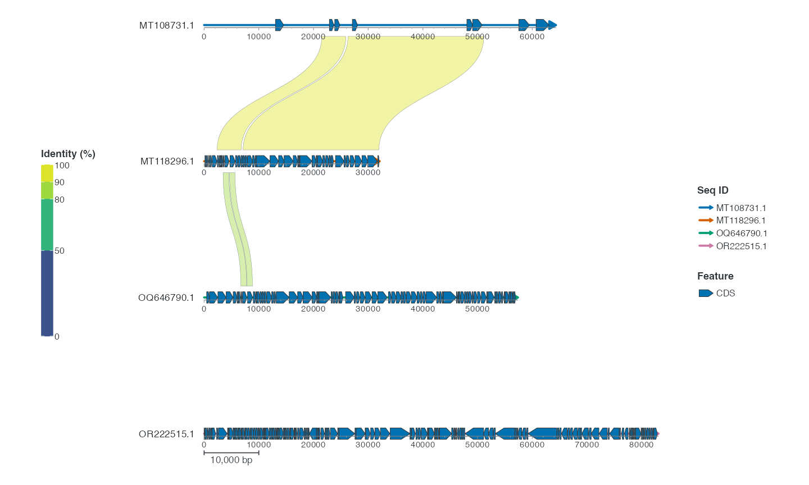
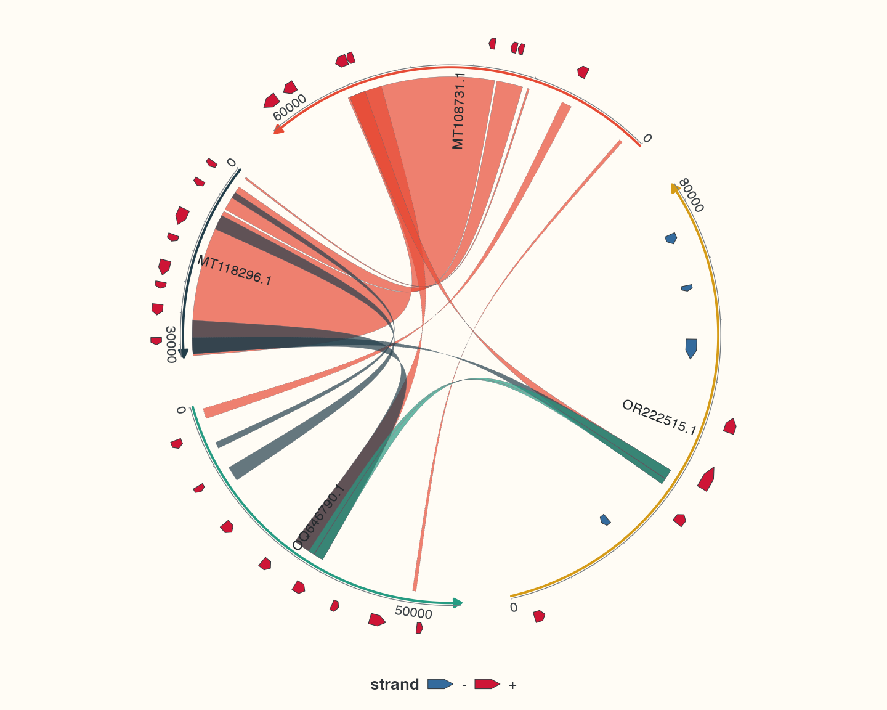
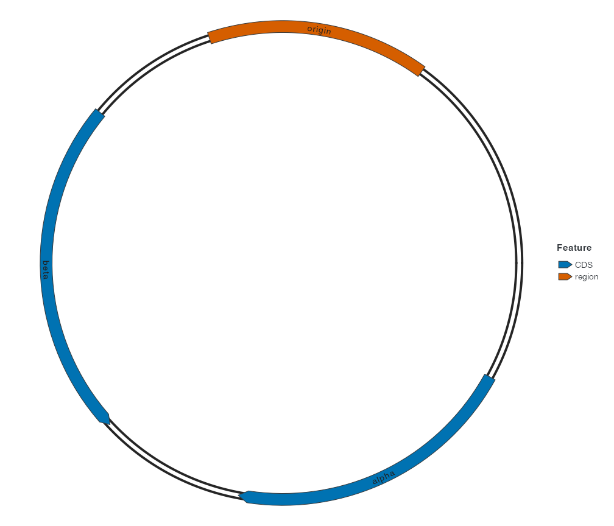
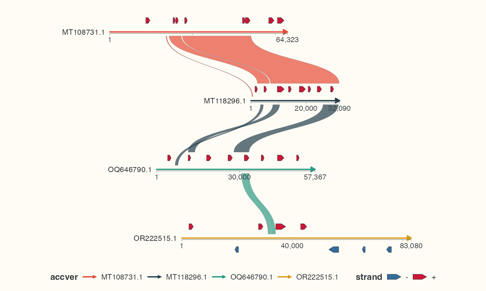

[English](README.md) · [现代汉语](README-Hans.md)


# ggchord：弦图、圆图与共线性图

基于 ggplot2 的 R 包。用独立图层组合序列骨架、区间连接、基因、通用注释、标签和定量轨道。

这里展示**0.16.5 开发版本（基于 0.16.4 候选 API）**，当前正式发布版仍为 0.15.0。源码中的新网站尚未部署。

## 安装

R ≥ 4.1.0 · ggplot2 ≥ 4.0.0

```r
install.packages("remotes")
remotes::install_github("DangJem/ggchord")
```

如已检出本版源码，在仓库根目录使用 `pkgload::load_all(".")`。不声称存在 CRAN 发布。



图中使用仓库原始 FASTA、GFF3 与 BLAST；完整读取、筛选代码与解释见[真实数据专题](vignettes/ggchord_guide_hans.Rmd#real-data)。


## 三种模式

下列代码先从随包数据中选出必需列，再绘图；原始数据与来源信息保留在原对象中。

```r
library(ggchord)
data(seq_data_example)
data(ribbon_data_example)
data(gene_data_example)
seqs <- seq_data_example[c("accver", "length")]
links <- ribbon_data_example[c("qaccver", "saccver", "qstart", "qend", "sstart", "send")]
# The fixture preserves biological strands separately from its old display strands.
genes <- transform(gene_data_example, strand = source_strand)[c("accver", "start", "end", "strand")]
```

```r
# Optional appearance choices; none of these columns or scales is required input.
library(ggchord)
seq_palette <- setNames(c("#3867D6", "#E58A28", "#219B83", "#9B59B6"),
  c("MT108731.1", "MT118296.1", "OQ646790.1", "OR222515.1"))
gene_palette <- c("+" = "#3B6FD8", "-" = "#E1812C", "." = "#8291A6")
feature_palette <- c(CDS = "#3973CB", promoter = "#8B5EC4", rep_origin = "#E8A42D",
  primer_bind = "#168F86", misc_feature = "#A0ADBD", protein_bind = "#CC6485")
doc_theme <- theme_ggchord_publication(axis.text = element_text(size = 11),
  axis.text.check.overlap = TRUE) + theme(legend.position = "bottom")
doc_axis <- function(coordinates = "relative") scale_seq_position_continuous(
  coordinates = coordinates, n.breaks = 3, minor_breaks = NULL,
  labels = function(x) format(x, scientific = FALSE, big.mark = ",", trim = TRUE))
```

```r
p_chord <- ggchord(seq_data = seqs, ribbon_data = links, gene_data = genes) +
  geom_link_ribbon(aes(ribbon_fill = qaccver), alpha = .7) +
  scale_ribbon_fill_manual(values = seq_palette, guide = "none") + geom_seq(show.legend = FALSE) + geom_gene(position = position_strand(.1), width = .04) +
  geom_seq_label(size = 4, seq_label_radius = .84, seq_label_hjust = .5) + coord_chord() +
  scale_seq_colour_manual(values = seq_palette) +
  scale_gene_fill_manual(values = gene_palette) + doc_theme
p_chord
```

```r
data(plasmid_example_pUC19)
plasmid_seq <- plasmid_example_pUC19[c("accver", "length")]
feature_source <- find_common_features(plasmid_example_pUC19)
features <- feature_source[c("accver", "start", "end", "strand", "type", "anno")]
```

```r
circle_features <- features[features$type %in% c("CDS", "rep_origin"), ]
p_circular <- ggchord(seq_data = plasmid_seq) + geom_seq() +
  geom_feature(aes(feature_fill = type), data = circle_features, position = position_plasmid()) +
  geom_feature_label_repel(data = circle_features, position = position_plasmid(), size = 4) +
  geom_seq_center_label() + scale_feature_fill_manual(values = feature_palette, breaks = unique(circle_features$type)) +
  coord_circular() + theme_ggchord_publication(axis.text = element_text(size = 11))
p_circular
```

```r
anchor_rows <- unlist(lapply(split(seq_len(nrow(genes)), genes$accver), function(i)
  i[which.max(genes$end[i] - genes$start[i])]))
anchors <- genes[anchor_rows, c("accver", "start", "end")]
p_collinear <- ggchord(seq_data = seqs, ribbon_data = links, gene_data = genes) +
  geom_link_ribbon(aes(ribbon_fill = qaccver), alpha = .7) +
  scale_ribbon_fill_manual(values = seq_palette, guide = "none") + geom_seq() +
  geom_gene(position = position_strand(.1)) + geom_seq_label(size = 4) +
  coord_collinear(anchor = anchors, align = "center", orientation = "auto") + doc_axis() +
  scale_seq_colour_manual(values = seq_palette) +
  scale_gene_fill_manual(values = gene_palette) + doc_theme
p_collinear
```

| Chord / 弦图 | Circular / 圆图 | Collinear / 共线性图 |
| --- | --- | --- |
|  |  |  |

`aes()` 映射数据，`scale_*()` 定义映射和图例，geom 定义几何与固定样式，Position 负责局部放置，coord 负责全局坐标，theme 负责非数据外观。

## 预览与保存

RStudio Plots 会按面板尺寸重新排列标签。按相同显式宽高预览并保存：

```r
view_ggchord(p_collinear, width = 8, height = 5, units = "in")
ggsave("comparison.png", p_collinear, width = 8, height = 5, units = "in", dpi = 144)
```

## 继续阅读

- [完整用户教程](vignettes/ggchord_guide_hans.Rmd)：真实数据、质粒、输入格式、连接、标签、轨道、投影与同源、样式、输出和 FAQ。
- [迁移指南](MIGRATION-Hans.md)与 [NEWS](NEWS.md)。
- [本地网站构建与预览](website/README.md)，含函数分类、术语、图集与部署方案。

[Issues](https://github.com/DangJem/ggchord/issues) · [MIT license](LICENSE)
