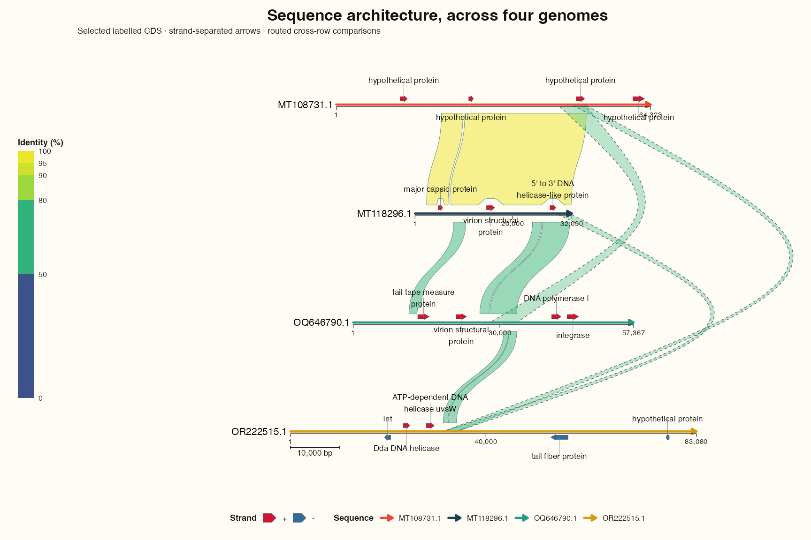
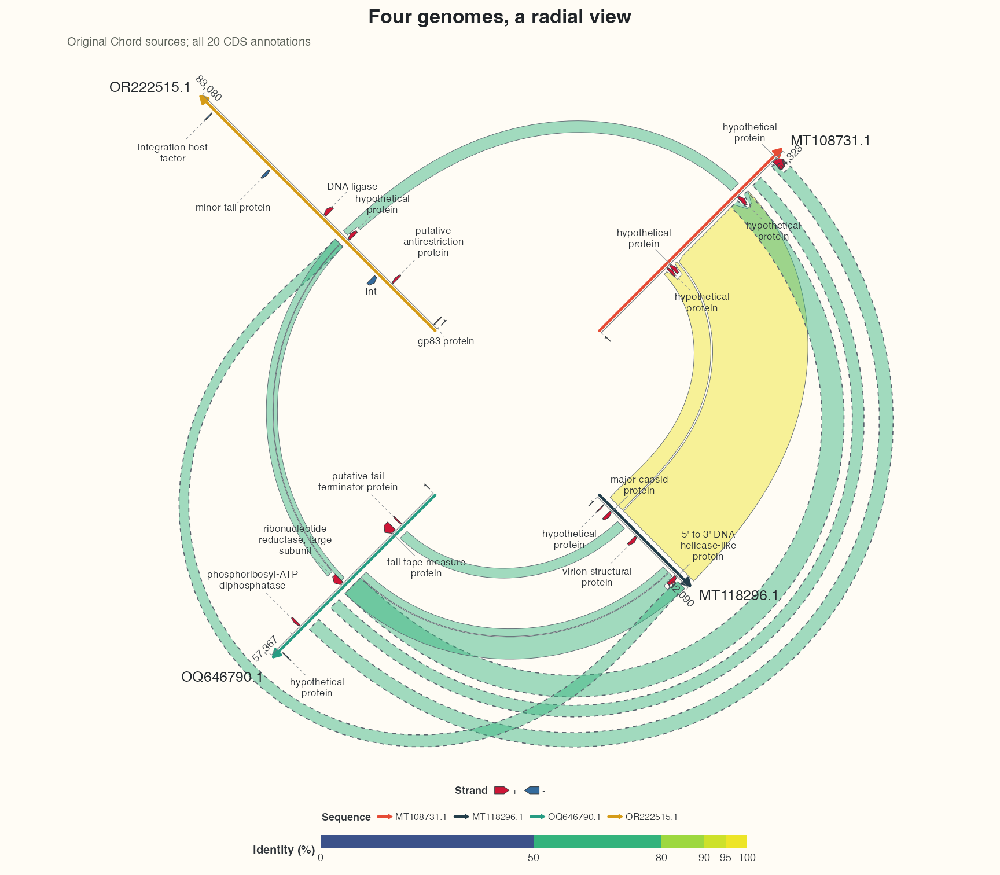
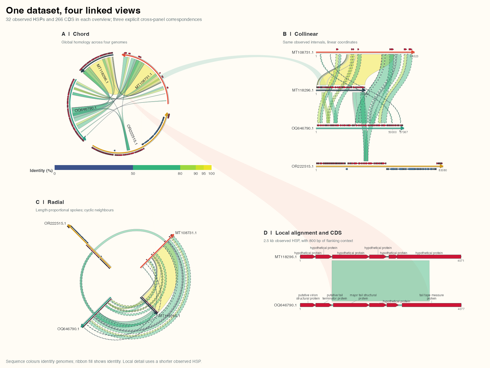

<!-- Generated from website/readme-template.md and website/readme-text.json. -->
<p align="center">
  
</p>

[English](README.md) · [现代汉语](README-Hans.md)

# ggchord：序列、注释与关系

基于 ggplot2 的 R 可视化包：比较多序列关系、组织单序列注释、展示 HSP 比对，并组合全局与局部视图。

> [!IMPORTANT]
> 需要使用旧 API 的代码请选用 v0.29.0，从 v0.50.0 起，接口与旧版不兼容。

[网站](https://dangjem.github.io/ggchord/) · [使用说明](website/zh/modes.md) · [示例图集](website/zh/gallery.md) · [问题反馈](https://github.com/DangJem/ggchord/issues)

<a id="modules"></a>
## 四个绘图模块

| 模块 | 主要用途 | 视图 |
| --- | --- | --- |
| [I · 多序列关系](website/zh/multi-sequence-views.md) | 比较序列区间、基因顺序与已有连接关系。 | Chord · Collinear · Radial · Sankey |
| [II · 单序列圆图](website/zh/circular.md) | 在一条序列上组织特征、引物和限制位点。 | Circular |
| [III · HSP 点图](website/zh/dotplot.md) | 在 query 与 subject 双轴上查看比对区间。 | Dotplot |
| [IV · 多视图组合](website/zh/fusion.md) | 用明确的来源区间连接独立图形。 | Fusion |

多序列模块包含四种 Coord；Circular、Dotplot 各有专属坐标系，Fusion 负责组合独立图形。图层、映射、标度、局部位置与主题各司其职，沿用 ggplot2 的绘图语法。

<a id="examples"></a>
## 真实数据综合示例

### I · 多序列关系

<table>
  <tr>
    <td width="50%"><strong>Chord · 四条基因组的关系总览</strong><br><a href="man/figures/showcasechord.png"></a><br>混合曲率骨架、保留真实链方向的 CDS 箭头、来源标签与 Identity 连接带组合展示。特征与 HSP 按显示需要从原始记录中选取。<br><a href="website/zh/case-chord.md">完整案例 →</a></td>
    <td width="50%"><strong>Collinear · 顺序、方向与跨行连接</strong><br><a href="man/figures/showcasecollinear.png"></a><br>在共同的 bp 标尺下比较四条基因组，骨架两侧展示精选 CDS。跨越非相邻显示行的连接带使用虚线轮廓。<br><a href="website/zh/case-collinear.md">完整案例 →</a></td>
  </tr>
</table>

<table>
  <tr>
    <td width="50%"><strong>Radial · 径向辐条上的共线性</strong><br><a href="man/figures/flagradial.png"></a><br>从弦图旗舰复用来源准备与精选特征，改用径向辐条骨架展示区间关系；序列身份与原生位置保持可追溯。<br><a href="website/zh/case-radial.md">完整案例 →</a></td>
    <td width="50%"><strong>Sankey · 镜像双列中的来源区间</strong><br><a href="man/figures/flagsankey.png"></a><br>从共线性旗舰派生，保留对应的精选基因与 HSP。序列镜像排列在两列中，连接带表示已有区间关系，带宽不代表守恒流量。<br><a href="website/zh/case-sankey.md">完整案例 →</a></td>
  </tr>
</table>

### II · 单序列圆图

<a href="man/figures/showcaseplasmid.png"></a>

完整圆图包含 20 个特征、5 个参考引物，以及声明酶集合中的 58 个合并切点位置。序列位置与注释身份均来自原始输入。

[上方密集注释图代码](tools/documentation-examples.R) · [对照 pETDuet-1 参考图](website/zh/plasmid-catalog.md#catalogduet)

### III · HSP 点图

<a href="man/figures/flagdotplot.png"></a>

32 条原始 HSP；颜色表示 Identity，线宽表示原记录中的比对长度。

[完整案例](website/zh/case-dotplot.md)

### IV · 多视图组合

<a href="man/figures/flagfusion.png"></a>

在同一组合中关联全局关系、共线性比较与来源区间的局部放大。

[完整案例](website/zh/case-fusion.md)

图像的输入、显示选择与绘图定义均可追溯：
[输入文件](examples/) · [Dotplot / Fusion 源码](tools/site-flagships.R) · [绘图源码](tools/documentation-examples.R) · [数据来源与归属](website/ASSET-SOURCES.md)

<a id="get-started"></a>
## 开始使用

<a id="installation"></a>
### 安装

R ≥ 4.1.0 · ggplot2 ≥ 4.0.0

从 [CRAN](https://CRAN.R-project.org/package=ggchord) 安装稳定版：

```r
install.packages("ggchord")
```

从 GitHub 安装指定的 v0.29.0 正式版：

```r
install.packages("remotes")
remotes::install_github("DangJem/ggchord", ref = "v0.29.0", dependencies = NA)
```

下面的最小示例只需加载 ggchord。完整数据整理示例会在代码旁声明 dplyr、purrr、tidyr 等可选依赖。

<a id="quick-start"></a>
### 绘制第一张图

使用随包表格绘制序列骨架、比对连接带和序列名称，无需下载文件或运行比对程序。

```r
library(ggchord)

p <- ggchord(prepare_ggchord_data(seq_data_example, ribbon_data_example)) +
  geom_seq() +
  geom_link_ribbon() +
  geom_seq_label() +
  coord_chord()

p
```

这段最小示例展示图层组合方式。上方综合图进一步加入了对应的来源注释、显示选择和样式。

<a id="output"></a>
### 预览与保存

按相同的明确宽高预览并保存，让标签按预定成图尺寸排布。

```r
view_ggchord(p, width = 10, height = 8, units = "in")
ggplot2::ggsave("ggchord.png", p, width = 10, height = 8, units = "in", dpi = 144)
```

<a id="design-inspiration"></a>
## 设计灵感来源

以下条目区分已记录并落实到设计的参考，以及仅用于能力调研的项目。具体依据见[设计来源核对](tools/site-audit/design-inspiration.md)。

### 绘图语法与序列关系表达

- [ggplot2](https://ggplot2.tidyverse.org/) — 提供分层绘图语法，以及映射、标度、图例、几何、坐标与主题的职责划分。ggchord 沿用这一模型，让用户组合独立图层，并使用自己的标度和样式。
- [BLAST](https://blast.ncbi.nlm.nih.gov/doc/blast-help/) — 为紧凑的 query/subject 字段命名提供参照，便于追踪比对记录、端点与序列标识。绘图读取已有结果，不在绘图阶段运行比对程序。
- [Circos](https://circos.ca/) · [circlize](https://github.com/jokergoo/circlize) — Circos 为环形信息层级和连接带表达提供设计参照；circlize 用于多轨道与显式 track/ring 契约的能力比较。

### 基因箭头、注释布局与局部比较

- [clinker](https://github.com/gamcil/clinker) · [gggenes](https://github.com/wilkox/gggenes) · [genoPlotR](https://genoplotr.r-forge.r-project.org/) — 为保留链方向的基因箭头、基因簇比较和直线共线性提供清晰范例，帮助协调序列方向、特征位置与连接关系的表达。
- [gggenomes](https://thackl.github.io/gggenomes/) — 为 tidy 多表输入、focus/sync 工作流、特征堆叠、局部锚定与局部显示翻转提供参照，帮助区分数据整理和显示选择的职责。
- [DNA Features Viewer](https://github.com/Edinburgh-Genome-Foundry/DnaFeaturesViewer) — 为可读的特征注释、拥挤标签处理和局部特征布局提供参照，帮助明确标签与其来源区间之间的对应关系。

### 局部放大、对齐字符与图形预览

- [ggmagnify](https://github.com/hughjonesd/ggmagnify) — 为整体图与局部放大图之间的关联表达提供参照。ggchord 围绕明确的来源区间和独立注册的序列视图发展这一表达方式。
- [ggmsa](https://bioconductor.org/packages/ggmsa/) — v0.20.0 将其列为字符视图调研对象；v0.28.0 进一步实际核对其残基格和化学性质配色，并用于 geom_residue() 的紧凑背景与默认颜色标度。保留独立字形绘制、真实坐标注册和用户标度优先规则。
[ggseqalign](https://www.bioconductor.org/packages/release/bioc/html/ggseqalign.html)、[ggseqlogo](https://omarwagih.github.io/ggseqlogo/)、[Jalview](https://www.jalview.org/help/html/features/annotation.html) 和 [ESPript](https://espript.ibcp.fr/ESPript/ESPript/) 仅列为对齐字符、序列 logo、列注释或静态输出的调研比较对象；当前未实现这些工具的集成、logo、共识或保守性图层。历史记录不足以证明它们分别影响了现有布局算法。
- [ggview](https://github.com/idmn/ggview) — 为按预定导出尺寸检查静态图形提供流程参照。ggchord 用 view_ggchord() 进行指定尺寸预览，用标准 ggsave() 保存。

[问题反馈](https://github.com/DangJem/ggchord/issues) · [MIT 许可证](LICENSE)
