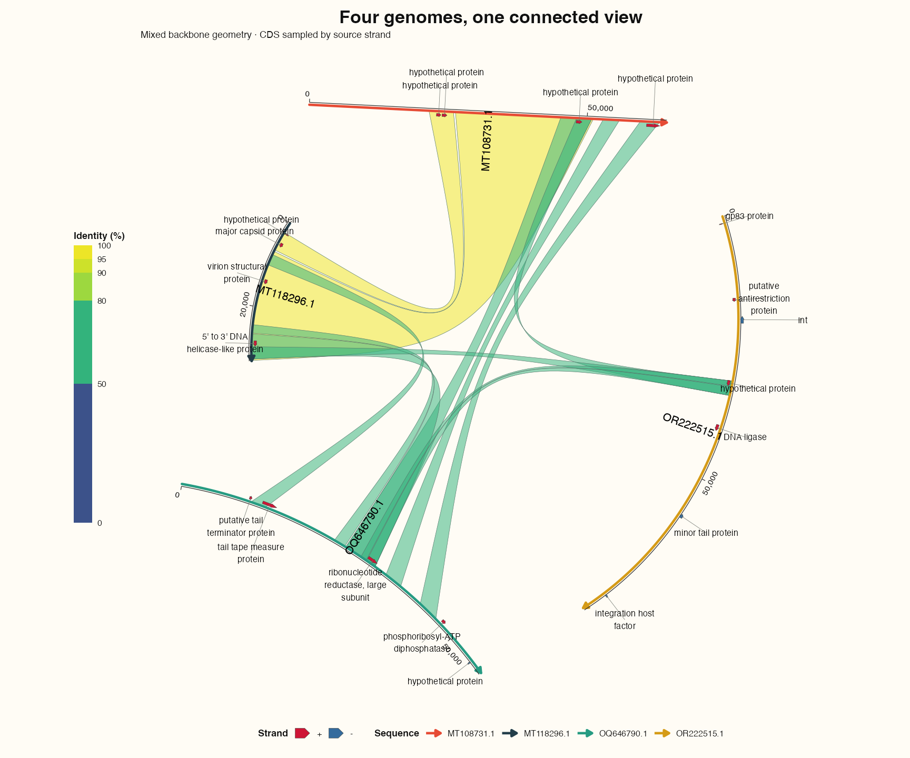
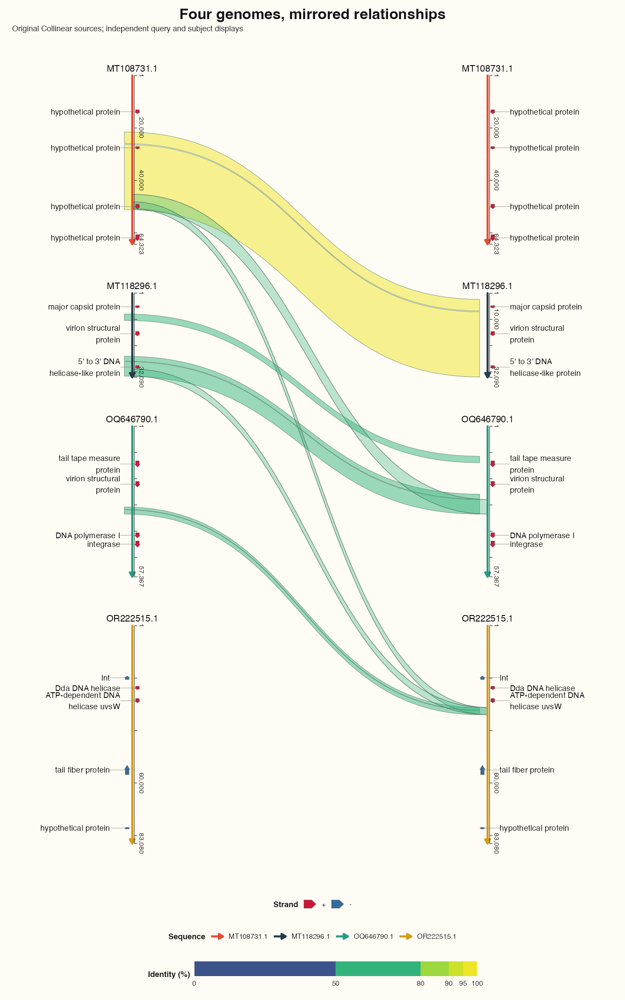
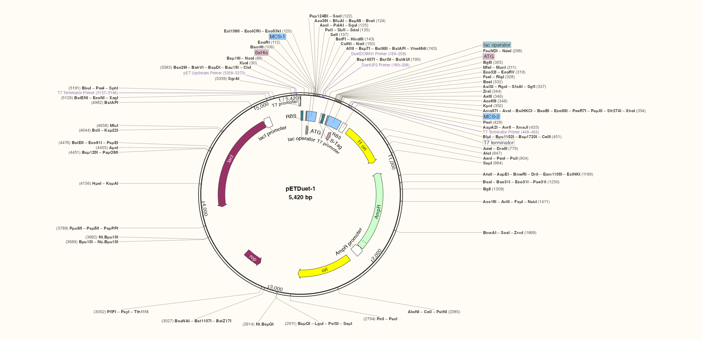
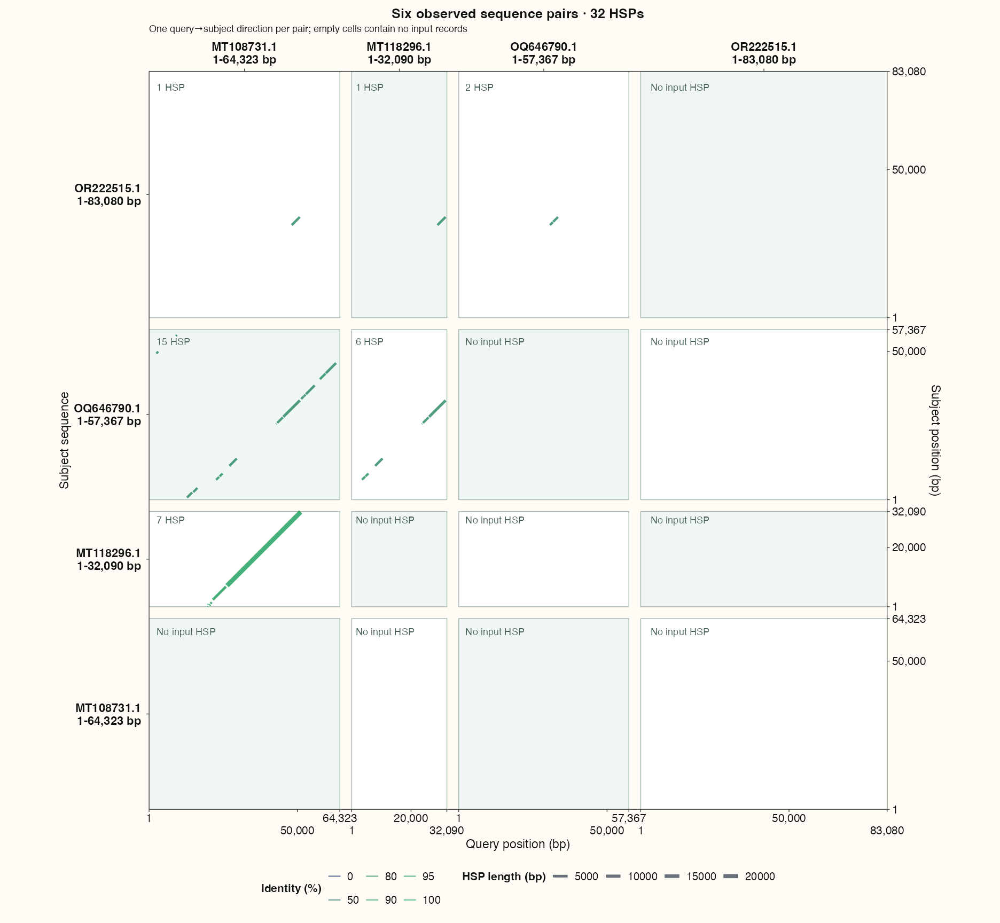

<!-- Generated from website/readme-template.md and website/readme-text.json. -->
<p align="center">
  
</p>

[English](README.md) · [现代汉语](README-Hans.md)

# ggchord：序列、注释与关系

基于 ggplot2 的 R 可视化包：比较多序列关系、组织单序列注释、展示 HSP 比对，并组合全局与局部视图。

> [!IMPORTANT]
> 此 README 对应开发中的 v0.50.0 源码。请从当前检出目录安装后运行示例。

[网站](https://dangjem.github.io/ggchord/) · [教程](vignettes/ggchord_guide_hans.Rmd) · [问题反馈](https://github.com/DangJem/ggchord/issues)

<a id="modules"></a>
## 四个绘图模块

| 模块 | 主要用途 | 视图 |
| --- | --- | --- |
| I · 多序列关系 | 比较序列区间、基因顺序与已有连接关系。 | Chord · Collinear · Radial · Sankey |
| II · 单序列圆图 | 在同一条序列上绘制区间、位点和切口，标签可固定放置或避让排布。 | Circular |
| III · HSP 点图 | 在 query 与 subject 双轴上查看比对区间。 | Dotplot |
| IV · 多视图组合 | 用明确的来源区间连接独立图形。 | Fusion |

多序列模块包含四种 Coord；Circular、Dotplot 各有专属坐标系，Fusion 负责组合独立图形。图层、映射、标度、局部位置与主题各司其职，沿用 ggplot2 的绘图语法。

<a id="examples"></a>
## 真实数据综合示例

### I · 多序列关系

<table>
  <tr>
    <td width="50%"><strong>Chord · 四条基因组的关系总览</strong><br><a href="man/figures/showcasechord.png"></a><br>比较四条基因组参考。基因箭头显示链向，连带按原始比对一致性着色。<br><a href="examples/make_readme_plots.R">完整案例 →</a></td>
    <td width="50%"><strong>Collinear · 顺序、方向与跨行连接</strong><br><a href="man/figures/showcasecollinear.png"></a><br>同一组源区间使用共同的碱基位置比例，按显式声明的显示方向排列。<br><a href="examples/make_readme_plots.R">完整案例 →</a></td>
  </tr>
</table>

<table>
  <tr>
    <td width="50%"><strong>Radial · 径向辐条上的共线性</strong><br><a href="man/figures/flagradial.png"></a><br>同一组观察投影到径向辐条，保留参考身份与源区间端点。<br><a href="examples/make_readme_plots.R">完整案例 →</a></td>
    <td width="50%"><strong>Sankey · 镜像双列中的来源区间</strong><br><a href="man/figures/flagsankey.png"></a><br>各参考在查询列和目标列各显示一次，连带颜色沿用其他比较视图的一致性标度。<br><a href="examples/make_readme_plots.R">完整案例 →</a></td>
  </tr>
</table>

### II · 单序列圆图

<a href="man/figures/showcaseplasmid.png"></a>

pETDuet-1 密集图在环内标出特征和引物，在环外标注酶名与切点坐标。

[完整案例](examples/make_readme_plots.R)

### III · HSP 点图

<a href="man/figures/flagdotplot.png"></a>

显示 32 条原始 HSP，颜色表示原始一致性，线宽表示原始比对长度。

[完整案例](examples/make_readme_plots.R)

### IV · 多视图组合

<a href="man/figures/flagfusion.png"></a>

同一组比对关系用三种视图呈现，随后逐步放大至源区间、比对窗口和可逐碱基阅读的细节。

[完整案例](examples/make_readme_plots.R)

图像的输入、显示选择与绘图定义均可追溯：
[输入文件](examples/) · [绘图源码](examples/make_readme_plots.R) · [数据制备](data-raw/) · [数据来源与归属](website/ASSET-SOURCES.md)

<a id="get-started"></a>
## 开始使用

<a id="installation"></a>
### 安装

R ≥ 4.1.0 · ggplot2 ≥ 4.0.0

从 [CRAN](https://CRAN.R-project.org/package=ggchord) 安装稳定版：

```r
install.packages("ggchord")
```

在当前检出目录的根目录安装开发版源码。

```r
install.packages("remotes")
remotes::install_local(".", dependencies = NA)
```

入门图使用随包数据和 ggplot2。旗舰图复现脚本还使用 dplyr。

<a id="quick-start"></a>
### 绘制第一张图

使用随包表格绘制序列骨架、比对连接带和序列名称，无需下载文件或运行比对程序。

```r
library(ggchord)
library(ggplot2)

p <- ggchord(seq_data_example) +
  geom_seq() +
  geom_link_ribbon(aes(fill = pident), data = ribbon_data_example) +
  scale_fill_pident() +
  geom_seq_label() +
  coord_chord()

p
```

观察层各自接收数据。切换坐标系时，序列参考定义保持一致。

<a id="output"></a>
### 预览与保存

按相同的明确宽高预览并保存，让标签按预定成图尺寸排布。

```r
view_ggchord(p, width = 10, height = 8, units = "in")
ggsave("ggchord.png", p, width = 10, height = 8, units = "in", dpi = 144)
```

<a id="design-inspiration"></a>
## 设计参考

ggchord 的设计参考了成熟的开源项目及科学可视化方法。这些参考涵盖绘图语法、基因组布局、注释策略和多视图组合等方面。以下分别说明各项目对 ggchord 设计过程的具体参考价值；列出参考对象不代表直接复用了其算法或实现。

### 绘图语法与 API 架构

- [ggplot2](https://ggplot2.tidyverse.org/) — 提供分层绘图语法基础，明确数据映射、几何、统计、位置、标度、图例、坐标与主题的职责。ggchord 在这一架构上扩展基因组可视化能力，支持图层组合和用户自定义样式。
- [gggenomes](https://thackl.github.io/gggenomes/) — 为基因组序列与注释的数据组织、链方向布局、特征堆叠、序列方向调整、锚点对齐和局部聚焦工作流提供重要参考。ggchord 借鉴这些领域设计理念，同时保留独立的参考坐标与图层数据契约。
- [gggenes](https://wilkox.org/gggenes/) — 为具有生物学方向的基因箭头、链方向相关的位置调整，以及基因组区间长度与图形物理尺寸的区分提供参考。

### 环形与比较基因组可视化

- [Circos](https://circos.ca/) — 为环形基因组信息的视觉组织提供灵感，包括序列扇区、多层注释和表示基因组区间关系的连接带。
- [circlize](https://github.com/jokergoo/circlize) — 为灵活的环形轨道组织、环层排列和多层基因组可视化提供设计参考。
- [clinker](https://github.com/gamcil/clinker) — 为基因簇比较、方向性基因箭头，以及基因组相似性和共线性关系的清晰表达提供视觉参考。
- [genoPlotR](https://genoplotr.r-forge.r-project.org/) — 为线性比较基因组布局、序列区域对齐、基因组坐标表达和多个基因组片段之间的关系展示提供参考。

### 基因组注释与多尺度可视化

- [DNA Features Viewer](https://github.com/Edinburgh-Genome-Foundry/DnaFeaturesViewer) — 为基因组特征展示、注释几何、标签位置以及高密度注释区域中的碰撞处理提供参考。
- [ggmagnify](https://github.com/hughjonesd/ggmagnify) — 为整体图与局部放大视图之间的关联表达提供参考。ggchord 进一步围绕明确的来源区间和独立构建的子视图实现跨视图连接。
- [ggmsa](https://bioconductor.org/packages/ggmsa/) — 为核酸与氨基酸比对可视化、紧凑残基单元格及化学性质配色提供参考。部分残基颜色值经过适配并在 [NOTICE](inst/NOTICE) 中注明来源；序列注册与图形渲染由 ggchord 独立实现。
- [ggview](https://github.com/idmn/ggview) — 为按照预定输出尺寸预览科研图形的工作流提供参考。ggchord 通过 `view_ggchord()` 提供尺寸感知的预览，并继续使用标准 `ggsave()` 保存图形。

### 数据规范与相关研究

- [BLAST](https://blast.ncbi.nlm.nih.gov/doc/blast-help/) — 其成熟的 query/subject 术语为 ggchord 的比对数据字段规范提供参考。ggchord 负责可视化已有比对结果，不在绘图过程中执行序列比对。
- [trackViewer](https://bioconductor.org/packages/trackViewer/) — 作为基因组信号轨道、区间测量及定量注释展示的研究参考对象。
- [ggseqalign](https://bioconductor.org/packages/ggseqalign/)、[ggseqlogo](https://omarwagih.github.io/ggseqlogo/)、[Jalview](https://www.jalview.org/) 和 [ESPript](https://espript.ibcp.fr/ESPript/ESPript/) — 作为序列比对可视化、序列 Logo、残基注释及发表级序列图形的相关研究与比较对象。列入此处不代表已完成工具集成或采用其图形渲染算法。

[问题反馈](https://github.com/DangJem/ggchord/issues) · [MIT 许可证](LICENSE)
