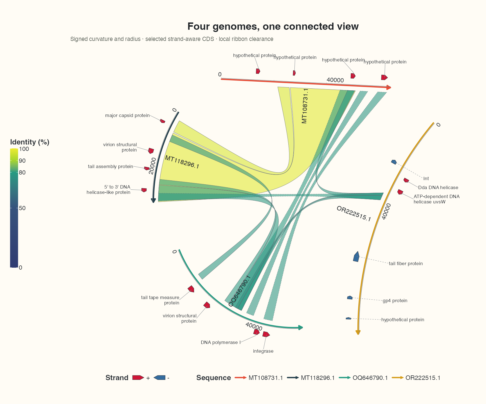
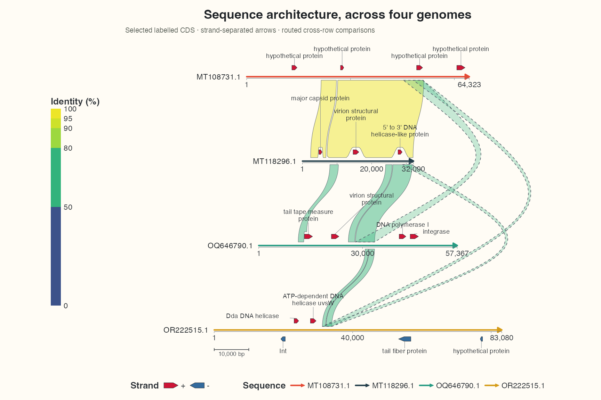
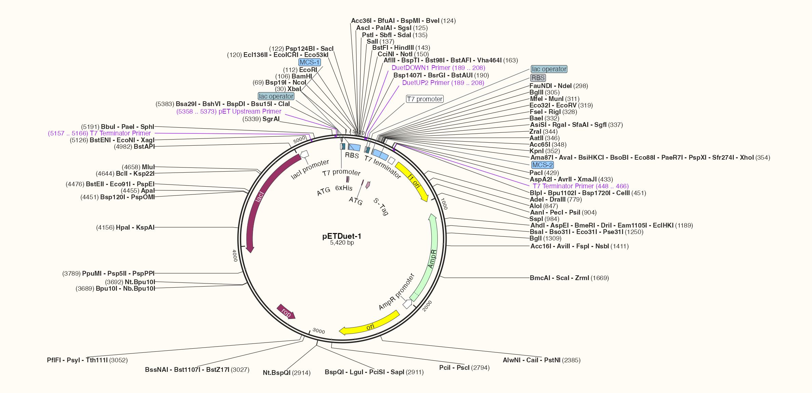

<p align="center">
  <a href="https://dangjem.github.io/ggchord/en/index.html"></a>
</p>

[English](README.md) · [现代汉语](README-Hans.md)

# ggchord: sequence plots and composition

An R package built on ggplot2. Combine independent layers for sequence backbones, interval links, genes, general features, labels and quantitative tracks.

The stable release is **ggchord 0.16.6**. These examples are generated from the local **v0.27.0** development source. Formal assets are on GitHub Releases.

## Install

R ≥ 4.1.0 · ggplot2 ≥ 4.0.0

```r
install.packages("remotes")
remotes::install_github(
  "DangJem/ggchord@0f5dd96da57876da74cd1234c7de9cf5579c80b8",
  dependencies = NA, upgrade = "never"
)
```

For a checkout of this version, use `pkgload::load_all(".")` from its root. The stable release is available from CRAN. Examples use dplyr (≥ 1.1.0), purrr, tidyr and the native `|>` pipe as optional example dependencies.

## Three source-backed comprehensive examples

These three complete examples demonstrate this version. Inputs are traceable; each guide provides preparation and interpretation. New users can begin with the minimal first-plot lesson.

<details>
<summary>Run first: shared appearance for all three views</summary>

```r
# Optional appearance choices; none of these columns or scales is required input.
seq_palette <- setNames(
  c("#E64B35", "#233E4A", "#269B82", "#D59B17"),
  c("MT108731.1", "MT118296.1", "OQ646790.1", "OR222515.1")
)
gene_palette <- c("+" = "#CE1536", "-" = "#346B9D", "." = "#8291A6")
```

```r
doc_background <- "#FFFCF5"
doc_legend_theme <- theme(
  legend.title = element_text(size = 13, face = "bold"),
  legend.text = element_text(size = 11),
  legend.key.width = unit(9, "mm"), legend.key.height = unit(5, "mm"),
  legend.spacing.x = unit(9, "mm"), legend.spacing.y = unit(7, "mm"),
  legend.margin = margin(l = 4, r = 4, unit = "mm")
)
sequence_guide <- guide_ggchord_legend(nrow = 1, theme = doc_legend_theme)
strand_guide <- guide_ggchord_legend(
  nrow = 1, override.aes = list(strand = c("+", "-")), theme = doc_legend_theme
)
identity_guide_theme <- theme(
  legend.key.height = unit(100, "mm"), legend.key.width = unit(5, "mm"),
  legend.title = element_text(size = 13, face = "bold"),
  legend.text = element_text(size = 11), legend.margin = margin(r = 7, unit = "mm")
)
identity_guide <- ggplot2::guide_coloursteps(
  available_aes = "ribbon_fill", even.steps = FALSE, show.limits = TRUE,
  position = "left", direction = "vertical", theme = identity_guide_theme
)

doc_theme <- theme_ggchord_publication(
  axis.text = element_text(size = 11),
  axis.text.check.overlap = TRUE
) +
  theme(
    legend.position = "bottom",
    legend.title = element_text(size = 13, face = "bold"),
    legend.text = element_text(size = 11),
    legend.key.width = unit(9, "mm"), legend.key.height = unit(5, "mm"),
    legend.spacing.x = unit(9, "mm"), legend.spacing.y = unit(7, "mm"),
    legend.box.spacing = unit(6, "mm"),
    plot.background = element_rect(fill = doc_background, colour = NA),
    panel.background = element_blank(),
    plot.title = element_text(face = "bold", size = 18),
    plot.subtitle = element_text(size = 10, colour = "#5C625A"),
    plot.margin = margin(14, 18, 14, 18)
  )
doc_axis <- function(coordinates = "relative") {
  scale_seq_position_continuous(
    coordinates = coordinates, n.breaks = 3, minor_breaks = NULL,
    labels = function(x) format(x, scientific = FALSE, big.mark = ",", trim = TRUE)
  )
}
```

</details>

### Chord: four genomes, mixed curvature and identity

CDS are sampled separately by source strand without a length threshold. The two MT records have only positive-strand CDS in the source annotations. Positive-strand arrows sit inside, where ribbons leave clearance at overlapping endpoints.



<details>
<summary>Preparation and plot code · expand to run</summary>

```r
library(dplyr)
library(purrr)
library(tidyr)
# Original repository records; extract the tutorial input bundle first.
show_sequences <- read_fasta_lengths(files = "examples/fasta/*.fna") |>
  select(accver, length)
show_annotations <- read_gff3(files = "examples/gff3/*.gff3", unstranded = "keep")
show_genes <- show_annotations |>
  filter(type == "CDS") |>
  select(accver, start, end, strand, anno)
show_alignments <- read_blast(files = "examples/blastn-standard/*.tsv")
# At most three substantial observed HSPs per pair; no coordinates are invented.
show_links <- show_alignments |>
  filter(length >= 900, pident >= 75) |>
  group_by(qaccver, saccver) |>
  slice_max(length, n = 3, with_ties = FALSE) |>
  ungroup()
# Select up to four source CDS per sequence, spread across annotation order.
# No feature is moved or invented; keep complete source tables separately.
show_features <- show_genes |>
  filter(end - start + 1 >= 500) |>
  group_by(accver) |>
  arrange(start, .by_group = TRUE) |>
  mutate(display_bin = ntile(row_number(), 4), informative = !is.na(anno) & anno != "hypothetical protein") |>
  group_by(accver, display_bin) |>
  arrange(desc(informative), desc(end - start), .by_group = TRUE) |>
  slice_head(n = 1) |>
  ungroup() |>
  select(accver, start, end, strand, anno)
# Also retain well-separated negative-strand CDS, if not already represented.
show_reverse <- show_genes |>
  filter(strand == "-", end - start + 1 >= 500) |>
  group_by(accver) |>
  arrange(start, .by_group = TRUE) |>
  dplyr::slice(c(1, n())) |>
  ungroup()
show_features <- bind_rows(show_features, show_reverse) |>
  distinct(accver, start, end, strand, .keep_all = TRUE) |>
  arrange(accver, start)
show_labels <- show_features
show_optimization <- optimize_ggchord_layout(
  show_sequences, show_links,
  optimize = "orientation", weight = "length"
)
```

```r
# Sample each observed strand separately across the source coordinates.
# Keep short CDS and retain the original strand and coordinates.
# Prefer a CDS overlapping a displayed ribbon endpoint within each positive-strand bin.
chord_link_ends <- bind_rows(
  transmute(show_links, accver = qaccver, lo = pmin(qstart, qend), hi = pmax(qstart, qend)),
  transmute(show_links, accver = saccver, lo = pmin(sstart, send), hi = pmax(sstart, send))
)
chord_endpoint_genes <- show_genes |>
  filter(strand == "+") |>
  semi_join(chord_link_ends, by = join_by(accver, overlaps(start, end, lo, hi)))
chord_genes <- show_genes |>
  filter(strand %in% c("+", "-")) |>
  left_join(mutate(chord_endpoint_genes, at_endpoint = TRUE),
    by = c("accver", "start", "end", "strand", "anno")) |>
  group_by(accver, strand) |>
  arrange(start, .by_group = TRUE) |>
  mutate(display_bin = ntile(row_number(), if (first(strand) == "+") 4L else 3L)) |>
  group_by(accver, strand, display_bin) |>
  arrange(desc(coalesce(at_endpoint, FALSE)), is.na(anno) | anno == "hypothetical protein",
    start, .by_group = TRUE) |>
  slice_head(n = 1) |>
  ungroup() |>
  select(accver, start, end, strand, anno)
chord_labels <- chord_genes
chord_position <- position_strand(c("+" = -0.030, "-" = 0.030))
```

```r
show_curvature <- c(
  "MT108731.1" = 0, "MT118296.1" = 1,
  "OQ646790.1" = -0.65, "OR222515.1" = 0.75
)
show_radius <- c(
  "MT108731.1" = 1.08, "MT118296.1" = 0.82,
  "OQ646790.1" = 1.18, "OR222515.1" = 1.02
)
p_show_chord <- ggchord(seq_data = show_sequences, ribbon_data = show_links) +
  geom_link_ribbon(link_avoid = "smooth", alpha = 0.46, linewidth = 0.14) +
  geom_seq(
    seq_orientation = show_optimization$seq_orientation,
    seq_curvature = show_curvature, seq_radius = show_radius,
    seq_gap = 0.06, linewidth = 1.1
  ) +
  geom_gene(data = chord_genes, position = chord_position, width = 0.025) +
  geom_gene_label_repel(
    data = chord_labels, label_layout = "radial", label_wrap = 24,
    size = 2.8, label_max_lines = 3, position = chord_position
  ) +
  geom_seq_label(size = 4, seq_label_radius = 0.77, seq_label_hjust = 0.5) +
  scale_seq_colour_manual(
    values = seq_palette, name = "Sequence",
    guide = sequence_guide
  ) +
  scale_gene_fill_manual(values = gene_palette, breaks = c("+", "-"), name = "Strand") +
  guides(gene_fill = strand_guide, ribbon_fill = identity_guide) +
  doc_axis() +
  coord_chord(rotation = 50) +
  doc_theme +
  labs(
    title = "Four genomes, one connected view",
    subtitle = "Mixed backbone geometry · CDS sampled by source strand"
  )
view_ggchord(p_show_chord, width = 12, height = 10, units = "in")
```

</details>

[Read the full guide →](https://dangjem.github.io/ggchord/en/chord.html)

### Collinear: four genomes with cross-row links

Strand-separated selected CDS with labels, local clearance, dashed cross-row ribbons and right-side control-point routes.



<details>
<summary>Preparation and plot code · expand to run</summary>

```r
library(dplyr)
library(purrr)
library(tidyr)
# Original repository records; extract the tutorial input bundle first.
show_sequences <- read_fasta_lengths(files = "examples/fasta/*.fna") |>
  select(accver, length)
show_annotations <- read_gff3(files = "examples/gff3/*.gff3", unstranded = "keep")
show_genes <- show_annotations |>
  filter(type == "CDS") |>
  select(accver, start, end, strand, anno)
show_alignments <- read_blast(files = "examples/blastn-standard/*.tsv")
# At most three substantial observed HSPs per pair; no coordinates are invented.
show_links <- show_alignments |>
  filter(length >= 900, pident >= 75) |>
  group_by(qaccver, saccver) |>
  slice_max(length, n = 3, with_ties = FALSE) |>
  ungroup()
# Select up to four source CDS per sequence, spread across annotation order.
# No feature is moved or invented; keep complete source tables separately.
show_features <- show_genes |>
  filter(end - start + 1 >= 500) |>
  group_by(accver) |>
  arrange(start, .by_group = TRUE) |>
  mutate(display_bin = ntile(row_number(), 4), informative = !is.na(anno) & anno != "hypothetical protein") |>
  group_by(accver, display_bin) |>
  arrange(desc(informative), desc(end - start), .by_group = TRUE) |>
  slice_head(n = 1) |>
  ungroup() |>
  select(accver, start, end, strand, anno)
# Also retain well-separated negative-strand CDS, if not already represented.
show_reverse <- show_genes |>
  filter(strand == "-", end - start + 1 >= 500) |>
  group_by(accver) |>
  arrange(start, .by_group = TRUE) |>
  dplyr::slice(c(1, n())) |>
  ungroup()
show_features <- bind_rows(show_features, show_reverse) |>
  distinct(accver, start, end, strand, .keep_all = TRUE) |>
  arrange(accver, start)
show_labels <- show_features
show_optimization <- optimize_ggchord_layout(
  show_sequences, show_links,
  optimize = "orientation", weight = "length"
)
```

```r
# Omit two short, crowded candidates from this linear display only.
# Both source rows remain in show_features and in the chord display.
show_linear_features <- show_features |>
  filter(!anno %in% c("tail assembly protein", "gp4 protein"))
# Separate adjacent and cross-row links, retaining original endpoint values.
show_pair_rows <- show_links |>
  mutate(
    query_row = match(qaccver, show_sequences$accver),
    subject_row = match(saccver, show_sequences$accver),
    span = abs(query_row - subject_row)
  )
show_adjacent <- show_pair_rows |> filter(span == 1)
# One longest observed HSP per non-neighbour pair keeps the long routes legible.
show_cross <- show_pair_rows |>
  filter(span > 1) |>
  group_by(qaccver, saccver) |>
  slice_max(length, n = 1, with_ties = FALSE) |>
  ungroup()
# Inspect a backbone-only layout using the same alignment and gap as the final view.
show_linear_coord <- coord_collinear(align = "center", orientation = "auto", ratio = 0.7)
show_routing_base <- ggchord(show_sequences, show_links) +
  geom_seq(seq_gap = 0.42) + show_linear_coord
show_reference <- get_chord_layout(show_routing_base)$sequence_reference
# Shared controls sit just beyond the intervening backbones, rather than far away.
show_cross_controls <- map2(show_cross$query_row, show_cross$subject_row, function(query_row, subject_row) {
  between <- seq(min(query_row, subject_row) + 1L, max(query_row, subject_row) - 1L)
  middle_ids <- show_sequences$accver[between]
  right_edge <- max(show_reference$x_offset[middle_ids] + show_reference$lens[middle_ids] * show_reference$x_scale)
  middle_y <- mean(show_reference$y[show_sequences$accver[c(query_row, subject_row)]])
  c(right_edge + if (abs(query_row - subject_row) == 3) 0.85 else 0.65, middle_y)
})
p_show_collinear <- ggchord(show_sequences, gene_data = show_linear_features) +
  geom_link_ribbon(
    aes(ribbon_fill = pident),
    data = show_adjacent,
    link_avoid = "smooth", alpha = 0.48, linewidth = 0.22
  ) +
  geom_link_ribbon(
    aes(ribbon_fill = pident),
    data = show_cross,
    adjacent_only = FALSE, link_ctrl_point = show_cross_controls,
    link_avoid = "smooth", alpha = 0.28, linewidth = 0.3
  ) +
  geom_seq(seq_gap = 0.42, linewidth = 1) +
  geom_gene(position = position_strand(0.09), width = 0.045) +
  geom_gene_label_repel(
    data = show_linear_features |> arrange(desc(nchar(anno)), accver, start),
    label_layout = "auto", label_wrap = 24,
    label_side = "auto", position = position_strand(0.09), size = 3.3
  ) +
  geom_seq_label(size = 4) +
  geom_seq_scale(length = 10000, offset = unit(c(0, 10), "mm")) +
  scale_seq_colour_manual(
    values = seq_palette, name = "Sequence",
    guide = sequence_guide
  ) +
  scale_gene_fill_manual(values = gene_palette, breaks = c("+", "-"), name = "Strand") +
  guides(gene_fill = strand_guide, ribbon_fill = identity_guide) +
  doc_axis() +
  show_linear_coord +
  doc_theme +
  labs(
    title = "Sequence architecture, across four genomes",
    subtitle = "Selected labelled CDS · strand-separated arrows · routed cross-row comparisons"
  )
view_ggchord(p_show_collinear, width = 12, height = 8, units = "in")
```

</details>

[Read the full guide →](https://dangjem.github.io/ggchord/en/collinear.html)

### Plasmid: dense pETDuet-1 annotation

A double backbone, 20 features, five reference primers and 58 grouped cut positions from real inputs.



<details>
<summary>Preparation and plot code · expand to run</summary>

```r
library(dplyr)
data(plasmid_example_pETDuet_1)
show_plasmid <- plasmid_example_pETDuet_1 |>
  select(accver, length)
show_plasmid_features <- find_common_features(plasmid_example_pETDuet_1)
show_plasmid_primers <- find_primer_bindings(plasmid_example_pETDuet_1, set = "reference")
show_plasmid_all_sites <- find_restriction_sites(plasmid_example_pETDuet_1)
show_plasmid_sites <- filter_restriction_sites(
  show_plasmid_all_sites,
  set = "unique_6plus", parent_set = "commercial_all"
)
```

```r
show_plasmid_position <- position_feature_stack(
  spacing = 0.085, base_position = position_plasmid()
)
p_show_plasmid <- ggchord(show_plasmid, feature_data = show_plasmid_features, validate = "none") +
  geom_seq(seq_style = "double", colour = "#252525") +
  geom_feature_plasmid(position = show_plasmid_position) +
  geom_feature_label_repel(
    position = show_plasmid_position,
    external = TRUE, max_overlaps = 0,
    label_fit = "shrink", label_min_size = 2.5
  ) +
  geom_primer(data = show_plasmid_primers, colour = "#A020F0") +
  geom_primer_label_repel(
    data = show_plasmid_primers, colour = "#A020F0", max_overlaps = 0
  ) +
  geom_restriction_site(data = show_plasmid_sites, colour = "#252525") +
  geom_seq_center_label() +
  coord_circular(rotation = 0) +
  theme_ggchord_plasmid() +
  theme(
    legend.title = element_text(size = 13, face = "bold"),
    legend.text = element_text(size = 11),
    legend.spacing.x = unit(9, "mm"), legend.spacing.y = unit(7, "mm"),
    plot.background = element_rect(fill = doc_background, colour = NA),
    panel.background = element_blank()
  )
view_ggchord(p_show_plasmid, width = 16.5, height = 8, units = "in")
```

</details>

[Read the full guide →](https://dangjem.github.io/ggchord/en/plasmids.html#complex)

`aes()` maps data; scales define mapping and guides; geoms define geometry and fixed styles; Positions place local geometry; coords select the global view; themes style non-data elements.

## Preview and save

RStudio Plots can rearrange labels when its panel changes. Preview and save at the same explicit dimensions:

```r
view_ggchord(p_show_collinear, width = 12, height = 8, units = "in")
ggsave("comparison.png", p_show_collinear, width = 12, height = 8, units = "in", dpi = 144)
```

## Future directions

Development continues around readable static figures and a consistent plotting grammar. Current functions, supported inputs and limits are documented in the tutorials and reference; the directions below describe further improvements.

- Improve dense annotation, leader lines and legend placement at practical figure sizes, with clear diagnostics when space is insufficient.
- Strengthen overview-and-detail compositions while preserving original coordinates, units and the meaning of every displayed relationship.
- Broaden adapters for existing research outputs, using mature optional tools and retaining source records and missing information.
- Refine API consistency, compatibility and reproducible teaching examples while keeping ordinary data-frame inputs simple.

## Design references and acknowledgements

ggchord draws on these open-source projects and public tools for graphical grammar, genomic representation and figure preview:

- [ggplot2](https://ggplot2.tidyverse.org/): composing layers while separating mappings, scales, geometry, coordinates and themes.
- [BLAST](https://blast.ncbi.nlm.nih.gov/doc/blast-help/): query/subject table naming that helps trace alignment endpoints and sequence identifiers.
- [Circos](https://circos.ca/) and [circlize](https://github.com/jokergoo/circlize): circular information hierarchy, ribbons and readable ordering of multiple tracks.
- [clinker](https://github.com/gamcil/clinker), [gggenes](https://github.com/wilkox/gggenes) and [genoPlotR](https://genoplotr.r-forge.r-project.org/): readable gene arrows, gene clusters and linear synteny comparisons.
- [DNA Features Viewer](https://github.com/Edinburgh-Genome-Foundry/DnaFeaturesViewer) and [gggenomes](https://thackl.github.io/gggenomes/): annotation placement, multi-table input, feature stacking and local comparison workflows.
- [ggview](https://github.com/idmn/ggview): previewing figures at their intended export dimensions; ggchord previews with `view_ggchord()` and saves with standard `ggsave()`.

These projects inform design and comparison. Consult ggchord's function documentation and `DESCRIPTION` for its supported features, parameters and runtime dependencies.

## Continue

- [Get started](https://dangjem.github.io/ggchord/en/installation.html)
- [Learning overview](https://dangjem.github.io/ggchord/en/learn.html)
- [Function reference](https://dangjem.github.io/ggchord/en/reference/index.html)
- [Gallery](https://dangjem.github.io/ggchord/en/gallery.html)
- [Further information](https://dangjem.github.io/ggchord/en/about.html)

[Issues](https://github.com/DangJem/ggchord/issues) · [MIT license](LICENSE)
