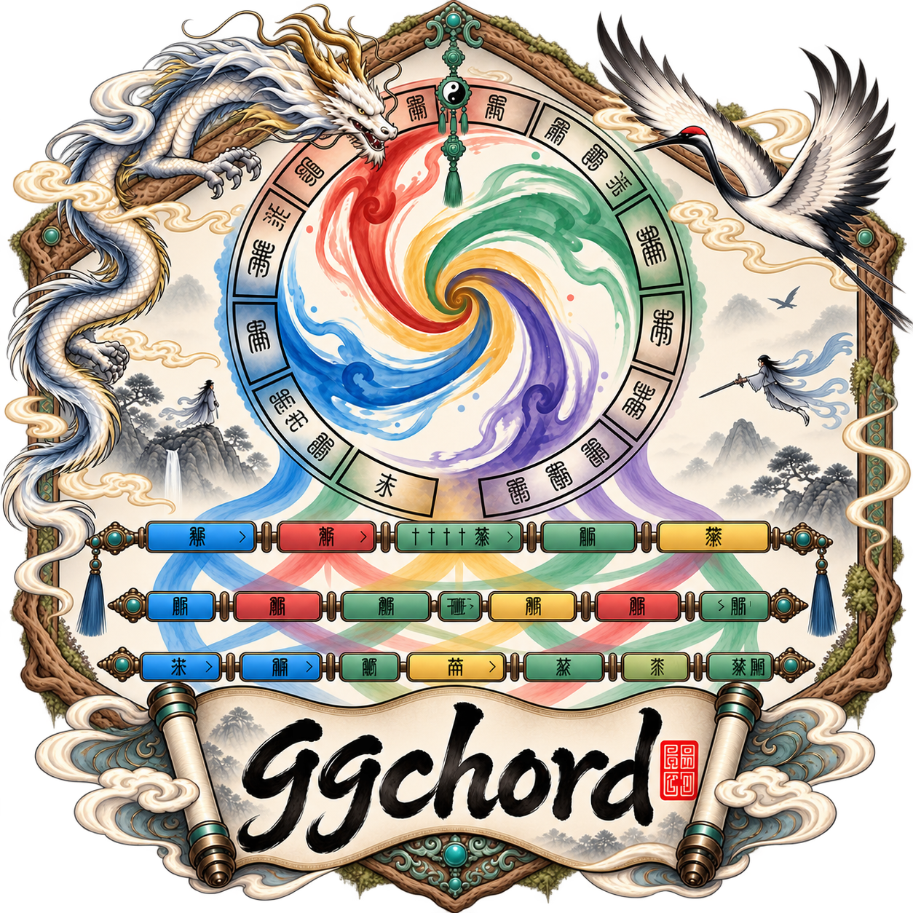
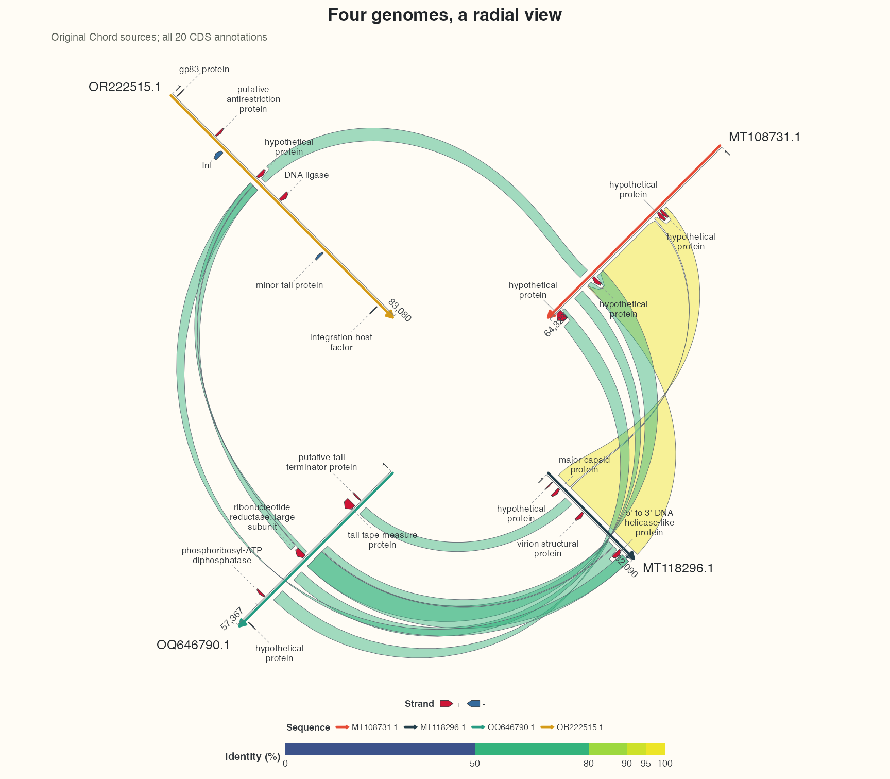
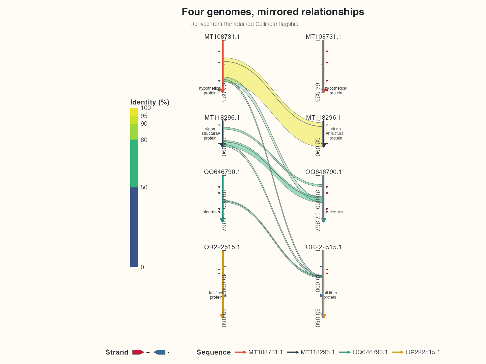
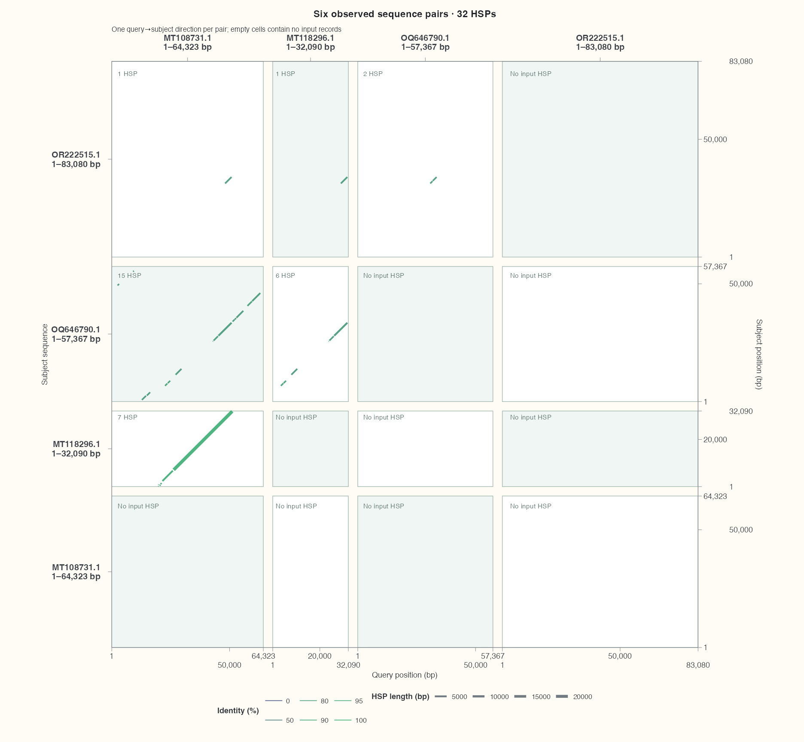
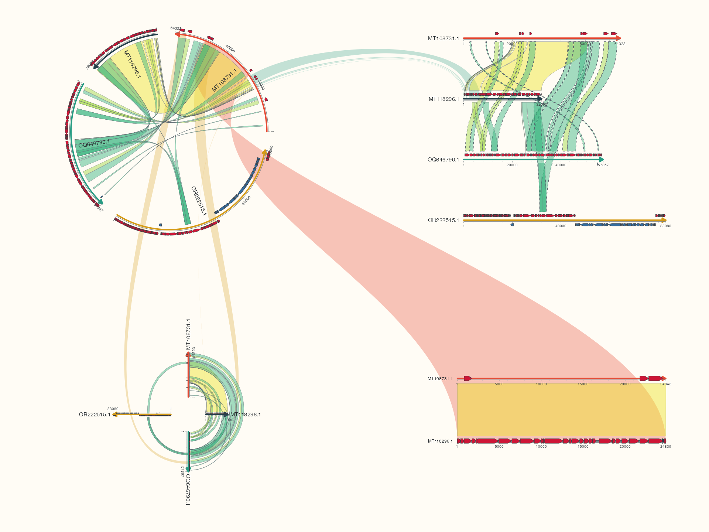

<!-- Generated from website/readme-template.md and website/readme-text.json. -->
<p align="center">
  
</p>

[English](README.md) · [现代汉语](README-Hans.md)

# ggchord: sequences, annotations and relationships

Build layered sequence figures in R with ggplot2: compare multiple sequences, annotate a circular map, inspect HSP alignments and connect independent views.

[Website](https://dangjem.github.io/ggchord/) · [Usage guide](website/en/modes.md) · [Figure gallery](website/en/gallery.md) · [Report an issue](https://github.com/DangJem/ggchord/issues)

<a id="modules"></a>
## Four plotting modules

| Module | Use it to | Views |
| --- | --- | --- |
| [I · Multi-sequence relationships](website/en/multi-sequence.md) | Compare sequence intervals, gene order and observed relationships. | Chord · Collinear · Radial · Sankey |
| [II · Single-sequence circular maps](website/en/circular.md) | Place features, primers and restriction sites on one sequence. | Circular |
| [III · HSP Dotplot](website/en/dotplot.md) | Inspect alignment intervals on query and subject axes. | Dotplot |
| [IV · Multi-view composition](website/en/fusion.md) | Connect independent plots through explicit source intervals. | Fusion |

The multi-sequence module has four Coord types. Circular and Dotplot add two more; Fusion is the composition layer. Layers, mappings, scales, positions and themes retain their ggplot2 roles.

<a id="examples"></a>
## Real-data figures

### Chord · relationships across four genomes

Combine mixed-curvature backbones, strand-aware CDS arrows, selected source labels and Identity-coloured ribbons. Features and HSPs are display subsets of the original records.


[Complete example](website/en/chord.md) · [Chord / Collinear / Radial / Sankey](website/en/multi-sequence-views.md) · [Plot source](tools/documentation-examples.R)

### Collinear · order, orientation and cross-row links

Compare four genomes on a shared base-pair scale. Selected CDS sit on either side of each backbone; dashed outlines distinguish links across non-adjacent rows.


[Complete example](website/en/collinear.md) · [Alignment and arrangement](website/en/collinear-layout.md) · [Plot source](tools/documentation-examples.R)

### Radial · synteny along radial spokes

Derived from the Chord flagship, using its source preparation and selected features. Radial backbones expose interval relationships while preserving sequence identities and native positions.



[Complete example](website/en/radial-synteny.md) · [Plot source](tools/site-flagships.R)

### Sankey · source intervals across two mirrored columns

Derived from the Collinear flagship, retaining its selected genes and HSPs. Mirrored sequence columns show observed interval relationships; ribbon width is not a conserved flow quantity.



[Complete example](website/en/sankey.md) · [Plot source](tools/site-flagships.R)

### Circular · dense pETDuet-1 annotations

A complete circular map with 20 features, five reference primers and 58 grouped cut positions from the declared enzyme set. Original sequence positions and annotation identities are retained.


[Complete example](website/en/circular-dense-case.md) · [13 complete reference maps](website/en/plasmid-catalog.md) · [Plot source](tools/documentation-examples.R)

### Alignment matrices and linked views

<table>
  <tr>
    <th>III · HSP Dotplot</th>
    <th>IV · Multi-view composition</th>
  </tr>
  <tr>
    <td width="50%"><a href="man/figures/flagdotplot.png"></a></td>
    <td width="50%"><a href="man/figures/flagfusion.png"></a></td>
  </tr>
  <tr>
    <td>32 original HSPs; Identity by colour, reported alignment length by line width.</td>
    <td>Global relationships, ordered comparisons and a magnified source interval in one composition.</td>
  </tr>
  <tr>
    <td><a href="website/en/dotplot-start.md">Axes, direction and mappings →</a></td>
    <td><a href="website/en/fusion-details.md">Local magnification and character detail →</a></td>
  </tr>
</table>

Figures share traceable inputs and plot definitions. See the source records and reproduction notes:
[Input files](examples/) · [Dotplot / Fusion source](tools/site-flagships.R) · [Data sources and attribution](website/ASSET-SOURCES.md)

<a id="installation"></a>
## Installation

R ≥ 4.1.0 · ggplot2 ≥ 4.0.0

```r
install.packages("remotes")
remotes::install_github("DangJem/ggchord", dependencies = NA)
```

The minimal example below needs only ggchord. Complete data-preparation examples declare optional dependencies such as dplyr, purrr and tidyr alongside their code.

<a id="quick-start"></a>
## Draw a first plot

Use bundled tables to draw sequence backbones, alignment ribbons and sequence names. No file download or alignment program is needed.

```r
library(ggchord)

p <- ggchord(seq_data_example, ribbon_data_example) +
  geom_seq() +
  geom_link_ribbon() +
  geom_seq_label() +
  coord_chord()

p
```

This small example shows the layer grammar. The figures above add their own source annotations, display choices and styling.

<a id="output"></a>
## Preview and save

Preview and save at the same explicit dimensions so labels are arranged for the intended figure size.

```r
view_ggchord(p, width = 10, height = 8, units = "in")
ggplot2::ggsave("ggchord.png", p, width = 10, height = 8, units = "in", dpi = 144)
```

<a id="design-inspiration"></a>
## Design inspiration

The following projects inform ggchord’s graphical grammar, sequence layouts and detail views. Each entry describes the aspect that influenced the design.

### Graphical grammar and sequence relationships

- [ggplot2](https://ggplot2.tidyverse.org/) — Provides the layered grammar and the division of responsibilities between mappings, scales, guides, geometry, coordinates and themes. ggchord follows this model so users can compose layers and supply their own scales and styles.
- [BLAST](https://blast.ncbi.nlm.nih.gov/doc/blast-help/) — Informs the compact query/subject field names used to trace alignment records, endpoints and sequence identifiers. Plotting consumes existing results rather than running an alignment program.
- [Circos](https://circos.ca/) · [circlize](https://github.com/jokergoo/circlize) — Provide references for circular information hierarchy, restrained ribbon display, multi-track organization and the reading order of sequence relationships. These ideas inform the arrangement of backbones, annotations and links.

### Gene arrows, annotation placement and local comparison

- [clinker](https://github.com/gamcil/clinker) · [gggenes](https://github.com/wilkox/gggenes) · [genoPlotR](https://genoplotr.r-forge.r-project.org/) — Offer clear examples of strand-aware gene arrows, gene-cluster comparisons and linear synteny. They inform how sequence direction, feature placement and connections are presented together.
- [gggenomes](https://thackl.github.io/gggenomes/) — Informs tidy multi-table inputs, focus/sync workflows, feature stacking, local anchoring and local display reversal. Its approach helps keep data preparation distinct from display choices.
- [DNA Features Viewer](https://github.com/Edinburgh-Genome-Foundry/DnaFeaturesViewer) — Provides a reference for readable feature annotations, crowded-label handling and local feature layouts. It informs the emphasis on connecting labels clearly to their source intervals.

### Local magnification, aligned characters and figure preview

- [ggmagnify](https://github.com/hughjonesd/ggmagnify) — Provides a reference for connecting an overview to a magnified inset. ggchord develops this presentation idea around explicit source intervals and independently registered sequence views.
- [ggmsa](https://bioconductor.org/packages/ggmsa/) · [ggseqalign](https://bioconductor.org/packages/ggseqalign/) — Inform design studies of DNA/protein alignment displays, character colouring and composition with ggplot2 graphics, especially the relationship between alignment columns, gaps and character-level detail.
- [ggseqlogo](https://omarwagih.github.io/ggseqlogo/) · [Jalview](https://www.jalview.org/help/html/features/annotation.html) — Provide comparison references in character-view design studies: sequence-logo semantics, alignment-column annotations, consensus and conservation displays, and the relationship between per-column summaries and individual sequences.
- [ggview](https://github.com/idmn/ggview) — Informs the workflow of previewing a static figure at its intended export size. ggchord uses view_ggchord() for sized preview and standard ggsave() for saving.

[Report an issue](https://github.com/DangJem/ggchord/issues) · [MIT license](LICENSE)
