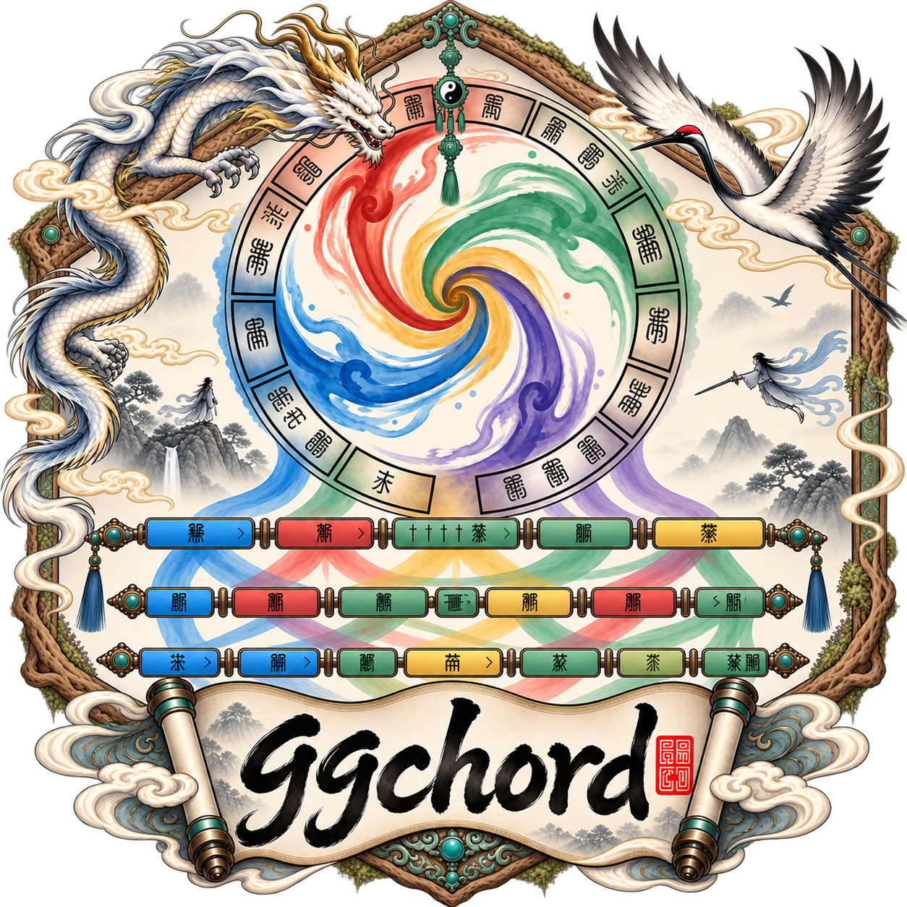
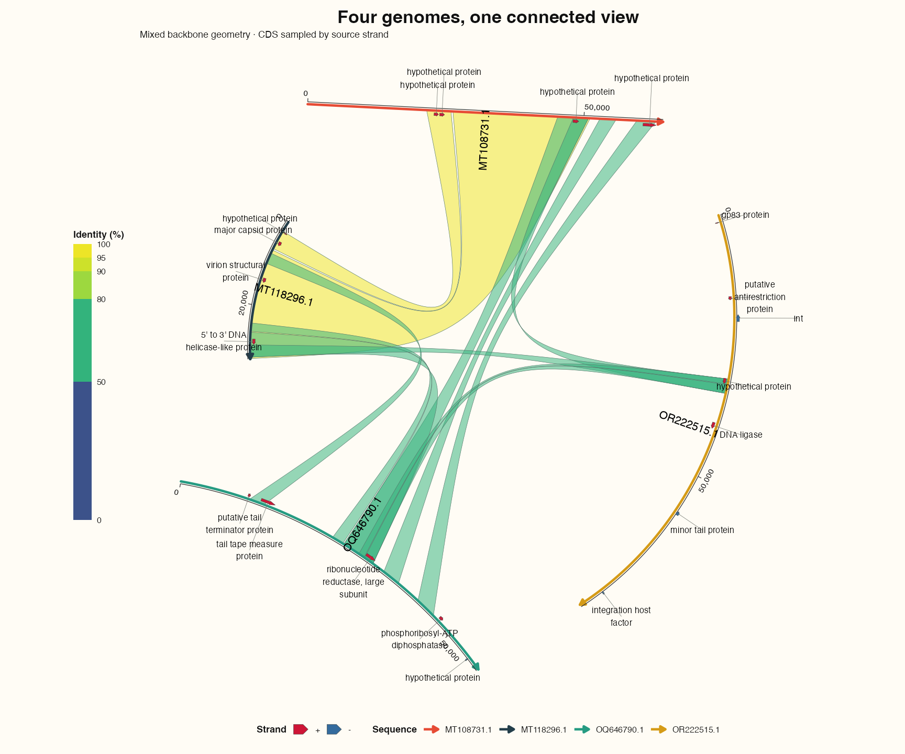
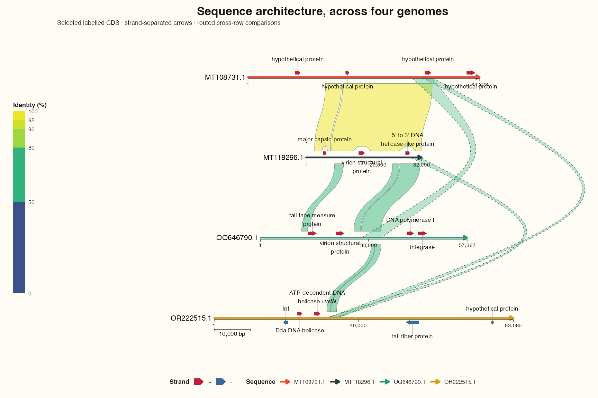
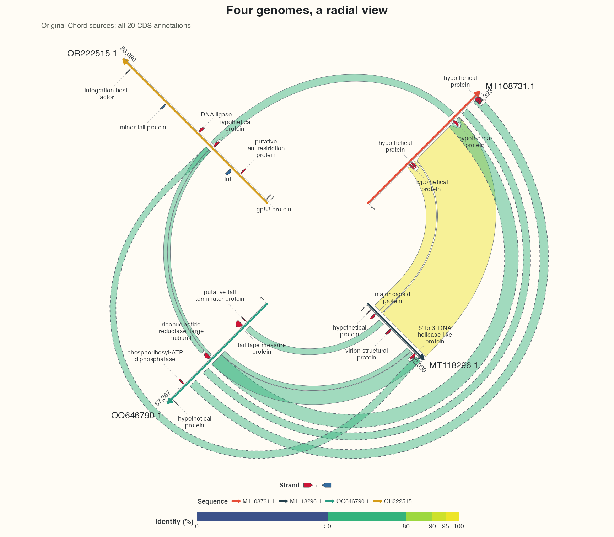
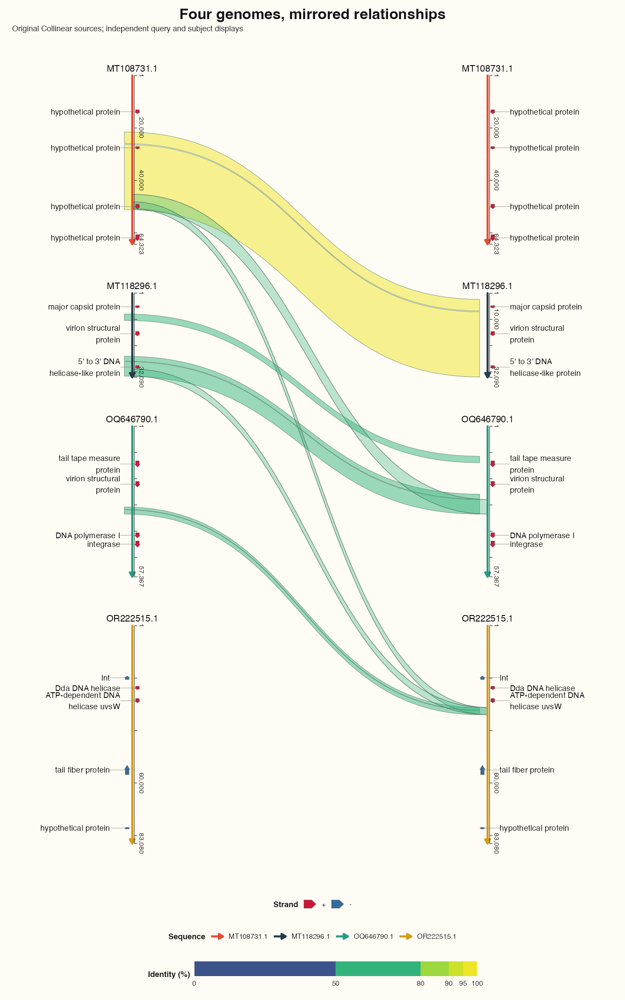
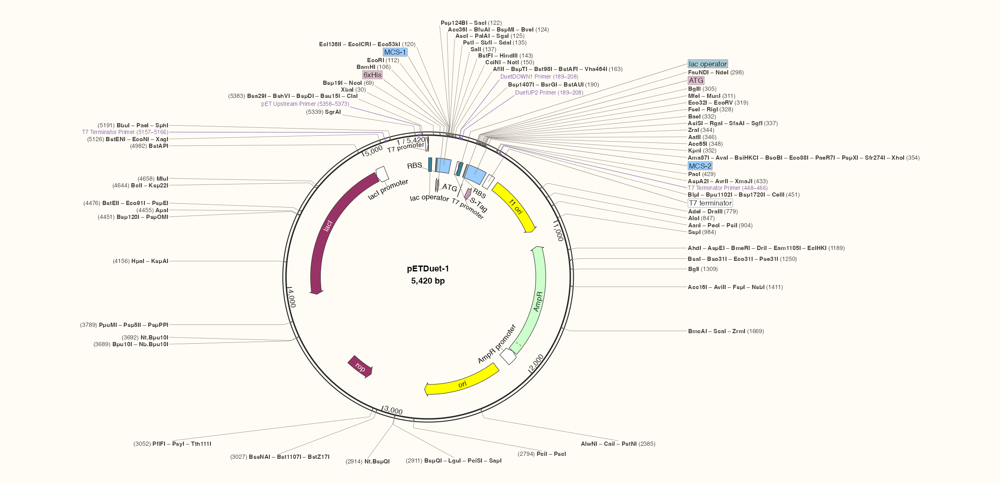
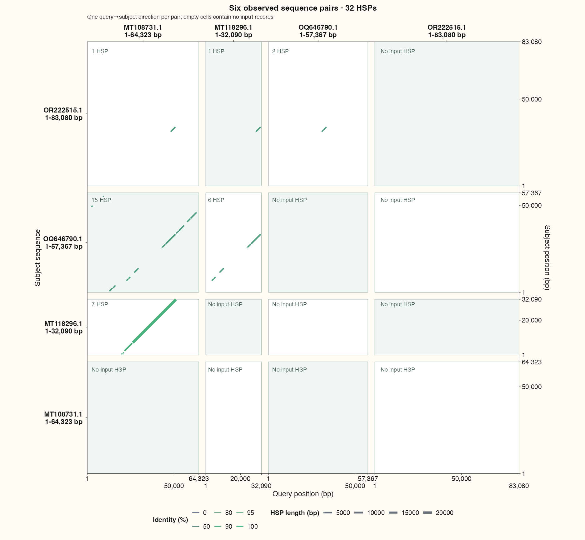
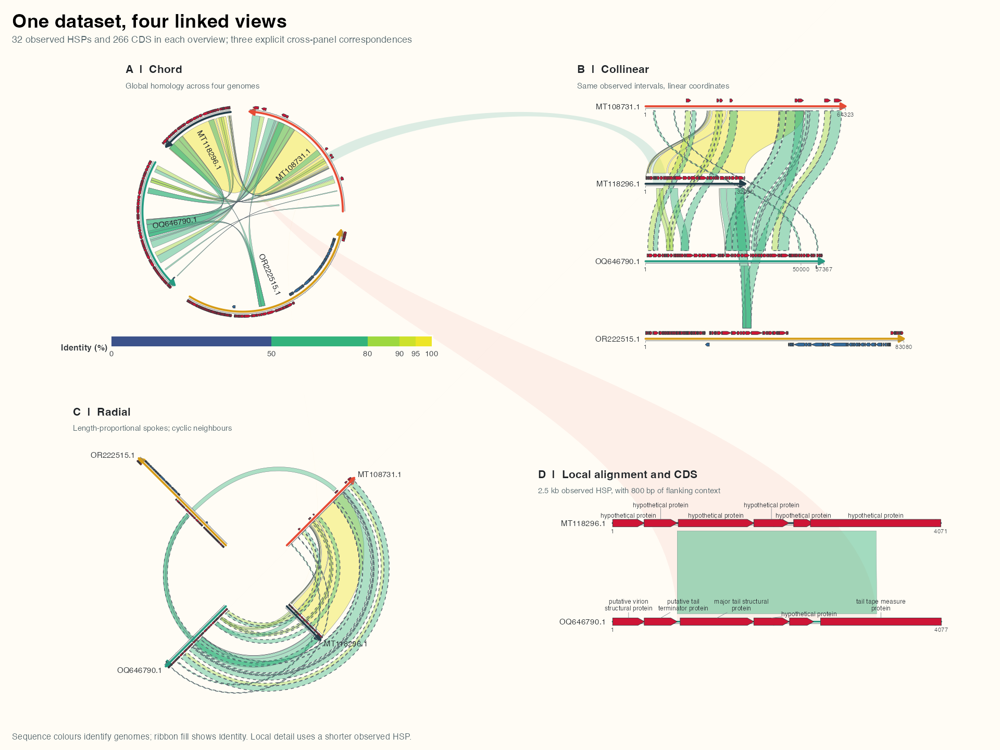

<!-- Generated from website/readme-template.md and website/readme-text.json. -->
<p align="center">
  
</p>

[English](README.md) · [现代汉语](README-Hans.md)

# ggchord: sequences, annotations and relationships

Build layered sequence figures in R with ggplot2: compare multiple sequences, annotate a circular map, inspect HSP alignments and connect independent views.

> [!IMPORTANT]
> This README describes the in-development v0.50.0 source. Install from this checkout to run its examples.

[Website](https://dangjem.github.io/ggchord/) · [Tutorial](vignettes/ggchord_vignette.Rmd) · [Report an issue](https://github.com/DangJem/ggchord/issues)

<a id="modules"></a>
## Four plotting modules

| Module | Use it to | Views |
| --- | --- | --- |
| I · Multi-sequence relationships | Compare sequence intervals, gene order and observed relationships. | Chord · Collinear · Radial · Sankey |
| II · Single-sequence circular maps | Draw intervals, sites and cuts on one sequence and label them with fixed or repelling placement. | Circular |
| III · HSP Dotplot | Inspect alignment intervals on query and subject axes. | Dotplot |
| IV · Multi-view composition | Connect independent plots through explicit source intervals. | Fusion |

The multi-sequence module has four Coord types. Circular and Dotplot add two more; Fusion is the composition layer. Layers, mappings, scales, positions and themes retain their ggplot2 roles.

<a id="examples"></a>
## Real-data figures

### I · Multi-sequence relationships

<table>
  <tr>
    <td width="50%"><strong>Chord · relationships across four genomes</strong><br><a href="man/figures/showcasechord.png"></a><br>Compare four genome references with strand-aware gene arrows and ribbons coloured by reported alignment identity.<br><a href="examples/make_readme_plots.R">Complete example →</a></td>
    <td width="50%"><strong>Collinear · order, orientation and cross-row links</strong><br><a href="man/figures/showcasecollinear.png"></a><br>The same source intervals share a base-pair scale. The declared display orientation orders each strand along its reference.<br><a href="examples/make_readme_plots.R">Complete example →</a></td>
  </tr>
</table>

<table>
  <tr>
    <td width="50%"><strong>Radial · synteny along radial spokes</strong><br><a href="man/figures/flagradial.png"></a><br>The same observations project onto radial spokes, preserving the reference identities and source interval endpoints.<br><a href="examples/make_readme_plots.R">Complete example →</a></td>
    <td width="50%"><strong>Sankey · source intervals across two mirrored columns</strong><br><a href="man/figures/flagsankey.png"></a><br>Each source reference has a query and subject copy. Colours retain the same identity scale as the other comparison views.<br><a href="examples/make_readme_plots.R">Complete example →</a></td>
  </tr>
</table>

### II · Single-sequence circular maps

<a href="man/figures/showcaseplasmid.png"></a>

The dense pETDuet-1 map shows features and primers inside the backbone, with labelled cut positions around the perimeter.

[Complete example](examples/make_readme_plots.R)

### III · HSP Dotplot

<a href="man/figures/flagdotplot.png"></a>

The original 32 HSPs use colour for reported identity and line width for reported alignment length.

[Complete example](examples/make_readme_plots.R)

### IV · Multi-view composition

<a href="man/figures/flagfusion.png"></a>

Three views of the same relationships lead into a source interval, an alignment window and a detail showing the individual bases.

[Complete example](examples/make_readme_plots.R)

Figures share traceable inputs and plot definitions. See the source records and reproduction notes:
[Input files](examples/) · [Figure source](examples/make_readme_plots.R) · [Data preparation](data-raw/) · [Data sources and attribution](website/ASSET-SOURCES.md)

<a id="get-started"></a>
## Get started

<a id="installation"></a>
### Installation

R ≥ 4.1.0 · ggplot2 ≥ 4.0.0

Install the stable release from [CRAN](https://CRAN.R-project.org/package=ggchord):

```r
install.packages("ggchord")
```

From the root of this checkout, install the development source.

```r
install.packages("remotes")
remotes::install_local(".", dependencies = NA)
```

The first plot uses bundled tables and ggplot2. The figure reproduction script also uses dplyr.

<a id="quick-start"></a>
### Draw a first plot

Use bundled tables to draw sequence backbones, alignment ribbons and sequence names. No file download or alignment program is needed.

```r
library(ggchord)
library(ggplot2)

p <- ggchord(seq_data_example) +
  geom_seq() +
  geom_link_ribbon(aes(fill = pident), data = ribbon_data_example) +
  scale_fill_pident() +
  geom_seq_label() +
  coord_chord()

p
```

Each observation layer receives its own data. The coordinate system can change without redefining the sequence reference.

<a id="output"></a>
### Preview and save

Preview and save at the same explicit dimensions so labels are arranged for the intended figure size.

```r
view_ggchord(p, width = 10, height = 8, units = "in")
ggsave("ggchord.png", p, width = 10, height = 8, units = "in", dpi = 144)
```

<a id="design-inspiration"></a>
## Design References

ggchord draws on established open-source projects and scientific visualization approaches. These references have informed its graphical grammar, genomic layouts, annotation strategies, and figure composition. Each project is acknowledged for its specific contributions to the design process; this does not imply direct reuse of its algorithms or implementations.

### Graphical grammar and API design

- [ggplot2](https://ggplot2.tidyverse.org/) — Provides the foundational layered grammar, separating data mappings, geometries, statistics, positions, scales, guides, coordinates, and themes. ggchord builds on this architecture to support composable genomic visualizations and consistent user-defined styling.
- [gggenomes](https://thackl.github.io/gggenomes/) — Offers important references for organizing genomic sequences and annotations, strand-aware layouts, feature stacking, sequence orientation, anchoring, and focus-based workflows. ggchord follows its own reference-coordinate and layer-data contracts while drawing on these domain-specific design concepts.
- [gggenes](https://wilkox.org/gggenes/) — Informs directional gene-arrow geometry, strand-aware positioning, and the distinction between genomic interval lengths and physical drawing dimensions.

### Circular and comparative genomic visualization

- [Circos](https://circos.ca/) — Inspires the visual organization of circular genomic information, including sequence sectors, layered annotations, and ribbons representing relationships between genomic intervals.
- [circlize](https://github.com/jokergoo/circlize) — Serves as a reference for flexible circular track organization, ring arrangement, and multi-layer genomic visualization.
- [clinker](https://github.com/gamcil/clinker) — Provides a visual reference for gene-cluster comparisons, directional gene arrows, and the readable presentation of genomic similarity and synteny.
- [genoPlotR](https://genoplotr.r-forge.r-project.org/) — Offers design references for linear comparative genomics, aligned sequence regions, genomic coordinate presentation, and relationships across multiple genomic segments.

### Feature annotations and multi-scale visualization

- [DNA Features Viewer](https://github.com/Edinburgh-Genome-Foundry/DnaFeaturesViewer) — Informs the presentation of genomic features, annotation geometry, label placement, and collision management in densely annotated regions.
- [ggmagnify](https://github.com/hughjonesd/ggmagnify) — Provides a reference for linking overview figures to magnified details. ggchord develops this concept through explicit source intervals and connections between independently constructed views.
- [ggmsa](https://bioconductor.org/packages/ggmsa/) — Provides references for aligned nucleotide and amino-acid visualization, compact residue cells, and chemistry-based colouring. Selected residue palette values are adapted with attribution in [NOTICE](inst/NOTICE); sequence registration and rendering are independently implemented.
- [ggview](https://github.com/idmn/ggview) — Informs the workflow of previewing figures at their intended output dimensions. ggchord provides size-aware previews through `view_ggchord()` while retaining standard `ggsave()` output.

### Data conventions and related research

- [BLAST](https://blast.ncbi.nlm.nih.gov/doc/blast-help/) — Provides established query/subject terminology reflected in ggchord's alignment data conventions. ggchord visualizes existing alignment results rather than performing sequence alignment.
- [trackViewer](https://bioconductor.org/packages/trackViewer/) — Serves as a research reference for genomic signal tracks, interval-based measurements, and quantitative annotation displays.
- [ggseqalign](https://bioconductor.org/packages/ggseqalign/), [ggseqlogo](https://omarwagih.github.io/ggseqlogo/), [Jalview](https://www.jalview.org/), and [ESPript](https://espript.ibcp.fr/ESPript/ESPript/) — Have been examined as related approaches to alignment visualization, sequence logos, residue annotations, and publication-oriented sequence figures. Their inclusion indicates research and comparison, not implemented integration or adoption of their rendering algorithms.

[Report an issue](https://github.com/DangJem/ggchord/issues) · [MIT license](LICENSE)
