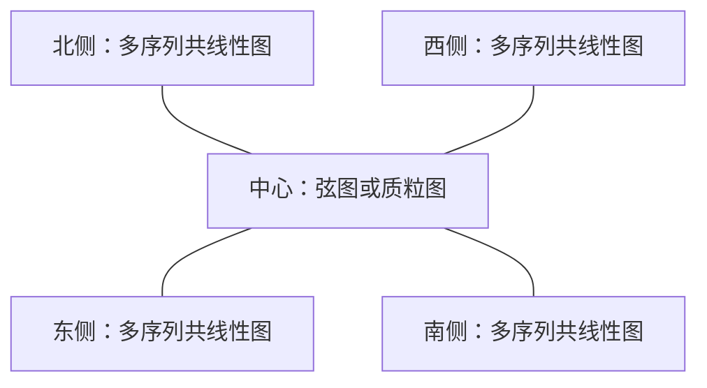

# 圆图与周边共线性视图的连接组合（待确认）

记录日期：2026-11-02。用户提出的未来构想；本轮只记录与分析，不实现、冻结API或
安排发布版本。它是现有三类视图之上的组合层，不是第四类坐标系。

## 目标与布局

中心为弦图或单序列质粒圆图，周围按方位摆放多个共线性图。外围每个图可含多条
序列；中心的一条序列可通过真实比对连接到不同视图、不同序列的区间。

图中连线仅为结构示意；未来输出应为连接真实区间两端的ribbon，具有宽度、方向与
生物学来源。外围允许斜向布局，不局限于四个正方向。

## 可行的架构

当前 `export_ggchord_layout()` 与位置映射接口已有序列局部坐标、来源和几何。
可在组合层增加视图ID、布局矩形、旋转与缩放变换，将端点从序列坐标映射到
子图panel，再映射到整张画布。两阶段完成：先确定子图与实际设备尺寸，再计算
跨视图ribbon及避障。保存应仍走标准ggsave流程，不能靠拼接导出的位图来连线。

- 区间连接至少需要 `qview`、`qaccver`、`qstart`、`qend`、`sview`、`saccver`、
  `sstart`、`send`；这些只是设计角色，字段名尚未确认。
- 视图ID与序列ID构成联合键，同一accver可出现在多个窗口；不得猜测重复ID指向谁。
- 保留实际比对值与原始方向。缩放、翻转、分段视图需通过原始来源映射定位；
  超出窗口的区间必须明确报告裁剪/不显示，不能偷偷改变比对。
- 跨图层的ribbon在统一画布中绘制，需决定位于子图之下还是之上，以及是否裁剪。
  避障应区分序列、标签、其他子图与合法ribbon交叉，不承诺任意布局零交叉。
- 外围旋转后的文字保持可读需要单独策略；panel固定比例、mm字号、图例收集、
  字体测量、设备变化和布局缓存必须整体处理。

## 组合语法方向

[patchwork布局](https://patchwork.data-imaginist.com/articles/guides/layout.html)
可借鉴命名区域、布局设计和图例组织；
[aplot](https://yulab-smu.top/aplot/)可借鉴相关视图的添加与对齐方式。
二者的页面布局能力本身不等于已经具备ggchord区间端口和跨图ribbon契约。

建议先以显式命名视图列表、中心/周边布局和独立连接表建模；随后考虑管道或
运算符语法糖。不要过早重载 `+`，以免与现有ggplot图层加法发生歧义。函数名
与参数保持通用，不包含第三方包名。此处不提供会被误认为当前可运行API的伪代码。

## 待确认的边界

1. 第一阶段是否只支持单个中心图、少量外围图和已提供的比对表？
2. 外围先支持四个正方向，还是首版即支持任意角度？
3. 是否允许外围之间互连，以及一个ribbon跨越多个分段窗口？
4. 优先兼容现有组合包，还是由ggchord管理整张画布？

可先用中心一条圆序列、外围两个各两行的共线性图验证区间端点变换，再验证旋转、
窗口裁剪与方向，最后处理全局避障和复杂布局。上述步骤是可行性建议，未成为版本承诺。
