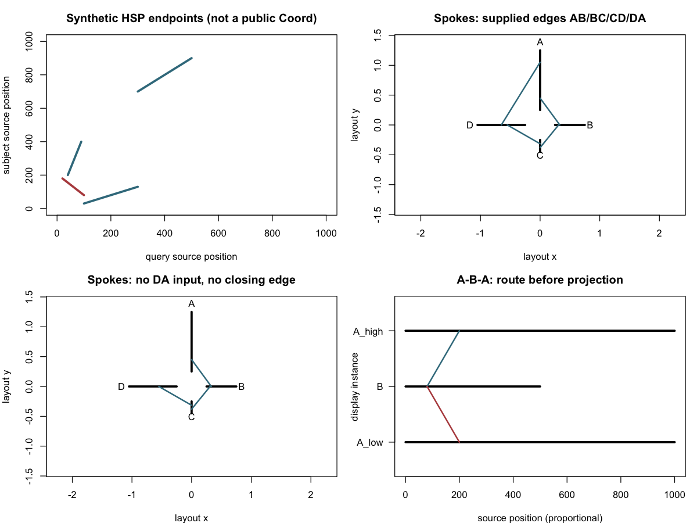

# v10 首轮审计交付

当前长期任务进度见 [V10逐项状态](V10-STATUS.md)；下文保留首轮历史基线。

本文件记录首轮基线快照；后续实际实现见 [v0.17.0 开发记录](DEVELOPMENT-v0.17.0.md)。

2026-11-10。基线 main：`33236efa98f308895368367ac9f96ea7f7337566`。
用户已明确选择以 v10 重排未来路线。本轮完成任务书第 10 章要求的首轮审计、方案、
可复核实验及 README 简化；**没有实现全部长期功能，也没有新增公开 API**。

## 基线、同步和事实边界

- 本地分支 `v0.17.0` 从干净 main 创建。中断恢复后按用户要求 `git fetch origin`，
  HEAD 与 origin/main 差异为 `0 / 0`；无需 merge、rebase 或覆盖工作文件。
- DESCRIPTION 为 `0.16.7.9000`；R 4.6.0、ggplot2 4.0.3、pkgload 1.5.3、dplyr 1.2.1。
  声明下限 R≥4.1、ggplot2≥4.0 不代表本轮验证了下限组合。
- NAMESPACE 实际 130 导出：103 本包实现、22 重导出、5 个 color/colour 别名。
  收集 1474 formal 参数、498 本地函数定义。方法和未导出函数不混入公开导出总数。
  签名是静态契约，不意味着全部参数组合经过运行。
- 本地存在 `v0.16.7-beta.1` tag，NEWS 仍写 development；路线图将 v0.16.6 记录为正式版。
  本轮不移动 tag，不据本地 tag 推断 GitHub Release 状态，也未查询远端 Release 对象。
- 安装页说“CRAN 0.16.6”与本地正式验收的“未获 CRAN 接受/未提交”记录存在来源差异。
  本轮访问 [CRAN 页面](https://cran.r-project.org/web/packages/ggchord/index.html) 返回的
  抓取内容为旧 0.2.0（2025-07-16），不足以证明当前 CRAN 状态。因此登记为必须重新
  核验的安装事实，不替任何一份记录补造结论。GitHub 正式版、CRAN 版本、网站部署状态
  必须分开描述。

任务书来源、SHA256 与同步事实见 [task-input.json](task-input.json)。完整任务书在用户
提供的 Downloads 路径，本目录不将候选代码复制进正式示例。长期规划目录继续遵循本地
`.git/info/exclude`，不强行跟踪；可跟踪的审计证据放在 tools，已被 .Rbuildignore 排除。

## 当前架构与差距

| 工作包 | 已核查事实与源码证据 | 差距/设计债 | 当前处理 |
| --- | --- | --- | --- |
| 构造输入 | `R/ggchord.R:97` 第三位置参数 gene_data，无 feature_data；aa 拒绝 gene_data | 混合注释没有构造级统一入口 | 设计兼容桥接，原入口不改 |
| 通用注释 | `R/geom-feature.R:89` 保存真实链与辅助几何链；已有十种 shape 与 feature_shape mapping | 基因角色、全表/子集与跨层来源需集中定义 | 合成混合表验证互斥分区，尚未接入公开入口 |
| 独立图层 | `R/ggchord-build.R` 注册/解析 layer inputs，生成 layer_geometry；export 带 layer_id/source_row | 层 source_row 不是跨层永久源 ID | 增加 source registry 的方案，不重释旧字段 |
| 实例唯一性 | `R/ggchord-build.R:119` 拒绝重复 seq_order；`R/layout-collinear-transform.R:135` 要求唯一 ID | 多处直接以 accver 索引，删一处检查远远不够 | 独立实例/路由原型与下游改动清单 |
| Track | `R/geom-track.R:145` bar 接收 track_value；`:172` 拒绝 x/y，`:195` 固定 identity | `position` 同时被物理 band 占用，没有真实 count/bin；通用入口/col 不存在 | 保留基线，迁移审计 24 处调用/引用 |
| 统计 | `R/stat-ribbon.R` 已有 bundle/density，并暴露 after_stat 字段 | 不能由 Ribbon Stat 推断 Track 任意 Stat 已支持 | 复用阶段设计，不新增无意义 Stat |
| Coord | `R/coord-collinear.R` 仅横向；chord/circular 有共享 Coord 框架 | Sankey/Dotplot/Radial、seq_axis 尚无公开实现 | 空间定义与隔离几何原型 |
| HSP | `R/data-formats.R:192` PAF 转 1-based closed，负向 subject 降序，保留 tags/源行 | 端点不足以推断逐碱基 mismatch/gap | 真实 PAF 11 行端点转换核验，保留来源 |
| 映射/导出 | `R/layout-export.R` 导出旋转后、coord transform 前 native geometry；source坐标/物理尺寸分开 | `map_ggchord_position()` **仅支持 Collinear**，不是任意 Coord 的定位器 | 不夸大现有能力；新增统一 projector 的设计 |
| 参数解析 | `R/helpers_params.R:22,:168` 接收单值、命名/无名向量与列表；未知序列有错误 | 实体与实例命名需要优先级；重复键等当前路径行为需专项审计 | 不将所有参数推广到 aes/scale/theme；实例覆盖原型 |
| 标签 | `R/layout-external-annotation.R:720` ≥30 restriction 或混合 primer 触发 dense；有禁用候选分支 | 稀疏/密集与隐藏策略可能产生不同结果，尚无控制变量因果证据 | 登记可证伪假设，未改通用 solver |
| 默认 Ribbon | `R/geom-ribbon.R` 隐式 pident，整条 polygon 单填充，默认 alpha=.42 | 端点渐变/target箭头尚未实现；默认变化须迁移 | 保持运行时，提出显式优先级 |
| pident 标度 | `R/ggchord-scales.R:68` 为 0/50/80/90/100；0–100 limits；默认 colourbar | 少 95；实际分段条比例与标签需实测，不能只补 tick | 原生候选映射输出，目标图例未声称完成 |
| Guide | `R/guides.R` device scale、nrow/ncol 参数；`R/diagnostics.R:16` gtable 尺寸报告 | 没有内容候选→panel→多 guide 的联合自动重排 | 一个设备的候选测量，不称完整自适应 |
| Render | `R/render-context.R` measured panel、有限重算、clone与恢复；`:8` 缓存键含设备编号/画布/metric | 字体签名、布局策略和多 panel 还需增强；fit=labels 不等于自动缩放 | 统一策略与缓存/失败规格 |
| Viewer | `R/viewer.R` 按物理目标尺寸测量、冻结 gtable，可拟合圆图 | 不是全图文字/图例 adaptive 能力 | 保持 ggsave/viewer 共用上下文的设计 |
| 网站 | pages.json 为 59 对页面，nav 仍漏 shared-techniques；存在开发记录和源码换行风险 | 构建和浏览器视觉效果需独立验证 | 全页面源索引和整改计划，无全站源码修改 |

几何重复/特殊分支重点：`ggchord-build.R` 按图层依赖重复计算子布局并合并，
`layout-track.R` 手工局部曲线/法向投影，collinear/curve 分支散落于 link/feature/axis；
新增视图若继续按布尔分支扩散会难以维护。建议抽出统一源端点/局部 frame/projector，
不在首轮大规模替换这些已工作的路径。measurements 与几何缓存保持独立来源和状态。
这些属于源码设计风险，未量化为性能瓶颈。

## 索引和可复核结果

- [api.csv](api.csv)：全部导出、native/reexport/alias、定义位置与签名。
- [parameters.csv](parameters.csv)、[functions.csv](functions.csv)：参数默认值和本地函数。
- [capabilities.csv](capabilities.csv)：31 个既有 Geom/Stat/Position/Coord 入口及 23 项候选，
  逐项采用“现有参数/扩展层/新通用层/适配器/新 Coord/Stat/暂不开发”七选一。
  “现有参数”类用于未来入口的设计归属，**不等于该参数现在存在**。
- [test-references.csv](test-references.csv)：已有测试调用位置，只作静态索引，本轮未运行。
- [track-bar-migration.csv](track-bar-migration.csv)：24 处调用/文档/工具引用，不等于24个独立
  业务案例；需按真实含义迁移，历史验收脚本不机械改名。
- [baseline-checks.json](baseline-checks.json)：三类当前 API build、数值 bar、导出/映射、
  单一目标设备诊断、实际缺失入口与真实 PAF 转换。重复 seq_order 的 error 是预期拒绝。
- [prototype.R](prototype.R)、[prototype-results.json](prototype-results.json)：独立合成模型
  断言及 CSV。A–B–A 路由每源行一次，实例覆盖优先，缺 DA 无虚构边，正负 HSP 斜率正确；
  equal 边界投影、混合 feature 显式分区、加权源位置 count 与原生 ggplot2 对照成功。
- [guide-candidates.csv](guide-candidates.csv)：20 个合成分类，8×6 in 单设备，测得 1/2/4/5/10
  行候选宽高。在本实验分配的 191.2×50.8 mm 图例预算中，5 行方案约 167.16×42.08 mm
  可容纳；不是对所有图形/多 Guide/用户锁定的保证。
- [pident-candidate-mapping.csv](pident-candidate-mapping.csv)：目标分界附近的原生候选取值。
  [pident-guide-required-segments.csv](pident-guide-required-segments.csv) 是目标比例规格，
  **不是已测出的图例段长**。

唯一概念图已人工查看：



图中辐条连接只画 HSP 中点证明邻接，不是已实现的 Ribbon；Dotplot 共用坐标范围用于
验证端点符号，不是完整双轴拼接功能；A–B–A 是独立脚本，不是包的公开语法。

## 双语网站需求、发现与整改计划

[website-pages.csv](website-pages.csv) 列出全部 118 个 Markdown 页面：语种、标题、课程组、
文件存在性、哈希、源码候选问题、教学人工审核与浏览器待办状态。
[website-findings.csv](website-findings.csv) 为上下文复核线索，不能把未匹配页面当作无问题。

| 范围 | 本轮证据 | 计划与验收 | 状态 |
| --- | --- | --- | --- |
| 顶部导航 | navigation.json 的 shared-techniques 未进入 render-website.R:26 白名单 | 六类用户任务入口直接到课程，宽/窄屏双语都可发现参数课 | 已定位源码；待整改 |
| about/目录 | build-website.py:82 的“全部专题”；render-website.R:28-29 同页锚点中转 | about 改项目资料，保留旧锚点兼容，目录退为辅助 | 已定位源码；待整改 |
| 安装与首页 | installation:11-29、index、about、compatibility 存在开发/版本审计用语 | 核实实际安装渠道；保留简短必要兼容提示，其余归迁移/NEWS | 已定位；不擅自改发布事实 |
| README | 基线7条长段落，包含候选函数和内部架构 | 同源改为双语各4点，不写未来版本号或目标API | 已修改并检查生成一致性 |
| Markdown 源 | scanner跳过 fenced代码，标记汉语连续源行与br线索 | 每页人工核对段落、表格/列表、链接/锚点；禁止机械合行 | 已建全页索引；语义审核待做 |
| CSS/模板 | site.css:53 全main overflow-wrap:anywhere；:145/:208/:210 hero栅格；home_hero 无br | 正式HTML与320/375/650/768/1024/1280/1440截图定位原因 | 源码风险，未复现视觉缺陷 |
| 生成源污染 | site_components.py、render-website.R、build-website.py、共享示例/参考JSON均需审查 | 上游模板与双语内容同步，引用矩阵，代码与输出可追溯 | 已定位审计范围；深度整改待做 |
| 内容 lint | 本轮有限短语/源行扫描，不作全站CI硬阻断 | 按教学/安装/迁移上下文审核，免误伤科学方法说明 | 本轮工具可复跑；正式CI待开发 |
| 教学深度 | parameters/feature/tracks/source coord/export及参考图谱需人工任务核验 | 最小输入→作图→读图→错误，清楚单位与可运行API | 已有清单；未声称逐页通过 |
| 渲染/功能 | 本轮不生成网站、不启动浏览器审查 | Pandoc HTML、双语/链接/锚点/资源，主题/字体/打印/移动菜单实测 | 待后续实施 |

本轮只改 README 上游片段，未修改网站导航/CSS/教程正文，不重建冻结 docs 或生成新站。
源码软换行不等于浏览器强制换行；历史截图与过去检查不充当本轮证据。

## 对应任务书第10章的状态

| 项 | 交付 | 状态与边界 |
| --- | --- | --- |
| 1 | main API/数据/布局/输出/网站审计 | 完成并已做定向探针；不代表全参数运行或浏览器验收 |
| 2 | 关系模型、迁移及A–B–A原型/路由表 | 方案+隔离原型已测试；公开API待开发 |
| 3 | 七选一矩阵 | 已形成54项分类；细分Track支持仍待实现证据 |
| 4 | Dotplot几何/复用决策 | 隔离端点原型及真实PAF转换已测试；Coord待开发 |
| 5 | spokes数学/闭环 | 隔离拓扑已测试；完整Ribbon与真实多视图验收待开发 |
| 6 | 跨系列里程碑与依赖 | 已形成方案，编号不承诺发布日期 |
| 7 | 分阶段授权边界 | 已遵守；未批量实现所有系列 |
| 8 | 双语网站需求矩阵 | 已完成源索引和计划；渲染/视觉待后续 |
| 9 | Feature迁移 | 已形成方案及互斥分区原型；提示和新入口待开发 |
| 10 | Track规格/迁移 | 已盘点、形成方案及count对照；正式Stat/col/通用层待开发 |
| 11 | DA有/无输入证据 | 已输出并测试；合成数据明确标注 |
| 12 | equal/首末轴 | 规格+边界原型；设备感知轴与闭圆求解待开发 |
| 13 | 短序列研究 | 已形成两级数据方案与官方资料对照；Jalview访问超时，字符图待样本 |
| 14 | 双语README未来方向 | 完成并已验证同源一致性 |
| 15 | 自适应图例 | 规格+单设备候选测量；多Guide/真实分段条测量待开发 |
| 16 | 重复序列专项 | 实例/路由/覆盖原型已测试；三Coord集成和下游层待开发 |
| 17 | 工具书整改计划 | 59对源索引、问题/原因/上游路径与验收计划；无全站修复宣称 |
| 18 | 状态表 | 本表；未验证、待开发、外部资料访问失败均明确 |

详细迁移、公开语义推荐与风险见 [DESIGN.md](DESIGN.md)，后续工作包与进入/退出门槛见
[MILESTONES.md](MILESTONES.md)。没有把消息频率、类型集合、候选名字等方案写成既有实现。

## 复现与验证范围

在仓库根目录依次执行：

```sh
Rscript tools/long-term-audit/audit.R
python3 tools/long-term-audit/audit-site.py
Rscript tools/long-term-audit/prototype.R
Rscript tools/long-term-audit/guide-prototype.R
python3 tools/sync-tutorials.py --check
```

需要已安装 pkgload、ggplot2、dplyr、jsonlite；不自动安装或改变运行时依赖。
这些脚本只做本次直接相关的探针和隔离实验，不调用 testthat/devtools::test、R CMD
build/check、vignette织编或发布设备矩阵。CSV/JSON保留原始测量，耗时不作跨机器门槛。
单张PNG的人工查看不是PNG/PDF/SVG一致性验证，也没有质粒与第三方的同尺寸对标。

发布状态：仅本地版本分支工作；未合并 main、push、部署、tag/Release 或 CRAN 操作。
后续正式功能实现和网站整改按对应阶段继续；完整发布检测仍需明确发布授权。
