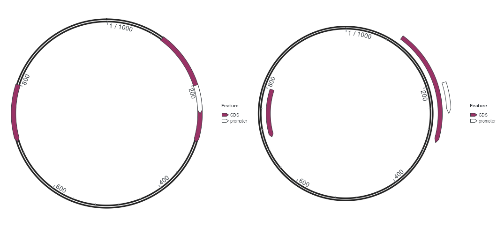
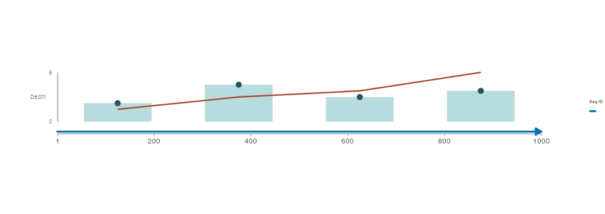
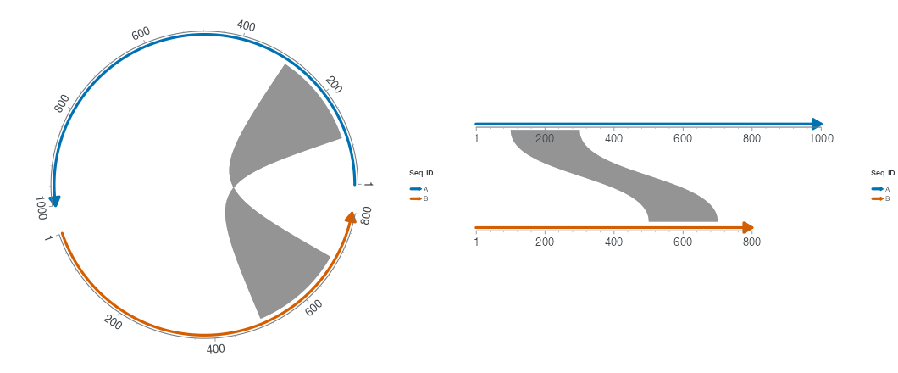

# v0.50.0 目标工作流评审

## 0.50.0 开发版的回放入口

| 真实工作流 | 当前记录 |
| --- | --- |
| 弦图、共线性 | 用下文弦图调用的标准填色、序列排列和 12 条 HSP 实际构建、导出。共线性调用已将早期的 `position_follow(...)` 改为 `anchor_layer = "cds"`，两组连接来源分别为 7 行和 3 行；完整实体层有 16 条 CDS，四条子集标签均绑定到该层。参见下文两个数据配方。 |
| 密集单圆、Fusion | 准备表、预设、标签及全局序列排列已迁移并与原图核对。[图像、设置与来源记录](v0.50.0-render.md) |
| Dotplot、共享参考的多样本统计 | 32 条线段保留。中点、起点与 5,000.5 bp 边界仅作分箱比较。多样本使用真实 HSP 的源区间计算 39 个窗。[代码与分母核对](v0.50.0-candidates.md) |
| 教学起点 | 在一个短例中实际绘出双样本轨道及筛选后的实体标签，可查看逐窗成员。[迁移脚本](../../examples/migrate-v0.50.0.R) |

上表列出本版实际回放的范围。以下旧讨论中的“目标”代码保留设计史，含待定接口。


2026-11-18 的后续评审增加了下列入门案例，输入是用于解释图形的教学表。随后六个工作流使用真实随包数据检验[设计总表](v0.50.0-design.md)。标为“现行”的调用对应 v0.50.0 分支 `33f5f43f` 中的 v0.29.0 运行时代码。标为“目标”或“待确认”的调用供评审，既有初稿和后来提出的简写分别注明。旗舰数据的行数、端点和对照值来自随包对象。旧调用的拟议替代方式见[迁移清单](v0.50.0-api-inventory.md)，实测反例及复核条件见[引擎审计](v0.50.0-engine.md)。

## 从第一张圆图开始

**现行，可运行。** 给定一条长 1,000 bp 的序列 A，和 ggplot2 中 `ggplot(mpg, aes(displ, hwy)) + geom_point()` 一样，先给数据，再选择要看的几何。序列表提供长度，`geom_seq()` 选择画出骨架，`coord_circular()` 表达看圆图的意图。同一条序列也可以画成直线。起始角、半径、线宽、配色和画布使用默认值。

```r
library(ggplot2)
library(ggchord)

seqs <- data.frame(accver = "A", length = 1000)
circle <- ggchord(seqs) +
  geom_seq() +
  coord_circular()
circle

two_features <- data.frame(
  accver = "A", start = c(100, 600), end = c(250, 800), strand = c("+", "-")
)
circle + geom_feature(data = two_features)
```

下面改用三条注释，让分道的效果可见。区间列是规范名称，`aes(fill = type)` 表达按类别着色。统一填色可以直接写 `geom_feature(data = features, fill = "grey70")`。使用者决定显示什么以及映射哪一列，图层提供默认色和图例。

```r
# 现行
features <- data.frame(
  accver = "A", start = c(101, 201, 701), end = c(300, 250, 800),
  strand = c("+", "+", "-"), type = c("CDS", "promoter", "CDS"),
  feature_id = c("cdsA", "pA", "cdsB")
)
annotated <- circle + geom_feature(aes(fill = type), data = features)
stacked <- circle +
  geom_feature(aes(fill = type), data = features, position = position_feature_stack())
annotated
stacked
```



左图中，`pA` 在 `cdsA` 区间内，盖住了部分 CDS。右图分道后可分别读出起止位置，用户无需逐条指定半径、道号或间距。要只标两个 CDS，后续评审建议采用以下简写。

```r
# 目标，待确认
labelled <- dplyr::filter(features, type == "CDS")
stacked +
  geom_feature_label(aes(label = feature_id), data = labelled, placement = "repel")
```

来源、实体键与面板内显示实例均可唯一确定时，标签拟直接沿用特征的位置。只筛标签也保留原锚点。同名实体或同一特征在两窗重复出现时，仍需选择目标；独立标签有自身合法区间时可单独添加。初稿用 `position_follow(layer = "genes")` 显式选择，后来提出的 `anchor_layer = "genes"` 可让锚点选择与位置调整分别设置，名称和取舍待确认。

### 同一组区间的统计与外观

```r
# 目标，待确认。各调用均派生自同一张圆图。
circle + stat_coverage(data = features, binwidth = 250)
circle + stat_coverage(aes(y = after_stat(mean_depth)), data = features, binwidth = 250)
circle + stat_coverage(aes(fill = after_stat(coverage)), data = features, binwidth = 250)
circle +
  stat_coverage(
    aes(group = type, colour = type), data = features,
    binwidth = 250, geom = "track_line"
  )
```

简写拟让单轨默认自动放置并用柱高表达并集覆盖率。用户决定窗口和度量。1–250 bp 窗的并集是 101–250，共 150 个位置，覆盖率 150/250 = 60%。启动子的 50 个位置对平均深度另有贡献，结果为 200/250 = 0.8。其余三个窗口的覆盖率与平均深度均为 0.2。现行引擎可用 `geom_track_bar(data = features, stat = "coverage", binwidth = 250, track = position_track("coverage"))` 复核。原始离散类型可以改变统计分组；`after_stat(coverage)` 给已算出的比例着色。换几何时按相同源区间、分组和窗口核对结果。

```r
# 目标。三项可以分别添加。
annotated +
  scale_fill_manual(name = "注释类型", values = c(CDS = "#417D85", promoter = "#D87945")) +
  scale_seq_position_continuous(breaks = c(1, 250, 500, 750)) +
  theme(legend.position = "bottom")
```

调颜色、刻度值或图例位置时拟各用一处声明，需要控制轴的避让或显示哪些轴时再配置相应 guide。此配色在现行分支的 `ggplot_build()` 中可见，最终图像仍显示了默认色。普通填色标度、实际图形和图例同时生效，是退役专用填色标度的验收条件。

### 一条定量轨道叠加柱、线和点

**现行，可运行。** 一次 `geom_track()` 调用构建一个图层，`geom` 接受一个支持的几何名称。一条轨道可以接收多个这样的图层。用合成数据演示：柱和点取观测深度，线取同单位的预期深度。给三个层传同一个带名即可叠画；各层也可选用自己的数据、映射、Stat 和数据 Position。

```r
# 现行，沿用开头的 seqs
d <- data.frame(
  accver = "A", pos = c(125, 375, 625, 875),
  observed = c(3, 6, 4, 5), expected = c(2, 4, 5, 8)
)
band <- position_track("depth", width = grid::unit(18, "mm"))
depth_plot <- ggchord(seqs) +
  geom_seq() +
  geom_track_col(aes(pos, observed), data = d, track = band,
                 width = 140, fill = "#B8DBDE") +
  geom_track(aes(pos, expected), data = d, track = band,
             geom = "line", colour = "#A54A2C", linewidth = 0.7) +
  geom_track(aes(pos, observed), data = d, track = band,
             geom = "point", colour = "#21535B", size = 2.3) +
  scale_track_value_continuous("depth", name = "Depth", guide = "axis") +
  coord_collinear()
depth_plot
```



在 `d5caaf78` 的 0.29.0 运行时，`export_ggchord_layout(depth_plot)$track_registry` 对 A 返回一行，`source_layers` 有三个成员，`limits` 为 0–8。柱的最大值为 6，线的最大值为 8。再把线改用另一张表（位置 125、875，预期深度 2、8），直线与圆形坐标均能绘制，各层分别导出 4、2、4 行统计记录。图层按添加顺序覆盖，轨道的 `order` 控制多条带与骨架的远近。同名带的侧别、顺序、宽度与间隔须相符。多个序列的同名带各自有显示位置，仍可共享数值标度。[布局与训练](../../R/layout-track.R) · [已有置信带与均值线示例](../../website/zh/tracks-statistics.md)

**待确认的设计取舍。** 新版首选平铺的加法语法：用 `track_band("depth", width = grid::unit(18, "mm"))` 声明带宽，三个定量图层各用 `track = "depth"` 引用。同一默认带的简写可省略声明与引用。一个 ID 对应一个可比较的高度域、一组轴设置；每层独立保留数据、统计及来源。现行 `unit` 主要用于标注和导出，共轴的度量含义仍需调用者辨认。若后续希望在一个调用里接收多个现成图层，可再评审显式轨道容器，让子层分别拥有映射和参数，并限定支持的坐标及统计。仅传 `geom = c("col", "line")` 无法分别为柱和线指定观测值与预期值。普通 `ggplot2::geom_point()` 使用面板坐标；轨道上的点需要沿序列的位置和局部高度。通用区间注释还有自己的分道规则。

### 两条序列、一个连接、两种视图

```r
# 现行
refs <- data.frame(accver = c("A", "B"), length = c(1000, 800))
hits <- data.frame(
  qaccver = "A", qstart = 101, qend = 300,
  saccver = "B", sstart = 501, send = 700
)
comparison <- ggchord(refs) +
  geom_link_ribbon(data = hits) +
  geom_seq()
comparison + coord_chord()
comparison + coord_collinear()
```



同一个比对只定义一次，四个端点随两种视图保留。要改变序列次序或仅反转某条序列时，再引入布局设置。跨表映射宜尽量靠近数据，例如在序列层写 `geom_seq(aes(colour = accver))`，在含有相似度列的连接层写 `geom_link_ribbon(aes(fill = pident), data = links)`。后面的旗舰初稿另演示显式全图继承。

### 两个样本的圆图

```r
# 现行，可复现分面分派及跨面板分道问题
sample_features <- data.frame(
  accver = "A", start = 101, end = 300, strand = "+", sample = c("S1", "S2")
)
circle +
  geom_feature(
    data = sample_features, shape = "block", position = position_feature_stack()
  ) +
  facet_wrap(vars(sample))
```

现行两面板各有共享骨架和本样本的一条注释。S2 的特征被排到更外的一道；两个样本各自单独出图时，特征都在第一道。待确认的首批分面目标是先按样本分派，再按面板统计、分道与避让，并共享可比较的量尺。增添 S3 不应挤走 S1 的特征。样本对照用 `facet_wrap()`，同时按条件与时间点排列可用上游 `facet_grid(rows = vars(condition), cols = vars(timepoint))`。跨图连接和异构细节图继续由 Fusion 组合。[分面实测与当前限制](v0.50.0-engine.md) · [ggplot2 分面](https://ggplot2.tidyverse.org/reference/facet_wrap.html) · [ggplot2 网格](https://ggplot2.tidyverse.org/reference/facet_grid.html)

## 旗舰数据准备

在安装有 ggchord、ggplot2、dplyr 和 scales 的 R 环境中加载。四个旗舰对象来自同版安装包，避免混用不同批次的展示子集。

```r
library(ggchord)
library(ggplot2)
library(dplyr)

data(flagship_comparison_example, package = "ggchord")
data(flagship_circular_example, package = "ggchord")
data(flagship_dotplot_example, package = "ggchord")
data(flagship_fusion_example, package = "ggchord")
```

比较图、Dotplot 和 Fusion 的原始输入为四条序列的 FASTA、GFF3 和标准 BLAST 输出。完整来源有 4 条序列、32 条 HSP、266 条 CDS。圆图使用已保存的质粒序列和识别结果。一基闭区间使用 bp，pident 为百分比。各工作流分别注明自己的筛选与归属规则。[旗舰数据说明](../../website/zh/flagship-data.md) · [生成脚本](../../data-raw/generate_flagship_data.R) · [原始输入清单](../../data-raw/website-data-sources.tsv)

## 1. 弦图：同一组 HSP 的方向和身份

**任务。** 将四条骨架按展示次序和方向排布，用带宽显示原始区间，用填色显示 Identity。旧式 `ggchord(seqs, links)` 把第二表按参数位置解释为连接，方向则写入 `geom_seq(seq_orientation = ...)`。目标把全图顺序和方向声明一次，并由连接层持有自己的输入表。骨架继承全局的序列颜色。连接层从自己的表读取百分比，关闭全局映射继承。

```r
# 0.50.0 本地核验
chord <- flagship_comparison_example$chord

p_chord <- ggchord(data = chord$seq_data, mapping = aes(colour = accver)) +
  layout_sequences(
    order = chord$seq_data$accver,
    orientation = chord$orientation,
    length_mode = "proportional"
  ) +
  geom_link_ribbon(
    data = chord$links, mapping = aes(fill = pident), inherit.aes = FALSE
  ) +
  geom_seq() +
  geom_seq_label(inherit.aes = FALSE) +
  scale_colour_discrete(name = "序列") +
  scale_fill_gradient(
    name = "Identity (%)", limits = c(0, 100),
    low = "#DCEAF0", high = "#20566C"
  ) +
  coord_chord()
```

**核对。** 检查每条带的 query/subject 标识、四端点、pident 和源行。应有 4 条骨架、12 条已筛选 HSP。原始标准表按序列对分文件，`.source_line` 只在其文件内唯一。用序列对和原文件行回查可区分不同文件中同一行号。改变 `orientation` 后应能找回相同来源。旧式 `ggchord(chord$seq_data, chord$links)` 在目标签名中将表传入 mapping 位，应提示改为图层 data。第二个骨架层不能隐式重排已有图层。

## 2. 单序列圆图：拥挤标签跟随原特征

**任务。** 在密集质粒上给不同类型的区间分道，标签使用同一组已排好的特征。旧图使用质粒专用几何包装、位置预设或向标签重复传入位置对象。目标由通用特征层持有分道参数，由标签层通过图层 ID 引用其锚点。保留输入的跨起点标记、分段信息和链，显示文字可以重复。

```r
# 目标
circle <- flagship_circular_example$dense
features <- circle$features |>
  mutate(feature_id = match_id)

p_circle <- ggchord(data = circle$seq_data) +
  geom_seq() +
  geom_feature(
    id = "annotations", data = features, preset = "plasmid", mapping = aes(fill = type),
    position = position_feature_stack(
      base_position = position_offset(0), direction = "outward"
    )
  ) +
  geom_feature_label(
    data = features, mapping = aes(label = anno),
    placement = "repel", position = position_follow(layer = "annotations")
  ) +
  scale_fill_discrete(name = "注释类型") +
  scale_seq_position_continuous(guide = guide_seq_axis()) +
  coord_circular()
```

**核对。** pETDuet-1 长 5,420 bp。20 条特征有 20 个不同的 match_id、16 种不同的标签文本，1 条特征跨起点。比较分道前后的源 ID、链和分段，核对跨起点的两段指向同一特征。只筛标签或改变设备尺寸时，标签数量或引线形状允许变化，锚点仍应指向同一层、同一特征。另有 5 个参考引物和 139 条入选限制位点，本例只取特征表。错误的层 ID、重复可引用 ID 或以重复的 anno 文本作唯一键均应报告。隐藏序列轴的设置只作用于轴装饰。

**保真回放。** 上述初稿特意演示从偏移 0 向外增道。既有密集旗舰使用 `position_feature_stack(spacing = 0.085, base_position = position_plasmid())`，从 −0.1 向内增道，且包含引物、限制位点与标签。对照迁移前后外观时，须令两次绘制使用同一组图层、起点、方向、间距、字体和画布；归档输入、配方及基线提交，再检视来源、锚点和引线。[既有旗舰配方](../documentation-examples.R)

## 3. 共线性图：局部筛选、跨行连接与分道

**任务。** 使用四行共线性旗舰的 7 条相邻行连接、3 条跨行连接及 16 条已选 CDS。两个连接层分别持有数据和固定样式。按真实链画箭头，上色和标注由不同图层承担。旧式 gene 几何和标签包装分别接收位置。目标保留箭头的领域语义，标签跟随命名特征层。

```r
# 0.50.0 本地核验
linear <- flagship_comparison_example$collinear
data(genome_comparison_example, package = "ggchord")
cds <- genome_comparison_example$annotations |>
  semi_join(linear$features, by = c("accver", "start", "end", "strand", "anno")) |>
  mutate(strand = source_strand)
labelled <- cds |>
  group_by(accver) |>
  slice_min(start, n = 1, with_ties = FALSE) |>
  ungroup()

p_linear <- ggchord(data = linear$seq_data) +
  layout_sequences(order = linear$seq_data$accver) +
  geom_link_ribbon(data = linear$adjacent_links, fill = "#ACC6CF") +
  geom_link_ribbon(
    data = linear$cross_links, adjacent_only = FALSE, fill = "#D3C2B1"
  ) +
  geom_seq() +
  geom_feature(
    id = "cds", data = cds, preset = "gene", mapping = aes(fill = strand),
    position = position_feature_stack()
  ) +
  geom_feature_label(
    data = labelled, mapping = aes(label = anno), placement = "repel",
    anchor_layer = "cds"
  ) +
  scale_fill_manual(name = "来源链", values = c("+" = "#B7463B", "-" = "#366E91")) +
  coord_collinear()
```

**核对。** 随包筛选结果含 16 个不同的 feature_id，13 条源正链、3 条源负链。代码为每条序列选择源 start 最小的 CDS，翻转显示时继续跟随同一个源实体。若任务要求屏幕上最左侧的特征，则须按翻转后的显示端点选取；反向水平骨架上通常是源 end 最大的特征。现有旗舰在给定数据上自动求得的四个骨架方向均为正，保真回放须保留居中对齐和原路由的布局条件。另设一个显式反向场景来区分两种标签规则，同时核对箭头和有方向的 HSP 端点。[旗舰生成配方](../../data-raw/generate_flagship_data.R)

在相同序列次序上相邻层接收 7 行，跨行层接收 3 行。若重新排序，先按新相邻关系重分连接。旗舰的旧路由控制点仅适用原布局。将初稿的 `position_follow(layer = "cds")` 交给双端点 HSP 层应报告输入类型不相容。将经筛选的标签独立重新分道会错开部分锚点。

## 4. 密集 Dotplot：按两个源坐标聚合，再查单条 HSP

**任务。** 现行 `geom_alignment_segment()` 适合检视四端点。高重叠时希望读出局部命中数量，再定位原始线。目标统计建议分别取一条 HSP 在 query 和 subject 上的**中点**，把这对坐标落入的二维格计数加一。先按有方向的源序列对分开，再以两轴原生 bp 分箱，拼接间隙不参加计算。该口径可与两轴端点起算的方案比较、定案。本例用真实小矩阵说明汇总和追溯，不构成大数据性能测量。

```r
# 目标
dot <- flagship_dotplot_example
base_dot <- ggchord(data = dot$seq_data) +
  coord_dotplot(
    x_seqs = dot$seq_data$accver, y_seqs = dot$seq_data$accver,
    gap = dot$axis_gap
  )

binned_dot <- base_dot +
  stat_alignment_bin2d(
    data = dot$links, binwidth = c(query = 5000, subject = 5000),
    geom = "alignment_tile", mapping = aes(fill = after_stat(count))
  ) +
  scale_fill_viridis_c(name = "HSP 条数")

raw_dot <- base_dot +
  geom_alignment_segment(data = dot$links, mapping = aes(colour = pident)) +
  scale_colour_viridis_c(name = "Identity (%)", limits = c(0, 100))

crowded <- dot$links |>
  filter(qaccver == "MT108731.1", saccver == "MT118296.1") |>
  filter(
    floor(((qstart + qend) / 2 - 1) / 5000) == 4,
    floor(((sstart + send) / 2 - 1) / 5000) == 0
  )
binned_dot +
  geom_alignment_segment(data = crowded, colour = "black", linewidth = 0.4)
```

**核对。** 一级坐标从 1 起，每格左端为 `1 + 5000 * k`，最后一格截于真实序列长度。对每行独立计算 `floor(((qstart + qend) / 2 - 1) / 5000)` 及 subject 对应值，再按两序列和两格号计数。32 条记录分布于 23 个非空格。MT108731.1 对 MT118296.1，query 第 5 格与 subject 第 1 格共 4 条。该格的源 HSP ID 集合应与原始表筛选结果一致。未镜像的方向保持空白，0 次命中表示这份输入中没有记录。反转显示轴只改变位置，不改变格号、计数和来源。把 count 解读为碱基覆盖、将长线穿过的每格都加一，或尝试把二维格子叠到单骨架圆图，均不满足此契约。

**比较范围。** 后续复核修正了初稿只写 `gap` 的示例。真实输入有 4 条参照序列，query 和 subject 各出现 3 条；按输入命中取轴只显示 3 × 3 个序列对区域。上面的显式双轴复现旗舰 4 × 4 的比较范围，多出 7 个无输入记录的区域，两图都保留全部 32 条 HSP。仅凭空白无法断定两条序列是否做过比较。应先决定要展示完整参照集合还是当前输入的命中集合，再查看各序列对内的 5,000 bp 分箱。目标统计导出应给出格号、源边界及成员 ID，供用户直接反查。中点恰在两个碱基之间（如 5,000.5）时的归格和几何边沿约定仍待确认，需在正反双轴上核对原始线、所属色格和较短末格。[现行双轴选择](../../R/coord-dotplot.R) · [旗舰的完整轴域](../../data-raw/generate_flagship_data.R)

## 5. 多样本定量：同一参考的分组覆盖及共同量尺

**任务。** 多个实验样本并排比较时，每个样本应有独立的区间来源、共同的参考和可解释的值域。随包案例没有给这一参考配套的多样本实验信号。本例改用真实的三组比较对象，在同一个 query 上计算它与各 subject 的 HSP 并集覆盖率。Subject 的名称与记录来源都保留，不当作实验样本或测序深度。真正的多样本输入可用相同的轨道声明，按各样本实际别名和已观测区间替换这三张表。已经量化的连续信号直接显示其数值，不能再按覆盖统计累积。

```r
# 目标
dot <- flagship_dotplot_example
reference <- dot$seq_data |>
  filter(accver == "MT108731.1")
intervals <- dot$links |>
  filter(qaccver == reference$accver) |>
  transmute(
    accver = qaccver, comparison = saccver,
    start = pmin(qstart, qend), end = pmax(qstart, qend),
    qstart, qend, source_hsp_id
  )
comparisons <- unique(intervals$comparison)

p_tracks <- ggchord(data = reference) + geom_seq() + coord_collinear()
for (i in seq_along(comparisons)) {
  subject <- comparisons[[i]]
  selected <- intervals |> filter(comparison == subject)
  p_tracks <- p_tracks +
    track_band(id = subject, side = "outside", order = i, width = grid::unit(5, "mm")) +
    stat_coverage(
      data = selected, binwidth = 5000, track = subject, geom = "track_col",
      mapping = aes(y = after_stat(coverage))
    ) +
    scale_track_value_continuous(
      track = subject, name = subject, limits = c(0, 1),
      breaks = c(0, 0.5, 1), labels = scales::label_percent(),
      guide = guide_track_axis()
    )
}
```

**核对。** MT118296.1、OQ646790.1、OR222515.1 三组分别有 7、15、1 条 HSP。每轨 13 窗，源长度 64,323 bp，末窗 4,323 bp。用各组输入在参考上的区间并集独立计算。在 OQ646790.1 轨，第 1 窗为 637/5,000，末窗为 3,033/4,323。对另外两组，这两窗均为 0。逐窗核对原始 ID，改变轨道顺序和毫米宽度不得改变分子、分母与来源。三个有观测的比较对象可按此口径补齐零覆盖窗。缺失的实验样本或未观测信号不能补为零。每个带宽按毫米解释，binwidth 按 bp。给 `stat_coverage()` 同时传互相冲突的 windows 和 binwidth 应报错。独立标度显式写入同样数值域即可比较。声明跨轨或跨面板复用标度的简写待定。

**同轨对照，待确认。** 要让三个比较对象的覆盖率共享一条值轴，可以直接将同一张长表按 comparison 分组。与上面的独立轨道示例逐组比较，每组应仍有 13 窗，可回查各自的贡献 ID。若改为按样本分面，也需验证骨架的共享、观测的面板归属及值轴范围。

```r
# 目标。显式声明并引用同一条物理轨道。
ggchord(data = reference) +
  geom_seq() +
  track_band(id = "coverage") +
  stat_coverage(
    aes(group = comparison, colour = comparison, y = after_stat(coverage)),
    data = intervals, binwidth = 5000, geom = "track_line", track = "coverage"
  ) +
  scale_track_value_continuous(track = "coverage", limits = c(0, 1)) +
  coord_collinear()
```

**互换条件。** 若每个样本每个窗口保留多个独立的数值观测，可用同一张长表按样本、窗口显式分组，分别做箱线或小提琴。箱线采用分位数和须，小提琴需要有足够观测来估计密度。每窗口单个覆盖比例可以画柱、线或色块。把该比例复制成多行，或将分位摘要当成原始观测，都会改变问题。色块应使用各窗实际边界，尤其是较短末窗。

## 6. Fusion：从全长比较定位到两个真实源窗口

**任务。** 在全长双序列比较图上标出一条已观测关系的两端，再连接到带相同来源身份的局部面板。现行 magnify/Fusion 已能使用显式窗口，目标让两端面板使用同一图层语法，并使每个面板独立训练标度、独立保存来源。示例只取六面板旗舰中的总览与局部，省去无关图层。

```r
# 目标
fusion <- flagship_fusion_example
local <- fusion$focused
regions <- fusion$focus_regions |>
  filter(source_panel == "center", detail_panel == "zoom")

overview <- ggchord(data = fusion$context_sequences) +
  geom_link_ribbon(data = fusion$selected, allow_repeated = TRUE) +
  geom_seq() +
  geom_feature(data = fusion$context_features, preset = "gene") +
  coord_collinear()

detail <- ggchord(data = local$seq_data) +
  geom_link_ribbon(data = local$ribbon_data, allow_repeated = TRUE) +
  geom_seq() +
  geom_feature(data = fusion$detail_features, preset = "gene") +
  scale_seq_position_continuous(coordinates = "source", guide = guide_seq_axis()) +
  coord_collinear()

p_fusion <- magnify_ggchord(
  overview, region = regions, detail_plot = list(zoom = detail),
  connector = "envelope"
)
```

**核对。** 两个来源窗口为 MT118296.1 的 7,122–11,192 bp 和 OQ646790.1 的 10,615–14,691 bp。局部长度为 4,071 和 4,077 bp，选中的 `source-HSP-25` 在总览和局部各展示一次。核对 2 个源窗口、各自两端、源 HSP ID 和局部坐标回算。总览源注释为 9 行，局部仅展示 4 行。真实连接来自 HSP 的两端，放大框对应窗口范围，两者在图上表达不同关系。用 `export_ggchord_fusion()` 按绘制尺寸核对面板与跨面板映射。若两端来源单位不同、窗口不完整或同一来源有多个可见实例未指定，要求报告并指出有歧义的端点。只缩放总览视口时保留来源及统计。调用 focus 后要重算时，需声明沿源网格取交集，或从局部起点重新分窗，并保留有效端点、分母和贡献记录。双端 HSP 的现行局部裁剪可使用线性投影；要计算逐碱基的比对覆盖，须有相应的逐段或对齐证据。[聚焦实现](../../R/focus.R)

## 五页上游依据与设计取舍

| ggplot2 官方材料 | 可直接核对的行为 | 本提案据此接受的验证 |
| --- | --- | --- |
| [入门文章](https://ggplot2.tidyverse.org/articles/ggplot2.html) | 数据、映射、图层、标度、分面、坐标和主题分别组合。坐标解释位置，分面按变量切分。 | 单图更换坐标仍能查回同一组来源。Fusion 的独立面板与跨面板来源关系在组合层处理。 |
| [参考索引](https://ggplot2.tidyverse.org/reference/index.html) | 每层组合 data、mapping、geom、stat、position，geom 有默认 stat 和 position。 | 覆盖与二维分箱分别对外说明消费哪些源坐标、生成哪些量。轨道物理带、数据位置调整和全局序列排列分别声明。 |
| [箱线](https://ggplot2.tidyverse.org/reference/geom_boxplot.html) | 默认 boxplot/dodge2。自备五数结果能用 identity 绘制。 | 同一图层类型应区分观测与已汇总输入。保留源位置锚点与原始组名。 |
| [小提琴](https://ggplot2.tidyverse.org/reference/geom_violin.html) | 默认 ydensity/dodge。少于两个观测的组默认丢弃，小提琴宽度还受归一化方式影响。 | 允许共享原始观测，说明计算口径，保留样本不足的诊断。窗口裁选与显示缩放分别核对。 |
| [矩形与色块](https://ggplot2.tidyverse.org/reference/geom_tile.html) | tile 按中心与宽高，rect 可按边界。宽高在标度变换后应用。 | 真实边界决定短末窗、双轴格和拆分区间覆盖的范围。普通色块可复用显示语法，源区间与单元归属仍需领域统计负责。 |

补充扩展依据见 [ggplot2 扩展指南](https://ggplot2.tidyverse.org/articles/extending-ggplot2.html)、[映射求值阶段](https://ggplot2.tidyverse.org/reference/aes_eval.html)和[视口缩放](https://ggplot2.tidyverse.org/reference/coord_cartesian.html)。`after_stat()` 读取具名计算量，原始表字段在输入阶段读取。上述来源 ID 与多行贡献关系属于 ggchord 的领域设计，实施时需在统计和投影前后逐项核对。
