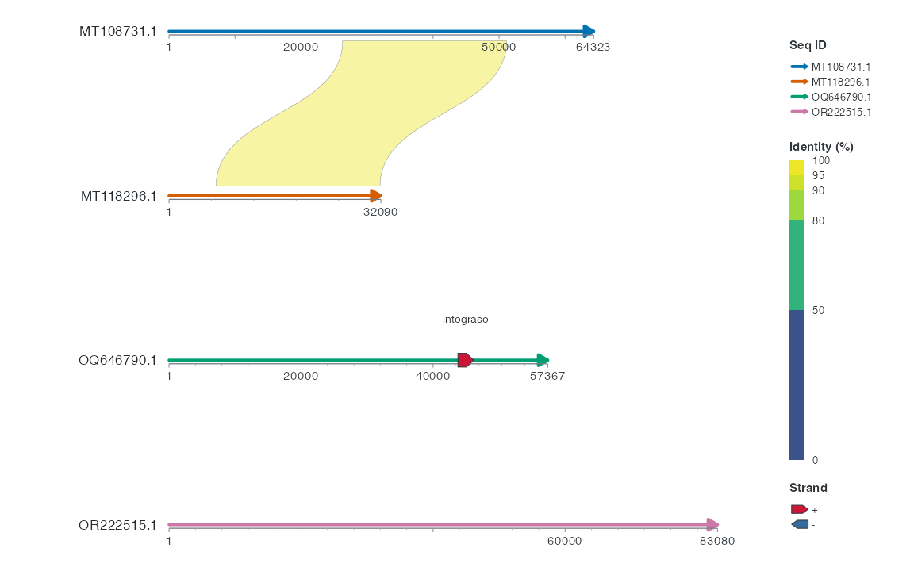

<!-- Generated by tools/sync-tutorials.py; edit website/ and tools/documentation-examples.R. -->

```{r setup, include=FALSE}
knitr::opts_chunk$set(eval = FALSE, collapse = TRUE, comment = "#>")
```


按任务选择四个绘图模块，每个模块都提供独立的首图代码。自备数据、专业专题和完整科研案例请继续查阅在线说明。


## 下载与安装 {#installation}

### 从 GitHub 安装 {#installation-requirements}

从项目仓库安装 ggchord 及必需依赖。源码安装需要可用的 R 开发环境。

```{r example-1, eval=FALSE}
install.packages("remotes")
remotes::install_github("DangJem/ggchord", dependencies = NA)
```

### 环境与安装检查 {#installation-environment}

需要 R ≥ 4.1.0、ggplot2 ≥ 4.0.0。安装后可查看当前会话实际加载的环境；排查问题时一并提供这些输出。

```{r example-2, eval=FALSE}
getRversion()
packageVersion("ggplot2")
packageVersion("ggchord")
find.package("ggchord")
```

### 加载与绘制 {#installation-first-plot}

```{r example-3, eval=FALSE}
library(ggchord)

p <- ggchord(seq_data_example) +
  geom_seq() +
  geom_seq_label() +
  coord_chord()
p
```

成功时应看到四条长度不同、标有序列 ID 的弧形骨架，且没有构建错误。若函数缺失，先检查库路径和会话加载的包，再核对对应[函数参考](https://dangjem.github.io/ggchord/zh/reference/index.html)。

### 可选依赖与输入文件 {#installation-support-evidence}

使用 dplyr、Biostrings 或格式解码器的示例会在代码旁声明依赖，按对应工作流安装即可。随包数据可离线使用；文件示例使用[输入归档](https://dangjem.github.io/ggchord/zh/formats.html)。

### 安装失败时 {#installation-troubleshooting}

| 症状 | 先检查 | 可操作的处理 |
| --- | --- | --- |
| 无法下载仓库或索引 | 第一条网络错误、代理与 GitHub 可达性 | 恢复网络后重试，不先修改示例数据 |
| 依赖缺失或版本不足 | 错误中点名的依赖及 R 下限 | 安装或更新该依赖，再重试 ggchord |
| 源码编译失败 | 日志中第一条编译错误、平台构建工具 | 补齐对应平台 R 开发工具，保留完整日志 |
| 安装成功但函数缺失 | `find.package()` 与新会话加载路径 | 重启 R，确认加载正确库后重试最小图 |

绘图和输入问题见[诊断与排错](https://dangjem.github.io/ggchord/zh/diagnostics.html)。

### 相关说明 {#installation-first-steps}

[绘图基本概念](https://dangjem.github.io/ggchord/zh/modes.html) · [输入数据表](https://dangjem.github.io/ggchord/zh/data.html) · [保存图形](https://dangjem.github.io/ggchord/zh/output.html)


<span id="input"></span><span id="read"></span><span id="save"></span><span id="source"></span><span id="stable"></span><span id="verified-versions"></span>


## 共用数据与图层 {#multi-sequence-start}

逐步构建骨架、连接、特征和标签。输入来自随包真实记录，按下面顺序运行；需要 ggchord 和可选 dplyr。

### 绘制骨架 {#multi-sequence-start-draw}

按[安装页](#installation)完成安装后，在全新 R 会话运行本例。


```{r example-4, eval=FALSE}
library(ggchord)
```


```{r example-5, eval=FALSE}
p_chord_backbone <- ggchord(seq_data = seq_data_example) +
  geom_seq() +
  geom_seq_label() +
  coord_chord()
view_ggchord(p_chord_backbone, width = 7, height = 7, units = "in")
```


<figure class="documentation-figure"><figcaption>四条序列的默认弧形骨架</figcaption></figure>

### 读图 {#multi-sequence-start-read}

每条弧代表序列表的一行。用标签找到 `MT108731.1`，再与 `MT118296.1` 比较。它们分别为 64,323 bp 和 32,090 bp，所以第一条弧约为第二条的两倍长。

`geom_seq()` 画出骨架，`geom_seq_label()` 标出序列 ID，`coord_chord()` 把四条骨架排成弧形。

### 标签层的作用 {#multi-sequence-start-try}

删除 `geom_seq_label()` 那一行并重新运行。四条弧会保留，序列名会消失。

### 加入一条比对带 {#multi-sequence-start-links}

取随包比对表的第一行。它连接四条骨架中的两条。


```{r example-6, eval=FALSE}
chord_links <- head(ribbon_data_example, 1)

p_chord_ribbon <- p_chord_backbone +
  geom_link_ribbon(data = chord_links)
view_ggchord(p_chord_ribbon, width = 7, height = 7, units = "in")
```


<figure class="documentation-figure"><figcaption>加入一条区间比对带</figcaption></figure>

沿着同一条带看两端。它在 `MT108731.1` 上覆盖 26,298–51,139 bp，在 `MT118296.1` 上覆盖 7,121–31,959 bp。两端都有跨度，因此这里使用 `geom_link_ribbon()`。

默认图用颜色显示该行的比对一致性（约 98.6%）。带的交叉形状来自两个区间端点的连接方式，仅凭它不能判定倒位。

### 加入一个 CDS {#multi-sequence-start-add-genes}

<span id="prepare"></span><span id="inspect-genes"></span><span id="genes"></span>选出 `OQ646790.1` 上从 43,765 bp 开始的原始注释，并取回它的真实链方向。


```{r example-7, eval=FALSE}
chord_genes_example <- subset(gene_data_example, accver == "OQ646790.1" & start == 43765)
chord_genes_example$strand <- chord_genes_example$source_strand

p_chord_feature <- p_chord_ribbon +
  geom_gene(data = chord_genes_example)
view_ggchord(p_chord_feature, width = 7, height = 7, units = "in")
```


<figure class="documentation-figure"><figcaption>在绿色骨架上加入一个 integrase CDS</figcaption></figure>

绿色的 `OQ646790.1` 上出现红色箭头。它是 integrase 的 CDS，范围为 43,765–46,140 bp，原始注释为正链。连接带和这个 CDS 使用各自的数据。

如果需要显示 CDS 名称，可以加上 `geom_gene_label(data = chord_genes_example)`，标签来自 `anno` 列。

### 显示特征名称 {#multi-sequence-start-labels}


```{r example-8, eval=FALSE}
p_chord_gene_labels <- p_chord_feature +
  geom_gene_label(data = chord_genes_example, label_radial_offset = 0.10)
view_ggchord(p_chord_gene_labels, width = 7, height = 7, units = "in")
```


<figure class="documentation-figure"><figcaption>保留骨架、连接与 CDS，增加特征名称</figcaption></figure>

### 切换线性布局 {#multi-sequence-start-collinear}


```{r example-9, eval=FALSE}
p_chord_linear <- p_chord_gene_labels + coord_collinear()
view_ggchord(p_chord_linear, width = 8, height = 5, units = "in")
```




这一步保留连接、CDS 和特征名称图层；线性视图默认只连接相邻行。完整四视图对照见[四视图对照](https://dangjem.github.io/ggchord/zh/multi-sequence-views.html)。

### 换成自己的序列 {#multi-sequence-start-adapt}

把 `seq_data_example` 换成含 `accver` 和 `length` 的表即可。列的含义见[基本数据表](https://dangjem.github.io/ggchord/zh/data.html#prepare)。局部参数配置见[灵活的参数格式](https://dangjem.github.io/ggchord/zh/parameters.html)，四种坐标的严格对照见[四视图对照](https://dangjem.github.io/ggchord/zh/multi-sequence-views.html#input)。


## 圆形骨架与已有注释 {#circular-start}

### 长度与已有注释 {#circular-start-input}

只需要长度与已知表格。本例 ori 行来自已核对 pUC19 注释 867–1455，与原 inspectorigin 输出一致；不运行 DNA 识别。需要 ggchord、dplyr。

```{r example-10, eval=FALSE}
library(ggchord)
```


```{r example-11, eval=FALSE}
library(dplyr)
circle_seqs <- plasmid_example_pUC19 |> select(accver, length)
circle_origins <- tibble(
  accver = "pUC19", start = 867, end = 1455,
  strand = "-", type = "rep_origin", anno = "ori"
)
p_coursecircle <- ggchord(circle_seqs) +
  geom_seq() + geom_seq_center_label() + coord_circular()
```


### 添加特征和标签 {#circular-start-features-and-labels}


```{r example-12, eval=FALSE}
p_coursecirclefeature <- p_coursecircle +
  geom_feature_plasmid(data = circle_origins) +
  geom_feature_label(data = circle_origins,
    label_side = "inside", label_radial_offset = 0.12, size = 4)
view_ggchord(p_coursecirclefeature, width = 10, height = 8, units = "in")
```


找到 ori 在刻度上的两端，确认文字来自 anno；圆形外观不表示已验证分子拓扑。

### 调整与保存 {#circular-start-exercise}

去掉标签层再运行，骨架和源区间保持。用自己的已知注释替换该行。

```{r example-13, eval=FALSE}
circular_width <- 10
circular_height <- 8
view_ggchord(p_coursecirclefeature,
  width = circular_width, height = circular_height, units = "in")
ggsave("circular-first.png", p_coursecirclefeature,
  width = circular_width, height = circular_height, units = "in", dpi = 144)
```


## HSP 双轴、方向与映射 {#dotplot-start}

本页先用一对序列的真实 HSP 画出双轴线段，再扩展到四序列综合矩阵。最小输入是完整序列长度和 HSP 四端点；无需注释表。


```{r example-14, eval=FALSE}
library(ggchord)
library(dplyr)
```


### 绘制HSP真实端点 {#dotplot-start-dotplot}

有来源记录的EMALE PAF序列对包含11条已观测HSP，文件声明的序列长度提供两条轴。
`read_paf()`将零基半开区间转换为内部一基约定，并将负向比对的target端点转为降序。
原始文件及来源见[输入下载](https://dangjem.github.io/ggchord/zh/formats.html)。以下准备代码需要可选依赖`dplyr`。


```{r example-15, eval=FALSE}
library(dplyr)
dotplot_hsp <- read_paf("examples/format-inputs/emales-pair.paf")
dotplot_seqs <- bind_rows(
  dotplot_hsp |> transmute(accver = qaccver, length = qlen),
  dotplot_hsp |> transmute(accver = saccver, length = slen)
) |>
  distinct()
```


每条线从`(qstart, sstart)`连接到`(qend, send)`，无需`geom_seq()`。
颜色、透明度、线宽和线型复用`link_*`映射与标度。默认Identity范围为0–100，
刻度为0/50/80/90/95/100；显式用户标度优先。


```{r example-16, eval=FALSE}
p_viewdotplot <- ggchord(dotplot_seqs, dotplot_hsp) +
  geom_alignment_segment(aes(link_colour = pident), linewidth = 0.65) +
  coord_dotplot()
view_ggchord(p_viewdotplot, width = 8, height = 7, units = "in")
```


<figure class="documentation-figure"><figcaption>真实EMALE PAF的全部11条HSP，一基原生坐标；反向比对保留负斜率。</figcaption></figure>

旧构造验证器可能对这些合法反向HSP的降序端点给出警告。应保留已规范化的端点顺序；逐区间升序排序会抹去显示倒位。

`x_seqs`和`y_seqs`分别选择和排列accession。`gap`使用原生bp/aa单位表示显示留白，
不代表省略源序列。轴方向接受1/-1或完整命名向量。显示翻转改变斜率，但不改来源表。
每条序列从源位置1起算；拼接后的区段保留各自accession和局部刻度标签。


```{r example-17, eval=FALSE}
dotplot_reversed <- ggchord(dotplot_seqs, dotplot_hsp) +
  geom_alignment_segment(aes(link_colour = pident), linewidth = 0.65) +
  coord_dotplot(y_orientation = -1)
dotplot_layout <- export_ggchord_layout(dotplot_reversed)
dotplot_layout$axis_layout
```


用`map_ggchord_position(..., axis = "x"/"y")`转换原生位置与拼接坐标，
`inverse = TRUE`用于反查，显示间隙返回NA。聚焦后的原始来源坐标用`source = TRUE`，
轴标签默认仍是窗口相对位置。未知方向会警告、省略并报告；方向元数据与端点冲突时报错。
同一显式HSP ID重复展示需要所有参与层指定`allow_repeated=TRUE`；无ID的重复或自比对
原行保持独立。没有cg/cs/CIGAR或其他精细轨迹时，只展示HSP线段，不推断逐碱基错配和缺口。

### 多序列综合矩阵 {#dotplot-start-matrix}

以下输入来自仓库原始 FASTA 和标准 BLAST 表。完整保留四序列的 32 条 HSP，不补造自比对、对称记录或缺失的 HSP。266 条 CDS 属于共用来源表，但不交给 Dotplot 的线段层。空白区域表示本次输入没有关系记录，不能据此认定不存在同源性。


<details class="preparation"><summary>准备数据与配置（展开）</summary>


```{r example-18, eval=FALSE}
library(ggchord)
library(dplyr)
flagship_paper <- "#FFFCF5"
flagship_sequences <- read_fasta_lengths("examples/fasta/*.fna") |>
  select(accver, length)
flagship_hsp <- read_blast(files = "examples/blastn-standard/*.tsv", source_file = TRUE) |>
  mutate(source_hsp_id = paste0("source-HSP-", row_number()))
flagship_theme <- theme_ggchord_publication() +
  theme(
    plot.background = element_rect(fill = flagship_paper, colour = NA),
    panel.background = element_rect(fill = flagship_paper, colour = NA),
    legend.background = element_rect(fill = flagship_paper, colour = NA),
    legend.key = element_rect(fill = flagship_paper, colour = NA),
    legend.position = "right", legend.box = "vertical", legend.text = element_text(size = 8),
    legend.title = element_text(size = 9),
    plot.margin = margin(12, 16, 12, 16)
  )
```

</details>


```{r example-19, eval=FALSE}
flag_dotplot <- ggchord(flagship_sequences, flagship_hsp) +
  geom_alignment_segment(aes(link_colour = pident, link_linewidth = length), alpha = 0.85) +
  scale_link_linewidth_continuous(range = c(0.45, 1.7), name = "HSP length (bp)") +
  coord_dotplot(x_seqs = flagship_sequences$accver, y_seqs = flagship_sequences$accver,
    gap = 4000) +
  labs(x = "Query position (bp)", y = "Subject position (bp)") +
  flagship_theme +
  theme(panel.grid.major = element_line(colour = "#DFDED5", linewidth = 0.25))
```


<figure class="documentation-figure" data-figure="flagdotplot"><figcaption>四序列 HSP 双轴总览 · <a href="tutorial-assets/site-flagships.R">完整 R 源码</a></figcaption></figure>

### 按来源记录检查方向 {#dotplot-start-direction}

四端点的相对方向来自源记录；反转显示轴会改变视觉斜率，但不改原始方向。可以按序列对统计已有 HSP 的方向：

```{r example-20, eval=FALSE}
hsp_direction <- flagship_hsp |>
  mutate(relative_direction = if_else(
    (qend - qstart) * (send - sstart) < 0, "reverse", "forward"
  )) |>
  count(qaccver, saccver, relative_direction, name = "HSP")
hsp_direction
```

### 查询精确坐标 {#dotplot-start-mapping}

下面将首条 HSP 的 query 起点换算到拼接 x 轴。反查时用 `inverse = TRUE`，并明确 `axis`；显示间隙返回 NA。该转换不改变四端点。

```{r example-21, eval=FALSE}
map_ggchord_position(
  flag_dotplot, flagship_hsp$qaccver[1], flagship_hsp$qstart[1], axis = "x"
)
```

### 边界与下一步 {#dotplot-start-support}

不支持骨架 gene/feature/track/ribbon 层、facet 或作为 Fusion 端点。需要 gap/mismatch 时，提供真实字符对齐，见[字符工作流](https://dangjem.github.io/ggchord/zh/aligned-sequences.html)。操作示例：选一条线，找回四端点，分别解释斜率和配色。


## 组合面板与真实区间连接 {#fusion-start}

### 先独立画好两张图 {#fusion-start-panels}

需要 ggchord、dplyr 和[输入包](https://dangjem.github.io/ggchord/assets/tutorial-inputs.zip)中的原始 PAF。先分别打印 course_center 和 course_detail，再组合一条已有关系。

```{r example-22, eval=FALSE}
library(ggchord)
library(dplyr)
```


<details class="preparation"><summary>准备数据与配置（展开）</summary>


```{r example-23, eval=FALSE}
library(dplyr)
fusion_hsp <- read_paf("examples/format-inputs/emales-pair.paf")
fusion_seqs <- bind_rows(
  fusion_hsp |> transmute(accver = qaccver, length = qlen),
  fusion_hsp |> transmute(accver = saccver, length = slen)
) |>
  distinct()
fusion_colours <- setNames(c("#0072B2", "#D55E00"), fusion_seqs$accver)
fusion_links <- fusion_hsp |>
  filter(length >= 900, pident >= 85)
fusion_events <- fusion_hsp |>
  transmute(accver = qaccver, pos = qstart)
```

</details>


```{r example-24, eval=FALSE}
course_center <- ggchord(fusion_seqs |> slice(1)) +
  geom_seq(show.legend = FALSE) +
  coord_circular()
course_detail <- ggchord(fusion_seqs) +
  geom_seq(show.legend = FALSE) +
  geom_seq_label() +
  coord_collinear(seq_axis = "vertical")
p_coursefusion <- ggchord_fusion(course_center) +
  fusion_panel(course_detail, id = "detail", side = "right") +
  fusion_ribbon(
    fusion_links |> slice(1), qpanel = "center", spanel = "detail",
    fill = "#269B82", alpha = 0.35
  )
view_ggchord(p_coursefusion, width = 12, height = 8, units = "in")
```


### 核对区间、面板和实例 {#fusion-start-intervals}

Fusion 是组合对象，不是第七 Coord。每个面板保留自己的数据、图层、标度和比例；side 仅摆放，不旋转子图。两端须同单位、完整可见且路由唯一，不能直接连接 bp 与 aa。

```{r example-25, eval=FALSE}
fusion_width <- 12
fusion_height <- 8
view_ggchord(p_coursefusion,
  width = fusion_width, height = fusion_height, units = "in")
course_export <- export_ggchord_fusion(p_coursefusion,
  width = fusion_width, height = fusion_height)
course_export$connections
course_export$fronts
```

### 按相同尺寸保存 {#fusion-start-save}

```{r example-26, eval=FALSE}
ggsave("fusion-first.png", p_coursefusion,
  width = fusion_width, height = fusion_height, units = "in", dpi = 144)
```

操作示例：换成另一条真实 HSP，指出 qpanel/spanel 与源行。Dotplot、facet 和未注册外部图当前不支持。


## HSP点阵图与径向辐条 {#view-expansion}

复用已有来源表，无需另一套比对表。Dotplot线段保留四个HSP端点，Radial使用已有环形邻接关系和真实长度比例。来源准备、支持图层与位置反查见网站view-expansion章节。

```{r example-27, eval=FALSE}
ggchord(seq_data_example, ribbon_data_example) +
  geom_alignment_segment(aes(link_colour = pident)) +
  coord_dotplot()

ggchord(seq_data_example, ribbon_data_example) +
  geom_seq() +
  geom_link_ribbon() +
  geom_seq_label() +
  coord_radial_synteny()
```
