<!-- Generated by tools/sync-tutorials.py; edit website/ and tools/documentation-examples.R. -->

```{r setup, include=FALSE}
knitr::opts_chunk$set(eval = FALSE, collapse = TRUE, comment = "#>")
```


本教程与英语教程、网站从同一组来源生成。vignette 渲染时只展示代码，不自动执行；共享文档脚本直接验证相关例子。示例优先使用随包数据和有来源的原始记录；人为构造的诊断错误会明确标注。每章提供本页准备代码；第一次使用请从首图教程开始。


## 安装与环境准备 {#installation}

<div class="lesson-intro">本页完成安装和环境确认，然后选择一个模块逐步学习；不要求先读完全部功能参考。</div>

### 安装并确认环境 {#installation-requirements}
需要R ≥4.1.0、ggplot2 ≥4.0.0。安装和示例均对应v0.16.6。

```{r example-1, eval=FALSE}
install.packages(c("remotes", "dplyr", "purrr", "tidyr"))
remotes::install_github("DangJem/ggchord@v0.16.6")
library(ggchord)
packageVersion("ggchord")
```

#### 你正在使用哪个版本？ {#installation-source}
基础安装和示例对应 **ggchord 0.16.6**。上面的安装命令固定到该版本的正式标签；发布资产可在 [GitHub Releases](https://github.com/DangJem/ggchord/releases/tag/v0.16.6) 查阅。
如果你使用的是源码 checkout，在仓库根目录运行：

```{r example-2, eval=FALSE}
install.packages("pkgload")
pkgload::load_all(".")
packageVersion("ggchord")
```

选择与你手中源码相符的加载方式，不需要同时运行两条安装路径。复现图时记录包版本。
本教程不需要可选的 Bioconductor 或 Biopython 依赖。

#### 支持证据 {#installation-support-evidence}
声明下限为 R 4.1.0、ggplot2 4.0.0。发布检查及实际平台版本记录在正式验收中，不代表所有依赖组合均获认证。可选读取器需要其文档列出的依赖。

### 选择一条学习路线 {#installation-first-steps}
1. [模块一『弦图』：先认识三张表](#chord-data)，再读导入、骨架、图层与参数。
2. [模块二『共线性图』：复用弦图数据](#collinear-data)，再替换坐标、路由与局部比较。
3. [模块三『质粒图』：从单序列与DNA开始](#plasmid-data)，再逐层添加，遍历13个参考案例。

建议从弦图开始，符合ggchord的发展顺序。完整学习地图见[全部教程](#articles)。下面的两序列练习仅用于快速确认环境，不代替三个模块的递进课程。

### 输入表先看哪些列？ {#installation-input}
序列表最少accver和length；连接表最少两个ID及四个端点；基因表最少accver/start/end/strand。[模块一的第一课](#chord-data)提供真实表格、可选列与BLAST命名说明。

### 可选：快速确认一次绘图 {#installation-first-plot}
运行整个折叠块，再查看图片。原始记录来自随包数据，不需要BLAST或外部文件。

<details class="preparation"><summary>准备代码 · 在本页运行一次</summary>

```{r example-3, eval=FALSE}
library(ggchord)
library(dplyr)
data(seq_data_example)
data(gene_data_example)
data(ribbon_data_example)
ids <- c("MT108731.1", "MT118296.1")
first_sequences <- seq_data_example |>
  filter(accver %in% ids) |>
  select(accver, length)
first_genes <- gene_data_example |>
  filter(accver %in% ids) |>
  transmute(accver, start, end, strand = source_strand)
first_links <- ribbon_data_example |>
  filter(qaccver %in% ids, saccver %in% ids) |>
  select(qaccver, saccver, qstart, qend, sstart, send)

first_colours <- setNames(c("#E64B35", "#233E4A"), ids)
p_first <- ggchord(
  seq_data = first_sequences, ribbon_data = first_links,
  gene_data = first_genes
) +
  geom_link_ribbon(fill = "#82B6AD", alpha = .55) +
  geom_seq(colour = "#233E4A", show.legend = FALSE) +
  geom_gene(aes(gene_fill = accver), position = position_strand(.10), width = .045) +
  geom_seq_label(size = 4) +
  coord_collinear() +
  scale_gene_fill_manual(
    values = first_colours, name = "Sequence",
    guide = guide_ggchord_legend(nrow = 1, theme = theme(
      legend.title = element_text(size = 13, face = "bold"), legend.text = element_text(size = 11),
      legend.key.width = unit(9, "mm"), legend.key.height = unit(5, "mm"), legend.margin = margin(l = 7, unit = "mm")
    ))
  ) +
  scale_seq_position_continuous(n.breaks = 3, minor_breaks = NULL) +
  theme_ggchord_publication(axis.text = element_text(size = 11)) +
  theme(
    legend.position = "bottom",
    plot.background = element_rect(fill = "#FFFCF5", colour = NA),
    panel.background = element_blank()
  )
p_first
```

</details>
<figure class="documentation-figure"><a class="figure-link" href="tutorial-assets/first.jpg" title="点击放大查看">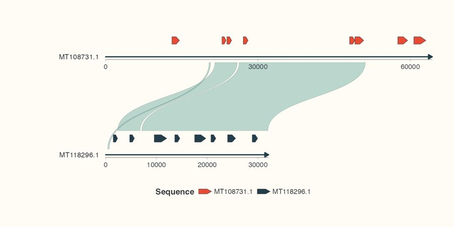</a><figcaption>第一张图：两条真实随包序列、基因箭头及已有比对区间 · <span class="figure-hint">点击放大查看</span></figcaption></figure>

### 如何阅读这个快速结果 {#installation-read}
箭头保留真实链方向，颜色只区分所属序列；连线是已有比对区间，绘图没有生成新的同源结论。该小图选择线性视图便于读位置；完整弦图教学从序列骨架开始。

### 可选：保存快速结果 {#installation-save}
仅当上方代码已运行、p_first已创建时执行：


```{r example-4, eval=FALSE}
ggsave("first-comparison.png", p_first, width = 10, height = 5, units = "in", dpi = 144)
```


预览与保存使用相同10×5 in尺寸，参见[输出](#output)。

### 常见运行问题 {#installation-troubleshooting}
找不到对象时，检查是否运行了本页准备；找不到函数时先确认版本。保存位置由getwd()决定。其他格式的可选依赖只在相应专题需要，基础模块不要求安装Bioconductor或Biopython。


## 选择合适的学习模块 {#modes}

<div class="task-intro"><p>为你的问题选择布局，而不是为了圆形效果改变问题。下面用同一批真实随包记录比较三种表达。</p></div>

### 怎么选择？ {#modes-choose}
| 场景 | 更合适的图 | 应避免的误读 |
| --- | --- | --- |
| 几条序列之间的总体对应关系 | 弦图 | 连线交叉本身不等于倒位 |
| 一条质粒或环形序列上的注释 | 圆图 | 多条序列不能塞进单序列坐标 |
| 比较位置、基因顺序与局部邻域 | 共线性图 | 显示对齐或翻转不等于生物学结论 |

三种图都消费已有数据，不计算新的 BLAST 比对。先尝试下面的最小组合，再进入[原始记录流程](#real-data)、[完整质粒图](#plasmids)或[局部同源比较](#homology)。

### 本页准备 {#modes-prepare}
在新的 R 会话中先运行下方代码，再按页面顺序继续。配色和排版是可选的显示设置，输入只选择需要的列。

<details class="preparation"><summary>准备代码 · 在本页运行一次</summary>

```{r example-5, eval=FALSE}
library(ggchord)
library(dplyr)
data(seq_data_example)
data(ribbon_data_example)
data(gene_data_example)
seqs <- seq_data_example |>
  select(accver, length)
links <- ribbon_data_example |>
  select(qaccver, saccver, qstart, qend, sstart, send)
# The fixture preserves biological strands separately from its old display strands.
genes <- gene_data_example |>
  transmute(accver, start, end, strand = source_strand)

# Optional appearance choices; none of these columns or scales is required input.
library(ggchord)
seq_palette <- setNames(
  c("#E64B35", "#233E4A", "#269B82", "#D59B17"),
  c("MT108731.1", "MT118296.1", "OQ646790.1", "OR222515.1")
)
gene_palette <- c("+" = "#CE1536", "-" = "#346B9D", "." = "#8291A6")

library(ggchord)
feature_palette <- c(
  CDS = "#993366", promoter = "#31849B", rep_origin = "#F1E51D",
  primer_bind = "#A020F0", misc_feature = "#A6ACB3", protein_bind = "#31849B"
)

library(ggchord)
doc_background <- "#FFFCF5"
identity_palette <- c("#303B71", "#36537D", "#269B82", "#A5D52C", "#ECEB31")
identity_values <- c(0, 0.5, 0.8, 0.9, 1)
identity_breaks <- c(0, 50, 80, 90, 100)
doc_legend_theme <- theme(
  legend.title = element_text(size = 13, face = "bold"),
  legend.text = element_text(size = 11),
  legend.key.width = unit(9, "mm"), legend.key.height = unit(5, "mm"),
  legend.spacing.x = unit(9, "mm"), legend.spacing.y = unit(7, "mm"),
  legend.margin = margin(l = 4, r = 4, unit = "mm")
)
sequence_guide <- guide_ggchord_legend(nrow = 1, theme = doc_legend_theme)
strand_guide <- guide_ggchord_legend(
  nrow = 1, override.aes = list(strand = c("+", "-")), theme = doc_legend_theme
)
identity_guide <- guide_ggchord_colourbar(
  position = "left", direction = "vertical",
  theme = theme(
    legend.key.height = unit(75, "mm"), legend.key.width = unit(5, "mm"),
    legend.title = element_text(size = 13, face = "bold"),
    legend.text = element_text(size = 11), legend.margin = margin(r = 7, unit = "mm")
  )
)
doc_theme <- theme_ggchord_publication(
  axis.text = element_text(size = 11),
  axis.text.check.overlap = TRUE
) +
  theme(
    legend.position = "bottom",
    legend.title = element_text(size = 13, face = "bold"),
    legend.text = element_text(size = 11),
    legend.key.width = unit(9, "mm"), legend.key.height = unit(5, "mm"),
    legend.spacing.x = unit(9, "mm"), legend.spacing.y = unit(7, "mm"),
    legend.box.spacing = unit(6, "mm"),
    plot.background = element_rect(fill = doc_background, colour = NA),
    panel.background = element_blank(),
    plot.title = element_text(face = "bold", size = 18),
    plot.subtitle = element_text(size = 10, colour = "#5C625A"),
    plot.margin = margin(14, 18, 14, 18)
  )
doc_axis <- function(coordinates = "relative") {
  scale_seq_position_continuous(
    coordinates = coordinates, n.breaks = 3, minor_breaks = NULL,
    labels = function(x) format(x, scientific = FALSE, big.mark = ",", trim = TRUE)
  )
}

library(dplyr)
data(plasmid_example_pUC19)
plasmid_seq <- plasmid_example_pUC19 |>
  select(accver, length)
feature_source <- find_common_features(plasmid_example_pUC19)
features <- feature_source |>
  select(accver, start, end, strand, type, anno)
```

</details>

下列对象都可按普通 ggplot 组合，
打印或使用 `ggsave()` 保存。

### 弦图：比较多条序列 {#modes-chord}

```{r example-6, eval=FALSE}
p_chord <- ggchord(seq_data = seqs, ribbon_data = links, gene_data = genes) +
  geom_link_ribbon(aes(ribbon_fill = qaccver), alpha = .7) +
  scale_ribbon_fill_manual(values = seq_palette, guide = "none") +
  geom_seq(show.legend = FALSE) +
  geom_gene(position = position_strand(.1), width = .04) +
  geom_seq_label(size = 4, seq_label_radius = .84, seq_label_hjust = .5) +
  coord_chord() +
  scale_seq_colour_manual(values = seq_palette) +
  scale_gene_fill_manual(values = gene_palette) +
  doc_theme
p_chord
```

<figure class="documentation-figure"><a class="figure-link" href="tutorial-assets/chord.jpg" title="点击放大查看">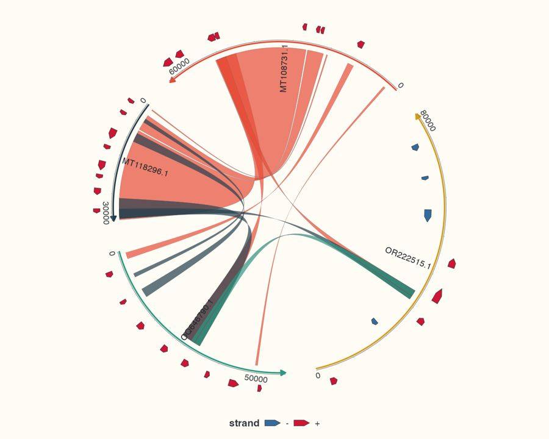</a><figcaption>随包序列与已有比对区间的弦图 · <span class="figure-hint">点击放大查看</span></figcaption></figure>

连接按 query 序列标识配色，与骨架使用同一类别色板；这不表示相似度或同源基因分组。按真实相似度配色见[原始记录教程](#real-data-chord)。
`coord_chord()` 控制全局旋转和拟合。逐序列半径、曲率、间隙和方向属于 `geom_seq()`。
连接控制点为 NULL 时，弦图保留历史的原点路径，并不表示各模式统一使用直线。
区间连接默认避障为 `uniform`，点连接默认避障为 `none`。

### 共线性图：对齐局部比较 {#modes-collinear}

```{r example-7, eval=FALSE}
anchors <- genes |>
  group_by(accver) |>
  slice_max(end - start, n = 1, with_ties = FALSE) |>
  ungroup() |>
  select(accver, start, end)
p_collinear <- ggchord(seq_data = seqs, ribbon_data = links, gene_data = genes) +
  geom_link_ribbon(aes(ribbon_fill = qaccver), alpha = .7) +
  scale_ribbon_fill_manual(values = seq_palette, guide = "none") +
  geom_seq() +
  geom_gene(position = position_strand(.1)) +
  geom_seq_label(size = 4) +
  coord_collinear(anchor = anchors, align = "center", orientation = "auto") +
  doc_axis() +
  scale_seq_colour_manual(values = seq_palette) +
  scale_gene_fill_manual(values = gene_palette) +
  doc_theme
p_collinear
```

<figure class="documentation-figure"><a class="figure-link" href="tutorial-assets/collinear.jpg" title="点击放大查看">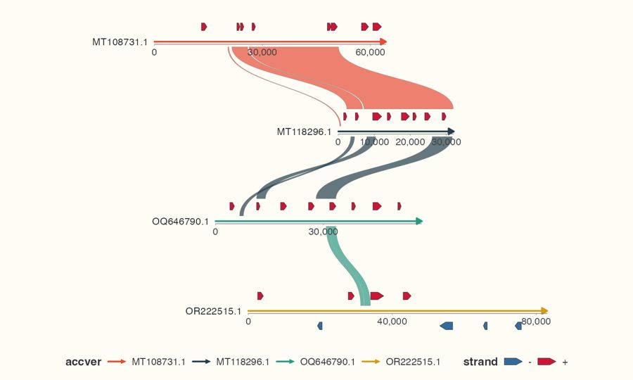</a><figcaption>按选定注释锚定的随包序列共线性图 · <span class="figure-hint">点击放大查看</span></figcaption></figure>
本例分别选每条序列最长的已知基因作显示锚点，不将它们当作同源基因。
`anchor` 对齐指定区间，`orientation = "auto"` 按现有证据选择支持的显示方向。
应查看方向诊断，不能直接把显示翻转解释为生物学倒位。区间连接默认连接相邻显示行；
使用 `adjacent_only = FALSE` 或明确 `pairs` 保留其他连接。非相邻边框默认虚线，
显式样式优先。这些规则与弦图不同。[局部视图与分段](#views)为裁剪或局部翻转
保留源坐标。

### 圆图：注释单条序列 {#modes-circular}

```{r example-8, eval=FALSE}
circle_features <- features |>
  filter(type %in% c("CDS", "rep_origin"))
p_circular <- ggchord(seq_data = plasmid_seq) +
  geom_seq() +
  geom_feature(aes(feature_fill = type), data = circle_features, position = position_plasmid()) +
  geom_feature_label_repel(data = circle_features, position = position_plasmid(), size = 4) +
  geom_seq_center_label() +
  scale_feature_fill_manual(values = feature_palette, breaks = unique(circle_features$type)) +
  coord_circular() +
  doc_theme
p_circular
```

<figure class="documentation-figure"><a class="figure-link" href="tutorial-assets/circular.jpg" title="点击放大查看">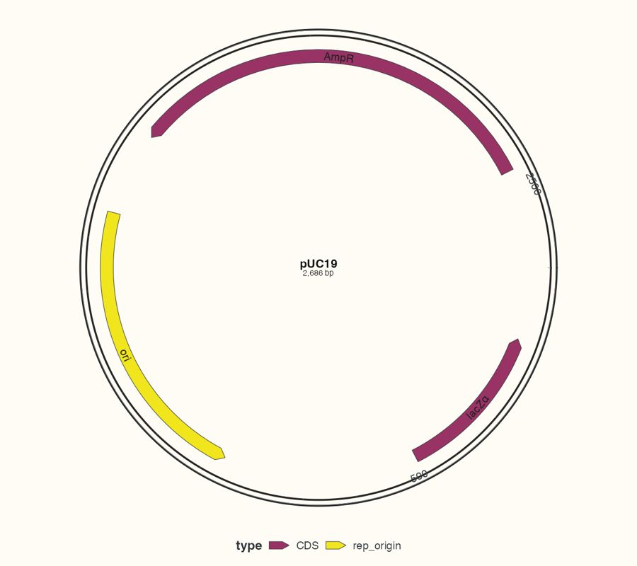</a><figcaption>pUC19 注释的单序列圆图 · <span class="figure-hint">点击放大查看</span></figcaption></figure>
本例只选 CDS 与复制起点显示，保留完整序列的 bp 刻度。
`coord_circular()` 要求单条序列。通用注释可带未知链。
`geom_feature_plasmid()` 是有独立默认值的便利预设，应在需要这些默认值时显式选择。
引物和酶切图层见[识别注释](#recognition)。

### 完成后检查 {#modes-check-result}
先看序列数：单序列注释用圆图；多序列总体连接用弦图；位置、距离或邻域比较用共线性图。

<div class="next-step">继续：<a href="#installation">开始使用：绘制第一张图 →</a></div>


## 1.1 输入表与字段含义 {#chord-data}

先认识表格，再决定使用哪些图层。弦图是ggchord最早的核心视图；早期工作流围绕BLAST比对表展开，因此保留了紧凑的BLAST风格字段。这里的“多序列比对弦图”展示多条序列间已有的区间比对，绘图本身不执行多序列比对算法。

### 三张表的最小形状 {#chord-data-tables}
| 表 | 必需列 | 每行的含义 |
| --- | --- | --- |
| seq_data | accver, length | 一条序列及其完整长度，bp |
| ribbon_data | qaccver, saccver, qstart, qend, sstart, send | 两条序列上的一对已有比对区间 |
| gene_data | accver, start, end, strand | 一个有已知正负链的基因区间 |

只画骨架时，后两张表都不需要。通用注释可保留未知链，请使用 `geom_feature()`，不要冒充有方向的基因。

### 名称与可选列 {#chord-data-names}
`accver` 源于 accession.version，但值可为任意稳定字符串，例如自己的contig名称；不会自动添加或删除版本号。`q` 是query，`s` 是subject，所以 `qstart` 是query端起点。两个标识都必须能在序列表中找到。

`pident` 是百分比相似度，仅映射或筛选相似度时需要；比对表的 `length` 是比对长度，序列表的 `length` 是完整序列长度，二者不能混用。`evalue`、`bitscore`、`qlen`、`slen` 按分析需求保留。基因的 `anno` 是可选注释文字；要画标签时提供它。其他类别列可供 `aes()` 映射，不是强制输入。

### 查看真实表格 {#chord-data-inspect}
```{r example-9, eval=FALSE}
library(ggchord)
library(dplyr)
seq_data_example |> select(accver, length) |> slice_head(n = 3)
ribbon_data_example |> select(qaccver, saccver, qstart, qend, sstart, send) |> slice_head(n = 3)
gene_data_example |> transmute(accver, start, end, strand = source_strand, anno) |> slice_head(n = 3)
```

这些行来自随包真实记录；原始生物学链在该历史教学对象的 `source_strand` 中，因此显式恢复。自己的GFF3读入结果直接使用其 `strand`。

### 坐标与方向 {#chord-data-coordinates}
使用一基闭区间bp坐标。基因 `start <= end`，方向另存于 `strand`。连接端点次序可表达反向比对；不要一律排序。未知完整长度不能由最大特征终点推断。详细契约见[数据与坐标](#data-coordinates)。

继续：[1.2 从分析结果到输入表](#chord-import)。


## 1.2 生成与导入比对数据 {#chord-import}

先有序列与分析结果，再由ggchord读取；没有比对表时不应为了连线伪造同源关系。

### 从FASTA与GFF3开始 {#chord-import-files}
解压[教学输入包](https://github.com/DangJem/ggchord/tree/main/examples)，使当前目录包含 `examples/`。FASTA提供完整长度，GFF3提供区间和链；保留原始记录，在显示表中选择必要字段。

<details class="preparation"><summary>准备代码 · 在本页运行一次</summary>

```{r example-10, eval=FALSE}
# Optional appearance choices; none of these columns or scales is required input.
library(ggchord)
seq_palette <- setNames(
  c("#E64B35", "#233E4A", "#269B82", "#D59B17"),
  c("MT108731.1", "MT118296.1", "OQ646790.1", "OR222515.1")
)
gene_palette <- c("+" = "#CE1536", "-" = "#346B9D", "." = "#8291A6")

library(ggchord)
doc_background <- "#FFFCF5"
identity_palette <- c("#303B71", "#36537D", "#269B82", "#A5D52C", "#ECEB31")
identity_values <- c(0, 0.5, 0.8, 0.9, 1)
identity_breaks <- c(0, 50, 80, 90, 100)
doc_legend_theme <- theme(
  legend.title = element_text(size = 13, face = "bold"),
  legend.text = element_text(size = 11),
  legend.key.width = unit(9, "mm"), legend.key.height = unit(5, "mm"),
  legend.spacing.x = unit(9, "mm"), legend.spacing.y = unit(7, "mm"),
  legend.margin = margin(l = 4, r = 4, unit = "mm")
)
sequence_guide <- guide_ggchord_legend(nrow = 1, theme = doc_legend_theme)
strand_guide <- guide_ggchord_legend(
  nrow = 1, override.aes = list(strand = c("+", "-")), theme = doc_legend_theme
)
identity_guide <- guide_ggchord_colourbar(
  position = "left", direction = "vertical",
  theme = theme(
    legend.key.height = unit(75, "mm"), legend.key.width = unit(5, "mm"),
    legend.title = element_text(size = 13, face = "bold"),
    legend.text = element_text(size = 11), legend.margin = margin(r = 7, unit = "mm")
  )
)
doc_theme <- theme_ggchord_publication(
  axis.text = element_text(size = 11),
  axis.text.check.overlap = TRUE
) +
  theme(
    legend.position = "bottom",
    legend.title = element_text(size = 13, face = "bold"),
    legend.text = element_text(size = 11),
    legend.key.width = unit(9, "mm"), legend.key.height = unit(5, "mm"),
    legend.spacing.x = unit(9, "mm"), legend.spacing.y = unit(7, "mm"),
    legend.box.spacing = unit(6, "mm"),
    plot.background = element_rect(fill = doc_background, colour = NA),
    panel.background = element_blank(),
    plot.title = element_text(face = "bold", size = 18),
    plot.subtitle = element_text(size = 10, colour = "#5C625A"),
    plot.margin = margin(14, 18, 14, 18)
  )
doc_axis <- function(coordinates = "relative") {
  scale_seq_position_continuous(
    coordinates = coordinates, n.breaks = 3, minor_breaks = NULL,
    labels = function(x) format(x, scientific = FALSE, big.mark = ",", trim = TRUE)
  )
}
```

</details>

```{r example-11, eval=FALSE}
library(ggchord)
library(dplyr)
library(purrr)
library(tidyr)
# Original repository records; extract the tutorial input bundle first.
show_sequences <- read_fasta_lengths(files = "examples/fasta/*.fna") |>
  select(accver, length)
show_annotations <- read_gff3(files = "examples/gff3/*.gff3", unstranded = "keep")
show_genes <- show_annotations |>
  filter(type == "CDS") |>
  select(accver, start, end, strand, anno)
show_alignments <- read_blast(files = "examples/blastn-standard/*.tsv")
# At most three substantial observed HSPs per pair; no coordinates are invented.
show_links <- show_alignments |>
  filter(length >= 900, pident >= 75) |>
  group_by(qaccver, saccver) |>
  slice_max(length, n = 3, with_ties = FALSE) |>
  ungroup()
# Select up to four source CDS per sequence, spread across annotation order.
# No feature is moved or invented; keep complete source tables separately.
show_features <- show_genes |>
  filter(end - start + 1 >= 500) |>
  group_by(accver) |>
  arrange(start, .by_group = TRUE) |>
  mutate(display_bin = ntile(row_number(), 4), informative = !is.na(anno) & anno != "hypothetical protein") |>
  group_by(accver, display_bin) |>
  arrange(desc(informative), desc(end - start), .by_group = TRUE) |>
  slice_head(n = 1) |>
  ungroup() |>
  select(accver, start, end, strand, anno)
# Also retain well-separated negative-strand CDS, if not already represented.
show_reverse <- show_genes |>
  filter(strand == "-", end - start + 1 >= 500) |>
  group_by(accver) |>
  arrange(start, .by_group = TRUE) |>
  slice(c(1, n())) |>
  ungroup()
show_features <- bind_rows(show_features, show_reverse) |>
  distinct(accver, start, end, strand, .keep_all = TRUE) |>
  arrange(accver, start)
show_labels <- show_features
show_optimization <- optimize_ggchord_layout(
  show_sequences, show_links,
  optimize = "orientation", weight = "length"
)
```


`show_alignments` 保留32条原始HSP，`show_links` 明确筛为12条；`show_genes` 保留全部266条CDS，`show_features` 按长度至少500 bp、序列内注释顺序分四组各选一个，并补充有来源的负链首尾注释用于展示。筛选不是重跑比对，也不证明功能同源。

坐标排查时可用tidyr将四个端点列转成长表，原始连接表保持原样：


```{r example-12, eval=FALSE}
link_endpoints <- show_links |>
  select(qaccver, saccver, qstart, qend, sstart, send) |>
  pivot_longer(
    cols = c(qstart, qend, sstart, send),
    names_to = c("side", "endpoint"), names_pattern = "([qs])(start|end)",
    values_to = "position"
  )
head(link_endpoints)
```


### 用BLAST产生自己的结果 {#chord-import-blast}
以下命令是分析者在安装BLAST后对自己的文件执行的生产步骤，网站构建不运行它们。

```sh
blastn -query query.fna -subject subject.fna -outfmt 6 -out result.tsv
```

```{r example-13, eval=FALSE}
library(ggchord)
blast_source <- read_blast(file = "result.tsv")
```

无自定义字段列表的 `-outfmt 6` 为标准12列表，7另带注释；完全不写outfmt是其他格式。query/subject ID由读取器映射到qaccver/saccver。参见[NCBI字段说明](https://www.ncbi.nlm.nih.gov/sites/books/NBK279684/table/appendices.T.options_common_to_all_blast/)和[核酸/蛋白比对教程](#alignments)。随站历史HSP只是格式转换，没有冒充本轮新BLAST结果。

### 已有其他格式时 {#chord-import-alternatives}
| 来源 | 入口 | 注意 |
| --- | --- | --- |
| 已读表格 | as_ggchord_seq/feature/link | 显式mapping映射角色，保留原表 |
| BED、PAF | read_bed、read_paf | 读取器只转换一次零基半开坐标 |
| GenBank | read_genbank | 需要可用Biopython；保留记录与分段来源 |
| GRanges、Seqinfo | as_ggchord_feature、as_ggchord_seq | 完整长度来自Seqinfo，未知链不转成正链 |
| GInteractions | as_ggchord_link、as_ggchord_seq | 第一锚点为query；仍需可靠完整长度 |

这些适配器对应[用户issue #2](https://github.com/DangJem/ggchord/issues/2)提出的需求。当前代码已有入口；issue中的历史“开发版未经测试”不等于现阶段所有组合均已验证。本地缺失可选包的路径会明确跳过。[格式专题](#formats-ranges)给出可选对象的完整代码和限制。

继续：[1.3 从骨架逐层画起](#chord-build)。


## 1.3 从骨架逐层添加 {#chord-build}

先完成每个小步骤，再查看综合图。四步复用同一组数据，直接比较每次新增图层的作用。

### 本页准备 {#chord-build-prepare}
先解压[教学输入](https://github.com/DangJem/ggchord/tree/main/examples)。
<details class="preparation"><summary>准备代码 · 在本页运行一次</summary>

```{r example-14, eval=FALSE}
# Optional appearance choices; none of these columns or scales is required input.
library(ggchord)
seq_palette <- setNames(
  c("#E64B35", "#233E4A", "#269B82", "#D59B17"),
  c("MT108731.1", "MT118296.1", "OQ646790.1", "OR222515.1")
)
gene_palette <- c("+" = "#CE1536", "-" = "#346B9D", "." = "#8291A6")

library(ggchord)
doc_background <- "#FFFCF5"
identity_palette <- c("#303B71", "#36537D", "#269B82", "#A5D52C", "#ECEB31")
identity_values <- c(0, 0.5, 0.8, 0.9, 1)
identity_breaks <- c(0, 50, 80, 90, 100)
doc_legend_theme <- theme(
  legend.title = element_text(size = 13, face = "bold"),
  legend.text = element_text(size = 11),
  legend.key.width = unit(9, "mm"), legend.key.height = unit(5, "mm"),
  legend.spacing.x = unit(9, "mm"), legend.spacing.y = unit(7, "mm"),
  legend.margin = margin(l = 4, r = 4, unit = "mm")
)
sequence_guide <- guide_ggchord_legend(nrow = 1, theme = doc_legend_theme)
strand_guide <- guide_ggchord_legend(
  nrow = 1, override.aes = list(strand = c("+", "-")), theme = doc_legend_theme
)
identity_guide <- guide_ggchord_colourbar(
  position = "left", direction = "vertical",
  theme = theme(
    legend.key.height = unit(75, "mm"), legend.key.width = unit(5, "mm"),
    legend.title = element_text(size = 13, face = "bold"),
    legend.text = element_text(size = 11), legend.margin = margin(r = 7, unit = "mm")
  )
)
doc_theme <- theme_ggchord_publication(
  axis.text = element_text(size = 11),
  axis.text.check.overlap = TRUE
) +
  theme(
    legend.position = "bottom",
    legend.title = element_text(size = 13, face = "bold"),
    legend.text = element_text(size = 11),
    legend.key.width = unit(9, "mm"), legend.key.height = unit(5, "mm"),
    legend.spacing.x = unit(9, "mm"), legend.spacing.y = unit(7, "mm"),
    legend.box.spacing = unit(6, "mm"),
    plot.background = element_rect(fill = doc_background, colour = NA),
    panel.background = element_blank(),
    plot.title = element_text(face = "bold", size = 18),
    plot.subtitle = element_text(size = 10, colour = "#5C625A"),
    plot.margin = margin(14, 18, 14, 18)
  )
doc_axis <- function(coordinates = "relative") {
  scale_seq_position_continuous(
    coordinates = coordinates, n.breaks = 3, minor_breaks = NULL,
    labels = function(x) format(x, scientific = FALSE, big.mark = ",", trim = TRUE)
  )
}

library(ggchord)
library(dplyr)
library(purrr)
library(tidyr)
# Original repository records; extract the tutorial input bundle first.
show_sequences <- read_fasta_lengths(files = "examples/fasta/*.fna") |>
  select(accver, length)
show_annotations <- read_gff3(files = "examples/gff3/*.gff3", unstranded = "keep")
show_genes <- show_annotations |>
  filter(type == "CDS") |>
  select(accver, start, end, strand, anno)
show_alignments <- read_blast(files = "examples/blastn-standard/*.tsv")
# At most three substantial observed HSPs per pair; no coordinates are invented.
show_links <- show_alignments |>
  filter(length >= 900, pident >= 75) |>
  group_by(qaccver, saccver) |>
  slice_max(length, n = 3, with_ties = FALSE) |>
  ungroup()
# Select up to four source CDS per sequence, spread across annotation order.
# No feature is moved or invented; keep complete source tables separately.
show_features <- show_genes |>
  filter(end - start + 1 >= 500) |>
  group_by(accver) |>
  arrange(start, .by_group = TRUE) |>
  mutate(display_bin = ntile(row_number(), 4), informative = !is.na(anno) & anno != "hypothetical protein") |>
  group_by(accver, display_bin) |>
  arrange(desc(informative), desc(end - start), .by_group = TRUE) |>
  slice_head(n = 1) |>
  ungroup() |>
  select(accver, start, end, strand, anno)
# Also retain well-separated negative-strand CDS, if not already represented.
show_reverse <- show_genes |>
  filter(strand == "-", end - start + 1 >= 500) |>
  group_by(accver) |>
  arrange(start, .by_group = TRUE) |>
  slice(c(1, n())) |>
  ungroup()
show_features <- bind_rows(show_features, show_reverse) |>
  distinct(accver, start, end, strand, .keep_all = TRUE) |>
  arrange(accver, start)
show_labels <- show_features
show_optimization <- optimize_ggchord_layout(
  show_sequences, show_links,
  optimize = "orientation", weight = "length"
)
```

</details>

### 第一步：只有序列骨架 {#chord-build-backbones}

```{r example-15, eval=FALSE}
p_learn_seq <- ggchord(seq_data = show_sequences) +
  geom_seq() +
  geom_seq_label(size = 4) +
  scale_seq_colour_manual(
    values = seq_palette, name = "Sequence",
    guide = sequence_guide
  ) +
  scale_seq_position_continuous(breaks = c(0, 20000, 40000), minor_breaks = NULL) +
  coord_chord() +
  doc_theme
p_learn_seq
```

<figure class="documentation-figure"><a class="figure-link" href="tutorial-assets/learnseq.jpg" title="点击放大查看">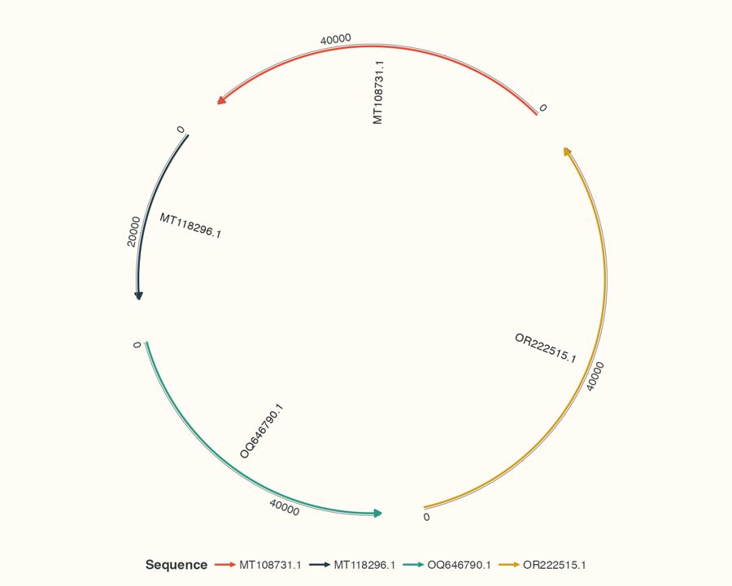</a><figcaption>弦图第一步：序列骨架 · <span class="figure-hint">点击放大查看</span></figcaption></figure>
`geom_seq()` 画骨架，`geom_seq_label()` 标识序列，`coord_chord()` 选择整体视图；此时不需要连接或基因输入。

### 第二步：加入已有比对 {#chord-build-links}

```{r example-16, eval=FALSE}
p_learn_links <- p_learn_seq +
  geom_link_ribbon(
    aes(ribbon_fill = pident),
    data = show_links,
    adjacent_only = FALSE, link_avoid = "smooth"
  ) +
  scale_ribbon_fill_gradientn(
    colours = identity_palette, values = identity_values, limits = c(0, 100),
    breaks = identity_breaks, name = "Identity (%)", guide = identity_guide
  )
p_learn_links
```

<figure class="documentation-figure"><a class="figure-link" href="tutorial-assets/learnlinks.jpg" title="点击放大查看">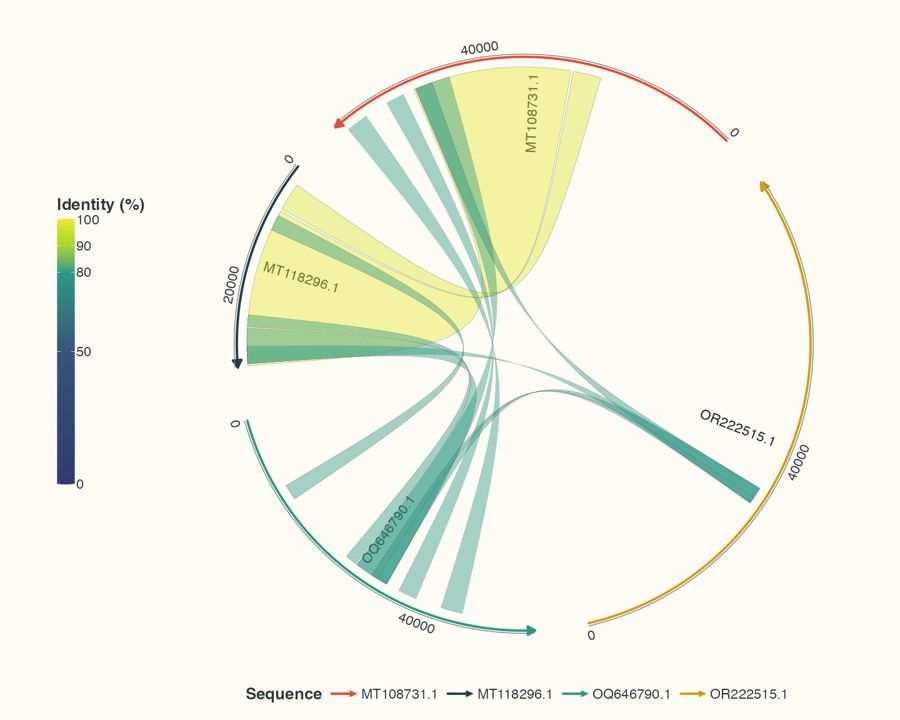</a><figcaption>弦图第二步：已有比对 · <span class="figure-hint">点击放大查看</span></figcaption></figure>
相似度由aes和scale表达；显式保留非相邻连接，让后面替换坐标时仍使用相同的连接数据。

### 第三步：加入精选基因 {#chord-build-genes}

```{r example-17, eval=FALSE}
p_learn_genes <- p_learn_links +
  geom_gene(data = show_features, position = position_strand(0.08)) +
  scale_gene_fill_manual(values = gene_palette, breaks = c("+", "-"), name = "Strand") +
  guides(gene_fill = strand_guide)
p_learn_genes
```

<figure class="documentation-figure"><a class="figure-link" href="tutorial-assets/learngenes.jpg" title="点击放大查看">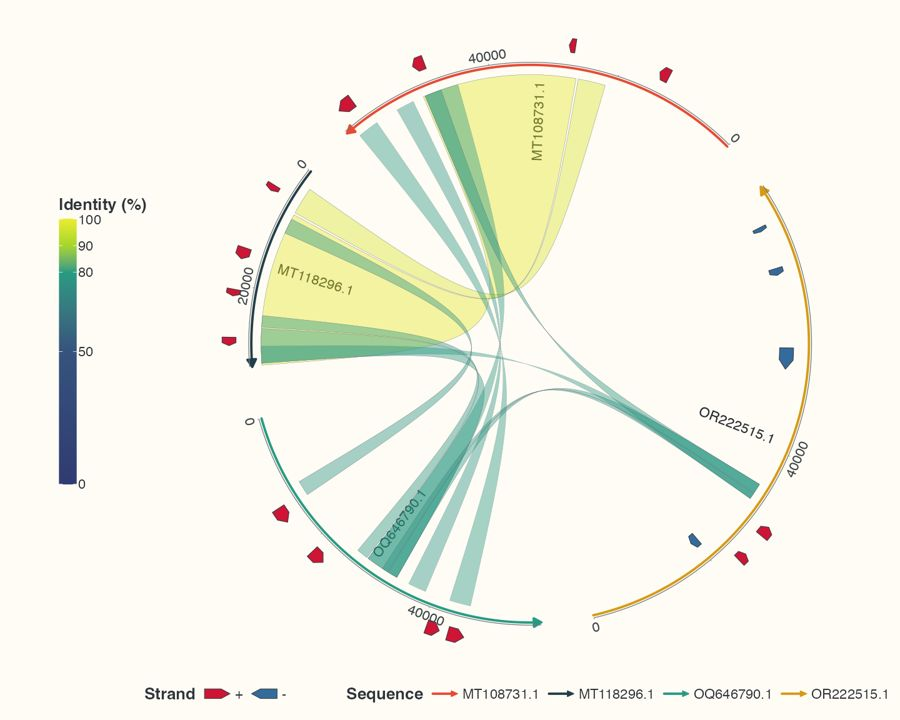</a><figcaption>弦图第三步：精选基因 · <span class="figure-hint">点击放大查看</span></figcaption></figure>
`position_strand()` 将正负链分到骨架两侧。仅展示真实筛选的注释，原表仍保留全部CDS。

### 第四步：给每个展示特征加标签 {#chord-build-labels}

```{r example-18, eval=FALSE}
p_learn_labels <- p_learn_genes +
  geom_gene_label_repel(
    data = show_features, label_layout = "arc", label_wrap = 24,
    label_max_lines = 3, position = position_strand(0.08), size = 3
  )
p_learn_labels
```

<figure class="documentation-figure"><a class="figure-link" href="tutorial-assets/learnlabels.jpg" title="点击放大查看">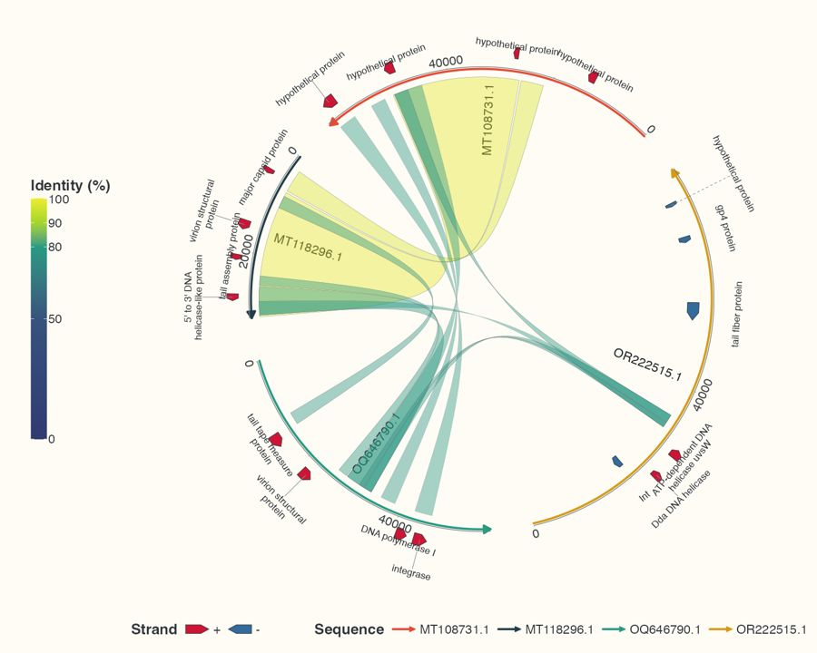</a><figcaption>弦图第四步：逐一添加标签 · <span class="figure-hint">点击放大查看</span></figcaption></figure>
同一特征表交给箭头层与repel标签层；标签层不另行筛选。与单独添加图层相比，改名、删行或排序会改变业务含义，应保留明确中间对象。

继续：[1.4 方向、半径、曲率和避障](#chord-tuning)。


## 1.4 方向、曲率与避障 {#chord-tuning}

这些调整属于不同职责：geom控制逐序列几何，Position控制局部放置，coord控制整体视图，scale与guide负责颜色和图例。

### 本页准备 {#chord-tuning-prepare}
先解压[教学输入](https://github.com/DangJem/ggchord/tree/main/examples)。
<details class="preparation"><summary>准备代码 · 在本页运行一次</summary>

```{r example-19, eval=FALSE}
# Optional appearance choices; none of these columns or scales is required input.
library(ggchord)
seq_palette <- setNames(
  c("#E64B35", "#233E4A", "#269B82", "#D59B17"),
  c("MT108731.1", "MT118296.1", "OQ646790.1", "OR222515.1")
)
gene_palette <- c("+" = "#CE1536", "-" = "#346B9D", "." = "#8291A6")

library(ggchord)
doc_background <- "#FFFCF5"
identity_palette <- c("#303B71", "#36537D", "#269B82", "#A5D52C", "#ECEB31")
identity_values <- c(0, 0.5, 0.8, 0.9, 1)
identity_breaks <- c(0, 50, 80, 90, 100)
doc_legend_theme <- theme(
  legend.title = element_text(size = 13, face = "bold"),
  legend.text = element_text(size = 11),
  legend.key.width = unit(9, "mm"), legend.key.height = unit(5, "mm"),
  legend.spacing.x = unit(9, "mm"), legend.spacing.y = unit(7, "mm"),
  legend.margin = margin(l = 4, r = 4, unit = "mm")
)
sequence_guide <- guide_ggchord_legend(nrow = 1, theme = doc_legend_theme)
strand_guide <- guide_ggchord_legend(
  nrow = 1, override.aes = list(strand = c("+", "-")), theme = doc_legend_theme
)
identity_guide <- guide_ggchord_colourbar(
  position = "left", direction = "vertical",
  theme = theme(
    legend.key.height = unit(75, "mm"), legend.key.width = unit(5, "mm"),
    legend.title = element_text(size = 13, face = "bold"),
    legend.text = element_text(size = 11), legend.margin = margin(r = 7, unit = "mm")
  )
)
doc_theme <- theme_ggchord_publication(
  axis.text = element_text(size = 11),
  axis.text.check.overlap = TRUE
) +
  theme(
    legend.position = "bottom",
    legend.title = element_text(size = 13, face = "bold"),
    legend.text = element_text(size = 11),
    legend.key.width = unit(9, "mm"), legend.key.height = unit(5, "mm"),
    legend.spacing.x = unit(9, "mm"), legend.spacing.y = unit(7, "mm"),
    legend.box.spacing = unit(6, "mm"),
    plot.background = element_rect(fill = doc_background, colour = NA),
    panel.background = element_blank(),
    plot.title = element_text(face = "bold", size = 18),
    plot.subtitle = element_text(size = 10, colour = "#5C625A"),
    plot.margin = margin(14, 18, 14, 18)
  )
doc_axis <- function(coordinates = "relative") {
  scale_seq_position_continuous(
    coordinates = coordinates, n.breaks = 3, minor_breaks = NULL,
    labels = function(x) format(x, scientific = FALSE, big.mark = ",", trim = TRUE)
  )
}

library(ggchord)
library(dplyr)
library(purrr)
library(tidyr)
# Original repository records; extract the tutorial input bundle first.
show_sequences <- read_fasta_lengths(files = "examples/fasta/*.fna") |>
  select(accver, length)
show_annotations <- read_gff3(files = "examples/gff3/*.gff3", unstranded = "keep")
show_genes <- show_annotations |>
  filter(type == "CDS") |>
  select(accver, start, end, strand, anno)
show_alignments <- read_blast(files = "examples/blastn-standard/*.tsv")
# At most three substantial observed HSPs per pair; no coordinates are invented.
show_links <- show_alignments |>
  filter(length >= 900, pident >= 75) |>
  group_by(qaccver, saccver) |>
  slice_max(length, n = 3, with_ties = FALSE) |>
  ungroup()
# Select up to four source CDS per sequence, spread across annotation order.
# No feature is moved or invented; keep complete source tables separately.
show_features <- show_genes |>
  filter(end - start + 1 >= 500) |>
  group_by(accver) |>
  arrange(start, .by_group = TRUE) |>
  mutate(display_bin = ntile(row_number(), 4), informative = !is.na(anno) & anno != "hypothetical protein") |>
  group_by(accver, display_bin) |>
  arrange(desc(informative), desc(end - start), .by_group = TRUE) |>
  slice_head(n = 1) |>
  ungroup() |>
  select(accver, start, end, strand, anno)
# Also retain well-separated negative-strand CDS, if not already represented.
show_reverse <- show_genes |>
  filter(strand == "-", end - start + 1 >= 500) |>
  group_by(accver) |>
  arrange(start, .by_group = TRUE) |>
  slice(c(1, n())) |>
  ungroup()
show_features <- bind_rows(show_features, show_reverse) |>
  distinct(accver, start, end, strand, .keep_all = TRUE) |>
  arrange(accver, start)
show_labels <- show_features
show_optimization <- optimize_ggchord_layout(
  show_sequences, show_links,
  optimize = "orientation", weight = "length"
)
```

</details>

### 先检查方向证据 {#chord-tuning-orientation}
`show_optimization` 只优化显示方向，保留序列顺序；按真实比对长度加权。检查其seq_orientation与score_before/score_after，不能把显示翻转解释为新的生物学倒位结论。自动优化是启发式，不保证全局最优。

### 将功能组合成可读的图 {#chord-tuning-parameters}

```{r example-20, eval=FALSE}
show_curvature <- c(
  "MT108731.1" = 0, "MT118296.1" = 0.85,
  "OQ646790.1" = 1.1, "OR222515.1" = -0.4
)
show_radius <- c(
  "MT108731.1" = 1, "MT118296.1" = 1.05,
  "OQ646790.1" = 0.95, "OR222515.1" = 1.08
)
p_show_chord <- ggchord(show_sequences, show_links, show_features) +
  geom_link_ribbon(aes(ribbon_fill = pident), link_avoid = "smooth", alpha = 0.58, linewidth = 0.18) +
  geom_seq(
    seq_orientation = show_optimization$seq_orientation,
    seq_curvature = show_curvature, seq_radius = show_radius,
    seq_gap = 0.06, linewidth = 1.1
  ) +
  geom_gene(position = position_strand(0.07), width = 0.035) +
  geom_gene_label_repel(
    data = show_labels, label_layout = "radial", label_wrap = 24,
    size = 3.1, label_max_lines = 3, position = position_strand(0.07)
  ) +
  geom_seq_label(size = 4, seq_label_radius = 0.84, seq_label_hjust = 0.5) +
  scale_seq_colour_manual(
    values = seq_palette, name = "Sequence",
    guide = sequence_guide
  ) +
  scale_gene_fill_manual(values = gene_palette, breaks = c("+", "-"), name = "Strand") +
  scale_ribbon_fill_gradientn(
    colours = identity_palette, values = identity_values,
    limits = c(0, 100), breaks = identity_breaks, name = "Identity (%)", guide = identity_guide
  ) +
  guides(gene_fill = strand_guide) +
  scale_seq_position_continuous(breaks = c(0, 20000, 40000), minor_breaks = NULL) +
  coord_chord(rotation = 50) +
  doc_theme +
  labs(
    title = "Four genomes, one connected view",
    subtitle = "Signed curvature and radius · selected strand-aware CDS · local ribbon clearance"
  )
p_show_chord
```

<figure class="documentation-figure"><a class="figure-link" href="tutorial-assets/showcasechord.jpg" title="点击放大查看">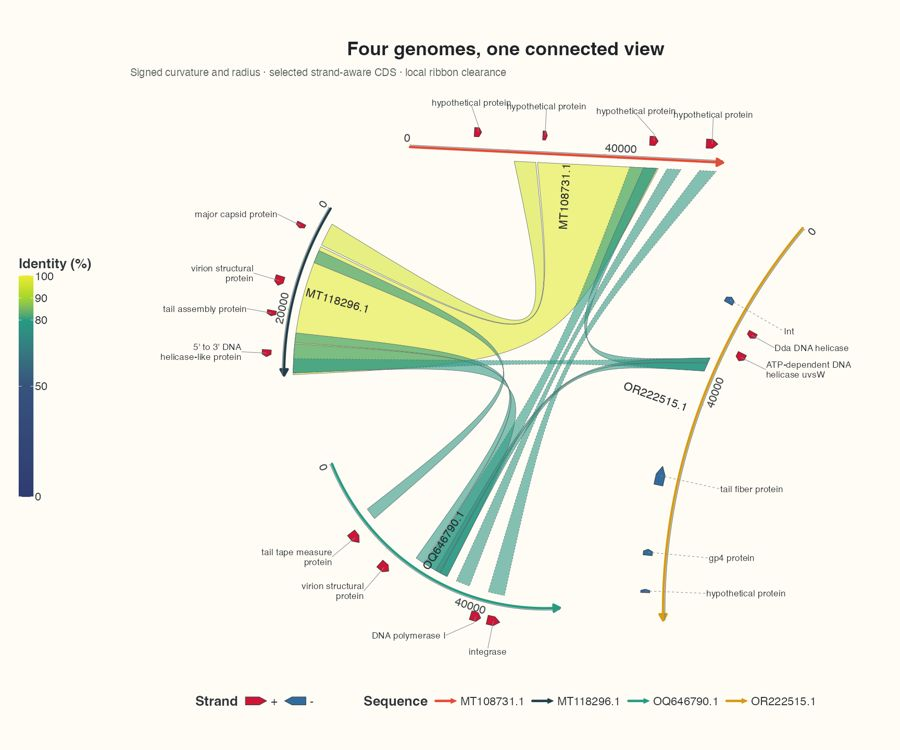</a><figcaption>四基因组弦图：混合骨架曲率与实测相似度 · <span class="figure-hint">点击放大查看</span></figcaption></figure>
命名向量逐序列匹配：曲率0是直线，正负值向相反方向弯曲，绝对值影响弓高；半径改变序列位置。上图同时演示自动方向、不同半径、零/正/负曲率和局部避障。参数不修改源坐标。

### 避障方式为何看起来不同 {#chord-tuning-clearance}
`link_avoid = "uniform"` 在整个端区间留统一空隙；`"smooth"` 只在特征附近平滑退让，形成局部缺口；`"none"` 不做特征避障。`link_gap = NULL` 才启用自动规则，给出固定数值会覆盖自动间距。避障检测箭头/特征几何，不避让文字，也不会自动绕过跨行连接途经的整条中间序列。

### 颜色与导出 {#chord-tuning-guides}
identity采用独立左侧长色条，序列和链图例在底部。链图例显式传递方向覆盖，箭头符号与图中几何一致。[样式专题](#styling)解释图例职责；按12×10 in导出，最后到[1.7 首页综合示例](#chord)核对数据与结果。


## 1.5 筛选与整理连接 {#ribbons}

<div class="task-intro"><p>减少连接拥挤，同时保留每一步的来源：筛选、去重、合并和聚束有不同含义。</p></div>

### 本页准备 {#ribbons-prepare}
在新的 R 会话中先运行下方代码，再按页面顺序继续。配色和排版是可选的显示设置，输入只选择需要的列。 涉及文件时，先解压[教学输入](https://github.com/DangJem/ggchord/tree/main/examples)，使工作目录包含 `examples/`。

<details class="preparation"><summary>准备代码 · 在本页运行一次</summary>

```{r example-21, eval=FALSE}
library(ggchord)
library(dplyr)
data(seq_data_example)
data(ribbon_data_example)
data(gene_data_example)
seqs <- seq_data_example |>
  select(accver, length)
links <- ribbon_data_example |>
  select(qaccver, saccver, qstart, qend, sstart, send)
# The fixture preserves biological strands separately from its old display strands.
genes <- gene_data_example |>
  transmute(accver, start, end, strand = source_strand)

# Optional appearance choices; none of these columns or scales is required input.
library(ggchord)
seq_palette <- setNames(
  c("#E64B35", "#233E4A", "#269B82", "#D59B17"),
  c("MT108731.1", "MT118296.1", "OQ646790.1", "OR222515.1")
)
gene_palette <- c("+" = "#CE1536", "-" = "#346B9D", "." = "#8291A6")

library(ggchord)
doc_background <- "#FFFCF5"
identity_palette <- c("#303B71", "#36537D", "#269B82", "#A5D52C", "#ECEB31")
identity_values <- c(0, 0.5, 0.8, 0.9, 1)
identity_breaks <- c(0, 50, 80, 90, 100)
doc_legend_theme <- theme(
  legend.title = element_text(size = 13, face = "bold"),
  legend.text = element_text(size = 11),
  legend.key.width = unit(9, "mm"), legend.key.height = unit(5, "mm"),
  legend.spacing.x = unit(9, "mm"), legend.spacing.y = unit(7, "mm"),
  legend.margin = margin(l = 4, r = 4, unit = "mm")
)
sequence_guide <- guide_ggchord_legend(nrow = 1, theme = doc_legend_theme)
strand_guide <- guide_ggchord_legend(
  nrow = 1, override.aes = list(strand = c("+", "-")), theme = doc_legend_theme
)
identity_guide <- guide_ggchord_colourbar(
  position = "left", direction = "vertical",
  theme = theme(
    legend.key.height = unit(75, "mm"), legend.key.width = unit(5, "mm"),
    legend.title = element_text(size = 13, face = "bold"),
    legend.text = element_text(size = 11), legend.margin = margin(r = 7, unit = "mm")
  )
)
doc_theme <- theme_ggchord_publication(
  axis.text = element_text(size = 11),
  axis.text.check.overlap = TRUE
) +
  theme(
    legend.position = "bottom",
    legend.title = element_text(size = 13, face = "bold"),
    legend.text = element_text(size = 11),
    legend.key.width = unit(9, "mm"), legend.key.height = unit(5, "mm"),
    legend.spacing.x = unit(9, "mm"), legend.spacing.y = unit(7, "mm"),
    legend.box.spacing = unit(6, "mm"),
    plot.background = element_rect(fill = doc_background, colour = NA),
    panel.background = element_blank(),
    plot.title = element_text(face = "bold", size = 18),
    plot.subtitle = element_text(size = 10, colour = "#5C625A"),
    plot.margin = margin(14, 18, 14, 18)
  )
doc_axis <- function(coordinates = "relative") {
  scale_seq_position_continuous(
    coordinates = coordinates, n.breaks = 3, minor_breaks = NULL,
    labels = function(x) format(x, scientific = FALSE, big.mark = ",", trim = TRUE)
  )
}

library(dplyr)
sequence_source <- read_fasta_lengths(files = "examples/fasta/*.fna", source_file = TRUE)
seq_real <- sequence_source |>
  select(accver, length)
annotation_source <- read_gff3(files = "examples/gff3/*.gff3", unstranded = "keep", source_file = TRUE)
feature_real <- annotation_source |>
  select(accver, start, end, strand, type, anno)
alignment_source <- read_blast(files = "examples/blastn-standard/*.tsv", source_file = TRUE)
link_real <- alignment_source |>
  select(qaccver, saccver, qstart, qend, sstart, send, pident, length)
real_validation <- validate_ggchord_data(seq_real, link_real)
real_validation

real_prepared <- prepare_ggchord_data(seq_real, link_real,
  features = list(annotation = feature_real)
)
real_filtered <- filter_ggchord_ribbons(link_real, min_pident = 80, min_length = 500)
# Explicit display subset: the six longest CDS per sequence; raw annotations stay intact.
real_display_features <- feature_real |>
  group_by(accver) |>
  slice_max(end - start + 1, n = 6, with_ties = FALSE) |>
  ungroup()
real_labels <- real_display_features |>
  filter(anno != "hypothetical protein") |>
  group_by(accver) |>
  slice_head(n = 2) |>
  ungroup()
real_filtered$report
```

</details>

### 从原始连接表开始 {#ribbons-input}
先用[真实记录工作流](#real-data-selection)创建 `seq_real`、`link_real` 和
`real_filtered`，保留原表及筛选报告。


```{r example-22, eval=FALSE}
unique_links <- deduplicate_ggchord_ribbons(real_filtered$data,
  by = "overlap",
  min_reciprocal_overlap = .9
)
merged_links <- merge_ggchord_ribbons(unique_links$data,
  max_gap = 100,
  min_pident_difference = 2
)
bundled_links <- bundle_ggchord_ribbons(link_real, seq_real, bins = 30)
p_density <- ggchord(seq_real, link_real, validate = "none") +
  geom_seq(show.legend = FALSE) +
  geom_seq_label(size = 4, seq_label_radius = .84, seq_label_hjust = .5) +
  stat_ribbon_density(aes(ribbon_alpha = after_stat(density)), fill = "#269B82") +
  scale_ribbon_alpha_continuous(
    name = "Relative density", range = c(.1, .6),
    guide = guide_ggchord_legend(position = "bottom", nrow = 1, theme = doc_legend_theme)
  ) +
  scale_seq_colour_manual(values = seq_palette) +
  coord_chord() +
  doc_theme
p_bundle <- ggchord(seq_real, link_real, validate = "none") +
  geom_seq() +
  stat_ribbon_bundle(bins = 30, fill = "#269B82") +
  coord_chord() +
  doc_theme
p_density
```

| 项目 | 结果 |
| --- | --- |
| 筛选后的比对数 | 8 |
| 重叠去重后数量 | 8 |
| 合并后的显示区间数 | 8 |
| 聚束输出行数 | 28 |

### 理解每步转换 {#ribbons-transformations}
筛选保留满足已声明阈值的观测；互惠重叠去重选择已有代表观测，不累加相似度；
合并把邻近兼容区间组合为显示外包范围；聚束按邻近 query/subject 位置形成汇总。
逐步检查 `$report` 和源行成员，特别注意冲突的额外元数据。
合并或聚束范围不是重新计算的核苷酸比对，估计长度保留标记，不凭空生成相似度。

### 密度是显式统计 {#ribbons-density}
<figure class="documentation-figure"><a class="figure-link" href="tutorial-assets/density.jpg" title="点击放大查看">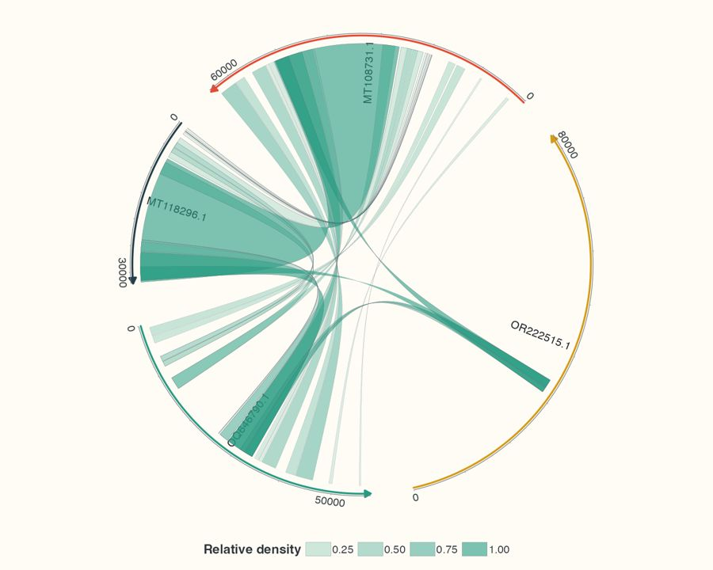</a><figcaption>原始比对记录的区间密度 · <span class="figure-hint">点击放大查看</span></figcaption></figure>

`stat_ribbon_density()` 映射计算后的密度，`stat_ribbon_bundle()` 在 build 时执行
明确聚合，普通区间连接几何层仍逐行绘制。计数、已报告长度和相似度加权有各自单位，
更不透明的连接不一定表示更强的独立同源证据。没有方向证据的点锚，不能因端点
相等就获得聚合方向。

### 选择区间区间连接或点连接 {#ribbons-points}


```{r example-23, eval=FALSE}
# Midpoints summarize existing HSPs for display; they are not new alignments.
points <- ribbon_data_example |>
  transmute(
    qaccver, saccver,
    qpos = floor((qstart + qend) / 2),
    spos = floor((sstart + send) / 2),
    pident
  )
p_points <- ggchord(seq_data = seqs) +
  geom_seq() +
  geom_seq_label(size = 4) +
  geom_link_line(aes(link_colour = pident),
    data = points,
    arrow = arrow(length = unit(2, "mm")), linewidth = .7
  ) +
  scale_link_colour_gradientn(
    colours = identity_palette, values = identity_values,
    limits = c(0, 100), breaks = identity_breaks,
    name = "Identity (%)", guide = guide_ggchord_colourbar(
      available_aes = "link_colour",
      position = "bottom", direction = "horizontal",
      theme = doc_legend_theme + theme(legend.key.width = unit(65, "mm"), legend.key.height = unit(5, "mm"))
    )
  ) +
  scale_seq_colour_manual(values = seq_palette) +
  coord_chord() +
  doc_theme
p_points
```

<figure class="documentation-figure"><a class="figure-link" href="tutorial-assets/pointlinks.jpg" title="点击放大查看">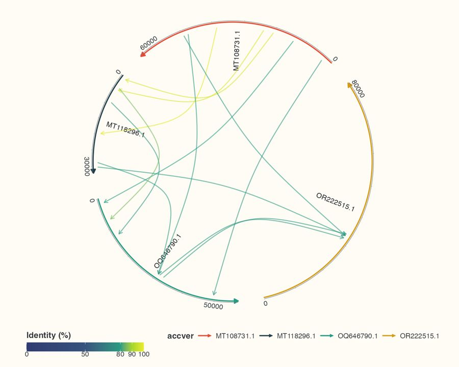</a><figcaption>从已有 HSP 区间计算中点的点连接 · <span class="figure-hint">点击放大查看</span></figcaption></figure>

点位置由随包真实 HSP 的中点向下取整得到，颜色使用已报告的 `pident`。line 使用 `qpos/spos`，而非区间端点，箭头由
query 指向 subject。点连接默认避障为 `none`，区间连接为 `uniform`。
全局弦图旋转属于坐标系，直线模式选对与相邻行默认见[三种模式](#modes-collinear)。

点连接的颜色条明确指定 `available_aes = "link_colour"`。普通 ggplot2 颜色条和
包装器默认值不接受全部扩展角色；自定义图例时应明确选择对应美学角色。

### 完成后检查 {#ribbons-check-result}
先检查各步骤 report 和成员行，再读图。聚合带的范围不是新比对；点连接是已有 HSP 中点的摘要。

<div class="next-step">继续：<a href="#views">查看局部和分段区域 →</a></div>


## 1.6 原始文件完整流程 {#real-data}

<div class="task-intro"><p>把原始 FASTA、GFF3 和标准 BLAST 表格组合成一张可追溯的序列比较图。你将检查输入、选择显示子集，再对照弦图与全长概览。</p></div>

### 本页准备 {#real-data-prepare}
在新的 R 会话中先运行下方代码，再按页面顺序继续。配色和排版是可选的显示设置，输入只选择需要的列。 涉及文件时，先解压[教学输入](https://github.com/DangJem/ggchord/tree/main/examples)，使工作目录包含 `examples/`。

<details class="preparation"><summary>准备代码 · 在本页运行一次</summary>

```{r example-24, eval=FALSE}
# Optional appearance choices; none of these columns or scales is required input.
library(ggchord)
seq_palette <- setNames(
  c("#E64B35", "#233E4A", "#269B82", "#D59B17"),
  c("MT108731.1", "MT118296.1", "OQ646790.1", "OR222515.1")
)
gene_palette <- c("+" = "#CE1536", "-" = "#346B9D", "." = "#8291A6")

library(ggchord)
doc_background <- "#FFFCF5"
identity_palette <- c("#303B71", "#36537D", "#269B82", "#A5D52C", "#ECEB31")
identity_values <- c(0, 0.5, 0.8, 0.9, 1)
identity_breaks <- c(0, 50, 80, 90, 100)
doc_legend_theme <- theme(
  legend.title = element_text(size = 13, face = "bold"),
  legend.text = element_text(size = 11),
  legend.key.width = unit(9, "mm"), legend.key.height = unit(5, "mm"),
  legend.spacing.x = unit(9, "mm"), legend.spacing.y = unit(7, "mm"),
  legend.margin = margin(l = 4, r = 4, unit = "mm")
)
sequence_guide <- guide_ggchord_legend(nrow = 1, theme = doc_legend_theme)
strand_guide <- guide_ggchord_legend(
  nrow = 1, override.aes = list(strand = c("+", "-")), theme = doc_legend_theme
)
identity_guide <- guide_ggchord_colourbar(
  position = "left", direction = "vertical",
  theme = theme(
    legend.key.height = unit(75, "mm"), legend.key.width = unit(5, "mm"),
    legend.title = element_text(size = 13, face = "bold"),
    legend.text = element_text(size = 11), legend.margin = margin(r = 7, unit = "mm")
  )
)
doc_theme <- theme_ggchord_publication(
  axis.text = element_text(size = 11),
  axis.text.check.overlap = TRUE
) +
  theme(
    legend.position = "bottom",
    legend.title = element_text(size = 13, face = "bold"),
    legend.text = element_text(size = 11),
    legend.key.width = unit(9, "mm"), legend.key.height = unit(5, "mm"),
    legend.spacing.x = unit(9, "mm"), legend.spacing.y = unit(7, "mm"),
    legend.box.spacing = unit(6, "mm"),
    plot.background = element_rect(fill = doc_background, colour = NA),
    panel.background = element_blank(),
    plot.title = element_text(face = "bold", size = 18),
    plot.subtitle = element_text(size = 10, colour = "#5C625A"),
    plot.margin = margin(14, 18, 14, 18)
  )
doc_axis <- function(coordinates = "relative") {
  scale_seq_position_continuous(
    coordinates = coordinates, n.breaks = 3, minor_breaks = NULL,
    labels = function(x) format(x, scientific = FALSE, big.mark = ",", trim = TRUE)
  )
}
```

</details>

这条完整工作流使用源码仓库已有的四条序列记录，不需要重新比对或预测基因。
使用匹配的开发 checkout，或[下载教学输入](https://github.com/DangJem/ggchord/tree/main/examples)，解压后让
工作目录下包含 `examples/`。保存图形时同时记录包版本与[构建清单](https://github.com/DangJem/ggchord/tree/main/website)。

### 1. 读取并检查原始记录 {#real-data-read}

```{r example-25, eval=FALSE}
library(dplyr)
sequence_source <- read_fasta_lengths(files = "examples/fasta/*.fna", source_file = TRUE)
seq_real <- sequence_source |>
  select(accver, length)
annotation_source <- read_gff3(files = "examples/gff3/*.gff3", unstranded = "keep", source_file = TRUE)
feature_real <- annotation_source |>
  select(accver, start, end, strand, type, anno)
alignment_source <- read_blast(files = "examples/blastn-standard/*.tsv", source_file = TRUE)
link_real <- alignment_source |>
  select(qaccver, saccver, qstart, qend, sstart, send, pident, length)
real_validation <- validate_ggchord_data(seq_real, link_real)
real_validation
```


FASTA 头部提供原样 accession version 与长度，GFF3 提供 CDS 区间和真实链方向，
BLAST 文件提供已有比对；读取器不运行 BLAST。继续前检查 `real_validation`：
连接端点递减可能是合法的反向命中。不能把未知注释链改成 `+` 来满足基因快捷层。

### 2. 明确显示筛选规则 {#real-data-selection}

```{r example-26, eval=FALSE}
real_prepared <- prepare_ggchord_data(seq_real, link_real,
  features = list(annotation = feature_real)
)
real_filtered <- filter_ggchord_ribbons(link_real, min_pident = 80, min_length = 500)
# Explicit display subset: the six longest CDS per sequence; raw annotations stay intact.
real_display_features <- feature_real |>
  group_by(accver) |>
  slice_max(end - start + 1, n = 6, with_ties = FALSE) |>
  ungroup()
real_labels <- real_display_features |>
  filter(anno != "hypothetical protein") |>
  group_by(accver) |>
  slice_head(n = 2) |>
  ungroup()
real_filtered$report
```

| 项目 | 结果 |
| --- | --- |
| 序列数 | 4 |
| 注释记录数 | 266 |
| 弦图中选出的 CDS 数 | 24 |
| 原始比对记录数 | 32 |
| 通过显示筛选的比对数 | 8 |
| 选出的文字标签数 | 6 |

显示连接保留相似度 ≥80%、已报告比对长度 ≥500 bp 的记录。弦图每条序列选择最长
六条已导入 CDS，并在这些 CDS 中最多标记两条非 hypothetical protein 注释。这是显示规则，不是生物学结论，未显示的
基因不表示不存在。原始 `feature_real`、`link_real` 不变，`real_prepared$report`
和 `real_filtered$report` 保留准备与筛选证据。链方向不重编码；这与生成说明中
明确进行显示链重编码的小型随包教学 fixture 不同。

### 3. 构建弦图比较 {#real-data-chord}

```{r example-27, eval=FALSE}
p_real_chord <- ggchord(seq_data = seq_real, ribbon_data = real_filtered$data, validate = "none") +
  geom_link_ribbon(aes(ribbon_fill = pident), alpha = .65) +
  geom_seq(show.legend = FALSE) +
  geom_feature(aes(feature_fill = strand),
    data = real_display_features,
    width = .045, position = position_strand(.08)
  ) +
  geom_feature_label_repel(
    data = real_labels, label_layout = "radial",
    label_wrap = 20, size = 4, position = position_strand(.08)
  ) +
  geom_seq_label(size = 4, seq_label_radius = .84, seq_label_hjust = .5) +
  coord_chord() +
  scale_seq_colour_manual(values = seq_palette) +
  scale_feature_fill_manual(values = gene_palette, breaks = c("+", "-")) +
  scale_ribbon_fill_gradientn(
    colours = identity_palette, values = identity_values,
    limits = c(0, 100), breaks = identity_breaks, name = "Identity (%)", guide = identity_guide
  ) +
  doc_theme
p_real_chord
```

<figure class="documentation-figure"><a class="figure-link" href="tutorial-assets/realchord.jpg" title="点击放大查看">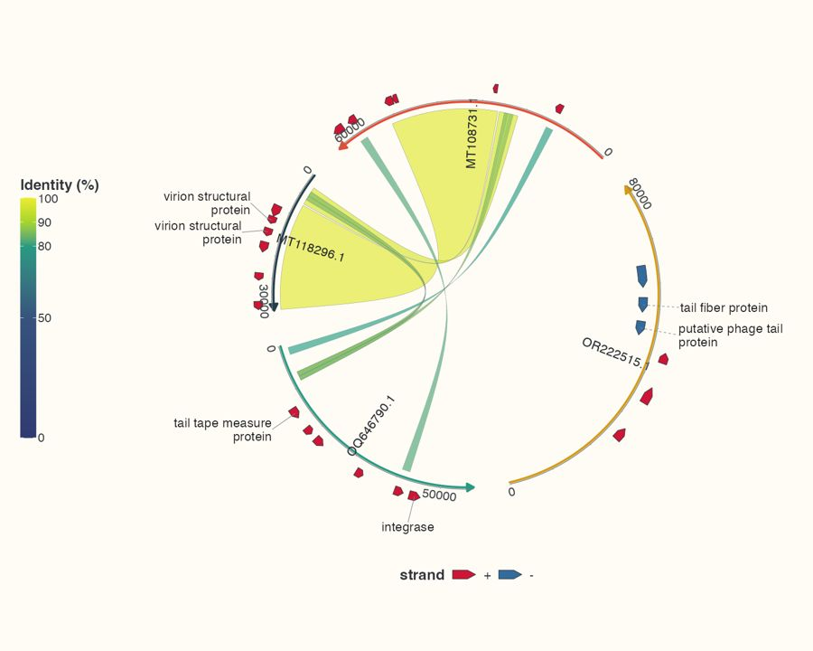</a><figcaption>原始序列、选定 CDS 与已有比对的弦图 · <span class="figure-hint">点击放大查看</span></figcaption></figure>

先读序列名称，再读真实链方向的注释箭头及区间连接。区间连接表达已有比对区间
和映射的相似度，连接交叉本身不构成重排证据。选定注释与更宽的比对区间分开阅读。
科学解释涉及显示子集之外的注释时，应使用完整输入表。

### 4. 在线性视图检查全部注释 {#real-data-linear}

```{r example-28, eval=FALSE}
p_real_linear <- ggchord(seq_real, real_filtered$data, validate = "none") +
  geom_link_ribbon(fill = "#6BAFA6", alpha = .45) +
  geom_seq() +
  geom_seq_label(size = 4) +
  geom_feature(data = feature_real, feature_fill = "#CE1536", show.legend = FALSE, position = position_strand(.18)) +
  geom_seq_scale(length = 10000) +
  coord_collinear() +
  doc_axis() +
  scale_seq_colour_manual(values = seq_palette) +
  doc_theme
p_real_linear
```

<figure class="documentation-figure"><a class="figure-link" href="tutorial-assets/reallinear.jpg" title="点击放大查看">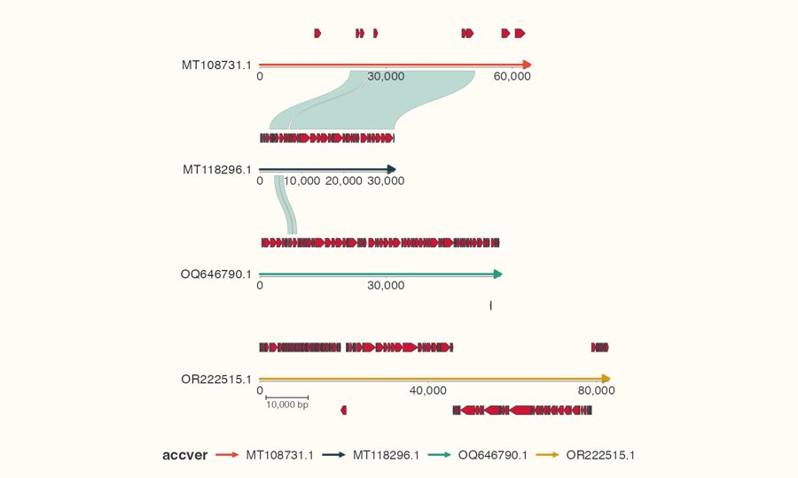</a><figcaption>原始序列、全部导入 CDS 与筛选连接的线性图 · <span class="figure-hint">点击放大查看</span></figcaption></figure>

这张图绘制全部导入注释。区间连接默认只连接相邻显示序列，保留所有比较需要显式
图层设置。bp 参照条属于共线性坐标。裁剪、源坐标轴与独立窗口见[局部视图](#views)，
按图集明确尺寸预览保存见[输出](#output)。

### 5. 随图保留证据 {#real-data-provenance}
教学输入包包含未改写的 FASTA/GFF3/BLAST、SHA256 清单和共享示例脚本。
绘图清单记录代码 hash、PNG 设备、宽高和 dpi。accession 名称标识来源记录，
图片不替代原始注释或比对证据。

### 先选列，再传入函数 {#real-data-minimal-fields}
`*_source` 对象保留原字段与来源；`seq_real` 只有两列，`feature_real` 只保留几何、
类型和注释文字，`link_real` 因为本例实际筛选和映射相似度，才额外保留 `pident`
和已报告的 `length`。这里使用标准 12 列转换文件，不要求历史 17 列布局。
随包基因示例将真实链保存在 `source_strand`；简短例子恢复该方向后，只选四列传入
基因图层。格式和单位的区别见[比对输入教程](#alignments)。

### 完成后检查 {#real-data-check-result}
检查序列 ID 在三张表中一致，查看筛选报告，再确认图例表达相似度与链方向。全长概览用于定位；若要研究具体 CDS，请继续聚焦邻域。

<div class="next-step">继续：<a href="#homology">连接同源基因 →</a></div>

### 保存本页结果 {#real-data-save-result}
在工作目录中保存刚刚创建的图；预览时使用相同宽高。

```{r example-29, eval=FALSE}
ggsave("phage-comparison.png", p_real_chord, width = 10, height = 8, units = "in", dpi = 144)
```


## 1.7 弦图综合展示 {#chord}

<div class="lesson-intro">把四条基因组放在同一张关系图中，组合直线与弧形骨架、保留真实链方向的基因、连续相似度标度和精选标签，同时保留数据来源。</div>

### 综合结果 {#chord-overview}
<figure class="documentation-figure"><a class="figure-link" href="tutorial-assets/showcasechord.jpg" title="点击放大查看"></a><figcaption>四基因组弦图：混合骨架曲率与实测相似度 · <span class="figure-hint">点击放大查看</span></figcaption></figure>

本页是模块一的终点。初学请按[输入表](#chord-data) → [生成与导入](#chord-import) → [逐层绘图](#chord-build) → [参数与避障](#chord-tuning)学习。四条真实序列上只展示18个精选CDS，每个均交给repel标签层，避免密集箭头淹没连接。

### 准备原始记录 {#chord-prepare}
将[教程输入包](https://github.com/DangJem/ggchord/tree/main/examples)解压到工作目录，使其包含 `examples/`。使用 `install.packages(c("dplyr", "purrr", "tidyr"))` 安装示例可选依赖；完整流程用它们整理表格和计算 GC 轨道。

<details class="preparation"><summary>准备代码 · 在本页运行一次</summary>

```{r example-30, eval=FALSE}
# Optional appearance choices; none of these columns or scales is required input.
library(ggchord)
seq_palette <- setNames(
  c("#E64B35", "#233E4A", "#269B82", "#D59B17"),
  c("MT108731.1", "MT118296.1", "OQ646790.1", "OR222515.1")
)
gene_palette <- c("+" = "#CE1536", "-" = "#346B9D", "." = "#8291A6")

library(ggchord)
doc_background <- "#FFFCF5"
identity_palette <- c("#303B71", "#36537D", "#269B82", "#A5D52C", "#ECEB31")
identity_values <- c(0, 0.5, 0.8, 0.9, 1)
identity_breaks <- c(0, 50, 80, 90, 100)
doc_legend_theme <- theme(
  legend.title = element_text(size = 13, face = "bold"),
  legend.text = element_text(size = 11),
  legend.key.width = unit(9, "mm"), legend.key.height = unit(5, "mm"),
  legend.spacing.x = unit(9, "mm"), legend.spacing.y = unit(7, "mm"),
  legend.margin = margin(l = 4, r = 4, unit = "mm")
)
sequence_guide <- guide_ggchord_legend(nrow = 1, theme = doc_legend_theme)
strand_guide <- guide_ggchord_legend(
  nrow = 1, override.aes = list(strand = c("+", "-")), theme = doc_legend_theme
)
identity_guide <- guide_ggchord_colourbar(
  position = "left", direction = "vertical",
  theme = theme(
    legend.key.height = unit(75, "mm"), legend.key.width = unit(5, "mm"),
    legend.title = element_text(size = 13, face = "bold"),
    legend.text = element_text(size = 11), legend.margin = margin(r = 7, unit = "mm")
  )
)
doc_theme <- theme_ggchord_publication(
  axis.text = element_text(size = 11),
  axis.text.check.overlap = TRUE
) +
  theme(
    legend.position = "bottom",
    legend.title = element_text(size = 13, face = "bold"),
    legend.text = element_text(size = 11),
    legend.key.width = unit(9, "mm"), legend.key.height = unit(5, "mm"),
    legend.spacing.x = unit(9, "mm"), legend.spacing.y = unit(7, "mm"),
    legend.box.spacing = unit(6, "mm"),
    plot.background = element_rect(fill = doc_background, colour = NA),
    panel.background = element_blank(),
    plot.title = element_text(face = "bold", size = 18),
    plot.subtitle = element_text(size = 10, colour = "#5C625A"),
    plot.margin = margin(14, 18, 14, 18)
  )
doc_axis <- function(coordinates = "relative") {
  scale_seq_position_continuous(
    coordinates = coordinates, n.breaks = 3, minor_breaks = NULL,
    labels = function(x) format(x, scientific = FALSE, big.mark = ",", trim = TRUE)
  )
}
```

</details>

```{r example-31, eval=FALSE}
library(ggchord)
library(dplyr)
library(purrr)
library(tidyr)
# Original repository records; extract the tutorial input bundle first.
show_sequences <- read_fasta_lengths(files = "examples/fasta/*.fna") |>
  select(accver, length)
show_annotations <- read_gff3(files = "examples/gff3/*.gff3", unstranded = "keep")
show_genes <- show_annotations |>
  filter(type == "CDS") |>
  select(accver, start, end, strand, anno)
show_alignments <- read_blast(files = "examples/blastn-standard/*.tsv")
# At most three substantial observed HSPs per pair; no coordinates are invented.
show_links <- show_alignments |>
  filter(length >= 900, pident >= 75) |>
  group_by(qaccver, saccver) |>
  slice_max(length, n = 3, with_ties = FALSE) |>
  ungroup()
# Select up to four source CDS per sequence, spread across annotation order.
# No feature is moved or invented; keep complete source tables separately.
show_features <- show_genes |>
  filter(end - start + 1 >= 500) |>
  group_by(accver) |>
  arrange(start, .by_group = TRUE) |>
  mutate(display_bin = ntile(row_number(), 4), informative = !is.na(anno) & anno != "hypothetical protein") |>
  group_by(accver, display_bin) |>
  arrange(desc(informative), desc(end - start), .by_group = TRUE) |>
  slice_head(n = 1) |>
  ungroup() |>
  select(accver, start, end, strand, anno)
# Also retain well-separated negative-strand CDS, if not already represented.
show_reverse <- show_genes |>
  filter(strand == "-", end - start + 1 >= 500) |>
  group_by(accver) |>
  arrange(start, .by_group = TRUE) |>
  slice(c(1, n())) |>
  ungroup()
show_features <- bind_rows(show_features, show_reverse) |>
  distinct(accver, start, end, strand, .keep_all = TRUE) |>
  arrange(accver, start)
show_labels <- show_features
show_optimization <- optimize_ggchord_layout(
  show_sequences, show_links,
  optimize = "orientation", weight = "length"
)
```


输入包含四条未改写的 FASTA、对应 GFF3 注释和 32 条原始 HSP。展示保留长度至少 900 bp、相似度至少 75% 的 HSP，每对序列最多三条，以减少拥挤；没有合并或编造比对。

### 组合图层 {#chord-compose}

```{r example-32, eval=FALSE}
show_curvature <- c(
  "MT108731.1" = 0, "MT118296.1" = 0.85,
  "OQ646790.1" = 1.1, "OR222515.1" = -0.4
)
show_radius <- c(
  "MT108731.1" = 1, "MT118296.1" = 1.05,
  "OQ646790.1" = 0.95, "OR222515.1" = 1.08
)
p_show_chord <- ggchord(show_sequences, show_links, show_features) +
  geom_link_ribbon(aes(ribbon_fill = pident), link_avoid = "smooth", alpha = 0.58, linewidth = 0.18) +
  geom_seq(
    seq_orientation = show_optimization$seq_orientation,
    seq_curvature = show_curvature, seq_radius = show_radius,
    seq_gap = 0.06, linewidth = 1.1
  ) +
  geom_gene(position = position_strand(0.07), width = 0.035) +
  geom_gene_label_repel(
    data = show_labels, label_layout = "radial", label_wrap = 24,
    size = 3.1, label_max_lines = 3, position = position_strand(0.07)
  ) +
  geom_seq_label(size = 4, seq_label_radius = 0.84, seq_label_hjust = 0.5) +
  scale_seq_colour_manual(
    values = seq_palette, name = "Sequence",
    guide = sequence_guide
  ) +
  scale_gene_fill_manual(values = gene_palette, breaks = c("+", "-"), name = "Strand") +
  scale_ribbon_fill_gradientn(
    colours = identity_palette, values = identity_values,
    limits = c(0, 100), breaks = identity_breaks, name = "Identity (%)", guide = identity_guide
  ) +
  guides(gene_fill = strand_guide) +
  scale_seq_position_continuous(breaks = c(0, 20000, 40000), minor_breaks = NULL) +
  coord_chord(rotation = 50) +
  doc_theme +
  labs(
    title = "Four genomes, one connected view",
    subtitle = "Signed curvature and radius · selected strand-aware CDS · local ribbon clearance"
  )
p_show_chord
```


`geom_seq(seq_curvature = ...)` 通过命名向量将曲率绑定到稳定的序列标识，`0` 表示直线。曲率只改变展示几何，不改变序列长度、生物学链方向或比对端点。

### 阅读与调整 {#chord-read}
先看序列颜色和基因方向，再沿较大的比对区间阅读连接。连接交叉本身不能证明重排。相似度色条与[共线性视图](#collinear)使用相同范围和配色。

需要减少连接时查看[连接筛选](#ribbons)，调整文字密度时查看[标签](#labels)，改变半径和曲率时查看[逐序列参数](#parameters)。从文件读取开始学习可先看[真实序列比较](#real-data)。

### 按预定尺寸保存 {#chord-save}
```{r example-33, eval=FALSE}
ggsave("four-genome-chord.png", p_show_chord, width = 12, height = 10, units = "in", dpi = 144)
```


## 2.1 复用弦图的数据 {#collinear-data}

共线性图是ggchord从弦图扩展出的直线视图。设计目标是保留共同数据和图层，尽可能通过替换坐标系完成转换。

### 相同的三张表 {#collinear-data-tables}
| 输入 | 必需列 | 共线性含义 |
| --- | --- | --- |
| seq_data | accver, length | 每条序列占一行，共享bp横向比例 |
| ribbon_data | qaccver, saccver, qstart, qend, sstart, send | 两行之间的已有区间对应 |
| gene_data | accver, start, end, strand | 行上基因，正负链由Position上下分列 |

可选列和BLAST命名来历与[1.1](#chord-data)相同；相似度需要pident，标签需要anno。局部窗口的source字段用于保留原始坐标，不能将显示间隙解释为缺失DNA长度。

### 数据如何获得 {#collinear-data-import}
[1.2](#chord-import)的FASTA/GFF3/BLAST流程可以直接复用；已有PAF、GRanges、GInteractions通过[适配器](#formats)读入。蛋白比对必须先[投影到已知CDS坐标](#projection)，不能把aa直接画成bp。

### 当前转换边界 {#collinear-data-contract}
[下一页](#collinear-build)给出只替换coord的实际例子。显式圆形半径、曲率、ring和径向序列标签位置在当前共线性合同中会被拒绝，而不是悄悄忽略。将这些坐标特有样式留给各自展示图；“任意组合完美转换”仍是长期目标，不是当前保证。

共线性默认只连接相邻显示行；要保持弦图的连接集合，需要在共同图层明确 `adjacent_only = FALSE`。显示方向可手动指定或交给coord自动判断，两种入口不能同时使用。


## 2.2 只替换坐标系，再逐层添加 {#collinear-build}

先验证共同语法，再为直线视图调整排版。以下三个对象只在弦图教学对象上替换坐标系，不改表格、不重新计算比对。

### 本页准备 {#collinear-build-prepare}
先解压[教学输入](https://github.com/DangJem/ggchord/tree/main/examples)。
<details class="preparation"><summary>准备代码 · 在本页运行一次</summary>

```{r example-34, eval=FALSE}
# Optional appearance choices; none of these columns or scales is required input.
library(ggchord)
seq_palette <- setNames(
  c("#E64B35", "#233E4A", "#269B82", "#D59B17"),
  c("MT108731.1", "MT118296.1", "OQ646790.1", "OR222515.1")
)
gene_palette <- c("+" = "#CE1536", "-" = "#346B9D", "." = "#8291A6")

library(ggchord)
doc_background <- "#FFFCF5"
identity_palette <- c("#303B71", "#36537D", "#269B82", "#A5D52C", "#ECEB31")
identity_values <- c(0, 0.5, 0.8, 0.9, 1)
identity_breaks <- c(0, 50, 80, 90, 100)
doc_legend_theme <- theme(
  legend.title = element_text(size = 13, face = "bold"),
  legend.text = element_text(size = 11),
  legend.key.width = unit(9, "mm"), legend.key.height = unit(5, "mm"),
  legend.spacing.x = unit(9, "mm"), legend.spacing.y = unit(7, "mm"),
  legend.margin = margin(l = 4, r = 4, unit = "mm")
)
sequence_guide <- guide_ggchord_legend(nrow = 1, theme = doc_legend_theme)
strand_guide <- guide_ggchord_legend(
  nrow = 1, override.aes = list(strand = c("+", "-")), theme = doc_legend_theme
)
identity_guide <- guide_ggchord_colourbar(
  position = "left", direction = "vertical",
  theme = theme(
    legend.key.height = unit(75, "mm"), legend.key.width = unit(5, "mm"),
    legend.title = element_text(size = 13, face = "bold"),
    legend.text = element_text(size = 11), legend.margin = margin(r = 7, unit = "mm")
  )
)
doc_theme <- theme_ggchord_publication(
  axis.text = element_text(size = 11),
  axis.text.check.overlap = TRUE
) +
  theme(
    legend.position = "bottom",
    legend.title = element_text(size = 13, face = "bold"),
    legend.text = element_text(size = 11),
    legend.key.width = unit(9, "mm"), legend.key.height = unit(5, "mm"),
    legend.spacing.x = unit(9, "mm"), legend.spacing.y = unit(7, "mm"),
    legend.box.spacing = unit(6, "mm"),
    plot.background = element_rect(fill = doc_background, colour = NA),
    panel.background = element_blank(),
    plot.title = element_text(face = "bold", size = 18),
    plot.subtitle = element_text(size = 10, colour = "#5C625A"),
    plot.margin = margin(14, 18, 14, 18)
  )
doc_axis <- function(coordinates = "relative") {
  scale_seq_position_continuous(
    coordinates = coordinates, n.breaks = 3, minor_breaks = NULL,
    labels = function(x) format(x, scientific = FALSE, big.mark = ",", trim = TRUE)
  )
}

library(ggchord)
library(dplyr)
library(purrr)
library(tidyr)
# Original repository records; extract the tutorial input bundle first.
show_sequences <- read_fasta_lengths(files = "examples/fasta/*.fna") |>
  select(accver, length)
show_annotations <- read_gff3(files = "examples/gff3/*.gff3", unstranded = "keep")
show_genes <- show_annotations |>
  filter(type == "CDS") |>
  select(accver, start, end, strand, anno)
show_alignments <- read_blast(files = "examples/blastn-standard/*.tsv")
# At most three substantial observed HSPs per pair; no coordinates are invented.
show_links <- show_alignments |>
  filter(length >= 900, pident >= 75) |>
  group_by(qaccver, saccver) |>
  slice_max(length, n = 3, with_ties = FALSE) |>
  ungroup()
# Select up to four source CDS per sequence, spread across annotation order.
# No feature is moved or invented; keep complete source tables separately.
show_features <- show_genes |>
  filter(end - start + 1 >= 500) |>
  group_by(accver) |>
  arrange(start, .by_group = TRUE) |>
  mutate(display_bin = ntile(row_number(), 4), informative = !is.na(anno) & anno != "hypothetical protein") |>
  group_by(accver, display_bin) |>
  arrange(desc(informative), desc(end - start), .by_group = TRUE) |>
  slice_head(n = 1) |>
  ungroup() |>
  select(accver, start, end, strand, anno)
# Also retain well-separated negative-strand CDS, if not already represented.
show_reverse <- show_genes |>
  filter(strand == "-", end - start + 1 >= 500) |>
  group_by(accver) |>
  arrange(start, .by_group = TRUE) |>
  slice(c(1, n())) |>
  ungroup()
show_features <- bind_rows(show_features, show_reverse) |>
  distinct(accver, start, end, strand, .keep_all = TRUE) |>
  arrange(accver, start)
show_labels <- show_features
show_optimization <- optimize_ggchord_layout(
  show_sequences, show_links,
  optimize = "orientation", weight = "length"
)
```

</details>
<details class="preparation"><summary>准备代码 · 在本页运行一次</summary>

```{r example-35, eval=FALSE}
p_learn_seq <- ggchord(seq_data = show_sequences) +
  geom_seq() +
  geom_seq_label(size = 4) +
  scale_seq_colour_manual(
    values = seq_palette, name = "Sequence",
    guide = sequence_guide
  ) +
  scale_seq_position_continuous(breaks = c(0, 20000, 40000), minor_breaks = NULL) +
  coord_chord() +
  doc_theme
p_learn_seq

p_learn_links <- p_learn_seq +
  geom_link_ribbon(
    aes(ribbon_fill = pident),
    data = show_links,
    adjacent_only = FALSE, link_avoid = "smooth"
  ) +
  scale_ribbon_fill_gradientn(
    colours = identity_palette, values = identity_values, limits = c(0, 100),
    breaks = identity_breaks, name = "Identity (%)", guide = identity_guide
  )
p_learn_links

p_learn_genes <- p_learn_links +
  geom_gene(data = show_features, position = position_strand(0.08)) +
  scale_gene_fill_manual(values = gene_palette, breaks = c("+", "-"), name = "Strand") +
  guides(gene_fill = strand_guide)
p_learn_genes

p_learn_labels <- p_learn_genes +
  geom_gene_label_repel(
    data = show_features, label_layout = "arc", label_wrap = 24,
    label_max_lines = 3, position = position_strand(0.08), size = 3
  )
p_learn_labels
```

</details>

### 替换coord {#collinear-build-switch}

```{r example-36, eval=FALSE}
# Reuse exactly the same data and layers; replace only the coordinate system.
p_linear_seq <- p_learn_seq + coord_collinear()
p_linear_links <- p_learn_links + coord_collinear()
p_linear_labels <- p_learn_labels + coord_collinear(ratio = 0.65)
p_linear_labels
```


### 从骨架看比例 {#collinear-build-backbones}
<figure class="documentation-figure"><a class="figure-link" href="tutorial-assets/linearseq.jpg" title="点击放大查看">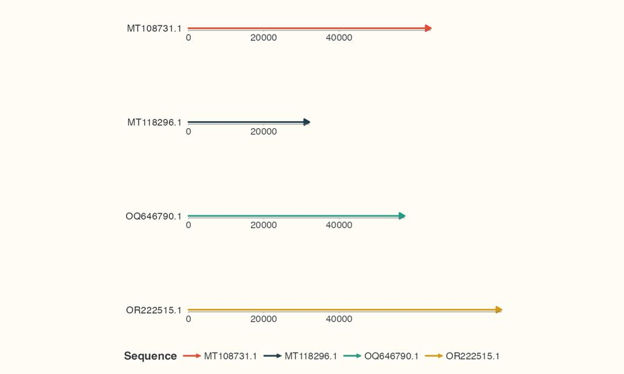</a><figcaption>相同骨架，仅替换坐标系 · <span class="figure-hint">点击放大查看</span></figcaption></figure>
每一行共享同一bp比例。序列长度不同，行长也不同；不是将每行任意缩放成一样长。

### 加入连接 {#collinear-build-links}
<figure class="documentation-figure"><a class="figure-link" href="tutorial-assets/linearlinks.jpg" title="点击放大查看">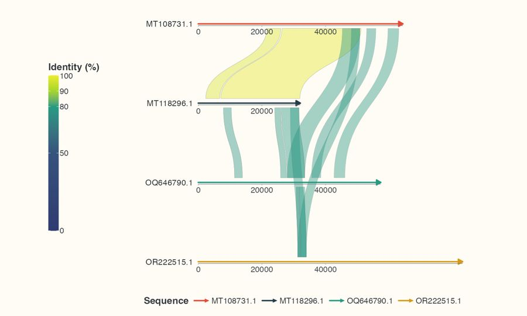</a><figcaption>相同连接，仅替换坐标系 · <span class="figure-hint">点击放大查看</span></figcaption></figure>
相同的HSP保留在图层中，跨行连接也保留，因此可直接看到默认路由的局限。长连接更适合在下一页明确路由。

### 加入上下分链与标签 {#collinear-build-labels}
<figure class="documentation-figure"><a class="figure-link" href="tutorial-assets/linearlabels.jpg" title="点击放大查看">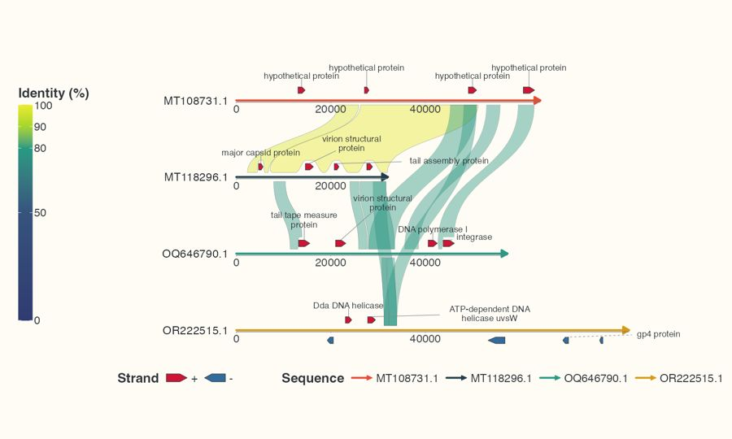</a><figcaption>相同基因与标签，仅替换坐标系 · <span class="figure-hint">点击放大查看</span></figcaption></figure>
箭头和标签来自同一个筛选表。正负链不改写；显示翻转也不会更改原始strand。继续：[2.3 调整跨行路由](#collinear-routing)。


## 2.3 跨行连接、避障与比例尺 {#collinear-routing}

相邻行连接与跨行连接有不同阅读负担。先分开数据，再分别控制；保留原始HSP端点，控制点只改变显示路径。

### 本页准备 {#collinear-routing-prepare}
先解压[教学输入](https://github.com/DangJem/ggchord/tree/main/examples)。
<details class="preparation"><summary>准备代码 · 在本页运行一次</summary>

```{r example-37, eval=FALSE}
# Optional appearance choices; none of these columns or scales is required input.
library(ggchord)
seq_palette <- setNames(
  c("#E64B35", "#233E4A", "#269B82", "#D59B17"),
  c("MT108731.1", "MT118296.1", "OQ646790.1", "OR222515.1")
)
gene_palette <- c("+" = "#CE1536", "-" = "#346B9D", "." = "#8291A6")

library(ggchord)
doc_background <- "#FFFCF5"
identity_palette <- c("#303B71", "#36537D", "#269B82", "#A5D52C", "#ECEB31")
identity_values <- c(0, 0.5, 0.8, 0.9, 1)
identity_breaks <- c(0, 50, 80, 90, 100)
doc_legend_theme <- theme(
  legend.title = element_text(size = 13, face = "bold"),
  legend.text = element_text(size = 11),
  legend.key.width = unit(9, "mm"), legend.key.height = unit(5, "mm"),
  legend.spacing.x = unit(9, "mm"), legend.spacing.y = unit(7, "mm"),
  legend.margin = margin(l = 4, r = 4, unit = "mm")
)
sequence_guide <- guide_ggchord_legend(nrow = 1, theme = doc_legend_theme)
strand_guide <- guide_ggchord_legend(
  nrow = 1, override.aes = list(strand = c("+", "-")), theme = doc_legend_theme
)
identity_guide <- guide_ggchord_colourbar(
  position = "left", direction = "vertical",
  theme = theme(
    legend.key.height = unit(75, "mm"), legend.key.width = unit(5, "mm"),
    legend.title = element_text(size = 13, face = "bold"),
    legend.text = element_text(size = 11), legend.margin = margin(r = 7, unit = "mm")
  )
)
doc_theme <- theme_ggchord_publication(
  axis.text = element_text(size = 11),
  axis.text.check.overlap = TRUE
) +
  theme(
    legend.position = "bottom",
    legend.title = element_text(size = 13, face = "bold"),
    legend.text = element_text(size = 11),
    legend.key.width = unit(9, "mm"), legend.key.height = unit(5, "mm"),
    legend.spacing.x = unit(9, "mm"), legend.spacing.y = unit(7, "mm"),
    legend.box.spacing = unit(6, "mm"),
    plot.background = element_rect(fill = doc_background, colour = NA),
    panel.background = element_blank(),
    plot.title = element_text(face = "bold", size = 18),
    plot.subtitle = element_text(size = 10, colour = "#5C625A"),
    plot.margin = margin(14, 18, 14, 18)
  )
doc_axis <- function(coordinates = "relative") {
  scale_seq_position_continuous(
    coordinates = coordinates, n.breaks = 3, minor_breaks = NULL,
    labels = function(x) format(x, scientific = FALSE, big.mark = ",", trim = TRUE)
  )
}

library(ggchord)
library(dplyr)
library(purrr)
library(tidyr)
# Original repository records; extract the tutorial input bundle first.
show_sequences <- read_fasta_lengths(files = "examples/fasta/*.fna") |>
  select(accver, length)
show_annotations <- read_gff3(files = "examples/gff3/*.gff3", unstranded = "keep")
show_genes <- show_annotations |>
  filter(type == "CDS") |>
  select(accver, start, end, strand, anno)
show_alignments <- read_blast(files = "examples/blastn-standard/*.tsv")
# At most three substantial observed HSPs per pair; no coordinates are invented.
show_links <- show_alignments |>
  filter(length >= 900, pident >= 75) |>
  group_by(qaccver, saccver) |>
  slice_max(length, n = 3, with_ties = FALSE) |>
  ungroup()
# Select up to four source CDS per sequence, spread across annotation order.
# No feature is moved or invented; keep complete source tables separately.
show_features <- show_genes |>
  filter(end - start + 1 >= 500) |>
  group_by(accver) |>
  arrange(start, .by_group = TRUE) |>
  mutate(display_bin = ntile(row_number(), 4), informative = !is.na(anno) & anno != "hypothetical protein") |>
  group_by(accver, display_bin) |>
  arrange(desc(informative), desc(end - start), .by_group = TRUE) |>
  slice_head(n = 1) |>
  ungroup() |>
  select(accver, start, end, strand, anno)
# Also retain well-separated negative-strand CDS, if not already represented.
show_reverse <- show_genes |>
  filter(strand == "-", end - start + 1 >= 500) |>
  group_by(accver) |>
  arrange(start, .by_group = TRUE) |>
  slice(c(1, n())) |>
  ungroup()
show_features <- bind_rows(show_features, show_reverse) |>
  distinct(accver, start, end, strand, .keep_all = TRUE) |>
  arrange(accver, start)
show_labels <- show_features
show_optimization <- optimize_ggchord_layout(
  show_sequences, show_links,
  optimize = "orientation", weight = "length"
)
```

</details>

### 明确长连接的控制点 {#collinear-routing-routes}

```{r example-38, eval=FALSE}
# Omit two short, crowded candidates from this linear display only.
# Both source rows remain in show_features and in the chord display.
show_linear_features <- show_features |>
  filter(!anno %in% c("tail assembly protein", "gp4 protein"))
# Separate adjacent and cross-row links, retaining original endpoint values.
show_pair_rows <- show_links |>
  mutate(
    query_row = match(qaccver, show_sequences$accver),
    subject_row = match(saccver, show_sequences$accver),
    span = abs(query_row - subject_row)
  )
show_adjacent <- show_pair_rows |> filter(span == 1)
# One longest observed HSP per non-neighbour pair keeps the long routes legible.
show_cross <- show_pair_rows |>
  filter(span > 1) |>
  group_by(qaccver, saccver) |>
  slice_max(length, n = 1, with_ties = FALSE) |>
  ungroup()
# Inspect a backbone-only layout using the same alignment and gap as the final view.
show_linear_coord <- coord_collinear(align = "center", orientation = "auto", ratio = 0.7)
show_routing_base <- ggchord(show_sequences, show_links) +
  geom_seq(seq_gap = 0.42) + show_linear_coord
show_reference <- get_chord_layout(show_routing_base)$sequence_reference
# Shared controls sit just beyond the intervening backbones, rather than far away.
show_cross_controls <- map2(show_cross$query_row, show_cross$subject_row, function(query_row, subject_row) {
  between <- seq(min(query_row, subject_row) + 1L, max(query_row, subject_row) - 1L)
  middle_ids <- show_sequences$accver[between]
  right_edge <- max(show_reference$x_offset[middle_ids] + show_reference$lens[middle_ids] * show_reference$x_scale)
  middle_y <- mean(show_reference$y[show_sequences$accver[c(query_row, subject_row)]])
  c(right_edge + if (abs(query_row - subject_row) == 3) 0.85 else 0.65, middle_y)
})
p_show_collinear <- ggchord(show_sequences, gene_data = show_linear_features) +
  geom_link_ribbon(
    aes(ribbon_fill = pident),
    data = show_adjacent,
    link_avoid = "smooth", alpha = 0.48, linewidth = 0.22
  ) +
  geom_link_ribbon(
    aes(ribbon_fill = pident),
    data = show_cross,
    adjacent_only = FALSE, link_ctrl_point = show_cross_controls,
    link_avoid = "smooth", alpha = 0.28, linewidth = 0.3
  ) +
  geom_seq(seq_gap = 0.42, linewidth = 1) +
  geom_gene(position = position_strand(0.09), width = 0.045) +
  geom_gene_label_repel(
    data = show_linear_features |> arrange(desc(nchar(anno)), accver, start),
    label_layout = "auto", label_wrap = 24,
    label_side = "auto", position = position_strand(0.09), size = 3.3
  ) +
  geom_seq_label(size = 4) +
  geom_seq_scale(length = 10000, offset = unit(c(0, 10), "mm")) +
  scale_seq_colour_manual(
    values = seq_palette, name = "Sequence",
    guide = sequence_guide
  ) +
  scale_gene_fill_manual(values = gene_palette, breaks = c("+", "-"), name = "Strand") +
  scale_ribbon_fill_gradientn(
    colours = identity_palette, values = identity_values,
    limits = c(0, 100), breaks = identity_breaks, name = "Identity (%)", guide = identity_guide
  ) +
  guides(gene_fill = strand_guide) +
  scale_seq_position_continuous(breaks = c(0, 20000, 40000, 60000, 80000), minor_breaks = NULL) +
  show_linear_coord +
  doc_theme +
  labs(
    title = "Sequence architecture, across four genomes",
    subtitle = "Selected labelled CDS · strand-separated arrows · routed cross-row comparisons"
  )
p_show_collinear
```

<figure class="documentation-figure"><a class="figure-link" href="tutorial-assets/showcasecollinear.jpg" title="点击放大查看">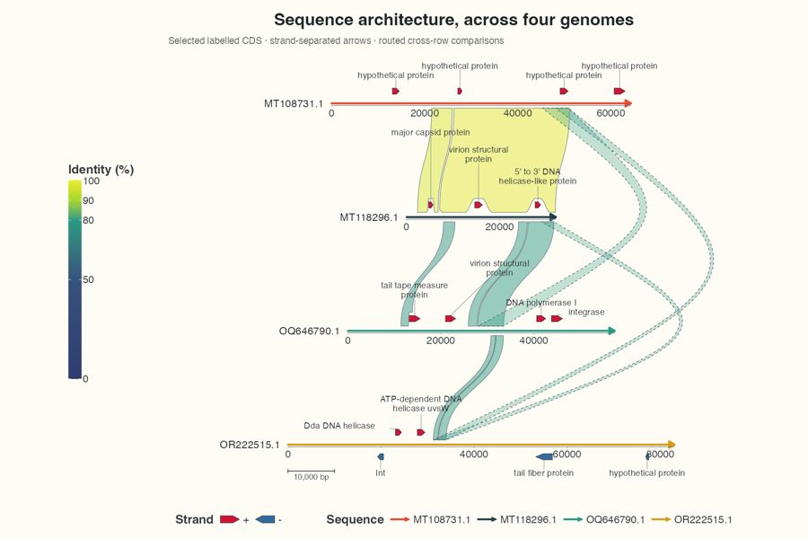</a><figcaption>四基因组共线性图：分链特征与绕行的跨行连接 · <span class="figure-hint">点击放大查看</span></figcaption></figure>
线性宣传图省略tail assembly protein与gp4 protein两条拥挤候选，它们仍保留在原始表和弦图中；其余16个特征逐一标注。相邻行保留筛选HSP，非相邻每对只选最长一条。`show_cross_controls` 与 `show_cross` 的行顺序一一对应；筛选或重新排序后应一同重建。控制点单位是导出布局x/y，不是bp。当前接口支持每条连接2个或4个数值；它塑造两条ribbon边的控制位置，并非全局路径规划器。

本例将短序列水平居中，使用骨架预布局导出的真实行位置、长度与偏移计算控制点，放在中间序列右端附近；不再把路径拉到远处。行距与seq_gap及最长骨架宽度有关，不能把bp直接填进控制点。修改行距、顺序或方向后，应重新检查实际路径；不能保证任意控制点都无自交。

### 局部缺口与虚线 {#collinear-routing-clearance}
上下分链用 `position_strand()`；`link_avoid = "smooth"` 配合默认NULL gap，在箭头附近产生局部退让。跨行外框默认虚线；本例增大linewidth使其可见，不用显式linetype覆盖。此规则依据最终显示邻接，不表示反向比对。

### 比例尺为何曾经没对齐 {#collinear-routing-ruler}
`geom_seq_scale()` 的默认offset是横向2 mm、纵向6 mm，因此原图左端略向右偏移是明确配置，而非bp长度计算出错。本例使用 `offset = unit(c(0, 10), "mm")`，水平起点对齐左侧序列包络，纵向留出标签空间。本例采用水平居中，各行源坐标0不再相互对齐；比例尺对齐左侧包络，反向行的源坐标0还会移到另一端。比例尺衡量距离，不代表某个源区间。

### 继续深入 {#collinear-routing-next}
局部比较优先用[focus/分段](#views)，同源证据见[基因邻域](#homology)，最终结果见[2.6 综合图](#collinear)。GC等定量轨道留在[轨道专题](#tracks)，首页为标签和连接留空间。


## 2.4 比较基因邻域 {#homology}

<div class="task-intro"><p>比较两条质粒的 AmpR 邻域。先核对真实编码 DNA，再建立对应关系，最后聚焦到 CDS 两侧各 200 bp。</p></div>

### 本页准备 {#homology-prepare}
只需随包数据，无需下载文件或重新比对。先加载包和本例的可选排版设置。

<details class="preparation"><summary>准备代码 · 在本页运行一次</summary>

```{r example-39, eval=FALSE}
library(ggchord)
doc_background <- "#FFFCF5"
identity_palette <- c("#303B71", "#36537D", "#269B82", "#A5D52C", "#ECEB31")
identity_values <- c(0, 0.5, 0.8, 0.9, 1)
identity_breaks <- c(0, 50, 80, 90, 100)
doc_legend_theme <- theme(
  legend.title = element_text(size = 13, face = "bold"),
  legend.text = element_text(size = 11),
  legend.key.width = unit(9, "mm"), legend.key.height = unit(5, "mm"),
  legend.spacing.x = unit(9, "mm"), legend.spacing.y = unit(7, "mm"),
  legend.margin = margin(l = 4, r = 4, unit = "mm")
)
sequence_guide <- guide_ggchord_legend(nrow = 1, theme = doc_legend_theme)
strand_guide <- guide_ggchord_legend(
  nrow = 1, override.aes = list(strand = c("+", "-")), theme = doc_legend_theme
)
identity_guide <- guide_ggchord_colourbar(
  position = "left", direction = "vertical",
  theme = theme(
    legend.key.height = unit(75, "mm"), legend.key.width = unit(5, "mm"),
    legend.title = element_text(size = 13, face = "bold"),
    legend.text = element_text(size = 11), legend.margin = margin(r = 7, unit = "mm")
  )
)
doc_theme <- theme_ggchord_publication(
  axis.text = element_text(size = 11),
  axis.text.check.overlap = TRUE
) +
  theme(
    legend.position = "bottom",
    legend.title = element_text(size = 13, face = "bold"),
    legend.text = element_text(size = 11),
    legend.key.width = unit(9, "mm"), legend.key.height = unit(5, "mm"),
    legend.spacing.x = unit(9, "mm"), legend.spacing.y = unit(7, "mm"),
    legend.box.spacing = unit(6, "mm"),
    plot.background = element_rect(fill = doc_background, colour = NA),
    panel.background = element_blank(),
    plot.title = element_text(face = "bold", size = 18),
    plot.subtitle = element_text(size = 10, colour = "#5C625A"),
    plot.margin = margin(14, 18, 14, 18)
  )
doc_axis <- function(coordinates = "relative") {
  scale_seq_position_continuous(
    coordinates = coordinates, n.breaks = 3, minor_breaks = NULL,
    labels = function(x) format(x, scientific = FALSE, big.mark = ",", trim = TRUE)
  )
}
```

</details>

### 1. 提取实际 CDS 与编码 DNA {#homology-membership}
选择随包 pUC19 与 pETDuet-1 的 AmpR 注释，保留 ID、坐标、链和文字。按负链进行反向互补，保证比较的是同一生物学方向的 DNA，而非仅比较注释名称。


```{r example-40, eval=FALSE}
library(dplyr)
data(plasmid_example_pUC19)
data(plasmid_example_pETDuet_1)
homolog_source <- bind_rows(plasmid_example_pUC19, plasmid_example_pETDuet_1)
homolog_seq <- homolog_source |>
  select(accver, length)
cluster_features <- homolog_source |>
  find_common_features() |>
  filter(type == "CDS", anno == "AmpR") |>
  select(accver, start, end, strand, anno) |>
  arrange(match(accver, homolog_source$accver)) |>
  mutate(feature_id = paste(accver, start, end, sep = ":"))
# Membership is computed from exact strand-corrected CDS DNA equality, not gene names.
reverse_complement <- function(sequence) {
  bases <- strsplit(sequence, "")[[1]]
  chartr("ACGT", "TGCA", paste(rev(bases), collapse = ""))
}
coding_sequences <- cluster_features |>
  left_join(select(homolog_source, accver, sequence), by = "accver") |>
  rowwise() |>
  mutate(
    coding_dna = substr(sequence, start, end),
    coding_dna = if (strand == "-") reverse_complement(coding_dna) else coding_dna
  ) |>
  ungroup()
cds_dna <- pull(coding_sequences, coding_dna)
```


`cluster_features` 应有两条实际 CDS，`cds_dna` 保存各自的定向编码序列。本例的严格目标是完全相同 DNA；一般同源性分析可使用外部比对与聚类结果，不能要求所有同源基因完全一致。

### 2. 显式声明成员和序列对 {#homology-links}
用编码 DNA 的完全一致性建立成员表；不同 DNA 不会因为都叫 AmpR 就分入同一组。


```{r example-41, eval=FALSE}
membership <- tibble(
  feature_id = cluster_features$feature_id,
  cluster_id = paste0("exact_CDS_", match(cds_dna, unique(cds_dna)))
)
homologs <- link_ggchord_clusters(cluster_features, membership,
  pairs = tibble(qaccver = homolog_seq$accver[1], saccver = homolog_seq$accver[2])
)
loci <- find_ggchord_loci(homolog_seq, cluster_features,
  targets = cluster_features$feature_id[cluster_features$anno == "AmpR"][1], upstream = 100, downstream = 100
)
```


查看 `membership` 与 `homologs$report$comparisons`、`$members`。连接工具消费已有分组，不计算新的序列比对。未知成员与歧义 paralog 会被报告；只有明确选择 `paralogs = "all"` 才请求受界限约束的所有组合。

### 3. 聚焦到可比较的邻域 {#homology-focus}
全长质粒图会把单个 CDS 压得很小。这里从两条真实 CDS 的源范围构建窗口，两侧各增加 200 bp；原始序列表与注释表保持不变。


```{r example-42, eval=FALSE}
# Compare equivalent local windows instead of shrinking one gene on full plasmids.
homolog_windows <- cluster_features |>
  select(accver, start, end)
local_homologs <- focus_ggchord_data(homolog_seq, homologs$data, cluster_features,
  loci = homolog_windows, expand = 200
)
p_homologs <- ggchord(
  seq_data = local_homologs$seq_data,
  ribbon_data = local_homologs$ribbon_data, gene_data = local_homologs$gene_data
) +
  geom_link_ribbon(fill = "#269B82", alpha = .65) +
  geom_seq(colour = "#233E4A", show.legend = FALSE) +
  geom_feature(
    data = local_homologs$gene_data, feature_fill = "#F1D334",
    position = position_strand(.10), width = .07
  ) +
  geom_feature_label_repel(data = local_homologs$gene_data, size = 4, label_fit = "shrink") +
  geom_seq_label(size = 4) +
  geom_seq_break() +
  coord_collinear() +
  doc_axis("source") +
  doc_theme
p_homologs
```

<figure class="documentation-figure"><a class="figure-link" href="tutorial-assets/homologs.jpg" title="点击放大查看">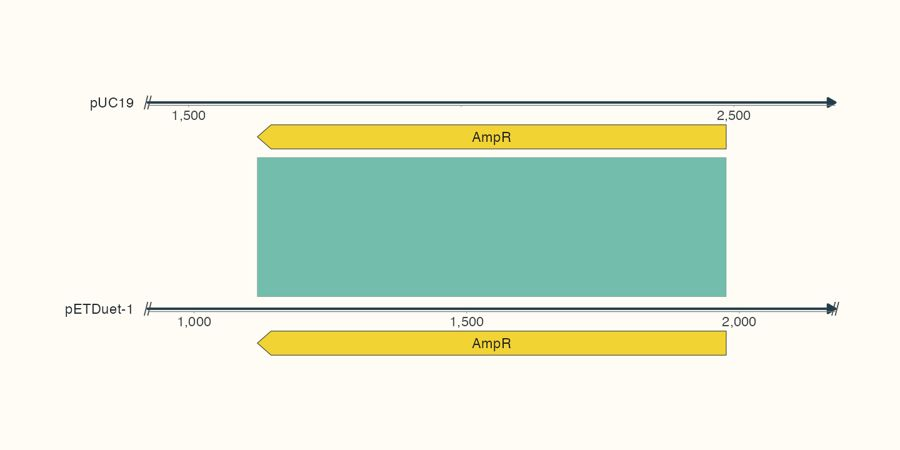</a><figcaption>两条质粒的 AmpR 邻域：相同 CDS、200 bp 侧翼与源坐标 · <span class="figure-hint">点击放大查看</span></figcaption></figure>

两条金色箭头表示已核对的相同编码序列，紫色带连接对应 CDS 范围，内部文字直接标明 AmpR。刻度来自各自源序列，因此同一个横向位置可以显示不同源坐标。断点标记说明图中只保留了局部窗口。

`local_homologs$report` 记录保留与裁剪情况。窗口外的基因没有显示，不表示它们不存在。区间连接表达分组对应范围，不是逐碱基比对；跨分段注释的外包范围也不等于外显子级对应。

### 4. 将有证据的蛋白区间投影到两端 CDS {#homology-projection}

```{r example-43, eval=FALSE}
# Exact CDS DNA equality supplies evidence for these selected ungapped residues.
matching <- homologs$data |>
  slice_head(n = 1)
paired_coding <- cluster_features |>
  mutate(phase = 0)
paired_cds <- build_ggchord_cds(paired_coding)
protein_link <- tibble(
  qfeature_id = matching$qfeature_id, sfeature_id = matching$sfeature_id,
  qstart = 1, qend = 20, sstart = 1, send = 20
)
projected_links <- project_ggchord_links(protein_link, paired_cds, ungapped = TRUE)
projected_links
```

| 项目 | 结果 |
| --- | --- |
| 投影到基因组的注释行数 | 1 |
| 投影后的核苷酸连接行数 | 1 |

这里选择相同 CDS 的前 20 个残基，因此 `ungapped = TRUE` 有实际序列依据。普通 BLASTp HSP 不能仅凭两端跨度相等作出这个断言。工具保留源蛋白统计，不把蛋白相似度冒充核苷酸相似度。

### 完成后检查 {#homology-check-result}
两个内部标签都应为 AmpR，箭头保留真实负链方向。对应关系来自编码 DNA；源坐标与聚焦报告解释了局部显示。保存时使用 [10 × 5 in 的明确尺寸](#output)。

下一步：[真实 BLASTp 查询区间读取](#alignments-protein)、[CDS 投影及分段限制](#projection)、[独立局部窗口](#views)。

### 保存本页结果 {#homology-save-result}
在工作目录中保存刚刚创建的图；预览时使用相同宽高。

```{r example-44, eval=FALSE}
ggsave("ampR-neighbourhood.png", p_homologs, width = 10, height = 5, units = "in", dpi = 144)
```


## 2.5 局部、锚定与分段 {#views}

<div class="task-intro"><p>为已有输入选择局部窗口或分段视图，同时保留原始位置与显示变换的区别。</p></div>

### 本页准备 {#views-prepare}
在新的 R 会话中先运行下方代码，再按页面顺序继续。配色和排版是可选的显示设置，输入只选择需要的列。

<details class="preparation"><summary>准备代码 · 在本页运行一次</summary>

```{r example-45, eval=FALSE}
library(ggchord)
library(dplyr)
data(seq_data_example)
data(ribbon_data_example)
data(gene_data_example)
seqs <- seq_data_example |>
  select(accver, length)
links <- ribbon_data_example |>
  select(qaccver, saccver, qstart, qend, sstart, send)
# The fixture preserves biological strands separately from its old display strands.
genes <- gene_data_example |>
  transmute(accver, start, end, strand = source_strand)

# Optional appearance choices; none of these columns or scales is required input.
library(ggchord)
seq_palette <- setNames(
  c("#E64B35", "#233E4A", "#269B82", "#D59B17"),
  c("MT108731.1", "MT118296.1", "OQ646790.1", "OR222515.1")
)
gene_palette <- c("+" = "#CE1536", "-" = "#346B9D", "." = "#8291A6")

library(ggchord)
doc_background <- "#FFFCF5"
identity_palette <- c("#303B71", "#36537D", "#269B82", "#A5D52C", "#ECEB31")
identity_values <- c(0, 0.5, 0.8, 0.9, 1)
identity_breaks <- c(0, 50, 80, 90, 100)
doc_legend_theme <- theme(
  legend.title = element_text(size = 13, face = "bold"),
  legend.text = element_text(size = 11),
  legend.key.width = unit(9, "mm"), legend.key.height = unit(5, "mm"),
  legend.spacing.x = unit(9, "mm"), legend.spacing.y = unit(7, "mm"),
  legend.margin = margin(l = 4, r = 4, unit = "mm")
)
sequence_guide <- guide_ggchord_legend(nrow = 1, theme = doc_legend_theme)
strand_guide <- guide_ggchord_legend(
  nrow = 1, override.aes = list(strand = c("+", "-")), theme = doc_legend_theme
)
identity_guide <- guide_ggchord_colourbar(
  position = "left", direction = "vertical",
  theme = theme(
    legend.key.height = unit(75, "mm"), legend.key.width = unit(5, "mm"),
    legend.title = element_text(size = 13, face = "bold"),
    legend.text = element_text(size = 11), legend.margin = margin(r = 7, unit = "mm")
  )
)
doc_theme <- theme_ggchord_publication(
  axis.text = element_text(size = 11),
  axis.text.check.overlap = TRUE
) +
  theme(
    legend.position = "bottom",
    legend.title = element_text(size = 13, face = "bold"),
    legend.text = element_text(size = 11),
    legend.key.width = unit(9, "mm"), legend.key.height = unit(5, "mm"),
    legend.spacing.x = unit(9, "mm"), legend.spacing.y = unit(7, "mm"),
    legend.box.spacing = unit(6, "mm"),
    plot.background = element_rect(fill = doc_background, colour = NA),
    panel.background = element_blank(),
    plot.title = element_text(face = "bold", size = 18),
    plot.subtitle = element_text(size = 10, colour = "#5C625A"),
    plot.margin = margin(14, 18, 14, 18)
  )
doc_axis <- function(coordinates = "relative") {
  scale_seq_position_continuous(
    coordinates = coordinates, n.breaks = 3, minor_breaks = NULL,
    labels = function(x) format(x, scientific = FALSE, big.mark = ",", trim = TRUE)
  )
}
```

</details>

### 保留来源的局部聚焦 {#views-focus}


```{r example-46, eval=FALSE}
focus_loci <- tibble(
  accver = seqs$accver,
  start = floor(seqs$length * .25), end = floor(seqs$length * .75)
)
focused <- focus_ggchord_data(seqs, links, genes, loci = focus_loci)
p_focus <- ggchord(
  seq_data = focused$seq_data, ribbon_data = focused$ribbon_data,
  gene_data = focused$gene_data
) +
  geom_seq() +
  geom_link_ribbon(fill = "#6BAFA6", alpha = .5) +
  geom_gene() +
  geom_seq_break() +
  geom_seq_label(size = 4) +
  scale_seq_colour_manual(values = seq_palette) +
  scale_gene_fill_manual(values = gene_palette) +
  doc_axis("source") +
  coord_collinear() +
  doc_theme
p_focus
```

<figure class="documentation-figure"><a class="figure-link" href="tutorial-assets/focus.jpg" title="点击放大查看">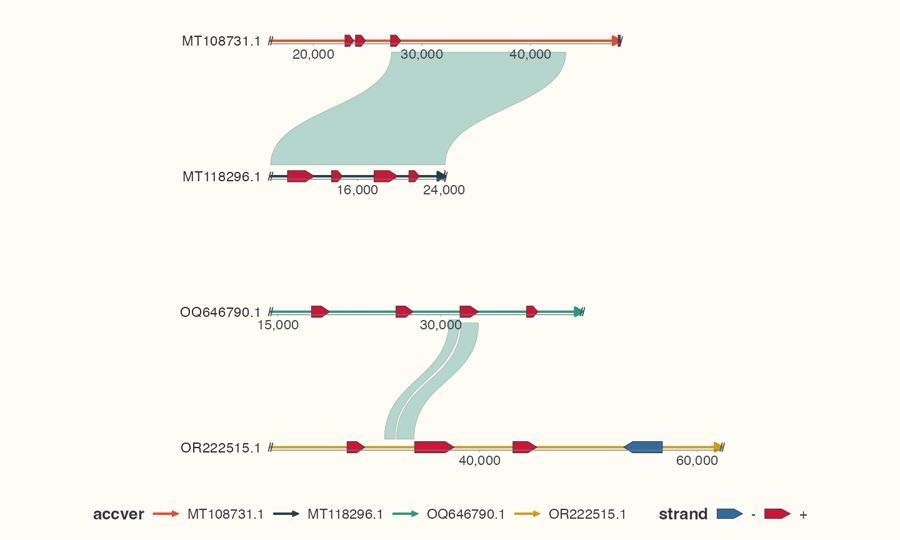</a><figcaption>保留原始坐标刻度的局部序列视图 · <span class="figure-hint">点击放大查看</span></figcaption></figure>

focus 把保留位置移到局部一基坐标，同时保留源原点、截断标记与报告。
`boundary = "trim"` 可按线性显示投影裁剪连接，不重新比对序列；缩放后的比对长度
带估计标记。`coordinates = "source"` 恢复源坐标轴标签，重复聚焦后同样适用。

### 独立窗口与局部翻转 {#views-segments}

```{r example-47, eval=FALSE}
windows <- tibble(
  accver = rep(seqs$accver[1], 2),
  start = c(1, floor(seqs$length[1] * .65)), end = c(floor(seqs$length[1] * .4), seqs$length[1]),
  locus_id = c("left_window", "right_window"), row_id = seqs$accver[1], orientation = c(1, -1)
)
segmented <- segment_ggchord_data(slice_head(seqs, n = 1), windows = windows)
p_segments <- ggchord(seq_data = segmented$seq_data) +
  geom_seq() +
  coord_collinear(segments = segmented$segments, segment_gap = 2000)
p_segments
```


各窗口有可逆的源映射，被省略的间隙没有映射。`map_ggchord_position()` 把显式源
位置映射到图中，供普通 ggplot2 注释使用。多个窗口共享源序列时应指定窗口 ID。
显示方向不表示原始链发生改变。

### 显式生物学关系 {#views-homology}
`find_ggchord_loci()` 按声明的注释/名称查询选择位置。
`link_ggchord_clusters()` 要求显式成员表和序列对，基因名称相同不构成同源证据。
`filter_ggchord_ribbons()`、`deduplicate_ggchord_ribbons()`、
`merge_ggchord_ribbons()` 整理已有比对，保留源成员和估计长度标记。
聚束和密度统计汇总已提供连接，不创建新的序列比对。

### 按源坐标放置普通注释 {#views-mapping}

```{r example-48, eval=FALSE}
source_position <- focus_loci$start[1] + 100
source_mark <- map_ggchord_position(p_focus, seqs$accver[1], source_position, source = TRUE)
p_marked <- p_focus +
  ggplot2::geom_point(
    data = source_mark, aes(x, y),
    inherit.aes = FALSE, colour = "#D59B17", size = 3
  )
p_marked
```


先运行[focus 例子](#views-focus)。辅助函数返回第一个所选窗口起点后 100 bp 位置的笛卡尔 x/y，
不把全部普通 ggplot2 坐标变成基因组 bp。分段视图应选窗口 ID，检查落在省略间隙
的位置，不跨间隙外推。区域 选择来自明确注释/同源分组 证据时见[显式同源关系](#homology)。

### 完成后检查 {#views-check-result}
关注裁剪报告、断点与源坐标。被省略的间隙没有映射；显示翻转不应直接解释为生物学倒位。

<div class="next-step">继续：<a href="#homology">连接同源基因 →</a></div>


## 2.6 共线性综合展示 {#collinear}

<div class="lesson-intro">模块二的综合结果：四条真实基因组、分链特征和向外绕行的跨行连接。</div>

### 综合结果 {#collinear-overview}
<figure class="documentation-figure"><a class="figure-link" href="tutorial-assets/showcasecollinear.jpg" title="点击放大查看"></a><figcaption>四基因组共线性图：分链特征与绕行的跨行连接 · <span class="figure-hint">点击放大查看</span></figcaption></figure>

共线性来自弦图的坐标表达扩展；复用数据和图层是设计目标。先读[数据](#collinear-data)、[坐标替换](#collinear-build)、[路由与比例尺](#collinear-routing)，再运行下方完整代码。沿用弦图的精选候选与相似度标度；线性图省略两条拥挤的短候选，展示16个CDS，每个特征传入标签层。正负链在骨架上下分列。

### 准备原始记录 {#collinear-prepare}
解压[教学输入包](https://github.com/DangJem/ggchord/tree/main/examples)，安装dplyr、purrr、tidyr后运行：

<details class="preparation"><summary>准备代码 · 在本页运行一次</summary>

```{r example-49, eval=FALSE}
# Optional appearance choices; none of these columns or scales is required input.
library(ggchord)
seq_palette <- setNames(
  c("#E64B35", "#233E4A", "#269B82", "#D59B17"),
  c("MT108731.1", "MT118296.1", "OQ646790.1", "OR222515.1")
)
gene_palette <- c("+" = "#CE1536", "-" = "#346B9D", "." = "#8291A6")

library(ggchord)
doc_background <- "#FFFCF5"
identity_palette <- c("#303B71", "#36537D", "#269B82", "#A5D52C", "#ECEB31")
identity_values <- c(0, 0.5, 0.8, 0.9, 1)
identity_breaks <- c(0, 50, 80, 90, 100)
doc_legend_theme <- theme(
  legend.title = element_text(size = 13, face = "bold"),
  legend.text = element_text(size = 11),
  legend.key.width = unit(9, "mm"), legend.key.height = unit(5, "mm"),
  legend.spacing.x = unit(9, "mm"), legend.spacing.y = unit(7, "mm"),
  legend.margin = margin(l = 4, r = 4, unit = "mm")
)
sequence_guide <- guide_ggchord_legend(nrow = 1, theme = doc_legend_theme)
strand_guide <- guide_ggchord_legend(
  nrow = 1, override.aes = list(strand = c("+", "-")), theme = doc_legend_theme
)
identity_guide <- guide_ggchord_colourbar(
  position = "left", direction = "vertical",
  theme = theme(
    legend.key.height = unit(75, "mm"), legend.key.width = unit(5, "mm"),
    legend.title = element_text(size = 13, face = "bold"),
    legend.text = element_text(size = 11), legend.margin = margin(r = 7, unit = "mm")
  )
)
doc_theme <- theme_ggchord_publication(
  axis.text = element_text(size = 11),
  axis.text.check.overlap = TRUE
) +
  theme(
    legend.position = "bottom",
    legend.title = element_text(size = 13, face = "bold"),
    legend.text = element_text(size = 11),
    legend.key.width = unit(9, "mm"), legend.key.height = unit(5, "mm"),
    legend.spacing.x = unit(9, "mm"), legend.spacing.y = unit(7, "mm"),
    legend.box.spacing = unit(6, "mm"),
    plot.background = element_rect(fill = doc_background, colour = NA),
    panel.background = element_blank(),
    plot.title = element_text(face = "bold", size = 18),
    plot.subtitle = element_text(size = 10, colour = "#5C625A"),
    plot.margin = margin(14, 18, 14, 18)
  )
doc_axis <- function(coordinates = "relative") {
  scale_seq_position_continuous(
    coordinates = coordinates, n.breaks = 3, minor_breaks = NULL,
    labels = function(x) format(x, scientific = FALSE, big.mark = ",", trim = TRUE)
  )
}
```

</details>

```{r example-50, eval=FALSE}
library(ggchord)
library(dplyr)
library(purrr)
library(tidyr)
# Original repository records; extract the tutorial input bundle first.
show_sequences <- read_fasta_lengths(files = "examples/fasta/*.fna") |>
  select(accver, length)
show_annotations <- read_gff3(files = "examples/gff3/*.gff3", unstranded = "keep")
show_genes <- show_annotations |>
  filter(type == "CDS") |>
  select(accver, start, end, strand, anno)
show_alignments <- read_blast(files = "examples/blastn-standard/*.tsv")
# At most three substantial observed HSPs per pair; no coordinates are invented.
show_links <- show_alignments |>
  filter(length >= 900, pident >= 75) |>
  group_by(qaccver, saccver) |>
  slice_max(length, n = 3, with_ties = FALSE) |>
  ungroup()
# Select up to four source CDS per sequence, spread across annotation order.
# No feature is moved or invented; keep complete source tables separately.
show_features <- show_genes |>
  filter(end - start + 1 >= 500) |>
  group_by(accver) |>
  arrange(start, .by_group = TRUE) |>
  mutate(display_bin = ntile(row_number(), 4), informative = !is.na(anno) & anno != "hypothetical protein") |>
  group_by(accver, display_bin) |>
  arrange(desc(informative), desc(end - start), .by_group = TRUE) |>
  slice_head(n = 1) |>
  ungroup() |>
  select(accver, start, end, strand, anno)
# Also retain well-separated negative-strand CDS, if not already represented.
show_reverse <- show_genes |>
  filter(strand == "-", end - start + 1 >= 500) |>
  group_by(accver) |>
  arrange(start, .by_group = TRUE) |>
  slice(c(1, n())) |>
  ungroup()
show_features <- bind_rows(show_features, show_reverse) |>
  distinct(accver, start, end, strand, .keep_all = TRUE) |>
  arrange(accver, start)
show_labels <- show_features
show_optimization <- optimize_ggchord_layout(
  show_sequences, show_links,
  optimize = "orientation", weight = "length"
)
```


保留四条完整FASTA、266条CDS及32条原始HSP。相邻行使用明确筛选的观测区间；非相邻每对仅保留最长一条，减轻长连接重叠。

### 为连接和标签保留空间 {#collinear-gc}
首页不再添加GC轨道，序列组成分析留在[轨道专题](#tracks)。避免将两种不同的阅读任务挤在同一宣传图中。

### 组合图层 {#collinear-compose}

```{r example-51, eval=FALSE}
# Omit two short, crowded candidates from this linear display only.
# Both source rows remain in show_features and in the chord display.
show_linear_features <- show_features |>
  filter(!anno %in% c("tail assembly protein", "gp4 protein"))
# Separate adjacent and cross-row links, retaining original endpoint values.
show_pair_rows <- show_links |>
  mutate(
    query_row = match(qaccver, show_sequences$accver),
    subject_row = match(saccver, show_sequences$accver),
    span = abs(query_row - subject_row)
  )
show_adjacent <- show_pair_rows |> filter(span == 1)
# One longest observed HSP per non-neighbour pair keeps the long routes legible.
show_cross <- show_pair_rows |>
  filter(span > 1) |>
  group_by(qaccver, saccver) |>
  slice_max(length, n = 1, with_ties = FALSE) |>
  ungroup()
# Inspect a backbone-only layout using the same alignment and gap as the final view.
show_linear_coord <- coord_collinear(align = "center", orientation = "auto", ratio = 0.7)
show_routing_base <- ggchord(show_sequences, show_links) +
  geom_seq(seq_gap = 0.42) + show_linear_coord
show_reference <- get_chord_layout(show_routing_base)$sequence_reference
# Shared controls sit just beyond the intervening backbones, rather than far away.
show_cross_controls <- map2(show_cross$query_row, show_cross$subject_row, function(query_row, subject_row) {
  between <- seq(min(query_row, subject_row) + 1L, max(query_row, subject_row) - 1L)
  middle_ids <- show_sequences$accver[between]
  right_edge <- max(show_reference$x_offset[middle_ids] + show_reference$lens[middle_ids] * show_reference$x_scale)
  middle_y <- mean(show_reference$y[show_sequences$accver[c(query_row, subject_row)]])
  c(right_edge + if (abs(query_row - subject_row) == 3) 0.85 else 0.65, middle_y)
})
p_show_collinear <- ggchord(show_sequences, gene_data = show_linear_features) +
  geom_link_ribbon(
    aes(ribbon_fill = pident),
    data = show_adjacent,
    link_avoid = "smooth", alpha = 0.48, linewidth = 0.22
  ) +
  geom_link_ribbon(
    aes(ribbon_fill = pident),
    data = show_cross,
    adjacent_only = FALSE, link_ctrl_point = show_cross_controls,
    link_avoid = "smooth", alpha = 0.28, linewidth = 0.3
  ) +
  geom_seq(seq_gap = 0.42, linewidth = 1) +
  geom_gene(position = position_strand(0.09), width = 0.045) +
  geom_gene_label_repel(
    data = show_linear_features |> arrange(desc(nchar(anno)), accver, start),
    label_layout = "auto", label_wrap = 24,
    label_side = "auto", position = position_strand(0.09), size = 3.3
  ) +
  geom_seq_label(size = 4) +
  geom_seq_scale(length = 10000, offset = unit(c(0, 10), "mm")) +
  scale_seq_colour_manual(
    values = seq_palette, name = "Sequence",
    guide = sequence_guide
  ) +
  scale_gene_fill_manual(values = gene_palette, breaks = c("+", "-"), name = "Strand") +
  scale_ribbon_fill_gradientn(
    colours = identity_palette, values = identity_values,
    limits = c(0, 100), breaks = identity_breaks, name = "Identity (%)", guide = identity_guide
  ) +
  guides(gene_fill = strand_guide) +
  scale_seq_position_continuous(breaks = c(0, 20000, 40000, 60000, 80000), minor_breaks = NULL) +
  show_linear_coord +
  doc_theme +
  labs(
    title = "Sequence architecture, across four genomes",
    subtitle = "Selected labelled CDS · strand-separated arrows · routed cross-row comparisons"
  )
p_show_collinear
```


虚线外框标识非相邻显示行，较明显的线宽便于辨认。控制点沿右侧分流，局部smooth避障在箭头附近退让。identity左侧色条与弦图一致，底部链图例使用箭头。比例尺水平offset为0，长度仍按共享bp转换计算。

### 调整与限制 {#collinear-read}
修改seq_gap、行顺序、方向或连接筛选后，应同步重建控制点。局部箭头避障不是绕过中间整条序列的自动路由器；跨行ribbon之间仍可合法相交。需要局部观察时使用[focus与分段](#views)。当前显式圆形半径/曲率不能直接传入共线性坐标，见[转换边界](#collinear-data-contract)。

### 按预定尺寸保存 {#collinear-save}
```{r example-52, eval=FALSE}
ggsave("four-genome-collinear.png", p_show_collinear, width = 12, height = 8, units = "in", dpi = 144)
```


## 3.1 DNA、注释与13个参考序列 {#plasmid-data}

单序列圆图可从一张两列表开始。要识别特征、引物或酶切位点，则另外提供真实DNA；已有注释时可以直接画表格，无需再次识别。

### 输入表与可选信息 {#plasmid-data-tables}
| 输入 | 必需内容 | 可选内容 |
| --- | --- | --- |
| 骨架 | accver, length，且只有一条序列 | label用于显示名称；sequence用于搜索 |
| 通用特征 | accver, start, end与方向声明 | type、anno/label、feature_id、形状类别 |
| 引物 | 已计算的结合区间、链与名称等对应geom要求 | 识别与来源信息 |
| 酶切位点 | 搜索结果中对应geom的位点与名称 | 酶目录、甲基化假设与筛选来源 |

最简单骨架只需要前两列，不能要求所有人都提供DNA。后两类优先使用本包搜索返回的表，字段细节查相应函数帮助。未知链特征由通用feature层表达，不伪造正链。

### 查看随包真实记录 {#plasmid-data-inspect}
```{r example-53, eval=FALSE}
library(ggchord)
library(dplyr)
plasmid_example_pUC19 |> select(accver, length)
find_common_features(plasmid_example_pUC19) |> select(accver, start, end, strand, type, anno) |> slice_head(n = 5)
```

数据字段命名沿用ggchord早期的BLAST风格；单序列ID仍称accver，不要求来自数据库。完整DNA与长度必须一致。识别得到的是计算匹配，不是实验验证。

### 导入自己的质粒 {#plasmid-data-import}
`read_fasta_lengths()`只读取FASTA标识与完整长度。识别还需要额外读取实际DNA，例如用可选Biostrings的 `readDNAStringSet()` 和 `as.character()`，保留与表格一致的ID；有GFF3/BED/GenBank或GRanges时按[格式专题](#formats)导入注释，保留来源。跨圆周起点与分段记录按对应导入契约处理，不手工把所有片段合成一个虚假的连续区间。

### 案例如何循序渐进 {#plasmid-data-path}
[3.2](#plasmid-build)从pUC19双线骨架逐层添加；[3.3](#recognition)解释识别目录和引物/酶切；[3.4](#plasmid-catalog)覆盖仓库13个独立质粒；[3.5](#plasmids-complex)完成pETDuet-1密集图。`pUC19c`只是兼容别名，不能冒充第14个案例。


## 3.2 从圆圈到多层注释 {#plasmid-build}

这一页只关注每次新增的视觉信息。准备时计算输入，绘图仍由独立图层完成。

### 本页准备 {#plasmid-build-prepare}
<details class="preparation"><summary>准备代码 · 在本页运行一次</summary>

```{r example-54, eval=FALSE}
library(ggchord)
feature_palette <- c(
  CDS = "#993366", promoter = "#31849B", rep_origin = "#F1E51D",
  primer_bind = "#A020F0", misc_feature = "#A6ACB3", protein_bind = "#31849B"
)

library(ggchord)
doc_background <- "#FFFCF5"
identity_palette <- c("#303B71", "#36537D", "#269B82", "#A5D52C", "#ECEB31")
identity_values <- c(0, 0.5, 0.8, 0.9, 1)
identity_breaks <- c(0, 50, 80, 90, 100)
doc_legend_theme <- theme(
  legend.title = element_text(size = 13, face = "bold"),
  legend.text = element_text(size = 11),
  legend.key.width = unit(9, "mm"), legend.key.height = unit(5, "mm"),
  legend.spacing.x = unit(9, "mm"), legend.spacing.y = unit(7, "mm"),
  legend.margin = margin(l = 4, r = 4, unit = "mm")
)
sequence_guide <- guide_ggchord_legend(nrow = 1, theme = doc_legend_theme)
strand_guide <- guide_ggchord_legend(
  nrow = 1, override.aes = list(strand = c("+", "-")), theme = doc_legend_theme
)
identity_guide <- guide_ggchord_colourbar(
  position = "left", direction = "vertical",
  theme = theme(
    legend.key.height = unit(75, "mm"), legend.key.width = unit(5, "mm"),
    legend.title = element_text(size = 13, face = "bold"),
    legend.text = element_text(size = 11), legend.margin = margin(r = 7, unit = "mm")
  )
)
doc_theme <- theme_ggchord_publication(
  axis.text = element_text(size = 11),
  axis.text.check.overlap = TRUE
) +
  theme(
    legend.position = "bottom",
    legend.title = element_text(size = 13, face = "bold"),
    legend.text = element_text(size = 11),
    legend.key.width = unit(9, "mm"), legend.key.height = unit(5, "mm"),
    legend.spacing.x = unit(9, "mm"), legend.spacing.y = unit(7, "mm"),
    legend.box.spacing = unit(6, "mm"),
    plot.background = element_rect(fill = doc_background, colour = NA),
    panel.background = element_blank(),
    plot.title = element_text(face = "bold", size = 18),
    plot.subtitle = element_text(size = 10, colour = "#5C625A"),
    plot.margin = margin(14, 18, 14, 18)
  )
doc_axis <- function(coordinates = "relative") {
  scale_seq_position_continuous(
    coordinates = coordinates, n.breaks = 3, minor_breaks = NULL,
    labels = function(x) format(x, scientific = FALSE, big.mark = ",", trim = TRUE)
  )
}

library(dplyr)
data(plasmid_example_pUC19)
plasmid_seq <- plasmid_example_pUC19 |>
  select(accver, length)
plasmid_feature_source <- find_common_features(plasmid_example_pUC19)
# Dedicated primer layers already show bindings; avoid duplicate primer annotations.
plasmid_features <- plasmid_feature_source |>
  filter(type != "primer_bind") |>
  select(accver, start, end, strand, type, anno)
plasmid_primers <- find_primer_bindings(plasmid_example_pUC19, set = "universal")
plasmid_sites <- find_restriction_sites(plasmid_example_pUC19)
display_sites <- filter_restriction_sites(plasmid_sites, enzymes = c("EcoRI", "BamHI", "HindIII"))
primer_names <- primer_catalog(set = "universal")
```

</details>

```{r example-55, eval=FALSE}
plasmid_position <- position_feature_stack(spacing = 0.085, base_position = position_plasmid())
p_plasmid_backbone <- ggchord(seq_data = plasmid_seq) +
  geom_seq(seq_style = "double", colour = "#252525") +
  geom_seq_center_label() +
  coord_circular(rotation = 90) +
  theme_ggchord_plasmid() +
  theme(
    panel.background = element_blank(),
    plot.background = element_rect(fill = doc_background, colour = NA)
  )
p_plasmid_features <- p_plasmid_backbone +
  geom_feature_plasmid(data = plasmid_features, position = plasmid_position)
p_plasmid_text <- p_plasmid_features +
  geom_feature_label_repel(
    data = plasmid_features, position = plasmid_position,
    external = TRUE, label_fit = "shrink", label_min_size = 2.5
  )
p_plasmid_text
```


### 第一步：双线骨架与中心名称 {#plasmid-build-backbone}
<figure class="documentation-figure"><a class="figure-link" href="tutorial-assets/plasmidbackbone.jpg" title="点击放大查看">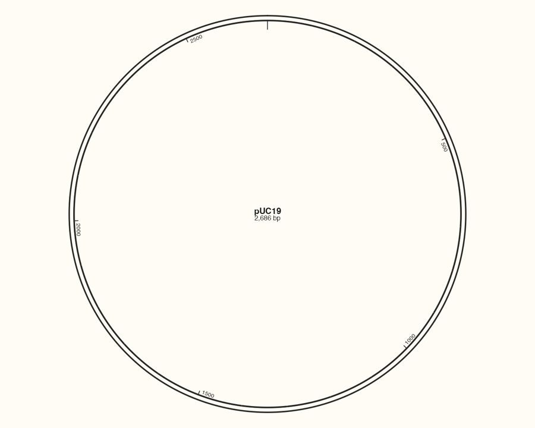</a><figcaption>pUC19第一步：双线骨架 · <span class="figure-hint">点击放大查看</span></figcaption></figure>
先检查长度和名称。`coord_circular()` 仅接受一条序列；双线样式由geom控制。

### 第二步：加入特征形状 {#plasmid-build-features}
<figure class="documentation-figure"><a class="figure-link" href="tutorial-assets/plasmidfeatures.jpg" title="点击放大查看">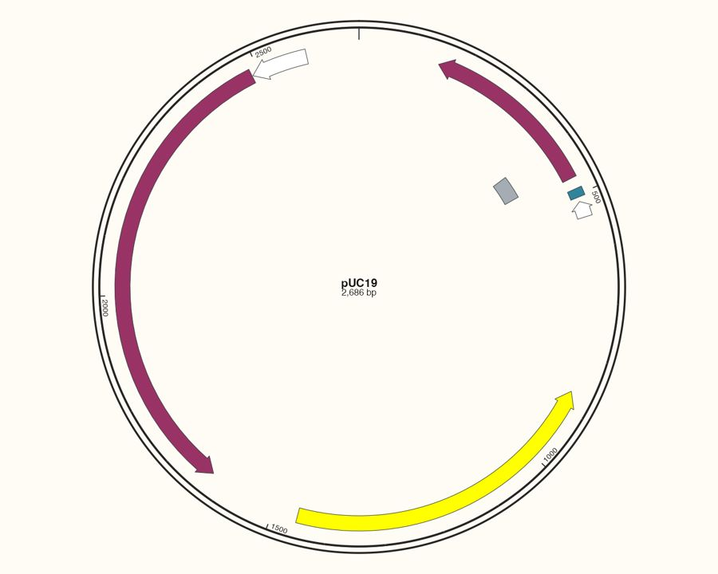</a><figcaption>pUC19第二步：特征 · <span class="figure-hint">点击放大查看</span></figcaption></figure>
`position_feature_stack()` 为重叠注释分层，`geom_feature_plasmid()` 按实际类别选择形状和配色。短特征可能使用紧凑形状，不等于缺失。

### 第三步：为特征适配标签 {#plasmid-build-labels}
<figure class="documentation-figure"><a class="figure-link" href="tutorial-assets/plasmidtext.jpg" title="点击放大查看">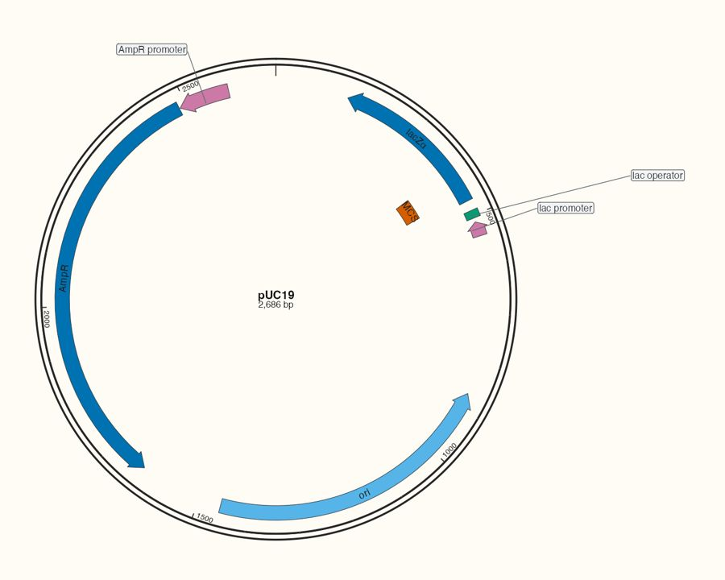</a><figcaption>pUC19第三步：标签 · <span class="figure-hint">点击放大查看</span></figcaption></figure>
箭头层与标签层使用同一Position。允许文字在明确字号下限内缩小，必要时外置；尺寸变化后重新检查。

### 第四步：引物与选定酶切位点 {#plasmid-build-details}

```{r example-56, eval=FALSE}
plasmid_position <- position_feature_stack(spacing = .10, base_position = position_plasmid())
p_plasmid <- ggchord(seq_data = plasmid_seq) +
  geom_seq(seq_style = "double") +
  geom_feature_plasmid(aes(feature_fill = type), data = plasmid_features, position = plasmid_position) +
  geom_feature_label_repel(
    data = plasmid_features, position = plasmid_position,
    size = 4
  ) +
  geom_primer(data = plasmid_primers, colour = "#A020F0") +
  geom_primer_label_repel(data = plasmid_primers, colour = "#A020F0", max_overlaps = 0, size = 3) +
  geom_restriction_site(data = display_sites, colour = "#29364B", label_size = 3, leader = "radial") +
  geom_seq_center_label() +
  scale_feature_fill_manual(values = feature_palette) +
  scale_seq_position_continuous() +
  coord_circular(rotation = 90) +
  theme_ggchord_plasmid() +
  theme(
    legend.title = element_text(size = 13, face = "bold"),
    legend.text = element_text(size = 11),
    legend.spacing.x = unit(9, "mm"), legend.spacing.y = unit(7, "mm"),
    plot.background = element_rect(fill = doc_background, colour = NA),
    panel.background = element_blank()
  )
p_plasmid
```

<figure class="documentation-figure"><a class="figure-link" href="tutorial-assets/plasmid.jpg" title="点击放大查看">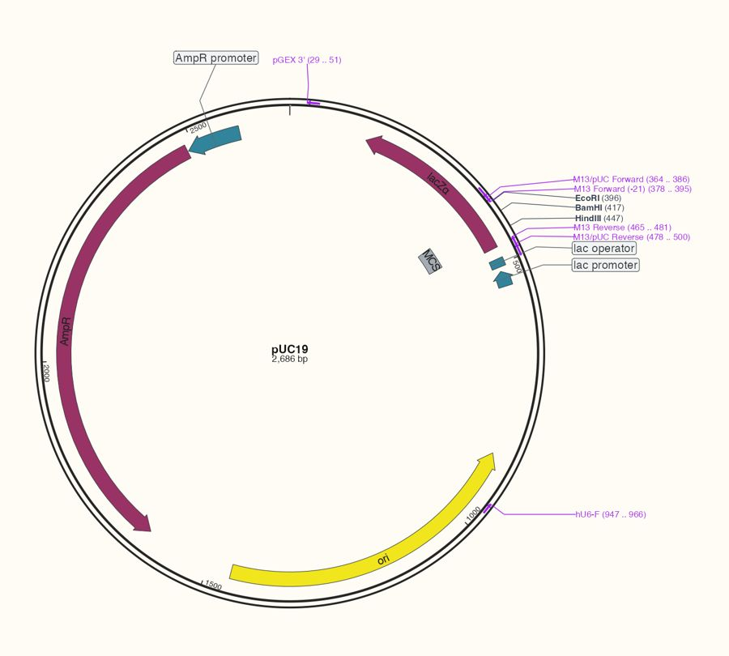</a><figcaption>pUC19 注释、精确引物命中与三个选定酶切位点 · <span class="figure-hint">点击放大查看</span></figcaption></figure>
只展示选定的三个酶切位点，完整搜索表仍保留。完整的识别方法、来源与假设见[3.3](#recognition)。然后使用[13个参考案例](#plasmid-catalog)比较注释密度，最后完成[pETDuet-1综合图](#plasmids-complex)。


## 3.3 识别特征、引物与酶切 {#recognition}

<div class="task-intro"><p>从已知 DNA 搜索引物、限制酶和常见注释，再决定如何显示；计算命中与实验验证是不同事情。</p></div>

### 本页准备 {#recognition-prepare}
在新的 R 会话中先运行下方代码，再按页面顺序继续。配色和排版是可选的显示设置，输入只选择需要的列。

```{r example-57, eval=FALSE}
library(ggchord)
library(dplyr)
```

### 搜索与显示分开 {#recognition-search}
直接使用随包 pUC19 DNA，查找目录引物的精确命中与选定酶切位点：


```{r example-58, eval=FALSE}
data(plasmid_example_pUC19)
target <- setNames(plasmid_example_pUC19$sequence, plasmid_example_pUC19$accver)
primers <- find_primer_bindings(target, set = "universal")
sites <- find_restriction_sites(target, enzymes = c("EcoRI", "BamHI", "HindIII"), methylation = "none")
recognition_seq <- plasmid_example_pUC19 |>
  select(accver, length)
p_sites <- ggchord(seq_data = recognition_seq) +
  geom_seq() +
  geom_primer(data = primers, colour = "#A020F0") +
  geom_restriction_site(data = sites, colour = "#29364B") +
  coord_circular()
p_sites
```


圆形搜索也检查跨原点的候选位置。线性序列应设置 `circular = FALSE`。搜索命中是计算匹配，
不等于实验验证。引物 `"three_prime"` 模式寻找精确后缀，没有错配模型；
Wallace 熔解温度估计是基于组成的启发式值。

### 解释酶切结果 {#recognition-restriction}
`find_restriction_sites()` 返回未筛选匹配和切割坐标，`filter_restriction_sites()`
选择显示集合。酶位点计数针对完整输入序列，筛选后保持不变。
`methylation = "auto"` 仅为精确识别的内置参考使用已审计背景，不能据此声称未知
样品不受阻断。本例明确选择 `"none"`，这是搜索条件，不是对实际样品甲基化状态的测量。
`geom_restriction_site(leader = "radial")` 是默认连线方式。

### 通用注释识别 {#recognition-features}
`find_common_features()` 支持精确参考的整理注释、DNA 匹配及逐记录检测模式。
蛋白搜索采用标准遗传密码六框翻译，不处理剪接、替代起始或跨原点蛋白匹配。
来源中的遗传密码元数据不选择另一套翻译表；非标准遗传密码应使用 DNA 匹配或外部
支持相应遗传密码的分析。confidence 是启发式标签，不是概率。
已知蛋白/基因组对应关系应使用[显式 CDS 投影](#projection)。

### 跟随完整参考注释流程 {#recognition-reference}
这个简短流程和完整圆图使用同一条有来源的随包质粒。[完整 pUC19 流程](#plasmids)将目录注释、
精确参考匹配、酶位点显示筛选、引物标签及注释堆叠组合起来。
只修改序列名称不能让它成为已知参考，有来源的识别依据是序列内容。
应读取结果方法及甲基化来源，不能把参考结论赋予未知样本。

### 完成后检查 {#recognition-check-result}
查看命中坐标、方法与来源。酶位点筛选是显示选择；甲基化搜索条件不是对未知样本状态的测量。

<div class="next-step">继续：<a href="#plasmids">绘制完整质粒图 →</a></div>


## 3.4 13个质粒参考案例 {#plasmid-catalog}

本图库包含13个独立的仓库FASTA参考记录，全部由当前代码重绘。旧版PNG和.dna文件不是本轮输出；下方只将载体用途作为学习线索，不由图形证明实验功能。完整来源和长度由随包数据及生成规则保留。

### 一次准备全部案例 {#plasmid-catalog-prepare}
<details class="preparation"><summary>准备代码 · 在本页运行一次</summary>

```{r example-59, eval=FALSE}
library(ggchord)
doc_background <- "#FFFCF5"
identity_palette <- c("#303B71", "#36537D", "#269B82", "#A5D52C", "#ECEB31")
identity_values <- c(0, 0.5, 0.8, 0.9, 1)
identity_breaks <- c(0, 50, 80, 90, 100)
doc_legend_theme <- theme(
  legend.title = element_text(size = 13, face = "bold"),
  legend.text = element_text(size = 11),
  legend.key.width = unit(9, "mm"), legend.key.height = unit(5, "mm"),
  legend.spacing.x = unit(9, "mm"), legend.spacing.y = unit(7, "mm"),
  legend.margin = margin(l = 4, r = 4, unit = "mm")
)
sequence_guide <- guide_ggchord_legend(nrow = 1, theme = doc_legend_theme)
strand_guide <- guide_ggchord_legend(
  nrow = 1, override.aes = list(strand = c("+", "-")), theme = doc_legend_theme
)
identity_guide <- guide_ggchord_colourbar(
  position = "left", direction = "vertical",
  theme = theme(
    legend.key.height = unit(75, "mm"), legend.key.width = unit(5, "mm"),
    legend.title = element_text(size = 13, face = "bold"),
    legend.text = element_text(size = 11), legend.margin = margin(r = 7, unit = "mm")
  )
)
doc_theme <- theme_ggchord_publication(
  axis.text = element_text(size = 11),
  axis.text.check.overlap = TRUE
) +
  theme(
    legend.position = "bottom",
    legend.title = element_text(size = 13, face = "bold"),
    legend.text = element_text(size = 11),
    legend.key.width = unit(9, "mm"), legend.key.height = unit(5, "mm"),
    legend.spacing.x = unit(9, "mm"), legend.spacing.y = unit(7, "mm"),
    legend.box.spacing = unit(6, "mm"),
    plot.background = element_rect(fill = doc_background, colour = NA),
    panel.background = element_blank(),
    plot.title = element_text(face = "bold", size = 18),
    plot.subtitle = element_text(size = 10, colour = "#5C625A"),
    plot.margin = margin(14, 18, 14, 18)
  )
doc_axis <- function(coordinates = "relative") {
  scale_seq_position_continuous(
    coordinates = coordinates, n.breaks = 3, minor_breaks = NULL,
    labels = function(x) format(x, scientific = FALSE, big.mark = ",", trim = TRUE)
  )
}
```

</details>

```{r example-60, eval=FALSE}
library(ggchord)
library(dplyr)
library(purrr)
# Thirteen unique records; the compatibility spelling pUC19c is not an extra plasmid.
catalog_objects <- c(
  "plasmid_example_pSB1C3", "plasmid_example_pUC19", "plasmid_example_pBR322",
  "plasmid_example_pBluescript_II_SK_plus", "plasmid_example_pET_28a_plus",
  "plasmid_example_pETDuet_1", "plasmid_example_pDONR221",
  "plasmid_example_pcDNA3_1_plus", "plasmid_example_pTRE_Tight_BI",
  "plasmid_example_pTRIPZ", "plasmid_example_pCAMBIA1300",
  "plasmid_example_pEarleyGate_201", "plasmid_example_pSpCas9_BB_2A_GFP_PX458"
)
read_catalog_record <- function(object) {
  target <- new.env(parent = emptyenv())
  data(list = object, package = "ggchord", envir = target)
  target[[object]]
}
catalog_sequences <- map(catalog_objects, read_catalog_record)
catalog_features <- map(catalog_sequences, find_common_features)
catalog_summary <- map2(catalog_sequences, catalog_features, function(sequence, features) {
  tibble(accver = sequence$accver, length = sequence$length, features = nrow(features))
}) |>
  bind_rows()
```


```{r example-61, eval=FALSE}
make_catalog_plot <- function(sequence, features) {
  placement <- position_feature_stack(spacing = 0.085, base_position = position_plasmid())
  ggchord(seq_data = sequence |> select(accver, length)) +
    geom_seq(seq_style = "double", colour = "#252525") +
    geom_feature_plasmid(data = features, position = placement) +
    geom_feature_label_repel(
      data = features, position = placement, external = FALSE,
      label_fit = "shrink", label_min_size = 2.5, max_overlaps = 0
    ) +
    geom_seq_center_label() +
    coord_circular(rotation = 90, fit = "manual", xlim = c(-1.35, 1.35), ylim = c(-1.35, 1.35)) +
    theme_ggchord_plasmid() +
    theme(
      panel.background = element_blank(),
      plot.background = element_rect(fill = doc_background, colour = NA)
    )
}
catalog_plots <- map2(catalog_sequences, catalog_features, make_catalog_plot)
names(catalog_plots) <- catalog_summary$accver
# Save any record at the same size used in the gallery.
# ggsave("pBR322.png", catalog_plots[["pBR322"]], width = 10, height = 8, dpi = 144)
```


同一个小函数组合独立图层，所有识别结果保留在catalog_features，实际数量见下表。这里保留全部特征几何，标签优先在图内适配，空间不足时可隐藏；引物与密集酶切的完整示例在[综合实战](#plasmids-complex)。选择任一名字即可用注释掉的ggsave调用保存。

### 输入与识别结果 {#plasmid-catalog-counts}
| 参考序列 | 长度（bp） | 识别特征数 |
| --- | --- | --- |
| [pSB1C3](#plasmid-catalog-catalogpsb) | 2070 | 7 |
| [pUC19](#plasmid-catalog-catalogpuc) | 2686 | 9 |
| [pBR322](#plasmid-catalog-catalogpbr) | 4361 | 6 |
| [pBluescript II SK(+)](#plasmid-catalog-catalogblue) | 2961 | 14 |
| [pET-28a(+)](#plasmid-catalog-catalogpet) | 5369 | 16 |
| [pETDuet-1](#plasmid-catalog-catalogduet) | 5420 | 20 |
| [pDONR221](#plasmid-catalog-catalogdonr) | 4761 | 11 |
| [pcDNA3.1(+)](#plasmid-catalog-catalogpcdna) | 5428 | 13 |
| [pTRE-Tight-BI](#plasmid-catalog-catalogtre) | 2856 | 15 |
| [pTRIPZ](#plasmid-catalog-catalogtripz) | 13320 | 33 |
| [pCAMBIA1300](#plasmid-catalog-catalogcambia) | 8959 | 17 |
| [pEarleyGate 201](#plasmid-catalog-catalogearley) | 11779 | 21 |
| [pSpCas9(BB)-2A-GFP (PX458)](#plasmid-catalog-catalogcas) | 9288 | 19 |

### pSB1C3：小载体与基本骨架 {#plasmid-catalog-catalogpsb}
<figure class="documentation-figure"><a class="figure-link" href="tutorial-assets/catalogpsb.jpg" title="点击放大查看">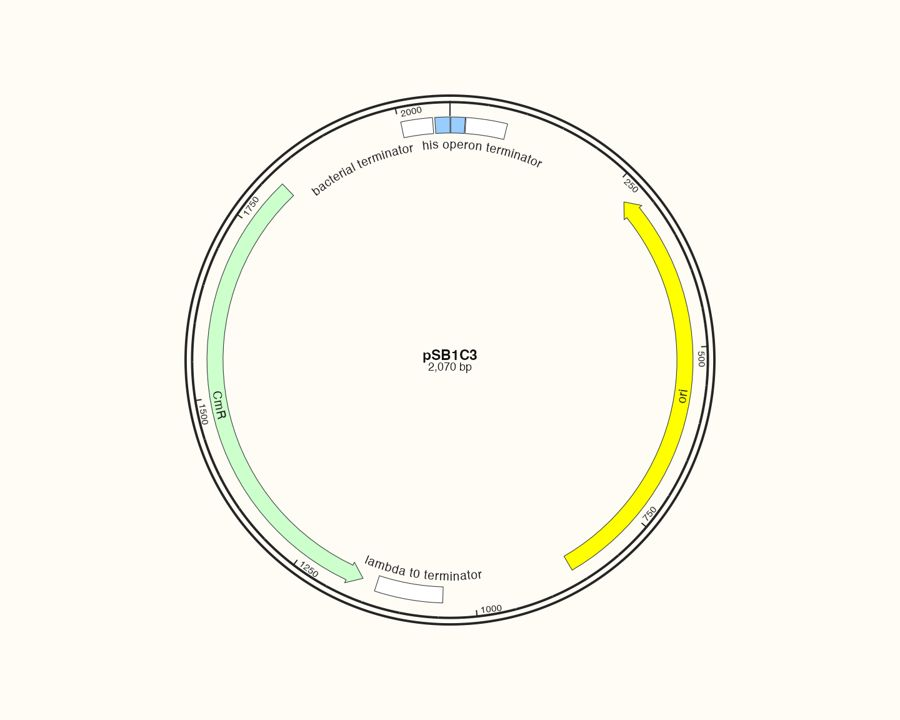</a><figcaption>pSB1C3：参考特征图 · <span class="figure-hint">点击放大查看</span></figcaption></figure>

### pUC19：常见注释与复制起点 {#plasmid-catalog-catalogpuc}
<figure class="documentation-figure"><a class="figure-link" href="tutorial-assets/catalogpuc.jpg" title="点击放大查看">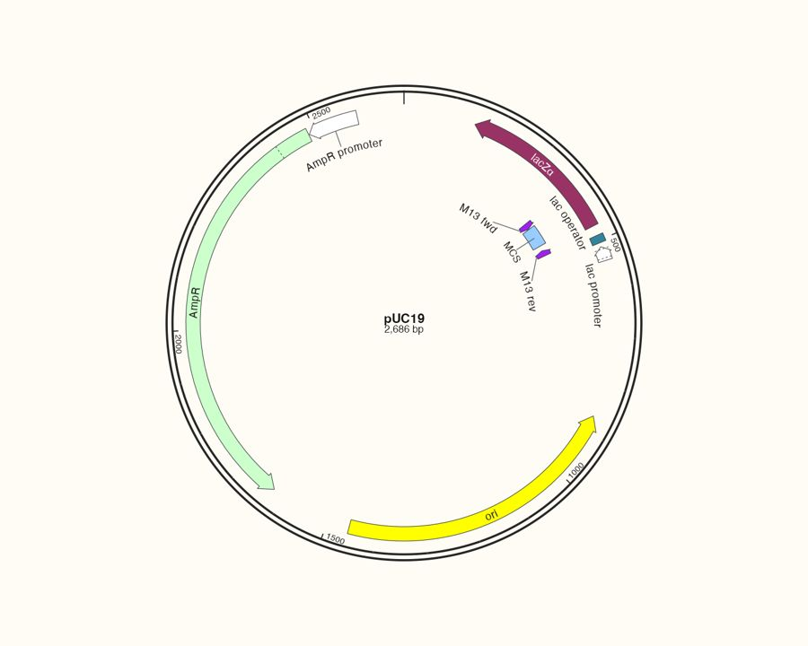</a><figcaption>pUC19：参考特征图 · <span class="figure-hint">点击放大查看</span></figcaption></figure>

### pBR322：多个抗性区与方向 {#plasmid-catalog-catalogpbr}
<figure class="documentation-figure"><a class="figure-link" href="tutorial-assets/catalogpbr.jpg" title="点击放大查看">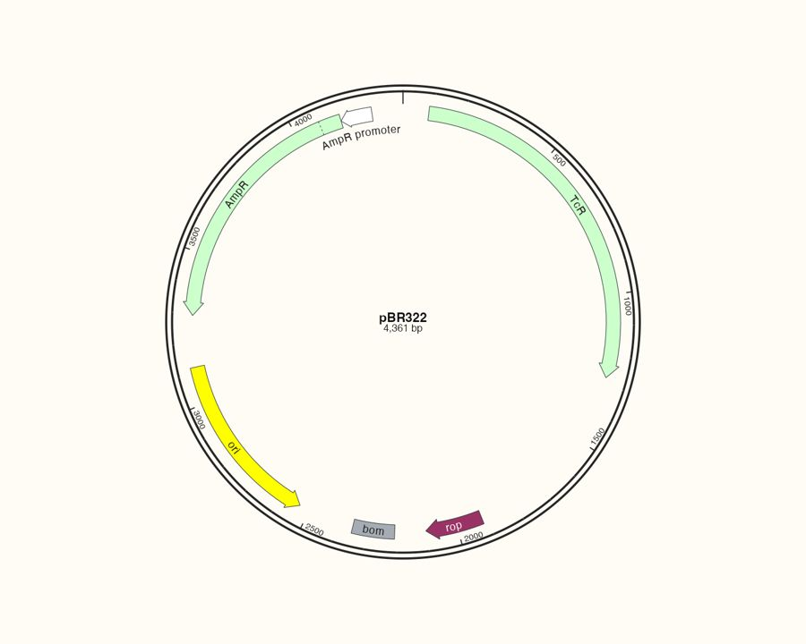</a><figcaption>pBR322：参考特征图 · <span class="figure-hint">点击放大查看</span></figcaption></figure>

### pBluescript II SK(+)：局部调控与短特征 {#plasmid-catalog-catalogblue}
<figure class="documentation-figure"><a class="figure-link" href="tutorial-assets/catalogblue.jpg" title="点击放大查看">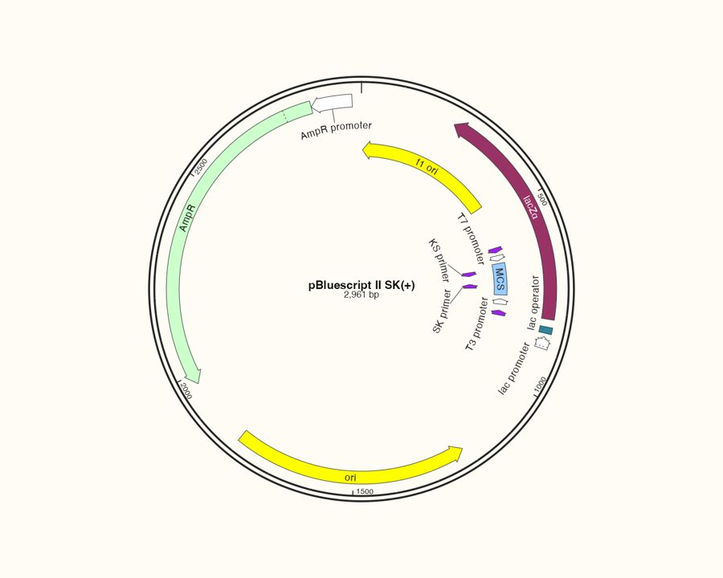</a><figcaption>pBluescript II SK(+)：参考特征图 · <span class="figure-hint">点击放大查看</span></figcaption></figure>

### pET-28a(+)：表达区与标签 {#plasmid-catalog-catalogpet}
<figure class="documentation-figure"><a class="figure-link" href="tutorial-assets/catalogpet.jpg" title="点击放大查看">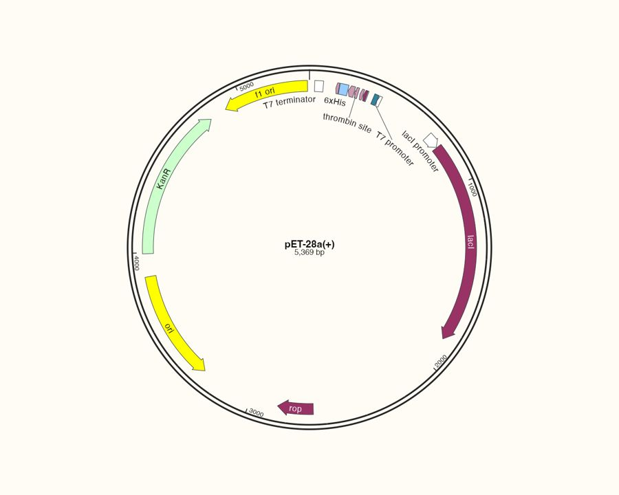</a><figcaption>pET-28a(+)：参考特征图 · <span class="figure-hint">点击放大查看</span></figcaption></figure>

### pETDuet-1：双表达单元，进入密集案例 {#plasmid-catalog-catalogduet}
<figure class="documentation-figure"><a class="figure-link" href="tutorial-assets/catalogduet.jpg" title="点击放大查看">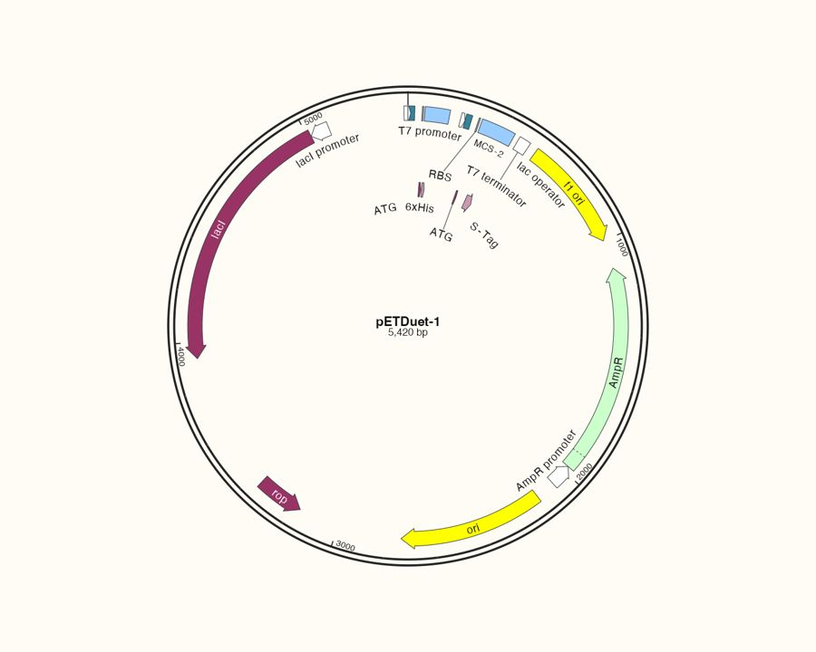</a><figcaption>pETDuet-1：参考特征图 · <span class="figure-hint">点击放大查看</span></figcaption></figure>

### pDONR221：重组相关结构 {#plasmid-catalog-catalogdonr}
<figure class="documentation-figure"><a class="figure-link" href="tutorial-assets/catalogdonr.jpg" title="点击放大查看">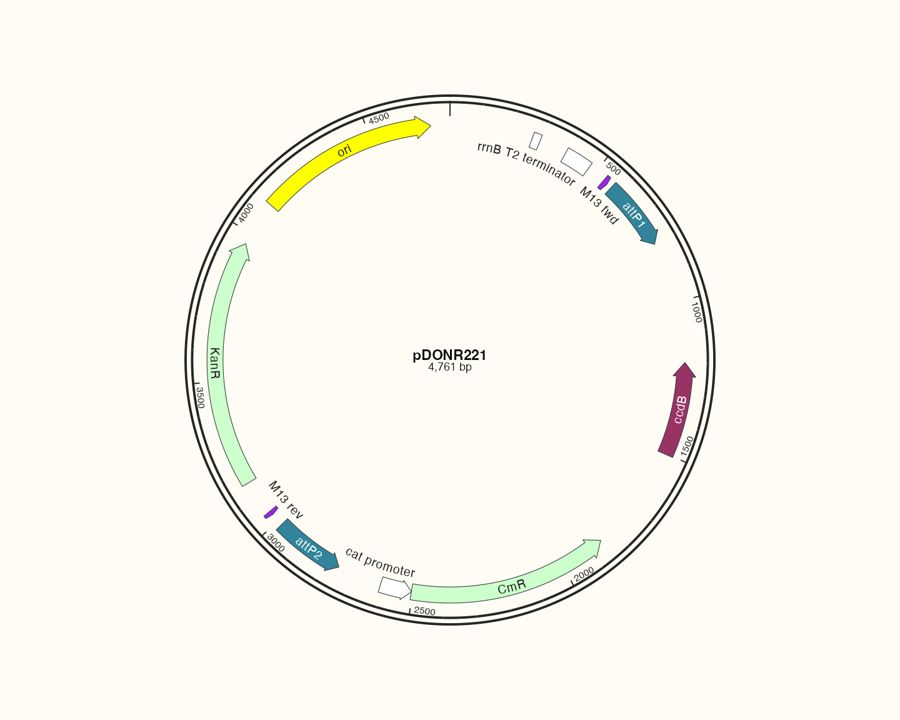</a><figcaption>pDONR221：参考特征图 · <span class="figure-hint">点击放大查看</span></figcaption></figure>

### pcDNA3.1(+)：表达载体的注释层级 {#plasmid-catalog-catalogpcdna}
<figure class="documentation-figure"><a class="figure-link" href="tutorial-assets/catalogpcdna.jpg" title="点击放大查看">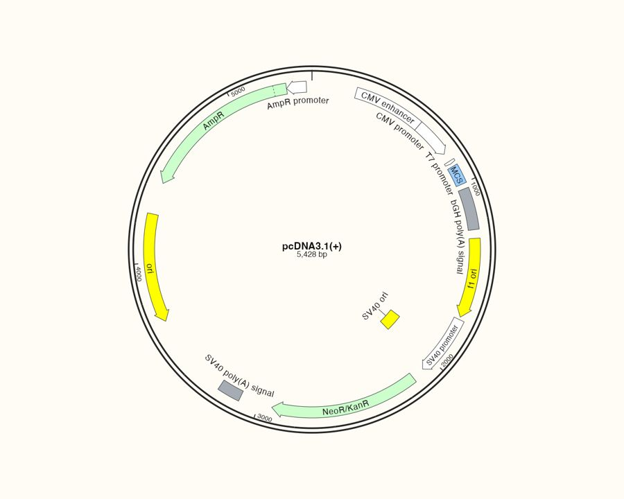</a><figcaption>pcDNA3.1(+)：参考特征图 · <span class="figure-hint">点击放大查看</span></figcaption></figure>

### pTRE-Tight-BI：双向调控布局 {#plasmid-catalog-catalogtre}
<figure class="documentation-figure"><a class="figure-link" href="tutorial-assets/catalogtre.jpg" title="点击放大查看">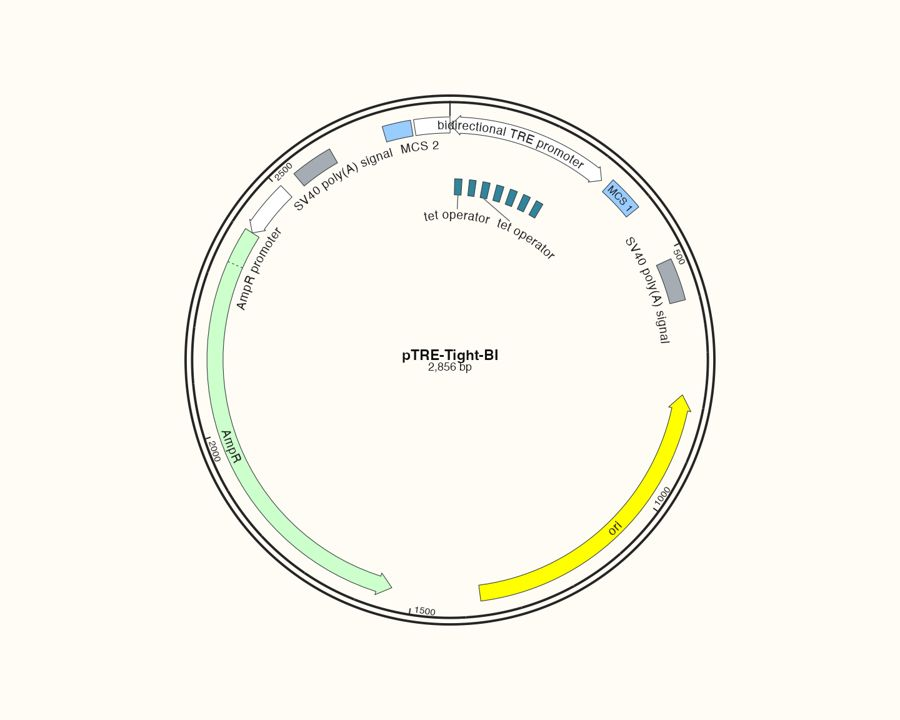</a><figcaption>pTRE-Tight-BI：参考特征图 · <span class="figure-hint">点击放大查看</span></figcaption></figure>

### pTRIPZ：更长序列的显示密度 {#plasmid-catalog-catalogtripz}
<figure class="documentation-figure"><a class="figure-link" href="tutorial-assets/catalogtripz.jpg" title="点击放大查看">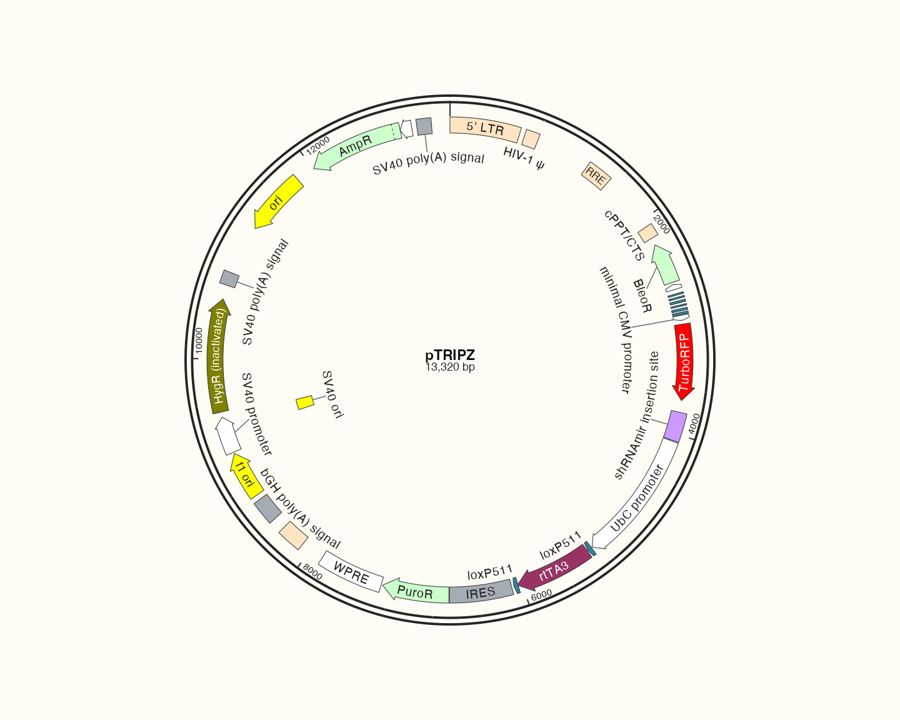</a><figcaption>pTRIPZ：参考特征图 · <span class="figure-hint">点击放大查看</span></figcaption></figure>

### pCAMBIA1300：较大植物载体的结构 {#plasmid-catalog-catalogcambia}
<figure class="documentation-figure"><a class="figure-link" href="tutorial-assets/catalogcambia.jpg" title="点击放大查看">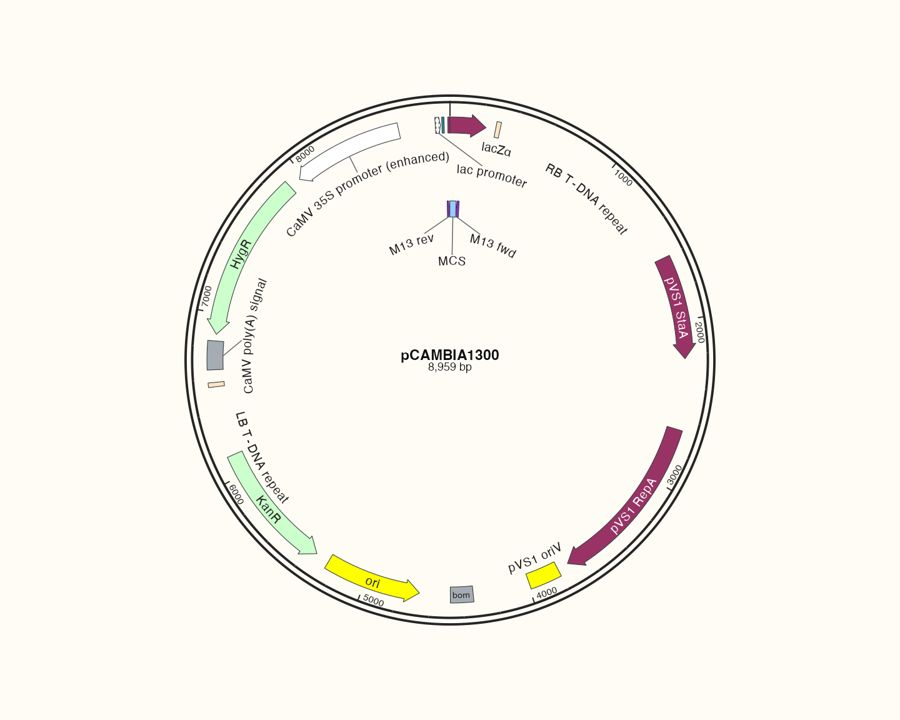</a><figcaption>pCAMBIA1300：参考特征图 · <span class="figure-hint">点击放大查看</span></figcaption></figure>

### pEarleyGate 201：另一植物载体的类别对照 {#plasmid-catalog-catalogearley}
<figure class="documentation-figure"><a class="figure-link" href="tutorial-assets/catalogearley.jpg" title="点击放大查看">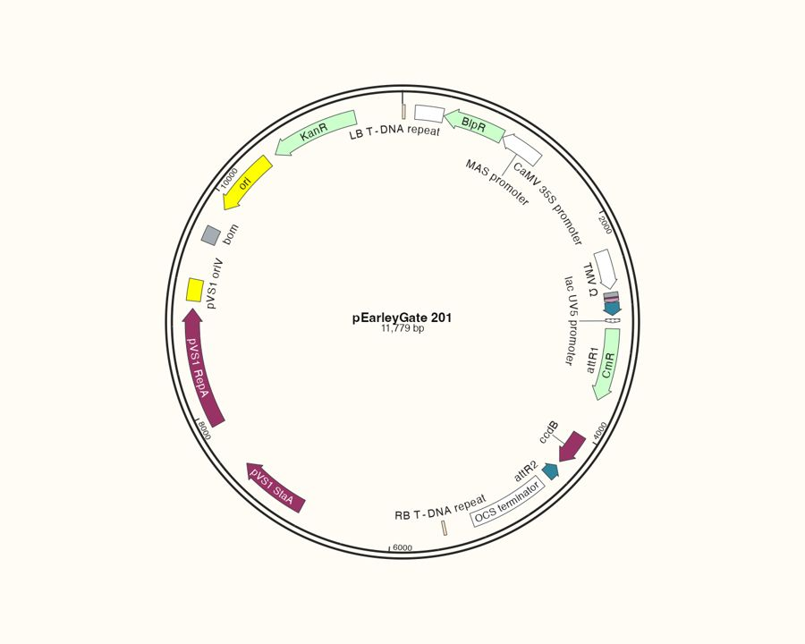</a><figcaption>pEarleyGate 201：参考特征图 · <span class="figure-hint">点击放大查看</span></figcaption></figure>

### pSpCas9(BB)-2A-GFP (PX458)：大型表达载体与文字适配 {#plasmid-catalog-catalogcas}
<figure class="documentation-figure"><a class="figure-link" href="tutorial-assets/catalogcas.jpg" title="点击放大查看">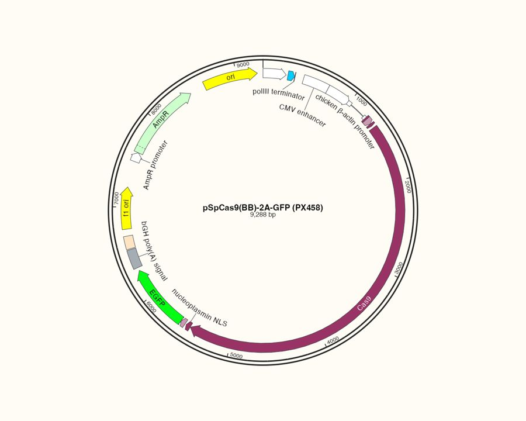</a><figcaption>pSpCas9(BB)-2A-GFP (PX458)：参考特征图 · <span class="figure-hint">点击放大查看</span></figcaption></figure>

### 下一步 {#plasmid-catalog-next}
比较不同密度后，进入[3.5 综合实战](#plasmids-complex)，添加独立引物与酶切图层。


## 3.5 质粒综合实战 {#plasmids}

<div class="task-intro"><p>用随包 pUC19 DNA 完成一张可阅读的质粒图：注释、引物和酶切分别成层，显示选择与完整结果分开保存。</p></div>

### 本页准备 {#plasmids-prepare}
在新的 R 会话中先运行下方代码，再按页面顺序继续。配色和排版是可选的显示设置，输入只选择需要的列。

<details class="preparation"><summary>准备代码 · 在本页运行一次</summary>

```{r example-62, eval=FALSE}
library(ggchord)
feature_palette <- c(
  CDS = "#993366", promoter = "#31849B", rep_origin = "#F1E51D",
  primer_bind = "#A020F0", misc_feature = "#A6ACB3", protein_bind = "#31849B"
)

library(ggchord)
doc_background <- "#FFFCF5"
identity_palette <- c("#303B71", "#36537D", "#269B82", "#A5D52C", "#ECEB31")
identity_values <- c(0, 0.5, 0.8, 0.9, 1)
identity_breaks <- c(0, 50, 80, 90, 100)
doc_legend_theme <- theme(
  legend.title = element_text(size = 13, face = "bold"),
  legend.text = element_text(size = 11),
  legend.key.width = unit(9, "mm"), legend.key.height = unit(5, "mm"),
  legend.spacing.x = unit(9, "mm"), legend.spacing.y = unit(7, "mm"),
  legend.margin = margin(l = 4, r = 4, unit = "mm")
)
sequence_guide <- guide_ggchord_legend(nrow = 1, theme = doc_legend_theme)
strand_guide <- guide_ggchord_legend(
  nrow = 1, override.aes = list(strand = c("+", "-")), theme = doc_legend_theme
)
identity_guide <- guide_ggchord_colourbar(
  position = "left", direction = "vertical",
  theme = theme(
    legend.key.height = unit(75, "mm"), legend.key.width = unit(5, "mm"),
    legend.title = element_text(size = 13, face = "bold"),
    legend.text = element_text(size = 11), legend.margin = margin(r = 7, unit = "mm")
  )
)
doc_theme <- theme_ggchord_publication(
  axis.text = element_text(size = 11),
  axis.text.check.overlap = TRUE
) +
  theme(
    legend.position = "bottom",
    legend.title = element_text(size = 13, face = "bold"),
    legend.text = element_text(size = 11),
    legend.key.width = unit(9, "mm"), legend.key.height = unit(5, "mm"),
    legend.spacing.x = unit(9, "mm"), legend.spacing.y = unit(7, "mm"),
    legend.box.spacing = unit(6, "mm"),
    plot.background = element_rect(fill = doc_background, colour = NA),
    panel.background = element_blank(),
    plot.title = element_text(face = "bold", size = 18),
    plot.subtitle = element_text(size = 10, colour = "#5C625A"),
    plot.margin = margin(14, 18, 14, 18)
  )
doc_axis <- function(coordinates = "relative") {
  scale_seq_position_continuous(
    coordinates = coordinates, n.breaks = 3, minor_breaks = NULL,
    labels = function(x) format(x, scientific = FALSE, big.mark = ",", trim = TRUE)
  )
}
```

</details>

其中定义了本例使用的配色。

### 使用有来源的序列 {#plasmids-input}
随包 `plasmid_example_pUC19` 原样来自仓库 `examples/plasmid/pUC19.fna`，不会为显示
修改碱基或序列标识。本流程使用包中有来源记录的识别目录，不需要网络请求，也不
为图形伪造实验测量值。


```{r example-63, eval=FALSE}
library(dplyr)
data(plasmid_example_pUC19)
plasmid_seq <- plasmid_example_pUC19 |>
  select(accver, length)
plasmid_feature_source <- find_common_features(plasmid_example_pUC19)
# Dedicated primer layers already show bindings; avoid duplicate primer annotations.
plasmid_features <- plasmid_feature_source |>
  filter(type != "primer_bind") |>
  select(accver, start, end, strand, type, anno)
plasmid_primers <- find_primer_bindings(plasmid_example_pUC19, set = "universal")
plasmid_sites <- find_restriction_sites(plasmid_example_pUC19)
display_sites <- filter_restriction_sites(plasmid_sites, enzymes = c("EcoRI", "BamHI", "HindIII"))
primer_names <- primer_catalog(set = "universal")
```


先查看 `plasmid_features`、`plasmid_primers` 与 `display_sites`，区分完整搜索与显示选择。

### 组合独立图层 {#plasmids-draw}
下面按骨架、注释、标签、引物和酶切的顺序添加图层。注释与标签共享同一个 Position；每个图层只读取自己的数据。


```{r example-64, eval=FALSE}
plasmid_position <- position_feature_stack(spacing = .10, base_position = position_plasmid())
p_plasmid <- ggchord(seq_data = plasmid_seq) +
  geom_seq(seq_style = "double") +
  geom_feature_plasmid(aes(feature_fill = type), data = plasmid_features, position = plasmid_position) +
  geom_feature_label_repel(
    data = plasmid_features, position = plasmid_position,
    size = 4
  ) +
  geom_primer(data = plasmid_primers, colour = "#A020F0") +
  geom_primer_label_repel(data = plasmid_primers, colour = "#A020F0", max_overlaps = 0, size = 3) +
  geom_restriction_site(data = display_sites, colour = "#29364B", label_size = 3, leader = "radial") +
  geom_seq_center_label() +
  scale_feature_fill_manual(values = feature_palette) +
  scale_seq_position_continuous() +
  coord_circular(rotation = 90) +
  theme_ggchord_plasmid() +
  theme(
    legend.title = element_text(size = 13, face = "bold"),
    legend.text = element_text(size = 11),
    legend.spacing.x = unit(9, "mm"), legend.spacing.y = unit(7, "mm"),
    plot.background = element_rect(fill = doc_background, colour = NA),
    panel.background = element_blank()
  )
p_plasmid
```

<figure class="documentation-figure"><a class="figure-link" href="tutorial-assets/plasmid.jpg" title="点击放大查看"></a><figcaption>pUC19 注释、精确引物命中与三个选定酶切位点 · <span class="figure-hint">点击放大查看</span></figcaption></figure>
| 项目 | 结果 |
| --- | --- |
| 完整序列长度（bp） | 2686 |
| 注释记录数 | 7 |
| 精确引物命中记录数 | 6 |
| 酶条目匹配记录数（非独立位置数） | 49845 |
| 选定显示的酶切记录数 | 3 |

混合的圈外标签按锚点顺序共同排版，包括少量酶切标签与引物共存的情况。
本例使用质粒专用主题和默认 feature 适配；默认先尝试内部文字，再使用相邻或
外侧位置。不要通过不断缩小文字或强制手动偏移掩盖交叉；请在相同导出尺寸下检查。


原始注释保留在 `plasmid_feature_source`。显示表去掉 `primer_bind` 注释，交由独立
引物层表达，避免重复；注释层只接收几何、类型和注释文字。

### 阅读各注释层 {#plasmids-layers}
双线骨架建立单条圆形序列，通用注释使用 plasmid 预设和显式 stacking Position，
标签共享该 Position。引物弧线表达结合范围，酶切短线表达切割/显示位置，中心标签
给出序列名称和长度。裁剪或筛选显示不改变完整序列的酶位点计数。

### 有意选择显示位点 {#plasmids-sites}
`find_restriction_sites()` 返回全部匹配。本图明确选择 EcoRI、BamHI 与 HindIII，
使局部酶切簇保持可读；`plasmid_sites` 保留完整搜索结果。只有完整输入序列精确匹配参考时，
`reference` 筛选才使用已保存的参考显示集合。其他任务可选 `unique`、`six_plus`
或明确酶名。绘图前检查 `display_sites` 及甲基化/来源列。参考集合是显示选择，
不表示未知样本的生物学状态已经确定。

### 理解目录和标签的限制 {#plasmids-limits}
`primer_names` 展示目录条目。本例精确搜索 universal 目录，参考引物注释与精确寡核苷酸搜索有不同来源。
近似蛋白注释识别遵循[识别专题](#recognition)的限制，不验证生物学功能或
引物实验。文字可以移位、在显式字号下限内缩小或隐藏。应保留几何并在最终尺寸
检查导出标签原因，而不是要求每条注释必须显示文字。

### 应用到自己的数据 {#plasmids-adapt}
将输入替换成有明确名称的 DNA 序列，先检查搜索结果再添加几何层。已有整理注释时，
直接提供注释表，无需再次运行识别。[堆叠与形状](#annotations)说明几何，
[标签](#labels)说明适配，[输出](#output)说明设备与尺寸。

`geom_primer_label_repel(side = "inside")` 将引物引出标签保留在骨架内侧，
包括同时存在外侧酶切及注释标签时。0.16.6 已修复此行为；
v0.16.5 可能将请求内侧的标签移到外侧。外侧默认布局和原始坐标不变。

内侧酶切标签继续保留内侧几何，导出 annotation registry 现在也正确记录内侧；
早期版本将这些诊断行误标为外侧资源。

完整内侧场景仍可能出现长引物文字与其他 feature 区域交叠；默认
`max_overlaps = Inf` 不认证跨 feature 图层的零交叠。空间不足时优先使用默认外侧，
或通过 `show_location = FALSE` 缩短显示文字，并在最终尺寸检查结果。

### 完成后检查 {#plasmids-check-result}
从中心的名称与长度开始，沿骨架读位置，再读类别色、箭头方向和外侧标签。核对 display_sites 的酶名；删减显示不会改变 plasmid_sites。

<div class="next-step">继续：<a href="#labels">放置和调整标签 →</a></div>

### 保存本页结果 {#plasmids-save-result}
在工作目录中保存刚刚创建的图；预览时使用相同宽高。

```{r example-65, eval=FALSE}
ggsave("pUC19-map.png", p_plasmid, width = 10, height = 9, units = "in", dpi = 144)
```

### 完整示例：pETDuet-1 密集质粒图 {#plasmids-complex}

先用上面的 pUC19 掌握图层，再用 pETDuet-1 展示复杂注释。以下来自随包真实序列、常见特征与参考引物表；酶切输入保留 commercial_all 中唯一的六碱基及以上识别位点，不把筛选后的图误称为全部酶的所有切点。


```{r example-66, eval=FALSE}
library(ggchord)
library(dplyr)
data(plasmid_example_pETDuet_1)
show_plasmid <- plasmid_example_pETDuet_1 |>
  select(accver, length)
show_plasmid_features <- find_common_features(plasmid_example_pETDuet_1)
show_plasmid_primers <- find_primer_bindings(plasmid_example_pETDuet_1, set = "reference")
show_plasmid_all_sites <- find_restriction_sites(plasmid_example_pETDuet_1)
show_plasmid_sites <- filter_restriction_sites(
  show_plasmid_all_sites,
  set = "unique_6plus", parent_set = "commercial_all"
)
```


```{r example-67, eval=FALSE}
show_plasmid_position <- position_feature_stack(
  spacing = 0.085, base_position = position_plasmid()
)
p_show_plasmid <- ggchord(show_plasmid, validate = "none") +
  geom_seq(seq_style = "double", colour = "#252525") +
  geom_feature_plasmid(data = show_plasmid_features, position = show_plasmid_position) +
  geom_feature_label_repel(
    data = show_plasmid_features, position = show_plasmid_position,
    external = TRUE, max_overlaps = 0,
    label_fit = "shrink", label_min_size = 2.5
  ) +
  geom_primer(data = show_plasmid_primers, colour = "#A020F0") +
  geom_primer_label_repel(
    data = show_plasmid_primers, colour = "#A020F0", max_overlaps = 0
  ) +
  geom_restriction_site(data = show_plasmid_sites, colour = "#252525") +
  geom_seq_center_label() +
  coord_circular(
    rotation = 90, fit = "manual",
    xlim = c(-3.4, 4.6), ylim = c(-1.6, 2.4)
  ) +
  theme_ggchord_plasmid() +
  theme(
    legend.title = element_text(size = 13, face = "bold"),
    legend.text = element_text(size = 11),
    legend.spacing.x = unit(9, "mm"), legend.spacing.y = unit(7, "mm"),
    plot.background = element_rect(fill = doc_background, colour = NA),
    panel.background = element_blank()
  )
p_show_plasmid
```


<figure class="documentation-figure"><a class="figure-link" href="tutorial-assets/showcaseplasmid.jpg" title="点击放大查看">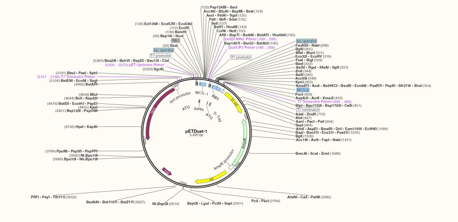</a><figcaption>pETDuet-1密集质粒图：特征、参考引物与合并酶切位点 · <span class="figure-hint">点击放大查看</span></figcaption></figure>

20 个特征、5 个参考引物、58 个合并切点构成输入。默认 feature 配色保留紫红编码区域、浅绿抗性基因、黄色复制起点和蓝色调控注释；引物为紫色，与本站其他图的相同语义保持一致。密集标签对尺寸敏感，下载原图或打开大图阅读。

显式视野将密集图固定在文档给出的导出尺寸。`label_fit = "shrink"` 允许短特征文字缩至 2.5 mm；仍放不下的文字保留为外置标签。预览和保存应使用相同的 16.5 × 8 in 尺寸。

```{r example-68, eval=FALSE}
ggsave("pETDuet-1-map.png", p_show_plasmid, width = 16.5, height = 8, units = "in", dpi = 144)
```


## 数据与坐标 {#data}

<div class="task-intro"><p>把文件中的观测整理成绘图角色。先检查最小字段与坐标，再使用校验报告决定是否清理；不要为了出图猜测缺失的长度或方向。</p></div>

### 本页准备 {#data-prepare}
在新的 R 会话中先运行下方代码，再按页面顺序继续。配色和排版是可选的显示设置，输入只选择需要的列。 涉及文件时，先解压[教学输入](https://github.com/DangJem/ggchord/tree/main/examples)，使工作目录包含 `examples/`。

<details class="preparation"><summary>准备代码 · 在本页运行一次</summary>

```{r example-69, eval=FALSE}
library(ggchord)
library(dplyr)
data(seq_data_example)
data(ribbon_data_example)
data(gene_data_example)
seqs <- seq_data_example |>
  select(accver, length)
links <- ribbon_data_example |>
  select(qaccver, saccver, qstart, qend, sstart, send)
# The fixture preserves biological strands separately from its old display strands.
genes <- gene_data_example |>
  transmute(accver, start, end, strand = source_strand)
```

</details>

### 输入表 {#data-tables}
| 输入 | 必需字段 | 含义 |
| --- | --- | --- |
| 序列 | `accver`, `length` | 唯一标识；正值的完整序列长度，单位 bp |
|区间连接| `qaccver`, `saccver`, `qstart`, `qend`, `sstart`, `send` | query 与 subject 锚点 |
| 基因 | `accver`, `start`, `end`, `strand` | 链为已知 `+`/`-`；`anno` 可选 |
| 通用注释| `accver`, `start`, `end`, `strand` 或已声明方向 | 可保留未知链；`type`, `label`, `feature_id` 可选 |

标识可以是任意字符串，accession version 原样保留。只有映射、筛选或统计需要时，
才要求 `pident` 和比对 `length`。不能由注释的范围推断完整序列长度。

### 坐标契约 {#data-coordinates}
基因组坐标采用 **一基、闭区间 bp**。BED/PAF 读取器已转换源坐标约定，不要重复转换。
基因起止坐标有序，链单独存储；连接端点的次序可表达方向。没有方向证据的单 bp
连接保持未知。未知链不会被静默改成 `+`；应使用 `geom_feature()`，而非严格的基因层。

氨基酸坐标需要[显式 CDS 投影](#projection)。笛卡尔布局单位、基因组 bp、角度、
物理 mm 和轨道数值单位是不同的域。详见完整的数据格式说明 (`help("ggchord_data_contract", package = "ggchord")`)。

### 导入原始记录 {#data-import}
在仓库根目录运行这个仅用于源码仓库的例子，不改写原始文件。


```{r example-70, eval=FALSE}
seq_files <- read_fasta_lengths(files = "examples/fasta/*.fna", source_file = TRUE)
link_files <- read_blast(files = "examples/blastn-standard/*.tsv", source_file = TRUE)
feature_files <- read_gff3(files = "examples/gff3/*.gff3", unstranded = "keep", source_file = TRUE)
```


`read_genbank()` 保留记录/注释来源和分段位置。`read_bed()`、`read_paf()` 保留
坐标转换元数据。`as_ggchord_seq()`、`as_ggchord_feature()`、`as_ggchord_link()`
适配支持的 S4 对象；对象缺少完整长度或标识时必须显式提供。
`file` 与 `files` 均支持路径向量或 glob，重复解析路径按首次出现顺序只读一次。
一个工作流选择一个清晰入口。缺失的序列或同源关系应由分析者
提供，绘图层不生成这些业务数据。

### 校验、清理与准备 {#data-validation}


```{r example-71, eval=FALSE}
validation <- validate_ggchord_data(seqs, links, genes)
cleaned <- clean_ggchord_data(seqs, links, genes)
prepared <- prepare_ggchord_data(seqs, links, features = list(genes = genes))
```


校验报告问题；清理执行明确修复并返回报告；准备函数组合工作流步骤，不推断生物学
归属。绘图前检查 `validation`、`cleaned$report` 和 `prepared$report`。
几何表的 `source_row` 指图层已解析输入行，`.source_line` 才是物理文件行；GenBank
另有记录/注释来源。聚合可带 `source_rows` 和 `.length_estimated`，筛选合并时应保留。

### 检查问题输入及修复报告 {#data-repairs}

```{r example-72, eval=FALSE}
# Deliberately corrupt copies to demonstrate diagnostics; original rows remain intact.
problem_links <- ribbon_data_example |>
  slice_head(n = 2) |>
  select(qaccver, saccver, qstart, qend, sstart, send, pident) |>
  mutate(
    qaccver = replace(qaccver, 2, "absent"),
    pident = replace(pident, 1, 103)
  )
problem_report <- validate_ggchord_data(seqs, problem_links)
repaired <- clean_ggchord_data(seqs, problem_links, unknown_id = "drop", invalid_pident = "clip")
```

| 项目 | 结果 |
| --- | --- |
| 输入行数 | 2 |
| 明确清理后保留的行数 | 1 |

例子只修改原始记录的副本，故意加入未知 ID 和超过 0–100 的相似度。明确修复不表示应该静默
截断科学观测。检查 `problem_report`、`repaired$report`，保留原表，并按实际证据
选择策略。合法反向比对可以保持端点顺序，而非排序。`prepare_ggchord_data()`
因此有其工作流相关的默认策略，不能假定独立清理和准备函数完全相同。

### 声明 genome 与 contig 键 {#data-hierarchy}

```{r example-73, eval=FALSE}
# Each source record represents a separate complete phage genome.
contigs <- seqs |>
  mutate(genome = accver)
genomes <- tibble(genome = seqs$accver)
hierarchy <- validate_ggchord_hierarchy(contigs, genomes, strict = TRUE)
```


`hierarchy$contigs` 汇总已声明归属，不拼接 contig，也不由 accession 前缀推断归属。
不同样本重复局部 contig 名时须显式提供全局唯一标识。
[文件格式与适配器](#formats)说明格式及可选对象，[真实记录教程](#real-data)
把这些报告带入完整绘图流程。

### 最小输入与蛋白比对 {#data-minimal}
| 项目 | 结果 |
| --- | --- |
| 传入绘图的序列列数 | 2 |
| 传入绘图的连接列数 | 6 |
| 传入绘图的基因列数 | 4 |

构造函数的第二个位置参数是 `ribbon_data`，不是 `gene_data`。建议像共享例子一样
写明参数名，避免把基因表误当成连接表。相似度、比对长度和覆盖率字段只在相应
映射、筛选或统计中才需要。详见[标准 BLAST 与蛋白输入](#alignments)和
[按序列、按链设置参数](#parameters)。

### 完成后检查 {#data-check-result}
输入 ID 必须能匹配到完整序列表；原始记录与修复副本分开保存。反向比对端点递减可以合法，不能把所有警告都当作需要删除的数据。

<div class="next-step">继续：<a href="#formats">导入和转换数据 →</a></div>


## 导入和转换数据 {#formats}

<div class="task-intro"><p>将已有表格、BED、PAF 或 GenBank 转成 ggchord 输入，保留记录身份，并且只转换一次坐标约定。</p></div>

### 本页准备 {#formats-prepare}
在新的 R 会话中先运行下方代码，再按页面顺序继续。配色和排版是可选的显示设置，输入只选择需要的列。 涉及文件时，先解压[教学输入](https://github.com/DangJem/ggchord/tree/main/examples)，使工作目录包含 `examples/`。

<details class="preparation"><summary>准备代码 · 在本页运行一次</summary>

```{r example-74, eval=FALSE}
library(ggchord)
library(dplyr)
data(seq_data_example)
data(ribbon_data_example)
data(gene_data_example)
seqs <- seq_data_example |>
  select(accver, length)
links <- ribbon_data_example |>
  select(qaccver, saccver, qstart, qend, sstart, send)
# The fixture preserves biological strands separately from its old display strands.
genes <- gene_data_example |>
  transmute(accver, start, end, strand = source_strand)

library(ggchord)
doc_background <- "#FFFCF5"
identity_palette <- c("#303B71", "#36537D", "#269B82", "#A5D52C", "#ECEB31")
identity_values <- c(0, 0.5, 0.8, 0.9, 1)
identity_breaks <- c(0, 50, 80, 90, 100)
doc_legend_theme <- theme(
  legend.title = element_text(size = 13, face = "bold"),
  legend.text = element_text(size = 11),
  legend.key.width = unit(9, "mm"), legend.key.height = unit(5, "mm"),
  legend.spacing.x = unit(9, "mm"), legend.spacing.y = unit(7, "mm"),
  legend.margin = margin(l = 4, r = 4, unit = "mm")
)
sequence_guide <- guide_ggchord_legend(nrow = 1, theme = doc_legend_theme)
strand_guide <- guide_ggchord_legend(
  nrow = 1, override.aes = list(strand = c("+", "-")), theme = doc_legend_theme
)
identity_guide <- guide_ggchord_colourbar(
  position = "left", direction = "vertical",
  theme = theme(
    legend.key.height = unit(75, "mm"), legend.key.width = unit(5, "mm"),
    legend.title = element_text(size = 13, face = "bold"),
    legend.text = element_text(size = 11), legend.margin = margin(r = 7, unit = "mm")
  )
)
doc_theme <- theme_ggchord_publication(
  axis.text = element_text(size = 11),
  axis.text.check.overlap = TRUE
) +
  theme(
    legend.position = "bottom",
    legend.title = element_text(size = 13, face = "bold"),
    legend.text = element_text(size = 11),
    legend.key.width = unit(9, "mm"), legend.key.height = unit(5, "mm"),
    legend.spacing.x = unit(9, "mm"), legend.spacing.y = unit(7, "mm"),
    legend.box.spacing = unit(6, "mm"),
    plot.background = element_rect(fill = doc_background, colour = NA),
    panel.background = element_blank(),
    plot.title = element_text(face = "bold", size = 18),
    plot.subtitle = element_text(size = 10, colour = "#5C625A"),
    plot.margin = margin(14, 18, 14, 18)
  )
doc_axis <- function(coordinates = "relative") {
  scale_seq_position_continuous(
    coordinates = coordinates, n.breaks = 3, minor_breaks = NULL,
    labels = function(x) format(x, scientific = FALSE, big.mark = ",", trim = TRUE)
  )
}

library(dplyr)
data(plasmid_example_pUC19)
plasmid_seq <- plasmid_example_pUC19 |>
  select(accver, length)
feature_source <- find_common_features(plasmid_example_pUC19)
features <- feature_source |>
  select(accver, start, end, strand, type, anno)
```

</details>

### 把已有表格转换成需要的列 {#formats-adapters}
这里使用随包的实际序列、连接和基因，
只重命名列来演示角色映射；没有额外生成示意序列或比对。


```{r example-75, eval=FALSE}
renamed_sequences <- seqs |>
  rename(chrom = accver, size = length)
sequence_input <- as_ggchord_seq(renamed_sequences, mapping = c(accver = "chrom", length = "size"))
renamed_features <- genes |>
  rename(chrom = accver, left = start, right = end)
feature_input <- as_ggchord_feature(renamed_features,
  mapping = c(accver = "chrom", start = "left", end = "right")
)
link_input <- as_ggchord_link(links)
```


转换返回普通数据框，并记录 `ggchord_conversion` 信息。标识原样保留；缺少完整
序列长度时应补充可靠来源，不能把最大注释端点当作全长。核酸与蛋白比对的最小列
和单位见[导入比对结果](#alignments)。

### BED 和 PAF：坐标只转换一次 {#formats-zero-based}
BED 例子把已知 pUC19 注释写为最小 BED3，再读回；PAF 直接读取公开教程中的真实
minimap2 输出，保留原始可选标签和值。显示筛选保留 mapq ≥30 的记录，绘图只接收六个端点角色。


```{r example-76, eval=FALSE}
# BED3 carries intervals only; the source annotations remain in features.
bed_path <- tempfile(fileext = ".bed")
bed_rows <- tibble(accver = features$accver, start0 = features$start - 1L, end = features$end)
write.table(bed_rows, bed_path, sep = "\t", quote = FALSE, row.names = FALSE, col.names = FALSE)
bed_features <- read_bed(bed_path)
unlink(bed_path)
# Unchanged PAF rows from the public EMALE tutorial, not a simulated alignment.
paf_source <- read_paf("examples/format-inputs/emales-pair.paf")
paf_selected <- paf_source |>
  filter(!is.na(mapq), mapq >= 30)
paf_links <- paf_selected |>
  select(qaccver, saccver, qstart, qend, sstart, send)
paf_seqs <- bind_rows(
  transmute(paf_source, accver = qaccver, length = qlen),
  transmute(paf_source, accver = saccver, length = slen)
) |>
  distinct()
p_paf <- ggchord(seq_data = paf_seqs, ribbon_data = paf_links) +
  geom_link_ribbon(fill = "#6BAFA6", alpha = .5) +
  geom_seq(colour = "#233E4A") +
  geom_seq_label(size = 4) +
  coord_collinear() +
  doc_axis() +
  doc_theme
p_paf
```

<figure class="documentation-figure"><a class="figure-link" href="tutorial-assets/paf.jpg" title="点击放大查看">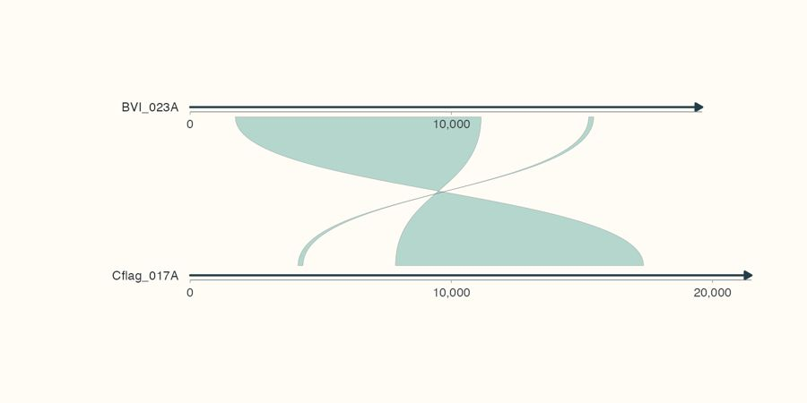</a><figcaption>从真实 minimap2 PAF 结果绘制的两条 EMALE 序列 · <span class="figure-hint">点击放大查看</span></figcaption></figure>

BED 的零起点半开区间由读取器转成一基包含坐标；不要再手工加一次 1。
BED3 没有链列，读回时链为未知；需要链方向时应使用含 strand 的原始格式。
PAF 的负相对方向表现为递减的 subject 端点，这是合法反向命中，不能一律排序去掉方向。
比对质量和 `pident` 来自生产工具报告的字段，不在绘图时重新计算碱基比对。

### GenBank：保留记录身份 {#formats-genbank}

```{r example-77, eval=FALSE}
# The original NCBI L09137.2 record identifies pUC19c; keep that identity.
genbank_result <- NULL
if (nzchar(Sys.which("python3")) && identical(suppressWarnings(system2("python3",
  c("-c", shQuote("from Bio import SeqIO")),
  stdout = FALSE, stderr = FALSE
)), 0L)) {
  genbank_result <- read_genbank("examples/format-inputs/pUC19c-L09137.2.gb")
}
```


这个文件是 NCBI 的原始 L09137.2 记录，名称是 pUC19c；不要把它强行改成随包 pUC19。
返回值包括 `seq_data`、`features$annotation` 与 `report`，分段位置及记录/注释来源
保留。这里需要所选 Python 已安装 Biopython；函数不自动安装依赖。
`unsupported = "report"` 将不支持的位置记入报告，不把远端或复杂位置猜成区间。

### 可选的区间对象 {#formats-ranges}

```{r example-78, eval=FALSE}
range_inputs <- NULL
if (requireNamespace("GenomicRanges", quietly = TRUE)) {
  unknown <- features |>
    filter(strand == ".") |>
    slice_head(n = 1)
  ranges <- GenomicRanges::GRanges(
    seqnames = unknown$accver,
    ranges = IRanges::IRanges(unknown$start, unknown$end), strand = "*",
    seqlengths = setNames(plasmid_seq$length, plasmid_seq$accver)
  )
  range_inputs <- list(seq_data = as_ggchord_seq(ranges), features = as_ggchord_feature(ranges))
}
```


```{r example-79, eval=FALSE}
interaction_inputs <- NULL
if (requireNamespace("GenomicRanges", quietly = TRUE) &&
  requireNamespace("InteractionSet", quietly = TRUE)) {
  source_links <- ribbon_data_example |>
    slice_head(n = 2)
  lengths <- setNames(seq_data_example$length, seq_data_example$accver)
  query <- GenomicRanges::GRanges(
    seqnames = source_links$qaccver,
    ranges = IRanges::IRanges(
      pmin(source_links$qstart, source_links$qend),
      pmax(source_links$qstart, source_links$qend)
    ),
    strand = ifelse(source_links$qstart <= source_links$qend, "+", "-"),
    seqlengths = lengths
  )
  subject <- GenomicRanges::GRanges(
    seqnames = source_links$saccver,
    ranges = IRanges::IRanges(
      pmin(source_links$sstart, source_links$send),
      pmax(source_links$sstart, source_links$send)
    ),
    strand = ifelse(source_links$sstart <= source_links$send, "+", "-"),
    seqlengths = lengths
  )
  interactions <- InteractionSet::GInteractions(query, subject)
  interaction_inputs <- list(
    seq_data = as_ggchord_seq(interactions),
    ribbon_data = as_ggchord_link(interactions)
  )
}
```

| 项目 | 结果 |
| --- | --- |
| GenBank 可选读取器 | 依赖未安装，已跳过 |
| 可选区间对象适配器 | PASS |
| 可选GInteractions适配器 | PASS |

这里选择 pUC19 中原本未知链的注释；转换后的 `*` 仍表示未知。
完整长度来自已知序列长度和 Seqinfo。`GInteractions` 可以转换成连接，但仍需明确
两端序列及长度。缺少可选依赖时结果会标记跳过，不把源码存在当作运行通过。
详见数据格式说明 (`help("ggchord_data_contract", package = "ggchord")`)。当前不直接解析 SAM/BAM 的
CIGAR；需先由相应工具正确解析，再通过表格角色映射转换，不能仅靠改列名处理剪接。

### 完成后检查 {#formats-check-result}
先查看返回列与转换报告，再选绘图列。PAF 反向命中保留端点方向；GenBank 记录身份不能因为展示需要而改成另一条随包质粒。

<div class="next-step">继续：<a href="#alignments">导入核酸和蛋白比对 →</a></div>


## 导入核酸和蛋白比对 {#alignments}

<div class="task-intro"><p>使用 BLAST 标准表格输出，无需早期自定义 17 列。区分“文件有哪些列”“绘图需要哪些列”及核酸/蛋白单位。</p></div>

### 本页准备 {#alignments-prepare}
在新的 R 会话中先运行下方代码，再按页面顺序继续。配色和排版是可选的显示设置，输入只选择需要的列。 涉及文件时，先解压[教学输入](https://github.com/DangJem/ggchord/tree/main/examples)，使工作目录包含 `examples/`。

```{r example-80, eval=FALSE}
library(ggchord)
library(dplyr)
```

### 默认表格列就够用 {#alignments-standard}
不需要早期教程中的 17 列自定义字段。使用 BLAST 标准表格输出即可：

```sh
blastn -query query.fna -subject subject.fna -outfmt 6 -out result.tsv
blastp -query proteins.faa -subject reference.faa -outfmt 7 -out result.tsv
```

`6` 是无注释表格，`7` 加上注释头；不再列出自定义字段时，两者使用默认 12 列。
完全省略 `-outfmt` 得到的是 pairwise 文本，当前表格读取器不解析该格式。
默认列为 query ID、subject ID、pident、length、mismatch、gapopen、qstart、qend、
sstart、send、evalue、bitscore。读取器将两个 ID 的角色命名为 `qaccver`、`saccver`，
保留字符串原值，并不要求它们一定是 accession version。
[NCBI 格式说明](https://www.ncbi.nlm.nih.gov/sites/books/NBK279684/table/appendices.T.options_common_to_all_blast/)。

### 文件布局与绘图最小列是两回事 {#alignments-minimal}
文件里有 12 列，不表示绘图必须接收 12 列。运行本页准备代码加载包后，使用下面的真实记录：


```{r example-81, eval=FALSE}
blast_source <- read_blast("examples/blastn-standard/MT108731.1__MT118296.1.tsv")
blast_links <- blast_source |>
  select(qaccver, saccver, qstart, qend, sstart, send)
# A six-column table is sufficient for drawing; extra fields stay in blast_source.
custom_path <- tempfile(fileext = ".tsv")
write.table(blast_links, custom_path, sep = "\t", quote = FALSE, row.names = FALSE, col.names = FALSE)
custom_source <- read_blast(custom_path, format = "custom", col_names = names(blast_links))
custom_links <- custom_source |>
  select(all_of(names(blast_links)))
unlink(custom_path)
```


`blast_source` 保留全部统计和来源信息；`blast_links` 只有六个端点角色。
`pident` 只有在按相似度配色/筛选时才需要，`length` 只有按比对长度筛选/加权时才需要。
`qlen`、`slen` 用于相应覆盖率计算，不能为了基础出图强制要求它们。
无表头的自定义列须明确 `col_names`，读取器不猜测任意六列的含义。
也可对任意已读入的表使用 `as_ggchord_link(x, mapping = ...)`，见[格式转换](#formats-adapters)。

仓库 `examples/blastn-standard/` 的文件是历史原始 HSP 的前 12 列转换，保留行和值，
不是本轮重新计算的 BLAST 结果。旧 `.o7` 文件保持原样，转换脚本和 hash 在来源清单中。

### BLASTp 可以读取，但坐标单位不同 {#alignments-protein}
下面是真实 BLASTP 2.9.0+ 结果与对应查询 CDS 注释，来自公开 EMALE 教程。
先保留完整输入，再选择有完整 CDS 映射、足够长度和较小 evalue 的查询 HSP。


```{r example-82, eval=FALSE}
protein_source <- read_blast("examples/format-inputs/emales-mavirus-blastp.tsv", source_file = TRUE)
emale_source <- read_gff3("examples/format-inputs/emales-BVI_023A.gff3", source_file = TRUE)
# The source declares complete Prodigal CDS and translation table 11.
emale_coding <- emale_source |>
  filter(grepl("partial=00", attributes)) |>
  select(feature_id, accver, start, end, strand, phase)
emale_cds <- build_ggchord_cds(emale_coding, genetic_code = 11)
# Keep strong HSPs whose query protein has a known complete CDS.
# Gaps are retained: projecting one query span does not assert an ungapped pair.
protein_kept <- protein_source |>
  filter(qaccver %in% emale_coding$feature_id, evalue <= 1e-10, length >= 50) |>
  arrange(desc(bitscore))
selected_hsp <- protein_kept |>
  slice_head(n = 1)
query_interval <- tibble(
  feature_id = "query_HSP", parent_id = selected_hsp$qaccver,
  start = selected_hsp$qstart, end = selected_hsp$qend
)
projected_query <- project_ggchord_features(query_interval, emale_cds)
# Subject projection additionally requires its own CDS map; it is not guessed from an accession.
```

| 项目 | 结果 |
| --- | --- |
| 原始 BLASTp 比对记录数 | 2948 |
| 具有完整注释的查询 CDS 数 | 24 |
| 明确筛选后保留的查询 HSP 数 | 3 |
| 所选查询起点（aa） | 50 |
| 所选查询终点（aa） | 289 |
| 投影后的查询范围行数 | 1 |

BLASTp 的 `qstart/qend/sstart/send` 是氨基酸坐标。这里将查询蛋白的 HSP 范围
转换到已知 CDS 的基因组坐标，保留负链和 phase；有缺口的 HSP 仍可投影查询范围，
但这只是范围，不能解释为逐个核苷酸的配对。原始弱命中、gapopen 和统计仍在原表中。

要得到两端的核苷酸连接，还须提供 subject 的 CDS 映射。不能从蛋白 accession、
最大端点或同名注释猜出来。`project_ggchord_links()` 的 `ungapped = TRUE` 必须有
证据，不能为了让默认 BLASTp 文件通过而随意打开。[投影教程](#projection)
使用两条编码 DNA 完全一致的真实质粒 CDS，展示可证明无缺口的双端例子。

本版不直接绘制以 aa 为轴的蛋白骨架。`blastx`、`tblastn` 的两侧单位也可能不同，
必须逐侧核对和转换；读取成功不代表可以直接用 bp 坐标绘图。

### 来源与限制 {#alignments-source}
EMALE 原始输出来自 [gggenomes 的公开数据与教程](https://thackl.github.io/gggenomes/articles/emales.html)。
本项目只复用数据记录，用 ggchord 自行绘图；没有复制上游图或绘图代码。
下载、原始成员、行号范围、SHA256 和筛选规则见教学输入包的 `sources.json`。
表格解析不重新运行比对，也不验证命中的生物学功能。

### 完成后检查 {#alignments-check-result}
基础连接表只需六列。BLASTp 读取后仍是 aa 坐标，必须通过有证据的 CDS 映射转换后才能用于本版 bp 绘图。

<div class="next-step">继续：<a href="#projection">将蛋白坐标转换为基因组坐标 →</a></div>


## 将蛋白区间转换为基因组坐标 {#projection}

<div class="task-intro"><p>把已知蛋白区间投影到真实 CDS 的基因组位置，显式保留 phase、链与分段关系。</p></div>

### 本页准备 {#projection-prepare}
在新的 R 会话中先运行下方代码，再按页面顺序继续。配色和排版是可选的显示设置，输入只选择需要的列。

<details class="preparation"><summary>准备代码 · 在本页运行一次</summary>

```{r example-83, eval=FALSE}
library(ggchord)
doc_background <- "#FFFCF5"
identity_palette <- c("#303B71", "#36537D", "#269B82", "#A5D52C", "#ECEB31")
identity_values <- c(0, 0.5, 0.8, 0.9, 1)
identity_breaks <- c(0, 50, 80, 90, 100)
doc_legend_theme <- theme(
  legend.title = element_text(size = 13, face = "bold"),
  legend.text = element_text(size = 11),
  legend.key.width = unit(9, "mm"), legend.key.height = unit(5, "mm"),
  legend.spacing.x = unit(9, "mm"), legend.spacing.y = unit(7, "mm"),
  legend.margin = margin(l = 4, r = 4, unit = "mm")
)
sequence_guide <- guide_ggchord_legend(nrow = 1, theme = doc_legend_theme)
strand_guide <- guide_ggchord_legend(
  nrow = 1, override.aes = list(strand = c("+", "-")), theme = doc_legend_theme
)
identity_guide <- guide_ggchord_colourbar(
  position = "left", direction = "vertical",
  theme = theme(
    legend.key.height = unit(75, "mm"), legend.key.width = unit(5, "mm"),
    legend.title = element_text(size = 13, face = "bold"),
    legend.text = element_text(size = 11), legend.margin = margin(r = 7, unit = "mm")
  )
)
doc_theme <- theme_ggchord_publication(
  axis.text = element_text(size = 11),
  axis.text.check.overlap = TRUE
) +
  theme(
    legend.position = "bottom",
    legend.title = element_text(size = 13, face = "bold"),
    legend.text = element_text(size = 11),
    legend.key.width = unit(9, "mm"), legend.key.height = unit(5, "mm"),
    legend.spacing.x = unit(9, "mm"), legend.spacing.y = unit(7, "mm"),
    legend.box.spacing = unit(6, "mm"),
    plot.background = element_rect(fill = doc_background, colour = NA),
    panel.background = element_blank(),
    plot.title = element_text(face = "bold", size = 18),
    plot.subtitle = element_text(size = 10, colour = "#5C625A"),
    plot.margin = margin(14, 18, 14, 18)
  )
doc_axis <- function(coordinates = "relative") {
  scale_seq_position_continuous(
    coordinates = coordinates, n.breaks = 3, minor_breaks = NULL,
    labels = function(x) format(x, scientific = FALSE, big.mark = ",", trim = TRUE)
  )
}

library(dplyr)
data(plasmid_example_pUC19)
data(plasmid_example_pETDuet_1)
homolog_source <- bind_rows(plasmid_example_pUC19, plasmid_example_pETDuet_1)
homolog_seq <- homolog_source |>
  select(accver, length)
cluster_features <- homolog_source |>
  find_common_features() |>
  filter(type == "CDS", anno == "AmpR") |>
  select(accver, start, end, strand, anno) |>
  arrange(match(accver, homolog_source$accver)) |>
  mutate(feature_id = paste(accver, start, end, sep = ":"))
# Membership is computed from exact strand-corrected CDS DNA equality, not gene names.
reverse_complement <- function(sequence) {
  bases <- strsplit(sequence, "")[[1]]
  chartr("ACGT", "TGCA", paste(rev(bases), collapse = ""))
}
coding_sequences <- cluster_features |>
  left_join(select(homolog_source, accver, sequence), by = "accver") |>
  rowwise() |>
  mutate(
    coding_dna = substr(sequence, start, end),
    coding_dna = if (strand == "-") reverse_complement(coding_dna) else coding_dna
  ) |>
  ungroup()
cds_dna <- pull(coding_sequences, coding_dna)

membership <- tibble(
  feature_id = cluster_features$feature_id,
  cluster_id = paste0("exact_CDS_", match(cds_dna, unique(cds_dna)))
)
homologs <- link_ggchord_clusters(cluster_features, membership,
  pairs = tibble(qaccver = homolog_seq$accver[1], saccver = homolog_seq$accver[2])
)
loci <- find_ggchord_loci(homolog_seq, cluster_features,
  targets = cluster_features$feature_id[cluster_features$anno == "AmpR"][1], upstream = 100, downstream = 100
)

# Compare equivalent local windows instead of shrinking one gene on full plasmids.
homolog_windows <- cluster_features |>
  select(accver, start, end)
local_homologs <- focus_ggchord_data(homolog_seq, homologs$data, cluster_features,
  loci = homolog_windows, expand = 200
)
p_homologs <- ggchord(
  seq_data = local_homologs$seq_data,
  ribbon_data = local_homologs$ribbon_data, gene_data = local_homologs$gene_data
) +
  geom_link_ribbon(fill = "#269B82", alpha = .65) +
  geom_seq(colour = "#233E4A", show.legend = FALSE) +
  geom_feature(
    data = local_homologs$gene_data, feature_fill = "#F1D334",
    position = position_strand(.10), width = .07
  ) +
  geom_feature_label_repel(data = local_homologs$gene_data, size = 4, label_fit = "shrink") +
  geom_seq_label(size = 4) +
  geom_seq_break() +
  coord_collinear() +
  doc_axis("source") +
  doc_theme
p_homologs
```

</details>

### 先准备有来源的 CDS {#projection-cds}
本页准备代码包含[完全相同 CDS 的比较](#homology-membership)，使用随包质粒的真实注释
和 DNA。完整 CDS 的 phase 明确为 0，翻译表显式设为 11。


```{r example-84, eval=FALSE}
# Run the exact-CDS comparison first; these are complete source-backed CDS.
coding <- cluster_features |>
  mutate(phase = 0)
cds <- build_ggchord_cds(coding, genetic_code = 11)
# This selects residues for a display example; it does not claim a detected domain.
domains <- tibble(feature_id = "selected_residues", parent_id = coding$feature_id[1], start = 2, end = 20)
genomic <- project_ggchord_features(domains, cds)
genomic
```


这个例子选择第 2–20 个残基作显示范围，不声称它是检测到的蛋白结构域。
投影结果是基因组区间，保留正负链与分段关系。真实检测到的 domain 也应提供确切
父 CDS ID 及氨基酸范围；不能通过同名注释或注释最大端点猜测。

### 分段、phase 和部分区域 {#projection-boundaries}
`build_ggchord_cds()` 先建立 CDS 分段映射，`project_ggchord_features()` 再将氨基酸
区间按映射切分。跨剪接边界可能返回多行；不要简单把坐标乘以 3。
不完整 CDS、phase、截断或不支持的位置必须按文档策略处理并检查报告。
DNA 匹配、氨基酸区间投影和真实翻译/比对是不同步骤，绘图库不会代为推断缺失证据。

### BLASTp 查询范围与双端连接 {#projection-links}

```{r example-85, eval=FALSE}
# Exact CDS DNA equality supplies evidence for these selected ungapped residues.
matching <- homologs$data |>
  slice_head(n = 1)
paired_coding <- cluster_features |>
  mutate(phase = 0)
paired_cds <- build_ggchord_cds(paired_coding)
protein_link <- tibble(
  qfeature_id = matching$qfeature_id, sfeature_id = matching$sfeature_id,
  qstart = 1, qend = 20, sstart = 1, send = 20
)
projected_links <- project_ggchord_links(protein_link, paired_cds, ungapped = TRUE)
projected_links
```


这个无缺口例子依赖[同源专题](#homology)中已核对的相同编码序列。
真实 BLASTp 输入可以有 gap；查询区间仍能投影，但双端连接还需要 subject 的 CDS
和无缺口对应证据。请阅读[真实 BLASTp 读取与投影](#alignments-protein)。
本版不把 aa 单位伪装成 bp，也不新增原生蛋白坐标绘图。

### 完成后检查 {#projection-check-result}
检查父 CDS ID、投影报告及返回分段。选择的残基区间只是显示例子，不能将其描述为检测到的结构域。

<div class="next-step">继续：<a href="#alignments">导入核酸和蛋白比对 →</a></div>


## 绘制注释与处理重叠 {#annotations}

<div class="task-intro"><p>把真实注释画为独立图层，选择合适形状，并让重叠区间和文字共享堆叠位置。</p></div>

### 本页准备 {#annotations-prepare}
在新的 R 会话中先运行下方代码，再按页面顺序继续。配色和排版是可选的显示设置，输入只选择需要的列。

<details class="preparation"><summary>准备代码 · 在本页运行一次</summary>

```{r example-86, eval=FALSE}
library(ggchord)
library(dplyr)
data(seq_data_example)
data(ribbon_data_example)
data(gene_data_example)
seqs <- seq_data_example |>
  select(accver, length)
links <- ribbon_data_example |>
  select(qaccver, saccver, qstart, qend, sstart, send)
# The fixture preserves biological strands separately from its old display strands.
genes <- gene_data_example |>
  transmute(accver, start, end, strand = source_strand)

# Optional appearance choices; none of these columns or scales is required input.
library(ggchord)
seq_palette <- setNames(
  c("#E64B35", "#233E4A", "#269B82", "#D59B17"),
  c("MT108731.1", "MT118296.1", "OQ646790.1", "OR222515.1")
)
gene_palette <- c("+" = "#CE1536", "-" = "#346B9D", "." = "#8291A6")

library(ggchord)
feature_palette <- c(
  CDS = "#993366", promoter = "#31849B", rep_origin = "#F1E51D",
  primer_bind = "#A020F0", misc_feature = "#A6ACB3", protein_bind = "#31849B"
)

library(ggchord)
doc_background <- "#FFFCF5"
identity_palette <- c("#303B71", "#36537D", "#269B82", "#A5D52C", "#ECEB31")
identity_values <- c(0, 0.5, 0.8, 0.9, 1)
identity_breaks <- c(0, 50, 80, 90, 100)
doc_legend_theme <- theme(
  legend.title = element_text(size = 13, face = "bold"),
  legend.text = element_text(size = 11),
  legend.key.width = unit(9, "mm"), legend.key.height = unit(5, "mm"),
  legend.spacing.x = unit(9, "mm"), legend.spacing.y = unit(7, "mm"),
  legend.margin = margin(l = 4, r = 4, unit = "mm")
)
sequence_guide <- guide_ggchord_legend(nrow = 1, theme = doc_legend_theme)
strand_guide <- guide_ggchord_legend(
  nrow = 1, override.aes = list(strand = c("+", "-")), theme = doc_legend_theme
)
identity_guide <- guide_ggchord_colourbar(
  position = "left", direction = "vertical",
  theme = theme(
    legend.key.height = unit(75, "mm"), legend.key.width = unit(5, "mm"),
    legend.title = element_text(size = 13, face = "bold"),
    legend.text = element_text(size = 11), legend.margin = margin(r = 7, unit = "mm")
  )
)
doc_theme <- theme_ggchord_publication(
  axis.text = element_text(size = 11),
  axis.text.check.overlap = TRUE
) +
  theme(
    legend.position = "bottom",
    legend.title = element_text(size = 13, face = "bold"),
    legend.text = element_text(size = 11),
    legend.key.width = unit(9, "mm"), legend.key.height = unit(5, "mm"),
    legend.spacing.x = unit(9, "mm"), legend.spacing.y = unit(7, "mm"),
    legend.box.spacing = unit(6, "mm"),
    plot.background = element_rect(fill = doc_background, colour = NA),
    panel.background = element_blank(),
    plot.title = element_text(face = "bold", size = 18),
    plot.subtitle = element_text(size = 10, colour = "#5C625A"),
    plot.margin = margin(14, 18, 14, 18)
  )
doc_axis <- function(coordinates = "relative") {
  scale_seq_position_continuous(
    coordinates = coordinates, n.breaks = 3, minor_breaks = NULL,
    labels = function(x) format(x, scientific = FALSE, big.mark = ",", trim = TRUE)
  )
}

library(dplyr)
data(plasmid_example_pUC19)
plasmid_seq <- plasmid_example_pUC19 |>
  select(accver, length)
feature_source <- find_common_features(plasmid_example_pUC19)
features <- feature_source |>
  select(accver, start, end, strand, type, anno)
```

</details>

### 保留注释语义 {#annotations-stack}
本页准备代码已加载 pUC19 的实际注释。
这里保留 pUC19 中实际重叠的注释和原本未知的链方向。
几何和填色分别映射同一类别；显式固定 `shape` 会覆盖 shape 映射。


```{r example-87, eval=FALSE}
stack_features <- features |>
  select(accver, start, end, strand, type, anno)
stack_position <- position_feature_stack(spacing = .12)
feature_shapes <- setNames(ifelse(names(feature_palette) == "CDS", "arrow", "block"), names(feature_palette))
p_stack <- ggchord(seq_data = plasmid_seq) +
  geom_seq(show.legend = FALSE) +
  geom_feature(aes(feature_fill = type, feature_shape = type),
    data = stack_features,
    width = .08, position = stack_position
  ) +
  geom_feature_label_repel(data = stack_features, position = stack_position, size = 3.8, label_fit = "shrink", label_min_size = 2.8) +
  scale_feature_shape_manual(values = feature_shapes) +
  scale_feature_fill_manual(values = feature_palette) +
  coord_collinear() +
  doc_axis() +
  doc_theme
p_stack
```

<figure class="documentation-figure"><a class="figure-link" href="tutorial-assets/featurestack.jpg" title="点击放大查看">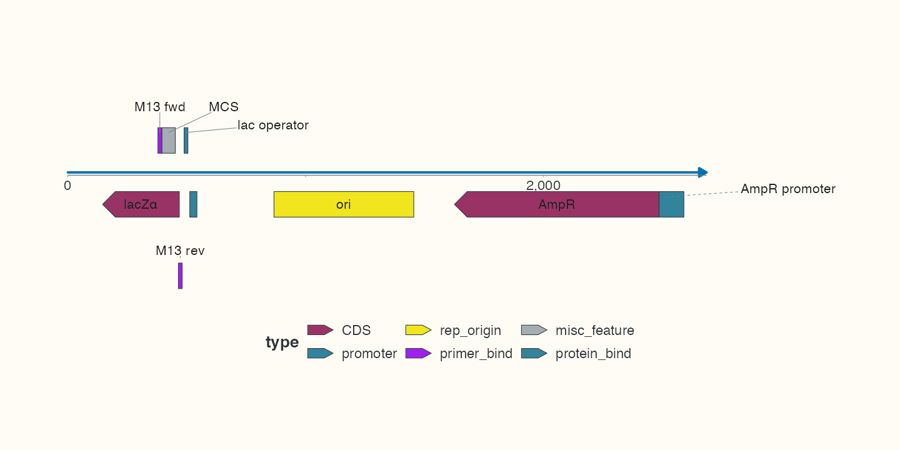</a><figcaption>pUC19 中重叠注释的分层显示 · <span class="figure-hint">点击放大查看</span></figcaption></figure>

`position_feature_stack()` 解决注释轨道重叠。标签层使用同一 Position，让文字锚点
跟随轨道。标签子集或重排时优先提供唯一 `feature_id`。严格的 gene 快捷层要求
已知 `+/-`，通用注释保留未知/双向语义。

### 按含义选择形状 {#annotations-shapes}
| 几何 | 常见用途 | 重要区别 |
| --- | --- | --- |
| `arrow`, `compact_arrow` | 有方向的编码/注释区间 | 已知方向来自证据，不由显示猜测 |
| `block`, `capped_line` | 区域或不填充区间 | 选择形状不推断生物学功能 |
| `promoter_arrow`, `primer_arrow`, `primer_arc` | 已声明的启动子/引物式注释 | 计算匹配与绘图分开 |
| `marker`, `chevron`, `lollipop` | 自定义区间/类点强调 | 保留真实区间元数据，显示形状属于映射 |

`geom_gene()`、`geom_feature_plasmid()` 是有用预设，默认值并不相同。
`position_strand()` 提供带符号位移，`position_plasmid()` 提供圆图放置预设，
后者不构成第四类坐标模式。

### 高亮区间而不改写观测 {#annotations-decoration}

```{r example-88, eval=FALSE}
regions <- tibble(
  accver = links$qaccver[1], start = min(links$qstart[1], links$qend[1]),
  end = max(links$qstart[1], links$qend[1]), category = "alignment interval"
)
p_decorated <- ggchord(seq_data = seqs, ribbon_data = links) +
  geom_seq_region(aes(region_fill = category), data = regions, colour = NA) +
  geom_link_ribbon(fill = "#6BAFA6", alpha = .4) +
  geom_seq() +
  geom_seq_label(size = 4) +
  scale_region_fill_manual(values = c("alignment interval" = "#F4D35E")) +
  scale_seq_colour_manual(values = seq_palette) +
  geom_seq_scale(length = 10000) +
  coord_collinear() +
  doc_axis() +
  doc_theme
p_decorated
```

<figure class="documentation-figure"><a class="figure-link" href="tutorial-assets/decorations.jpg" title="点击放大查看">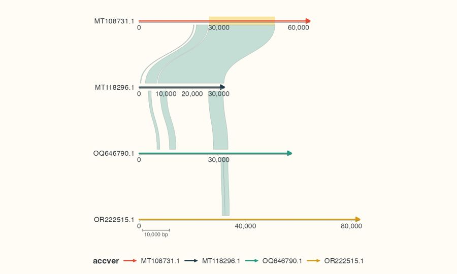</a><figcaption>突出显示一条实际比对的查询区间 · <span class="figure-hint">点击放大查看</span></figcaption></figure>

区域叠层有自己的数据和 `region_fill` 标度。`geom_seq_label()` 命名序列，
`geom_seq_center_label()` 在单圆图中心提供名称/长度，`geom_seq_break()` 标记裁剪或
分段末端。`geom_seq_scale()` 是仅用于共线性图的独立 bp 参照条，与控制序列基因组轴
的 `scale_seq_position_continuous()` 不同。普通 ggplot2 注释应使用
[位置映射](#views-mapping)，不能把 bp 直接当作笛卡尔 x/y。

### 完成后检查 {#annotations-check-result}
先检查区间与链，再看形状与标签。未知链仍保留在通用注释中；堆叠改变显示位置，不改变原始基因组坐标。

<div class="next-step">继续：<a href="#labels">放置和调整标签 →</a></div>


## 放置和调整标签 {#labels}

<div class="task-intro"><p>在保持注释几何的前提下安排文字：先选输出尺寸和标签子集，再选择自动或固定位置。</p></div>

### 本页准备 {#labels-prepare}
在新的 R 会话中先运行下方代码，再按页面顺序继续。配色和排版是可选的显示设置，输入只选择需要的列。

<details class="preparation"><summary>准备代码 · 在本页运行一次</summary>

```{r example-89, eval=FALSE}
library(ggchord)
library(dplyr)
data(seq_data_example)
data(ribbon_data_example)
data(gene_data_example)
seqs <- seq_data_example |>
  select(accver, length)
links <- ribbon_data_example |>
  select(qaccver, saccver, qstart, qend, sstart, send)
# The fixture preserves biological strands separately from its old display strands.
genes <- gene_data_example |>
  transmute(accver, start, end, strand = source_strand)

# Optional appearance choices; none of these columns or scales is required input.
library(ggchord)
seq_palette <- setNames(
  c("#E64B35", "#233E4A", "#269B82", "#D59B17"),
  c("MT108731.1", "MT118296.1", "OQ646790.1", "OR222515.1")
)
gene_palette <- c("+" = "#CE1536", "-" = "#346B9D", "." = "#8291A6")

library(ggchord)
doc_background <- "#FFFCF5"
identity_palette <- c("#303B71", "#36537D", "#269B82", "#A5D52C", "#ECEB31")
identity_values <- c(0, 0.5, 0.8, 0.9, 1)
identity_breaks <- c(0, 50, 80, 90, 100)
doc_legend_theme <- theme(
  legend.title = element_text(size = 13, face = "bold"),
  legend.text = element_text(size = 11),
  legend.key.width = unit(9, "mm"), legend.key.height = unit(5, "mm"),
  legend.spacing.x = unit(9, "mm"), legend.spacing.y = unit(7, "mm"),
  legend.margin = margin(l = 4, r = 4, unit = "mm")
)
sequence_guide <- guide_ggchord_legend(nrow = 1, theme = doc_legend_theme)
strand_guide <- guide_ggchord_legend(
  nrow = 1, override.aes = list(strand = c("+", "-")), theme = doc_legend_theme
)
identity_guide <- guide_ggchord_colourbar(
  position = "left", direction = "vertical",
  theme = theme(
    legend.key.height = unit(75, "mm"), legend.key.width = unit(5, "mm"),
    legend.title = element_text(size = 13, face = "bold"),
    legend.text = element_text(size = 11), legend.margin = margin(r = 7, unit = "mm")
  )
)
doc_theme <- theme_ggchord_publication(
  axis.text = element_text(size = 11),
  axis.text.check.overlap = TRUE
) +
  theme(
    legend.position = "bottom",
    legend.title = element_text(size = 13, face = "bold"),
    legend.text = element_text(size = 11),
    legend.key.width = unit(9, "mm"), legend.key.height = unit(5, "mm"),
    legend.spacing.x = unit(9, "mm"), legend.spacing.y = unit(7, "mm"),
    legend.box.spacing = unit(6, "mm"),
    plot.background = element_rect(fill = doc_background, colour = NA),
    panel.background = element_blank(),
    plot.title = element_text(face = "bold", size = 18),
    plot.subtitle = element_text(size = 10, colour = "#5C625A"),
    plot.margin = margin(14, 18, 14, 18)
  )
doc_axis <- function(coordinates = "relative") {
  scale_seq_position_continuous(
    coordinates = coordinates, n.breaks = 3, minor_breaks = NULL,
    labels = function(x) format(x, scientific = FALSE, big.mark = ",", trim = TRUE)
  )
}
```

</details>

### 选择布局 {#labels-layout}
基因标签提供 `"auto"`、`"radial"`、`"arc"` 布局。通用注释标签还支持优先
内部放置的默认 `"feature"` 和外部 `"callout"`。应按实际图层选择已记录的取值，
这些布局并不是可在所有入口互换的预设。


```{r example-90, eval=FALSE}
label_data <- gene_data_example |>
  filter(anno != "hypothetical protein") |>
  transmute(accver, start, end, strand = source_strand, anno)
p_labels <- ggchord(seq_data = seqs, gene_data = genes) +
  geom_seq() +
  geom_gene() +
  geom_gene_label_repel(data = label_data, label_layout = "auto", size = 4, label_wrap = 22) +
  geom_seq_label(size = 4) +
  coord_collinear() +
  doc_axis() +
  scale_seq_colour_manual(values = seq_palette) +
  scale_gene_fill_manual(values = gene_palette) +
  doc_theme
p_labels
```

<figure class="documentation-figure"><a class="figure-link" href="tutorial-assets/labels.jpg" title="点击放大查看">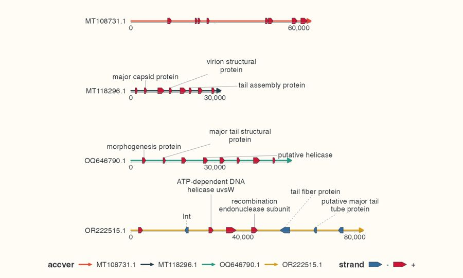</a><figcaption>实际基因注释的自动标签布局 · <span class="figure-hint">点击放大查看</span></figcaption></figure>

### 固定与自动放置 {#labels-fixed}
手动 `label_rotation`、径向/周向位移和方向控制使用 `geom_gene_label()` 或
`geom_feature_label()`。自动层拒绝这些手动控制，应选择 `label_layout` 或删除手动参数。
固定文字样式使用受支持的 `size`、`colour`、`family`。

在支持的入口中，`label_fit`、`label_wrap`、`label_max_lines`、`label_min_size`
控制适配。缩小字号须显式选择且有下限。无法放置的标签可能移位或隐藏，注释
几何仍保留。应在最终导出尺寸查看 `label_fit_diagnostics`、`label_diagnostics`。

### 跨层匹配锚点 {#labels-anchors}
共线性模式中，省略的注释标签 Position 可继承无歧义的匹配注释层。
唯一 `feature_id` 允许重排或取子集，但标识、区间、链仍须一致。
多个匹配层需要明确 Position 或无歧义 ID。先选最终设备尺寸再预览；调整 Plots
面板会改变可用空间。

### 对照三种基因标签布局 {#labels-comparison}

```{r example-91, eval=FALSE}
# Compare layouts with at most the first and last informative label per sequence.
comparison_labels <- label_data |>
  group_by(accver) |>
  filter(row_number() %in% c(1L, n())) |>
  ungroup()
label_plots <- lapply(c("auto", "radial", "arc"), function(layout) {
  ggchord(seq_data = seqs, gene_data = genes) +
    geom_seq() +
    geom_gene() +
    geom_gene_label_repel(data = comparison_labels, label_layout = layout, size = 4, label_wrap = 22) +
    geom_seq_label(size = 4) +
    scale_seq_colour_manual(values = seq_palette, name = "Sequence",
      guide = guide_ggchord_legend(nrow = 2, theme = doc_legend_theme)) +
    scale_gene_fill_manual(values = gene_palette, breaks = c("+", "-"), name = "Strand", guide = strand_guide) +
    coord_chord(xlim = c(-1.8, 1.8), ylim = c(-1.6, 1.6)) +
    theme_ggchord_publication(axis = element_blank()) +
    doc_legend_theme +
    theme(
      legend.position = "bottom",
      plot.background = element_rect(fill = doc_background, colour = NA),
      panel.background = element_blank()
    ) +
    labs(title = layout)
})
names(label_plots) <- c("auto", "radial", "arc")
p_manual_labels <- ggchord(seq_data = seqs, gene_data = genes) +
  geom_seq() +
  geom_gene() +
  geom_gene_label(data = label_data, label_rotation = 30) +
  coord_collinear()
label_plots$auto
```

<figure class="documentation-figure"><a class="figure-link" href="tutorial-assets/labelauto.jpg" title="点击放大查看">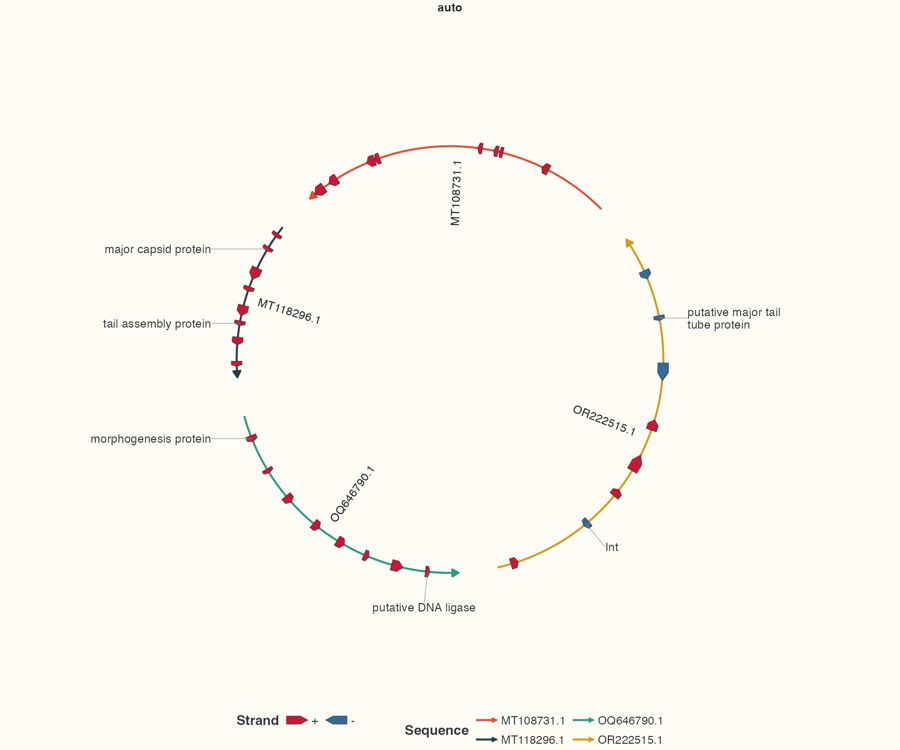</a><figcaption>实际基因注释的自动侧边标签 · <span class="figure-hint">点击放大查看</span></figcaption></figure>
<figure class="documentation-figure"><a class="figure-link" href="tutorial-assets/labelradial.jpg" title="点击放大查看"></a><figcaption>同一组基因注释的径向标签 · <span class="figure-hint">点击放大查看</span></figcaption></figure>
<figure class="documentation-figure"><a class="figure-link" href="tutorial-assets/labelarc.jpg" title="点击放大查看">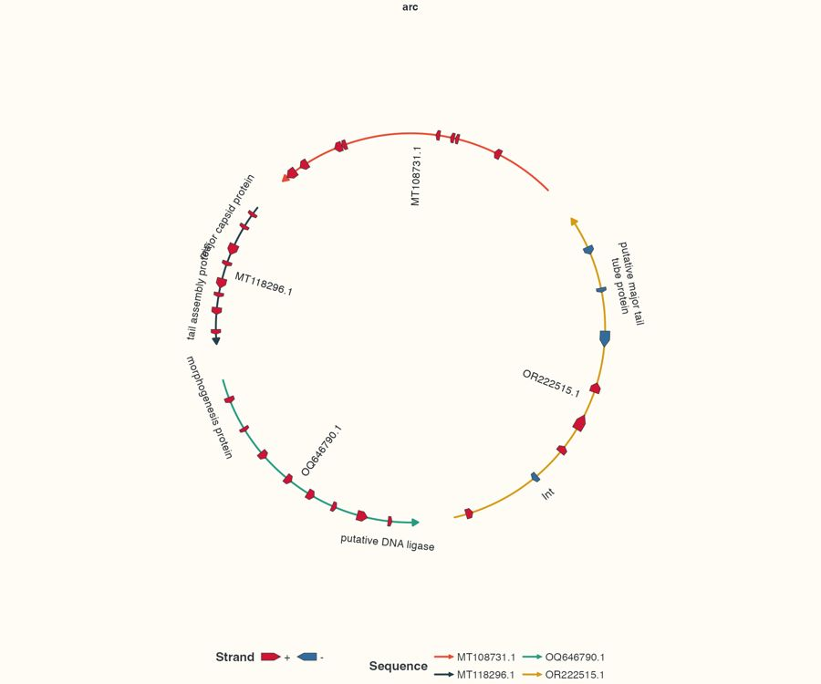</a><figcaption>同一组基因注释的沿弧标签 · <span class="figure-hint">点击放大查看</span></figcaption></figure>

每条序列最多选最前和最后两个有信息的标签，保留全部基因箭头，便于比较文字方向。
打印 `label_plots$auto`、`$radial` 或 `$arc` 查看候选图。三图输入和请求字号相同，
仅布局选择不同。auto 在适用处使用共享侧列，radial 跟随局部轮廓，arc 跟随序列切线。
`p_manual_labels` 展示独立固定标签入口，显式旋转不属于自动 repel 图层。
通用注释标签还可选内部优先/callout，密集混合注释见[完整圆图](#plasmids)，
继承或显式 Position 锚点见[堆叠](#annotations-stack)。

### 完成后检查 {#labels-check-result}
三张布局对照使用同一输入。判断可读性时同时看文字方向、连线和隐藏原因；没有标签不等于注释丢失。

<div class="next-step">继续：<a href="#output">预览和保存图形 →</a></div>


## 添加数据轨道 {#tracks}

<div class="task-intro"><p>从真实 DNA 计算 GC 比例，再逐步叠加柱、滑动均值和注释带。读者应能说清每个轨道的单位、窗口与基线。</p></div>

### 本页准备 {#tracks-prepare}
在新的 R 会话中先运行下方代码，再按页面顺序继续。配色和排版是可选的显示设置，输入只选择需要的列。

<details class="preparation"><summary>准备代码 · 在本页运行一次</summary>

```{r example-92, eval=FALSE}
library(ggchord)
feature_palette <- c(
  CDS = "#993366", promoter = "#31849B", rep_origin = "#F1E51D",
  primer_bind = "#A020F0", misc_feature = "#A6ACB3", protein_bind = "#31849B"
)

library(ggchord)
doc_background <- "#FFFCF5"
identity_palette <- c("#303B71", "#36537D", "#269B82", "#A5D52C", "#ECEB31")
identity_values <- c(0, 0.5, 0.8, 0.9, 1)
identity_breaks <- c(0, 50, 80, 90, 100)
doc_legend_theme <- theme(
  legend.title = element_text(size = 13, face = "bold"),
  legend.text = element_text(size = 11),
  legend.key.width = unit(9, "mm"), legend.key.height = unit(5, "mm"),
  legend.spacing.x = unit(9, "mm"), legend.spacing.y = unit(7, "mm"),
  legend.margin = margin(l = 4, r = 4, unit = "mm")
)
sequence_guide <- guide_ggchord_legend(nrow = 1, theme = doc_legend_theme)
strand_guide <- guide_ggchord_legend(
  nrow = 1, override.aes = list(strand = c("+", "-")), theme = doc_legend_theme
)
identity_guide <- guide_ggchord_colourbar(
  position = "left", direction = "vertical",
  theme = theme(
    legend.key.height = unit(75, "mm"), legend.key.width = unit(5, "mm"),
    legend.title = element_text(size = 13, face = "bold"),
    legend.text = element_text(size = 11), legend.margin = margin(r = 7, unit = "mm")
  )
)
doc_theme <- theme_ggchord_publication(
  axis.text = element_text(size = 11),
  axis.text.check.overlap = TRUE
) +
  theme(
    legend.position = "bottom",
    legend.title = element_text(size = 13, face = "bold"),
    legend.text = element_text(size = 11),
    legend.key.width = unit(9, "mm"), legend.key.height = unit(5, "mm"),
    legend.spacing.x = unit(9, "mm"), legend.spacing.y = unit(7, "mm"),
    legend.box.spacing = unit(6, "mm"),
    plot.background = element_rect(fill = doc_background, colour = NA),
    panel.background = element_blank(),
    plot.title = element_text(face = "bold", size = 18),
    plot.subtitle = element_text(size = 10, colour = "#5C625A"),
    plot.margin = margin(14, 18, 14, 18)
  )
doc_axis <- function(coordinates = "relative") {
  scale_seq_position_continuous(
    coordinates = coordinates, n.breaks = 3, minor_breaks = NULL,
    labels = function(x) format(x, scientific = FALSE, big.mark = ",", trim = TRUE)
  )
}

library(dplyr)
data(plasmid_example_pUC19)
plasmid_seq <- plasmid_example_pUC19 |>
  select(accver, length)
feature_source <- find_common_features(plasmid_example_pUC19)
features <- feature_source |>
  select(accver, start, end, strand, type, anno)
```

</details>

### 从实际 DNA 计算数据轨道 {#tracks-domain}
本例读取随包 pUC19，每 100 bp 计算
一次 GC 比例；末尾不足 100 bp 的窗口按实际碱基数计算。


```{r example-93, eval=FALSE}
library(dplyr)
data(plasmid_example_pUC19)
track_seq <- plasmid_example_pUC19 |>
  select(accver, length)
starts <- seq.int(1L, track_seq$length, by = 100L)
gc_fraction <- function(sequence) {
  bases <- strsplit(sequence, "")[[1]]
  mean(bases %in% c("G", "C"))
}
bins <- tibble(
  accver = track_seq$accver,
  start = starts,
  end = pmin(starts + 99L, track_seq$length)
) |>
  rowwise() |>
  mutate(gc = gc_fraction(substr(plasmid_example_pUC19$sequence, start, end))) |>
  ungroup()
head(bins)
```


`bins` 的每一行是一段实际序列窗口；先检查起止位置及 `gc`，再把数值映射到轨道高度与颜色。

#### 绘制 GC 比例 {#tracks-draw-gc}


```{r example-94, eval=FALSE}
p_tracks <- ggchord(seq_data = track_seq) +
  geom_seq() +
  geom_seq_center_label() +
  geom_track_bar(aes(track_value = gc, track_fill = gc),
    data = bins,
    position = position_track("gc", width = unit(10, "mm"))
  ) +
  scale_track_value_continuous("gc", limits = c(0, 1), unit = "GC fraction") +
  scale_track_fill_gradientn("gc", colours = c("#E4F3EA", "#65B79B", "#27775C")) +
  coord_circular() +
  doc_theme
p_tracks
```

<figure class="documentation-figure"><a class="figure-link" href="tutorial-assets/tracks.jpg" title="点击放大查看">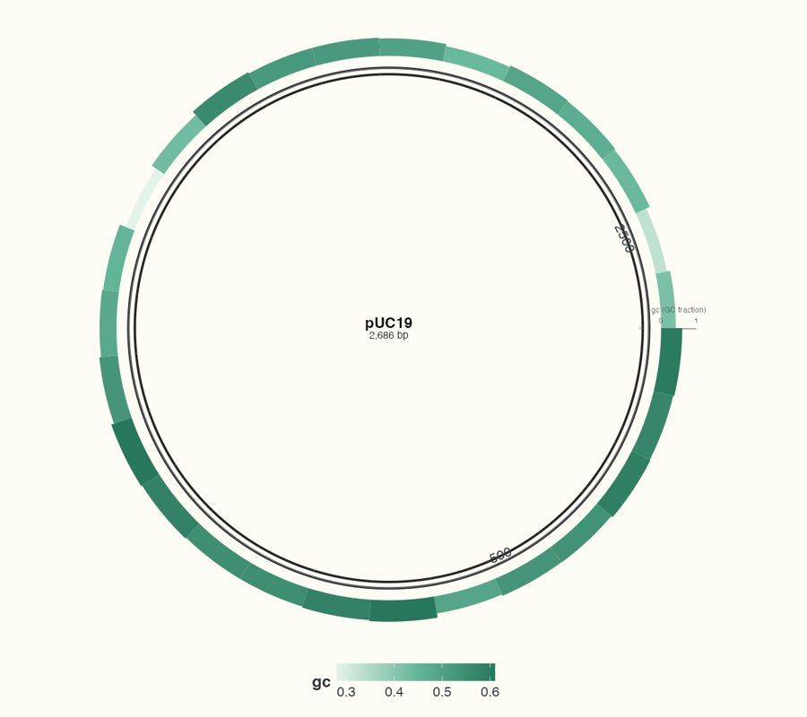</a><figcaption>从随包 pUC19 DNA 计算的 GC 比例 · <span class="figure-hint">点击放大查看</span></figcaption></figure>

值域为 0–1，单位是比例。换成其他测量值时，要声明对应单位和有效范围。
`position_track()` 决定放置与物理宽度，`scale_track_value_continuous()` 决定数值映射，
二者不能互相替代。

### 同一 ID 共享同一条轨道 {#tracks-sharing}
同名轨道上的各层共享数值域，bar 的基线也参与范围计算；它们必须声明一致的宽度和
放置方式。颜色标度按轨道 ID 独立设置。tile 表示区间类别，line 连接观测位置，
bar 表示相对基线的区间值。不要把相同数值域误认为必须位于同一条轨道。

### 检查裁剪和数值范围 {#tracks-diagnostics}
`export_ggchord_layout()` 的 `track_registry` 与 `track_diagnostics` 记录值域、
物理尺寸、原生位移及裁剪情况。被裁剪或省略的行不等于测量值为零。
局部视图使用 `focus_ggchord_track()` 并共享相同窗口。

### 叠加柱、滑动均值和注释带 {#tracks-multiple}
本页准备代码已创建实际注释 `features`，完成上面的 GC 计算后继续：


```{r example-95, eval=FALSE}
line_bins <- bins |>
  transmute(
    accver,
    pos = floor((start + end) / 2),
    gc_mean = as.numeric(stats::filter(gc, rep(1 / 3, 3), sides = 2))
  ) |>
  filter(is.finite(gc_mean))
categories <- features |>
  select(accver, start, end, type)
p_multitrack <- ggchord(seq_data = track_seq) +
  geom_seq() +
  geom_seq_center_label() +
  geom_track_bar(aes(track_value = gc, track_fill = gc),
    data = bins,
    position = position_track("gc", width = unit(10, "mm"))
  ) +
  geom_track_line(aes(track_value = gc_mean),
    data = line_bins,
    position = position_track("gc", width = unit(10, "mm")), colour = "#233E4A"
  ) +
  scale_track_value_continuous("gc", limits = c(0, 1), unit = "GC fraction") +
  scale_track_fill_gradientn("gc", colours = c("#E4F3EA", "#65B79B", "#27775C")) +
  geom_track_tile(aes(track_fill = type),
    data = categories,
    position = position_track("features", order = 2, width = unit(2, "mm"))
  ) +
  scale_track_fill_manual("features", values = feature_palette) +
  coord_circular() +
  doc_theme +
  theme(legend.box = "vertical", legend.box.just = "left")
focused_bins <- focus_ggchord_track(bins, track_seq,
  loci = tibble(accver = track_seq$accver, start = 500, end = 1500), type = "interval"
)
p_multitrack
```

<figure class="documentation-figure"><a class="figure-link" href="tutorial-assets/multitrack.jpg" title="点击放大查看">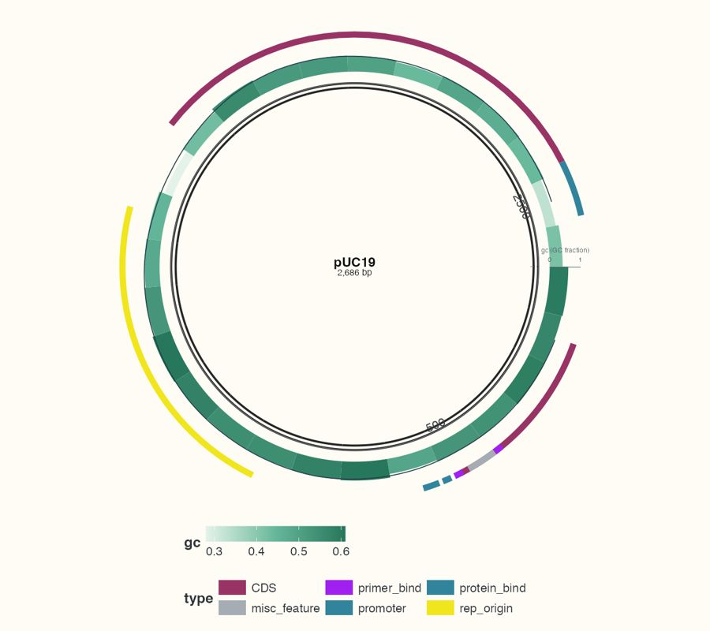</a><figcaption>pUC19 GC 比例、三点滑动均值和注释类型带 · <span class="figure-hint">点击放大查看</span></figcaption></figure>

柱和线都来自同一组实际 GC 值，线使用三个窗口的滑动均值；两端没有完整窗口时省略，
不填造观测值。折线位置是整数窗口中点。注释类型带有独立 ID 和配色。
轨道放在圆外并按顺序排列；小半径下过宽的内侧带可能折叠，此时会明确报错。

### 完成后检查 {#tracks-check-result}
bins 的 gc 在 0–1 之间，每行对应一个实际窗口；最后窗口可短于 100 bp。连续色表达数值，类别带只表达注释类型，不能用它比较 GC 大小。

<div class="next-step">继续：<a href="#output">预览和保存图形 →</a></div>

### 保存本页结果 {#tracks-save-result}
在工作目录中保存刚刚创建的图；预览时使用相同宽高。

```{r example-96, eval=FALSE}
ggsave("pUC19-tracks.png", p_multitrack, width = 9, height = 8, units = "in", dpi = 144)
```


## 设置配色、图例和主题 {#styling}

<div class="task-intro"><p>让颜色表达明确含义：先决定类别或连续数值，再选择映射、标度和图例。网站强调色不决定数据配色。</p></div>

### 本页准备 {#styling-prepare}
在新的 R 会话中先运行下方代码，再按页面顺序继续。配色和排版是可选的显示设置，输入只选择需要的列。

<details class="preparation"><summary>准备代码 · 在本页运行一次</summary>

```{r example-97, eval=FALSE}
library(ggchord)
library(dplyr)
data(seq_data_example)
data(ribbon_data_example)
data(gene_data_example)
seqs <- seq_data_example |>
  select(accver, length)
links <- ribbon_data_example |>
  select(qaccver, saccver, qstart, qend, sstart, send)
# The fixture preserves biological strands separately from its old display strands.
genes <- gene_data_example |>
  transmute(accver, start, end, strand = source_strand)

# Optional appearance choices; none of these columns or scales is required input.
library(ggchord)
seq_palette <- setNames(
  c("#E64B35", "#233E4A", "#269B82", "#D59B17"),
  c("MT108731.1", "MT118296.1", "OQ646790.1", "OR222515.1")
)
gene_palette <- c("+" = "#CE1536", "-" = "#346B9D", "." = "#8291A6")

library(ggchord)
doc_background <- "#FFFCF5"
identity_palette <- c("#303B71", "#36537D", "#269B82", "#A5D52C", "#ECEB31")
identity_values <- c(0, 0.5, 0.8, 0.9, 1)
identity_breaks <- c(0, 50, 80, 90, 100)
doc_legend_theme <- theme(
  legend.title = element_text(size = 13, face = "bold"),
  legend.text = element_text(size = 11),
  legend.key.width = unit(9, "mm"), legend.key.height = unit(5, "mm"),
  legend.spacing.x = unit(9, "mm"), legend.spacing.y = unit(7, "mm"),
  legend.margin = margin(l = 4, r = 4, unit = "mm")
)
sequence_guide <- guide_ggchord_legend(nrow = 1, theme = doc_legend_theme)
strand_guide <- guide_ggchord_legend(
  nrow = 1, override.aes = list(strand = c("+", "-")), theme = doc_legend_theme
)
identity_guide <- guide_ggchord_colourbar(
  position = "left", direction = "vertical",
  theme = theme(
    legend.key.height = unit(75, "mm"), legend.key.width = unit(5, "mm"),
    legend.title = element_text(size = 13, face = "bold"),
    legend.text = element_text(size = 11), legend.margin = margin(r = 7, unit = "mm")
  )
)
doc_theme <- theme_ggchord_publication(
  axis.text = element_text(size = 11),
  axis.text.check.overlap = TRUE
) +
  theme(
    legend.position = "bottom",
    legend.title = element_text(size = 13, face = "bold"),
    legend.text = element_text(size = 11),
    legend.key.width = unit(9, "mm"), legend.key.height = unit(5, "mm"),
    legend.spacing.x = unit(9, "mm"), legend.spacing.y = unit(7, "mm"),
    legend.box.spacing = unit(6, "mm"),
    plot.background = element_rect(fill = doc_background, colour = NA),
    panel.background = element_blank(),
    plot.title = element_text(face = "bold", size = 18),
    plot.subtitle = element_text(size = 10, colour = "#5C625A"),
    plot.margin = margin(14, 18, 14, 18)
  )
doc_axis <- function(coordinates = "relative") {
  scale_seq_position_continuous(
    coordinates = coordinates, n.breaks = 3, minor_breaks = NULL,
    labels = function(x) format(x, scientific = FALSE, big.mark = ",", trim = TRUE)
  )
}
```

</details>

### 从数据角色构建样式 {#styling-roles}
例子明确声明类别：区间连接填色映射
query ID，序列颜色映射序列 ID，基因填色映射链。手动标度的名称与实际取值匹配。


```{r example-98, eval=FALSE}
p_styled <- ggchord(seq_data = seqs, ribbon_data = links, gene_data = genes) +
  geom_seq() +
  geom_link_ribbon(aes(ribbon_fill = qaccver), alpha = .5) +
  geom_gene() +
  geom_seq_label(size = 4) +
  coord_collinear() +
  doc_axis() +
  scale_seq_colour_manual(values = seq_palette) +
  scale_gene_fill_manual(values = gene_palette) +
  scale_ribbon_fill_manual(values = seq_palette) +
  guides(gene_fill = guide_ggchord_legend(nrow = 1, theme = doc_legend_theme)) +
  doc_theme
theme_variants <- list(minimal = theme_ggchord_minimal(), dark = theme_ggchord_dark(), plasmid = theme_ggchord_plasmid())
p_styled
```

<figure class="documentation-figure"><a class="figure-link" href="tutorial-assets/styling.jpg" title="点击放大查看">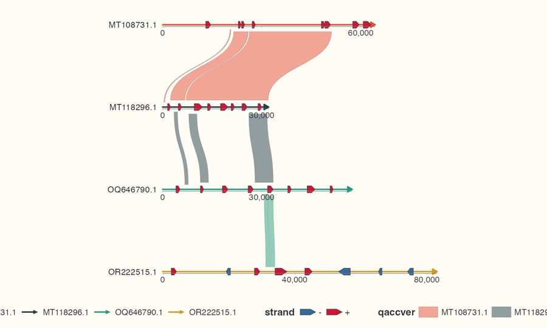</a><figcaption>显式设置序列、链方向和查询类别的颜色标度 · <span class="figure-hint">点击放大查看</span></figcaption></figure>

| 角色 | 映射数据 | 常用标度家族 |
| --- | --- | --- |
| `seq_colour`, `seq_ring` | 序列/类别 | 序列颜色或 ring 手动标度 |
| `ribbon_fill`, `ribbon_alpha`, `ribbon_colour`, `ribbon_linetype` | 比对元数据或统计 | 手动、渐变/分段/identity 和透明度标度 |
| `feature_fill`, `feature_shape`, `gene_fill`, `region_fill` | 注释类别或链 | 相应角色的手动/预设标度 |
| `link_colour`, `link_alpha`, `link_linewidth`, `link_linetype` | 点连接元数据 | 连续或手动 link标度|
| `track_value`, `track_fill`, `track_colour` | 命名轨道的数值/类别 | 命名数值域与颜色/填色标度 |

### 固定样式和用户标度优先 {#styling-priority}
常量样式写在 `aes()` 外，变化样式写在映射中并配合合适的标度。
显式几何层固定值优先，省略该固定参数才保持映射。用户标度优先于自动默认。
同类多层独立保留数据、映射和参数。按 `accver` 命名的几何向量，不表示标度
也接受逐序列列表。

### 组织可读图例 {#styling-guides}
`guide_ggchord_legend()` 控制离散角色图例，`guide_ggchord_colourbar()` 控制连续颜色
图例。colour/color 拼写别名保留，本文优先用 `colour`。图层 `show.legend`
决定显示，`guides()` 选择图例，`theme(legend.position = ...)` 决定位置。
过宽图例可分行或增加导出宽度，不需要删减生物学数据来迁就。

### 为场景选择主题 {#styling-themes}
例子在 `theme_variants` 中保存 minimal、dark 和 plasmid 备选，按场景添加到相应图中。
上图使用 `theme_ggchord_publication()`，plasmid 预设用于圆图流程。
主题控制非数据外观，不选择坐标系，也不替代数据驱动的填色标度。
文字外观用 `theme(text = element_text(...))`；已删除的 `base_size` 式快捷参数见
[迁移指南](#migration)。

### 完成后检查 {#styling-check-result}
同一 query 的连接颜色一致；连续相似度应使用连续标度。固定颜色放在 aes() 外，图例必须能说明映射。

<div class="next-step">继续：<a href="#adjustments">调整图形 →</a></div>


## 按序列和链设置参数 {#parameters}

<div class="task-intro"><p>按序列或链调整几何，保留旧版灵活参数的实用性，同时明确它不适用于所有参数。</p></div>

### 本页准备 {#parameters-prepare}
在新的 R 会话中先运行下方代码，再按页面顺序继续。配色和排版是可选的显示设置，输入只选择需要的列。

<details class="preparation"><summary>准备代码 · 在本页运行一次</summary>

```{r example-99, eval=FALSE}
library(ggchord)
library(dplyr)
data(seq_data_example)
data(ribbon_data_example)
data(gene_data_example)
seqs <- seq_data_example |>
  select(accver, length)
links <- ribbon_data_example |>
  select(qaccver, saccver, qstart, qend, sstart, send)
# The fixture preserves biological strands separately from its old display strands.
genes <- gene_data_example |>
  transmute(accver, start, end, strand = source_strand)

# Optional appearance choices; none of these columns or scales is required input.
library(ggchord)
seq_palette <- setNames(
  c("#E64B35", "#233E4A", "#269B82", "#D59B17"),
  c("MT108731.1", "MT118296.1", "OQ646790.1", "OR222515.1")
)
gene_palette <- c("+" = "#CE1536", "-" = "#346B9D", "." = "#8291A6")

library(ggchord)
doc_background <- "#FFFCF5"
identity_palette <- c("#303B71", "#36537D", "#269B82", "#A5D52C", "#ECEB31")
identity_values <- c(0, 0.5, 0.8, 0.9, 1)
identity_breaks <- c(0, 50, 80, 90, 100)
doc_legend_theme <- theme(
  legend.title = element_text(size = 13, face = "bold"),
  legend.text = element_text(size = 11),
  legend.key.width = unit(9, "mm"), legend.key.height = unit(5, "mm"),
  legend.spacing.x = unit(9, "mm"), legend.spacing.y = unit(7, "mm"),
  legend.margin = margin(l = 4, r = 4, unit = "mm")
)
sequence_guide <- guide_ggchord_legend(nrow = 1, theme = doc_legend_theme)
strand_guide <- guide_ggchord_legend(
  nrow = 1, override.aes = list(strand = c("+", "-")), theme = doc_legend_theme
)
identity_guide <- guide_ggchord_colourbar(
  position = "left", direction = "vertical",
  theme = theme(
    legend.key.height = unit(75, "mm"), legend.key.width = unit(5, "mm"),
    legend.title = element_text(size = 13, face = "bold"),
    legend.text = element_text(size = 11), legend.margin = margin(r = 7, unit = "mm")
  )
)
doc_theme <- theme_ggchord_publication(
  axis.text = element_text(size = 11),
  axis.text.check.overlap = TRUE
) +
  theme(
    legend.position = "bottom",
    legend.title = element_text(size = 13, face = "bold"),
    legend.text = element_text(size = 11),
    legend.key.width = unit(9, "mm"), legend.key.height = unit(5, "mm"),
    legend.spacing.x = unit(9, "mm"), legend.spacing.y = unit(7, "mm"),
    legend.box.spacing = unit(6, "mm"),
    plot.background = element_rect(fill = doc_background, colour = NA),
    panel.background = element_blank(),
    plot.title = element_text(face = "bold", size = 18),
    plot.subtitle = element_text(size = 10, colour = "#5C625A"),
    plot.margin = margin(14, 18, 14, 18)
  )
doc_axis <- function(coordinates = "relative") {
  scale_seq_position_continuous(
    coordinates = coordinates, n.breaks = 3, minor_breaks = NULL,
    labels = function(x) format(x, scientific = FALSE, big.mark = ",", trim = TRUE)
  )
}
```

</details>

旧版称为“灵活的参数格式”。本页用“按序列和链设置参数”明确其用途与边界。

### 这个能力仍然保留 {#parameters-recommendation}
同一图里常要单独调整某条序列，或分别调整正负链。为这些几何参数保留简洁的
逐序列/逐链写法是合理的；没有必要为了多一条序列而复制整个图层。
推荐先用单值，确实需要差异时用按 `accver` 命名的向量；正负链使用 `+`/`-` 命名向量。


```{r example-100, eval=FALSE}
# Sequence IDs remain stable when the data is reordered; positional lists do not.
radii <- setNames(c(1.1, 1, 1, 1), seqs$accver)
widths <- c("+" = .045, "-" = .065)
p_parameters <- ggchord(seq_data = seqs, gene_data = genes) +
  geom_seq(seq_radius = radii) +
  geom_gene(
    width = widths,
    position = position_strand(c("+" = .08, "-" = -.1))
  ) +
  geom_seq_label(size = 4) +
  scale_seq_colour_manual(values = seq_palette) +
  scale_gene_fill_manual(values = gene_palette) +
  coord_chord() +
  doc_theme
p_parameters
```


`radii` 的名称对应实际序列 ID，
`widths` 和位移对应链。重新排序时，命名值仍能找到原序列；无名值只按当前位置对应。
这个例子修改的是布局和几何，未把颜色或 theme 参数当成同一套扩展语法。

### 哪些参数支持 {#parameters-scope}
| 接口 | 支持参数 | 匹配范围 |
| --- | --- | --- |
| `geom_seq()` | `seq_radius`, `seq_curvature`, `seq_gap`, `seq_orientation` | 按序列；半径/曲率的效果取决于坐标模式 |
| `geom_seq_label()` | `labels`, `seq_label_radius`, `seq_label_rotation`, `size`, `seq_label_hjust`, `seq_label_vjust` | 按序列；`seq_label_orientation` 是单个模式选项 |
| `geom_link_ribbon()` / `geom_link_line()` | `link_gap` | 按端点所在序列；控制点不是逐序列标量 |
| `geom_gene()` / `geom_feature()` | `width` | 按序列，或分别按 `+`/`-` 链 |
| `position_strand()` / `position_plasmid()` | `offset` | 按序列或链；优先使用 Position 而非兼容 offset 入口 |
| 固定标签 `geom_gene_label()` / `geom_feature_label()` | `label_radial_offset`, `label_circum_offset`, `label_circum_limit`, `label_rotation` | 按序列或链；不代表所有文本参数都接受列表 |
| `position_track()` | 数值型 `width`, `gap` | 原生布局数值可按序列；物理 `unit()` 使用单个绝对尺寸 |

`seq_order` 本身就是序列排列，不是上述值的循环规则。自动避让标签的 `label_layout`
是布局模式；手动角度和偏移请使用固定标签层，不把它们塞进自动标签的 `...`。
axis/theme、aesthetic、标度、图例不继承这套列表扩展规则。手工标度本来就支持
按**数据类别**命名的颜色向量，那属于 ggplot2 的标度语义，见[配色教程](#styling)。

### 兼容写法与取舍 {#parameters-compatibility}
当前还兼容等长无名向量、按序列名的列表、按序号的列表及等长无名列表；gene/注释
的一项还可包含 `+`/`-` 两个值。它们是现有几何接口的兼容形式，不是任意参数的
通用容器。不同参数仍有自己的类型、长度、范围和单位检查。

v0.16.6 RC 审计决定保留这些等价形式，没有新增删除或弃用。位置写法跟随筛选后
当前显示序列顺序；名称匹配 accession ID 时优先按 ID。width/固定标签的逐序列
列表元素应为链值对，单值循环用 `list(value)`；Position offset 还允许逐序列单值
列表。显式按链命名的 Position offset 已带符号，未指定的链或序列补零；
`position_plasmid()` 使用共享 offset，拒绝链值对。键应唯一；`"1"`、`"+"`、`"-"`
这类序列 ID 可能与序号或链简写混淆，按链设置时宜使用按序列命名的嵌套列表。
原生数值型 track width/gap 必须覆盖所有显示序列。这些规则不扩展到 theme。

数值并不共用一个单位：`seq_gap` 是比例，旋转角度以度表示，物理轨道尺寸使用
明确的 `unit()`。`seq_backbone_gap`、`seq_backbone_width` 是单值样式参数，不在
上述列表规则中。共线性自动方向用 `coord_collinear(orientation = "auto")`；
`geom_seq(seq_orientation = ...)` 指定的是 +1/-1 数值方向。

### 完成后检查 {#parameters-check-result}
命名向量的键应对应实际 accver 或 +/− 链。重排后再次检查匹配；不要将列表规则推广到 theme、scale 或 aesthetic。

<div class="next-step">继续：<a href="#styling">设置配色、图例和主题 →</a></div>


## 调整图形 {#adjustments}

<div class="task-intro"><p>把常见调整放到正确的 ggplot2 组件：数据映射、几何位置、坐标和主题各负其责。</p></div>

### 本页准备 {#adjustments-prepare}
在新的 R 会话中先运行下方代码，再按页面顺序继续。配色和排版是可选的显示设置，输入只选择需要的列。

<details class="preparation"><summary>准备代码 · 在本页运行一次</summary>

```{r example-101, eval=FALSE}
library(ggchord)
library(dplyr)
data(seq_data_example)
data(ribbon_data_example)
data(gene_data_example)
seqs <- seq_data_example |>
  select(accver, length)
links <- ribbon_data_example |>
  select(qaccver, saccver, qstart, qend, sstart, send)
# The fixture preserves biological strands separately from its old display strands.
genes <- gene_data_example |>
  transmute(accver, start, end, strand = source_strand)

# Optional appearance choices; none of these columns or scales is required input.
library(ggchord)
seq_palette <- setNames(
  c("#E64B35", "#233E4A", "#269B82", "#D59B17"),
  c("MT108731.1", "MT118296.1", "OQ646790.1", "OR222515.1")
)
gene_palette <- c("+" = "#CE1536", "-" = "#346B9D", "." = "#8291A6")

library(ggchord)
doc_background <- "#FFFCF5"
identity_palette <- c("#303B71", "#36537D", "#269B82", "#A5D52C", "#ECEB31")
identity_values <- c(0, 0.5, 0.8, 0.9, 1)
identity_breaks <- c(0, 50, 80, 90, 100)
doc_legend_theme <- theme(
  legend.title = element_text(size = 13, face = "bold"),
  legend.text = element_text(size = 11),
  legend.key.width = unit(9, "mm"), legend.key.height = unit(5, "mm"),
  legend.spacing.x = unit(9, "mm"), legend.spacing.y = unit(7, "mm"),
  legend.margin = margin(l = 4, r = 4, unit = "mm")
)
sequence_guide <- guide_ggchord_legend(nrow = 1, theme = doc_legend_theme)
strand_guide <- guide_ggchord_legend(
  nrow = 1, override.aes = list(strand = c("+", "-")), theme = doc_legend_theme
)
identity_guide <- guide_ggchord_colourbar(
  position = "left", direction = "vertical",
  theme = theme(
    legend.key.height = unit(75, "mm"), legend.key.width = unit(5, "mm"),
    legend.title = element_text(size = 13, face = "bold"),
    legend.text = element_text(size = 11), legend.margin = margin(r = 7, unit = "mm")
  )
)
doc_theme <- theme_ggchord_publication(
  axis.text = element_text(size = 11),
  axis.text.check.overlap = TRUE
) +
  theme(
    legend.position = "bottom",
    legend.title = element_text(size = 13, face = "bold"),
    legend.text = element_text(size = 11),
    legend.key.width = unit(9, "mm"), legend.key.height = unit(5, "mm"),
    legend.spacing.x = unit(9, "mm"), legend.spacing.y = unit(7, "mm"),
    legend.box.spacing = unit(6, "mm"),
    plot.background = element_rect(fill = doc_background, colour = NA),
    panel.background = element_blank(),
    plot.title = element_text(face = "bold", size = 18),
    plot.subtitle = element_text(size = 10, colour = "#5C625A"),
    plot.margin = margin(14, 18, 14, 18)
  )
doc_axis <- function(coordinates = "relative") {
  scale_seq_position_continuous(
    coordinates = coordinates, n.breaks = 3, minor_breaks = NULL,
    labels = function(x) format(x, scientific = FALSE, big.mark = ",", trim = TRUE)
  )
}
```

</details>

### 职责分配 {#adjustments-grammar}
| 任务 | 接口 |
| --- | --- |
| 把数据列映射到 aesthetic | `aes()` |
| 定义映射规则与图例 | `scale_*()`, `guides()` |
| 几何与固定样式 | `geom_*()` |
| 局部放置 | `position_*()` |
| 全局坐标系 | `coord_*()` |
| 非数据外观 | `theme_*()`, `theme()` |
| 标题与说明 | `labs()` |

固定样式可直接传给几何层，数据驱动差异则使用映射和标度。显式固定值优先于映射，
省略固定参数则保留映射；用户标度优先于自动默认值。
`shape` 是固定注释几何参数，`feature_shape` 仍是映射角色。
显式 `shape = NULL` 无效，不表示改用映射。

### 映射连接相似度 {#adjustments-mapping}


```{r example-102, eval=FALSE}
identity_links <- ribbon_data_example |>
  select(qaccver, saccver, qstart, qend, sstart, send, pident)
p_mapped <- ggchord(seq_data = seqs, ribbon_data = identity_links) +
  geom_seq() +
  geom_link_ribbon(aes(ribbon_fill = pident), alpha = .6) +
  scale_ribbon_fill_gradientn(
    colours = identity_palette, values = identity_values,
    limits = c(0, 100), breaks = identity_breaks, name = "Identity (%)", guide = identity_guide
  ) +
  scale_seq_colour_manual(values = seq_palette) +
  coord_chord(rotation = 20) +
  labs(title = "Sequence comparison") +
  doc_theme
p_mapped
```


### 放置注释{#position}
使用 `position_strand(c("+" = .1, "-" = -.2))` 指定带符号的逐链位移。
`position_feature_stack()` 处理重叠注释，`position_track()` 分配命名定量轨道。
逐序列几何参数可用单值、等长无名向量或按 `accver` 命名的向量；推荐命名向量。
这套语法不扩展到标度、图例或 theme。

每层独立拥有 `data`、`mapping` 和参数，同类注释/连接层不会互相替换。
`show.legend` 和 `inherit.aes` 遵循 ggplot2。输入角色映射在几何生成前处理，
后期视觉映射遵循 ggplot2 求值。详见 接口说明 (`help("ggchord_api_contract", package = "ggchord")`)。

### 完成后检查 {#adjustments-check-result}
旋转整体图形使用 coord；逐序列几何使用明确命名值；颜色随数据变化时使用映射和标度。

<div class="next-step">继续：<a href="#parameters">按序列和链设置参数 →</a></div>


## 预览和保存图形 {#output}

<div class="task-intro"><p>按真实导出尺寸检查图形，再用标准 ggsave() 保存，并了解布局表与诊断可以证明什么。</p></div>

### 本页准备 {#output-prepare}
在新的 R 会话中先运行下方代码，再按页面顺序继续。配色和排版是可选的显示设置，输入只选择需要的列。

<details class="preparation"><summary>准备代码 · 在本页运行一次</summary>

```{r example-103, eval=FALSE}
library(ggchord)
library(dplyr)
data(seq_data_example)
data(ribbon_data_example)
data(gene_data_example)
seqs <- seq_data_example |>
  select(accver, length)
links <- ribbon_data_example |>
  select(qaccver, saccver, qstart, qend, sstart, send)
# The fixture preserves biological strands separately from its old display strands.
genes <- gene_data_example |>
  transmute(accver, start, end, strand = source_strand)

# Optional appearance choices; none of these columns or scales is required input.
library(ggchord)
seq_palette <- setNames(
  c("#E64B35", "#233E4A", "#269B82", "#D59B17"),
  c("MT108731.1", "MT118296.1", "OQ646790.1", "OR222515.1")
)
gene_palette <- c("+" = "#CE1536", "-" = "#346B9D", "." = "#8291A6")

library(ggchord)
doc_background <- "#FFFCF5"
identity_palette <- c("#303B71", "#36537D", "#269B82", "#A5D52C", "#ECEB31")
identity_values <- c(0, 0.5, 0.8, 0.9, 1)
identity_breaks <- c(0, 50, 80, 90, 100)
doc_legend_theme <- theme(
  legend.title = element_text(size = 13, face = "bold"),
  legend.text = element_text(size = 11),
  legend.key.width = unit(9, "mm"), legend.key.height = unit(5, "mm"),
  legend.spacing.x = unit(9, "mm"), legend.spacing.y = unit(7, "mm"),
  legend.margin = margin(l = 4, r = 4, unit = "mm")
)
sequence_guide <- guide_ggchord_legend(nrow = 1, theme = doc_legend_theme)
strand_guide <- guide_ggchord_legend(
  nrow = 1, override.aes = list(strand = c("+", "-")), theme = doc_legend_theme
)
identity_guide <- guide_ggchord_colourbar(
  position = "left", direction = "vertical",
  theme = theme(
    legend.key.height = unit(75, "mm"), legend.key.width = unit(5, "mm"),
    legend.title = element_text(size = 13, face = "bold"),
    legend.text = element_text(size = 11), legend.margin = margin(r = 7, unit = "mm")
  )
)
doc_theme <- theme_ggchord_publication(
  axis.text = element_text(size = 11),
  axis.text.check.overlap = TRUE
) +
  theme(
    legend.position = "bottom",
    legend.title = element_text(size = 13, face = "bold"),
    legend.text = element_text(size = 11),
    legend.key.width = unit(9, "mm"), legend.key.height = unit(5, "mm"),
    legend.spacing.x = unit(9, "mm"), legend.spacing.y = unit(7, "mm"),
    legend.box.spacing = unit(6, "mm"),
    plot.background = element_rect(fill = doc_background, colour = NA),
    panel.background = element_blank(),
    plot.title = element_text(face = "bold", size = 18),
    plot.subtitle = element_text(size = 10, colour = "#5C625A"),
    plot.margin = margin(14, 18, 14, 18)
  )
doc_axis <- function(coordinates = "relative") {
  scale_seq_position_continuous(
    coordinates = coordinates, n.breaks = 3, minor_breaks = NULL,
    labels = function(x) format(x, scientific = FALSE, big.mark = ",", trim = TRUE)
  )
}

anchors <- genes |>
  group_by(accver) |>
  slice_max(end - start, n = 1, with_ties = FALSE) |>
  ungroup() |>
  select(accver, start, end)
p_collinear <- ggchord(seq_data = seqs, ribbon_data = links, gene_data = genes) +
  geom_link_ribbon(aes(ribbon_fill = qaccver), alpha = .7) +
  scale_ribbon_fill_manual(values = seq_palette, guide = "none") +
  geom_seq() +
  geom_gene(position = position_strand(.1)) +
  geom_seq_label(size = 4) +
  coord_collinear(anchor = anchors, align = "center", orientation = "auto") +
  doc_axis() +
  scale_seq_colour_manual(values = seq_palette) +
  scale_gene_fill_manual(values = gene_palette) +
  doc_theme
p_collinear
```

</details>

### 按目标尺寸保存 {#output-size}
先在[三种模式](#modes)中创建 `p_collinear`：


```{r example-104, eval=FALSE}
ggsave("comparison.png", p_collinear, width = 8, height = 5, units = "in", dpi = 144)
```


RStudio Plots 使用当前面板尺寸，标签与图例可能随面板调整而重新排列。
最终 `ggsave()` 前，按相同显式尺寸预览：


```{r example-105, eval=FALSE}
view_ggchord(p_collinear, width = 8, height = 5, units = "in")
diagnosis <- diagnose_ggchord(p_collinear, width = 8, height = 5, units = "in")
```


`view_ggchord()` 返回临时图片路径，不保存最终导出文件。
网站、README 和 vignette 共用标准 `ggsave()` 生成的 PNG，尺寸见[图集](#gallery)，
不截取临时调整后的交互面板。最终矢量输出应显式选择目标 PDF/SVG 设备；字体可用性
和嵌入仍取决于设备。

### 按字段名消费几何 {#output-geometry}

```{r example-106, eval=FALSE}
geometry <- export_ggchord_layout(p_collinear, include = "seq")
rows <- geometry$seq |>
  distinct(layer_id, component, source_row)
```


`export_ggchord_layout()` 是推荐的分层表格接口；`get_chord_layout()` 保留完整的
已记录布局，两者都未弃用。选择字段名，不依赖固定列位置。
`source_row` 指已解析图层输入行，ID 是构建期资源，不是永久生物学标识。
详见完整布局结果说明 (`help("ggchord_layout_contract", package = "ggchord")`)。

### 理解诊断证据 {#output-diagnostics}
`diagnose_ggchord()` 区分面板已测量与几何收敛。面板已测量不表示文字无碰撞、字体
已嵌入或跨应用表现已认证。应检查警告、文字/图例测量及放置原因。
`optimize_ggchord_layout()` 按文档执行主动选择的调整，应保留副本并查看结果。
预览和诊断使用独立渲染副本。直接改动共享 ggproto 图层环境仍遵循普通 ggplot2
引用语义，不会自动隔离为一次独立编辑。

### 完整布局、表格与主动选择的排序 {#output-consumption}

```{r example-107, eval=FALSE}
full_layout <- get_chord_layout(p_collinear)
layer_tables <- export_ggchord_layout(p_collinear, include = c("seq", "gene"), original_data = TRUE)
layout_choice <- optimize_ggchord_layout(seqs, links, optimize = c("order", "orientation"), weight = "count")
```


先在[三种模式](#modes-collinear)创建 `p_collinear`。
`full_layout` 保留完整的已记录 getter 结果，`layer_tables` 选择序列/基因表与已解析
原始数据，不是原始文件档案。layer ID 和源行角色区分独立同类图层。
空组件可没有固定列原型，应按字段名读取。

`layout_choice` 以计数权重选择顺序/方向，因为本例的最小绘图表有意未保留比对长度统计列。
返回的选择应显式用于序列设置，不修改原图，也不确立生物学方向。
采用前应保存该选择并对照结果。文档精确尺寸见资产清单 (`website/assets/plots.csv` in the source repository)。

### 完成后检查 {#output-check-result}
预览与保存使用相同宽高。检查文字、图例与警告；一次测量成功不代表跨设备字体和发布质量已认证。

<div class="next-step">继续：<a href="#faq">常见问题 →</a></div>


## 使用教程 {#articles}

<div class="lesson-intro">按模块循序学习，再按需查阅共用技巧。每个模块从输入表出发，以完整展示图结束。</div>

### 三条学习路线 {#articles-modules}
<div class="route-grid">
<a class="route-card" href="#chord-data"><strong>模块一『弦图』部分</strong><span>表格 → 导入 → 骨架与图层 → 参数与避障 → 综合图</span></a>
<a class="route-card" href="#collinear-data"><strong>模块二『共线性图』部分</strong><span>复用数据 → 替换坐标 → 跨行路由 → 局部比较 → 综合图</span></a>
<a class="route-card" href="#plasmid-data"><strong>模块三『质粒图』部分</strong><span>DNA与注释 → 圆圈与图层 → 识别 → 13个案例 → 密集综合图</span></a>
</div>

### 依次阅读或按需查阅 {#articles-guides}
#### 安装与学习路线 {#articles-path-start}

- [安装与环境准备](#installation)
- [选择合适的学习模块](#modes)

#### 模块一『弦图』部分 {#articles-path-chord}

- [1.1 输入表与字段含义](#chord-data)
- [1.2 生成与导入比对数据](#chord-import)
- [1.3 从骨架逐层添加](#chord-build)
- [1.4 方向、曲率与避障](#chord-tuning)
- [1.5 筛选与整理连接](#ribbons)
- [1.6 原始文件完整流程](#real-data)
- [1.7 弦图综合展示](#chord)

#### 模块二『共线性图』部分 {#articles-path-collinear}

- [2.1 复用弦图的数据](#collinear-data)
- [2.2 只替换坐标系，再逐层添加](#collinear-build)
- [2.3 跨行连接、避障与比例尺](#collinear-routing)
- [2.4 比较基因邻域](#homology)
- [2.5 局部、锚定与分段](#views)
- [2.6 共线性综合展示](#collinear)

#### 模块三『质粒图』部分 {#articles-path-plasmid}

- [3.1 DNA、注释与13个参考序列](#plasmid-data)
- [3.2 从圆圈到多层注释](#plasmid-build)
- [3.3 识别特征、引物与酶切](#recognition)
- [3.4 13个质粒参考案例](#plasmid-catalog)
- [3.5 质粒综合实战](#plasmids)

#### 按需查阅：数据与图层 {#articles-path-shared}

- [数据与坐标](#data)
- [导入和转换数据](#formats)
- [导入核酸和蛋白比对](#alignments)
- [将蛋白区间转换为基因组坐标](#projection)
- [绘制注释与处理重叠](#annotations)
- [放置和调整标签](#labels)
- [添加数据轨道](#tracks)
- [设置配色、图例和主题](#styling)
- [按序列和链设置参数](#parameters)
- [调整图形](#adjustments)
- [预览和保存图形](#output)

#### 学习地图与函数查阅 {#articles-path-reference}

- [示例图集](#gallery)
- [常见问题](#faq)
- [迁移到候选 API](#migration)
- [术语说明](#glossary)

### 功能与可运行证据 {#articles-capabilities}
| 功能 | 使用教程 | 代码与结果 |
| --- | --- | --- |
| 三种坐标模式 | [选择合适的学习模块](#modes) | `chord`, `circular`, `collinear` · chord, circular, collinear |
| 真实记录比较 | [1.6 原始文件完整流程](#real-data) | `realimport`, `realprepare`, `realchord`, `reallinear` · realchord, reallinear |
| 完整圆图注释 | [3.5 质粒综合实战](#plasmids) | `plasmid` · plasmid |
| 校验、清理与层次 | [数据与坐标](#data) | `validation`, `cleaning`, `hierarchy` |
| 文件格式与适配器 | [导入和转换数据](#formats), [导入核酸和蛋白比对](#alignments) | `adapters`, `formats`, `genbank`, `optionalranges`, `standardblast`, `protein` · paf |
| 连接准备与统计 | [1.5 筛选与整理连接](#ribbons) | `ribbons` · density |
| 区间与点连接 | [1.5 筛选与整理连接](#ribbons), [选择合适的学习模块](#modes) | `pointlinks`, `collinear` · pointlinks |
| Feature 与 Position | [绘制注释与处理重叠](#annotations) | `featurestack` · featurestack |
| 自动与固定标签 | [放置和调整标签](#labels), [3.5 质粒综合实战](#plasmids) | `labellayouts`, `labels`, `plasmid` · labelauto, labelradial, labelarc |
| 轴、参照条与区域 | [绘制注释与处理重叠](#annotations), [2.5 局部、锚定与分段](#views) | `decorations`, `focus` · decorations |
| 定量轨道与数值域 | [添加数据轨道](#tracks) | `tracks`, `multitrack` · multitrack |
| 引物、酶切及 feature 搜索 | [3.3 识别特征、引物与酶切](#recognition), [3.5 质粒综合实战](#plasmids) | `recognition`, `plasmid` · plasmid |
| CDS 与连接投影 | [将蛋白区间转换为基因组坐标](#projection), [2.4 比较基因邻域](#homology) | `projection`, `linkprojection` |
| 显式 cluster 与 loci | [2.4 比较基因邻域](#homology) | `homologs` · homologs |
| 局部、分段与源映射 | [2.5 局部、锚定与分段](#views) | `focus`, `segment`, `mappingposition` · focus |
| 标度、图例与主题 | [设置配色、图例和主题](#styling), [调整图形](#adjustments), [按序列和链设置参数](#parameters) | `styling`, `adjustments`, `parameters` · styling |
| 预览、结果与排序 | [预览和保存图形](#output) | `save`, `preview`, `provenance`, `layoutresults` |
| 迁移与常见问题 | [迁移到候选 API](#migration), [常见问题](#faq) | `migration` |


## 示例图集 {#gallery}

<p class="lesson-intro">按要回答的问题选择案例；缩略图用于找到方向，点击可查看完整尺寸。每张图都链接到数据准备、代码和读图说明。</p>

### 按任务找图 {#gallery-tasks}
| 总体关系 | 单序列注释 | 局部位置 | 定量与排版 |
| --- | --- | --- | --- |
| [弦图](#gallery-realchord) | [质粒](#gallery-plasmid) | [CDS 邻域](#gallery-homologs) | [GC 轨道](#gallery-multitrack) |
| [点连接](#gallery-pointlinks) | [注释堆叠](#gallery-featurestack) | [聚焦](#gallery-focus) | [标签布局](#gallery-labelauto) |

### 图片与尺寸 {#gallery-figures}
<div class="gallery-grid"><section class="gallery-card"><h3 id="gallery-chord">随包序列与已有比对区间的弦图</h3><figure class="documentation-figure"><a class="figure-link" href="tutorial-assets/chord.jpg" title="点击放大查看"></a><figcaption>随包序列与已有比对区间的弦图 · <span class="figure-hint">点击放大查看</span></figcaption></figure><p><a href="#modes-chord">数据、代码与读图说明 →</a></p><p class="asset-size"><code>p_chord</code> · 10 × 8 in · 144 dpi</p></section><section class="gallery-card"><h3 id="gallery-circular">pUC19 注释的单序列圆图</h3><figure class="documentation-figure"><a class="figure-link" href="tutorial-assets/circular.jpg" title="点击放大查看"></a><figcaption>pUC19 注释的单序列圆图 · <span class="figure-hint">点击放大查看</span></figcaption></figure><p><a href="#modes-circular">数据、代码与读图说明 →</a></p><p class="asset-size"><code>p_circular</code> · 9 × 8 in · 144 dpi</p></section><section class="gallery-card"><h3 id="gallery-collinear">按选定注释锚定的随包序列共线性图</h3><figure class="documentation-figure"><a class="figure-link" href="tutorial-assets/collinear.jpg" title="点击放大查看"></a><figcaption>按选定注释锚定的随包序列共线性图 · <span class="figure-hint">点击放大查看</span></figcaption></figure><p><a href="#modes-collinear">数据、代码与读图说明 →</a></p><p class="asset-size"><code>p_collinear</code> · 10 × 6 in · 144 dpi</p></section><section class="gallery-card"><h3 id="gallery-tracks">从随包 pUC19 DNA 计算的 GC 比例</h3><figure class="documentation-figure"><a class="figure-link" href="tutorial-assets/tracks.jpg" title="点击放大查看"></a><figcaption>从随包 pUC19 DNA 计算的 GC 比例 · <span class="figure-hint">点击放大查看</span></figcaption></figure><p><a href="#tracks-domain">数据、代码与读图说明 →</a></p><p class="asset-size"><code>p_tracks</code> · 9 × 8 in · 144 dpi</p></section><section class="gallery-card"><h3 id="gallery-focus">保留原始坐标刻度的局部序列视图</h3><figure class="documentation-figure"><a class="figure-link" href="tutorial-assets/focus.jpg" title="点击放大查看"></a><figcaption>保留原始坐标刻度的局部序列视图 · <span class="figure-hint">点击放大查看</span></figcaption></figure><p><a href="#views-focus">数据、代码与读图说明 →</a></p><p class="asset-size"><code>p_focus</code> · 10 × 6 in · 144 dpi</p></section><section class="gallery-card"><h3 id="gallery-labels">实际基因注释的自动标签布局</h3><figure class="documentation-figure"><a class="figure-link" href="tutorial-assets/labels.jpg" title="点击放大查看"></a><figcaption>实际基因注释的自动标签布局 · <span class="figure-hint">点击放大查看</span></figcaption></figure><p><a href="#labels-layout">数据、代码与读图说明 →</a></p><p class="asset-size"><code>p_labels</code> · 10 × 6 in · 144 dpi</p></section><section class="gallery-card"><h3 id="gallery-realchord">原始序列、选定 CDS 与已有比对的弦图</h3><figure class="documentation-figure"><a class="figure-link" href="tutorial-assets/realchord.jpg" title="点击放大查看"></a><figcaption>原始序列、选定 CDS 与已有比对的弦图 · <span class="figure-hint">点击放大查看</span></figcaption></figure><p><a href="#real-data-chord">数据、代码与读图说明 →</a></p><p class="asset-size"><code>p_real_chord</code> · 10 × 8 in · 144 dpi</p></section><section class="gallery-card"><h3 id="gallery-reallinear">原始序列、全部导入 CDS 与筛选连接的线性图</h3><figure class="documentation-figure"><a class="figure-link" href="tutorial-assets/reallinear.jpg" title="点击放大查看"></a><figcaption>原始序列、全部导入 CDS 与筛选连接的线性图 · <span class="figure-hint">点击放大查看</span></figcaption></figure><p><a href="#real-data-linear">数据、代码与读图说明 →</a></p><p class="asset-size"><code>p_real_linear</code> · 10 × 6 in · 144 dpi</p></section><section class="gallery-card"><h3 id="gallery-plasmid">pUC19 注释、精确引物命中与三个选定酶切位点</h3><figure class="documentation-figure"><a class="figure-link" href="tutorial-assets/plasmid.jpg" title="点击放大查看"></a><figcaption>pUC19 注释、精确引物命中与三个选定酶切位点 · <span class="figure-hint">点击放大查看</span></figcaption></figure><p><a href="#plasmids-input">数据、代码与读图说明 →</a></p><p class="asset-size"><code>p_plasmid</code> · 10 × 9 in · 144 dpi</p></section><section class="gallery-card"><h3 id="gallery-density">原始比对记录的区间密度</h3><figure class="documentation-figure"><a class="figure-link" href="tutorial-assets/density.jpg" title="点击放大查看"></a><figcaption>原始比对记录的区间密度 · <span class="figure-hint">点击放大查看</span></figcaption></figure><p><a href="#ribbons-density">数据、代码与读图说明 →</a></p><p class="asset-size"><code>p_density</code> · 10 × 8 in · 144 dpi</p></section><section class="gallery-card"><h3 id="gallery-pointlinks">从已有 HSP 区间计算中点的点连接</h3><figure class="documentation-figure"><a class="figure-link" href="tutorial-assets/pointlinks.jpg" title="点击放大查看"></a><figcaption>从已有 HSP 区间计算中点的点连接 · <span class="figure-hint">点击放大查看</span></figcaption></figure><p><a href="#ribbons-points">数据、代码与读图说明 →</a></p><p class="asset-size"><code>p_points</code> · 10 × 8 in · 144 dpi</p></section><section class="gallery-card"><h3 id="gallery-featurestack">pUC19 中重叠注释的分层显示</h3><figure class="documentation-figure"><a class="figure-link" href="tutorial-assets/featurestack.jpg" title="点击放大查看"></a><figcaption>pUC19 中重叠注释的分层显示 · <span class="figure-hint">点击放大查看</span></figcaption></figure><p><a href="#annotations-stack">数据、代码与读图说明 →</a></p><p class="asset-size"><code>p_stack</code> · 10 × 5 in · 144 dpi</p></section><section class="gallery-card"><h3 id="gallery-multitrack">pUC19 GC 比例、三点滑动均值和注释类型带</h3><figure class="documentation-figure"><a class="figure-link" href="tutorial-assets/multitrack.jpg" title="点击放大查看"></a><figcaption>pUC19 GC 比例、三点滑动均值和注释类型带 · <span class="figure-hint">点击放大查看</span></figcaption></figure><p><a href="#tracks-multiple">数据、代码与读图说明 →</a></p><p class="asset-size"><code>p_multitrack</code> · 9 × 8 in · 144 dpi</p></section><section class="gallery-card"><h3 id="gallery-homologs">两条质粒的 AmpR 邻域：相同 CDS、200 bp 侧翼与源坐标</h3><figure class="documentation-figure"><a class="figure-link" href="tutorial-assets/homologs.jpg" title="点击放大查看"></a><figcaption>两条质粒的 AmpR 邻域：相同 CDS、200 bp 侧翼与源坐标 · <span class="figure-hint">点击放大查看</span></figcaption></figure><p><a href="#homology-membership">数据、代码与读图说明 →</a></p><p class="asset-size"><code>p_homologs</code> · 10 × 5 in · 144 dpi</p></section><section class="gallery-card"><h3 id="gallery-decorations">突出显示一条实际比对的查询区间</h3><figure class="documentation-figure"><a class="figure-link" href="tutorial-assets/decorations.jpg" title="点击放大查看"></a><figcaption>突出显示一条实际比对的查询区间 · <span class="figure-hint">点击放大查看</span></figcaption></figure><p><a href="#annotations-decoration">数据、代码与读图说明 →</a></p><p class="asset-size"><code>p_decorated</code> · 10 × 6 in · 144 dpi</p></section><section class="gallery-card"><h3 id="gallery-labelauto">实际基因注释的自动侧边标签</h3><figure class="documentation-figure"><a class="figure-link" href="tutorial-assets/labelauto.jpg" title="点击放大查看"></a><figcaption>实际基因注释的自动侧边标签 · <span class="figure-hint">点击放大查看</span></figcaption></figure><p><a href="#labels-comparison">数据、代码与读图说明 →</a></p><p class="asset-size"><code>p_labelauto</code> · 12 × 10 in · 144 dpi</p></section><section class="gallery-card"><h3 id="gallery-labelradial">同一组基因注释的径向标签</h3><figure class="documentation-figure"><a class="figure-link" href="tutorial-assets/labelradial.jpg" title="点击放大查看"></a><figcaption>同一组基因注释的径向标签 · <span class="figure-hint">点击放大查看</span></figcaption></figure><p><a href="#labels-comparison">数据、代码与读图说明 →</a></p><p class="asset-size"><code>p_labelradial</code> · 12 × 10 in · 144 dpi</p></section><section class="gallery-card"><h3 id="gallery-labelarc">同一组基因注释的沿弧标签</h3><figure class="documentation-figure"><a class="figure-link" href="tutorial-assets/labelarc.jpg" title="点击放大查看"></a><figcaption>同一组基因注释的沿弧标签 · <span class="figure-hint">点击放大查看</span></figcaption></figure><p><a href="#labels-comparison">数据、代码与读图说明 →</a></p><p class="asset-size"><code>p_labelarc</code> · 12 × 10 in · 144 dpi</p></section><section class="gallery-card"><h3 id="gallery-styling">显式设置序列、链方向和查询类别的颜色标度</h3><figure class="documentation-figure"><a class="figure-link" href="tutorial-assets/styling.jpg" title="点击放大查看"></a><figcaption>显式设置序列、链方向和查询类别的颜色标度 · <span class="figure-hint">点击放大查看</span></figcaption></figure><p><a href="#styling-roles">数据、代码与读图说明 →</a></p><p class="asset-size"><code>p_styled</code> · 10 × 6 in · 144 dpi</p></section><section class="gallery-card"><h3 id="gallery-paf">从真实 minimap2 PAF 结果绘制的两条 EMALE 序列</h3><figure class="documentation-figure"><a class="figure-link" href="tutorial-assets/paf.jpg" title="点击放大查看"></a><figcaption>从真实 minimap2 PAF 结果绘制的两条 EMALE 序列 · <span class="figure-hint">点击放大查看</span></figcaption></figure><p><a href="#formats-zero-based">数据、代码与读图说明 →</a></p><p class="asset-size"><code>p_paf</code> · 10 × 5 in · 144 dpi</p></section><section class="gallery-card"><h3 id="gallery-first">第一张图：两条真实随包序列、基因箭头及已有比对区间</h3><figure class="documentation-figure"><a class="figure-link" href="tutorial-assets/first.jpg" title="点击放大查看"></a><figcaption>第一张图：两条真实随包序列、基因箭头及已有比对区间 · <span class="figure-hint">点击放大查看</span></figcaption></figure><p><a href="#installation-first-plot">数据、代码与读图说明 →</a></p><p class="asset-size"><code>p_first</code> · 10 × 5 in · 144 dpi</p></section><section class="gallery-card"><h3 id="gallery-showcasechord">四基因组弦图：混合骨架曲率与实测相似度</h3><figure class="documentation-figure"><a class="figure-link" href="tutorial-assets/showcasechord.jpg" title="点击放大查看"></a><figcaption>四基因组弦图：混合骨架曲率与实测相似度 · <span class="figure-hint">点击放大查看</span></figcaption></figure><p><a href="#chord-compose">数据、代码与读图说明 →</a></p><p class="asset-size"><code>p_show_chord</code> · 12 × 10 in · 144 dpi</p></section><section class="gallery-card"><h3 id="gallery-showcaseplasmid">pETDuet-1密集质粒图：特征、参考引物与合并酶切位点</h3><figure class="documentation-figure"><a class="figure-link" href="tutorial-assets/showcaseplasmid.jpg" title="点击放大查看"></a><figcaption>pETDuet-1密集质粒图：特征、参考引物与合并酶切位点 · <span class="figure-hint">点击放大查看</span></figcaption></figure><p><a href="#plasmids-complex">数据、代码与读图说明 →</a></p><p class="asset-size"><code>p_show_plasmid</code> · 16.5 × 8 in · 144 dpi</p></section><section class="gallery-card"><h3 id="gallery-showcasecollinear">四基因组共线性图：分链特征与绕行的跨行连接</h3><figure class="documentation-figure"><a class="figure-link" href="tutorial-assets/showcasecollinear.jpg" title="点击放大查看"></a><figcaption>四基因组共线性图：分链特征与绕行的跨行连接 · <span class="figure-hint">点击放大查看</span></figcaption></figure><p><a href="#collinear-compose">数据、代码与读图说明 →</a></p><p class="asset-size"><code>p_show_collinear</code> · 12 × 8 in · 144 dpi</p></section><section class="gallery-card"><h3 id="gallery-learnseq">弦图第一步：序列骨架</h3><figure class="documentation-figure"><a class="figure-link" href="tutorial-assets/learnseq.jpg" title="点击放大查看"></a><figcaption>弦图第一步：序列骨架 · <span class="figure-hint">点击放大查看</span></figcaption></figure><p><a href="#chord-build-backbones">数据、代码与读图说明 →</a></p><p class="asset-size"><code>p_learn_seq</code> · 10 × 8 in · 144 dpi</p></section><section class="gallery-card"><h3 id="gallery-learnlinks">弦图第二步：已有比对</h3><figure class="documentation-figure"><a class="figure-link" href="tutorial-assets/learnlinks.jpg" title="点击放大查看"></a><figcaption>弦图第二步：已有比对 · <span class="figure-hint">点击放大查看</span></figcaption></figure><p><a href="#chord-build-links">数据、代码与读图说明 →</a></p><p class="asset-size"><code>p_learn_links</code> · 10 × 8 in · 144 dpi</p></section><section class="gallery-card"><h3 id="gallery-learngenes">弦图第三步：精选基因</h3><figure class="documentation-figure"><a class="figure-link" href="tutorial-assets/learngenes.jpg" title="点击放大查看"></a><figcaption>弦图第三步：精选基因 · <span class="figure-hint">点击放大查看</span></figcaption></figure><p><a href="#chord-build-genes">数据、代码与读图说明 →</a></p><p class="asset-size"><code>p_learn_genes</code> · 10 × 8 in · 144 dpi</p></section><section class="gallery-card"><h3 id="gallery-learnlabels">弦图第四步：逐一添加标签</h3><figure class="documentation-figure"><a class="figure-link" href="tutorial-assets/learnlabels.jpg" title="点击放大查看"></a><figcaption>弦图第四步：逐一添加标签 · <span class="figure-hint">点击放大查看</span></figcaption></figure><p><a href="#chord-build-labels">数据、代码与读图说明 →</a></p><p class="asset-size"><code>p_learn_labels</code> · 10 × 8 in · 144 dpi</p></section><section class="gallery-card"><h3 id="gallery-linearseq">相同骨架，仅替换坐标系</h3><figure class="documentation-figure"><a class="figure-link" href="tutorial-assets/linearseq.jpg" title="点击放大查看"></a><figcaption>相同骨架，仅替换坐标系 · <span class="figure-hint">点击放大查看</span></figcaption></figure><p><a href="#collinear-build-backbones">数据、代码与读图说明 →</a></p><p class="asset-size"><code>p_linear_seq</code> · 10 × 6 in · 144 dpi</p></section><section class="gallery-card"><h3 id="gallery-linearlinks">相同连接，仅替换坐标系</h3><figure class="documentation-figure"><a class="figure-link" href="tutorial-assets/linearlinks.jpg" title="点击放大查看"></a><figcaption>相同连接，仅替换坐标系 · <span class="figure-hint">点击放大查看</span></figcaption></figure><p><a href="#collinear-build-links">数据、代码与读图说明 →</a></p><p class="asset-size"><code>p_linear_links</code> · 10 × 6 in · 144 dpi</p></section><section class="gallery-card"><h3 id="gallery-linearlabels">相同基因与标签，仅替换坐标系</h3><figure class="documentation-figure"><a class="figure-link" href="tutorial-assets/linearlabels.jpg" title="点击放大查看"></a><figcaption>相同基因与标签，仅替换坐标系 · <span class="figure-hint">点击放大查看</span></figcaption></figure><p><a href="#collinear-build-labels">数据、代码与读图说明 →</a></p><p class="asset-size"><code>p_linear_labels</code> · 10 × 6 in · 144 dpi</p></section><section class="gallery-card"><h3 id="gallery-plasmidbackbone">pUC19第一步：双线骨架</h3><figure class="documentation-figure"><a class="figure-link" href="tutorial-assets/plasmidbackbone.jpg" title="点击放大查看"></a><figcaption>pUC19第一步：双线骨架 · <span class="figure-hint">点击放大查看</span></figcaption></figure><p><a href="#plasmid-build-backbone">数据、代码与读图说明 →</a></p><p class="asset-size"><code>p_plasmid_backbone</code> · 10 × 8 in · 144 dpi</p></section><section class="gallery-card"><h3 id="gallery-plasmidfeatures">pUC19第二步：特征</h3><figure class="documentation-figure"><a class="figure-link" href="tutorial-assets/plasmidfeatures.jpg" title="点击放大查看"></a><figcaption>pUC19第二步：特征 · <span class="figure-hint">点击放大查看</span></figcaption></figure><p><a href="#plasmid-build-features">数据、代码与读图说明 →</a></p><p class="asset-size"><code>p_plasmid_features</code> · 10 × 8 in · 144 dpi</p></section><section class="gallery-card"><h3 id="gallery-plasmidtext">pUC19第三步：标签</h3><figure class="documentation-figure"><a class="figure-link" href="tutorial-assets/plasmidtext.jpg" title="点击放大查看"></a><figcaption>pUC19第三步：标签 · <span class="figure-hint">点击放大查看</span></figcaption></figure><p><a href="#plasmid-build-labels">数据、代码与读图说明 →</a></p><p class="asset-size"><code>p_plasmid_text</code> · 10 × 8 in · 144 dpi</p></section><section class="gallery-card"><h3 id="gallery-catalogpsb">pSB1C3：参考特征图</h3><figure class="documentation-figure"><a class="figure-link" href="tutorial-assets/catalogpsb.jpg" title="点击放大查看"></a><figcaption>pSB1C3：参考特征图 · <span class="figure-hint">点击放大查看</span></figcaption></figure><p><a href="#plasmid-catalog-catalogpsb">数据、代码与读图说明 →</a></p><p class="asset-size"><code>p_catalogpsb</code> · 10 × 8 in · 144 dpi</p></section><section class="gallery-card"><h3 id="gallery-catalogpuc">pUC19：参考特征图</h3><figure class="documentation-figure"><a class="figure-link" href="tutorial-assets/catalogpuc.jpg" title="点击放大查看"></a><figcaption>pUC19：参考特征图 · <span class="figure-hint">点击放大查看</span></figcaption></figure><p><a href="#plasmid-catalog-catalogpuc">数据、代码与读图说明 →</a></p><p class="asset-size"><code>p_catalogpuc</code> · 10 × 8 in · 144 dpi</p></section><section class="gallery-card"><h3 id="gallery-catalogpbr">pBR322：参考特征图</h3><figure class="documentation-figure"><a class="figure-link" href="tutorial-assets/catalogpbr.jpg" title="点击放大查看"></a><figcaption>pBR322：参考特征图 · <span class="figure-hint">点击放大查看</span></figcaption></figure><p><a href="#plasmid-catalog-catalogpbr">数据、代码与读图说明 →</a></p><p class="asset-size"><code>p_catalogpbr</code> · 10 × 8 in · 144 dpi</p></section><section class="gallery-card"><h3 id="gallery-catalogblue">pBluescript II SK(+)：参考特征图</h3><figure class="documentation-figure"><a class="figure-link" href="tutorial-assets/catalogblue.jpg" title="点击放大查看"></a><figcaption>pBluescript II SK(+)：参考特征图 · <span class="figure-hint">点击放大查看</span></figcaption></figure><p><a href="#plasmid-catalog-catalogblue">数据、代码与读图说明 →</a></p><p class="asset-size"><code>p_catalogblue</code> · 10 × 8 in · 144 dpi</p></section><section class="gallery-card"><h3 id="gallery-catalogpet">pET-28a(+)：参考特征图</h3><figure class="documentation-figure"><a class="figure-link" href="tutorial-assets/catalogpet.jpg" title="点击放大查看"></a><figcaption>pET-28a(+)：参考特征图 · <span class="figure-hint">点击放大查看</span></figcaption></figure><p><a href="#plasmid-catalog-catalogpet">数据、代码与读图说明 →</a></p><p class="asset-size"><code>p_catalogpet</code> · 10 × 8 in · 144 dpi</p></section><section class="gallery-card"><h3 id="gallery-catalogduet">pETDuet-1：参考特征图</h3><figure class="documentation-figure"><a class="figure-link" href="tutorial-assets/catalogduet.jpg" title="点击放大查看"></a><figcaption>pETDuet-1：参考特征图 · <span class="figure-hint">点击放大查看</span></figcaption></figure><p><a href="#plasmid-catalog-catalogduet">数据、代码与读图说明 →</a></p><p class="asset-size"><code>p_catalogduet</code> · 10 × 8 in · 144 dpi</p></section><section class="gallery-card"><h3 id="gallery-catalogdonr">pDONR221：参考特征图</h3><figure class="documentation-figure"><a class="figure-link" href="tutorial-assets/catalogdonr.jpg" title="点击放大查看"></a><figcaption>pDONR221：参考特征图 · <span class="figure-hint">点击放大查看</span></figcaption></figure><p><a href="#plasmid-catalog-catalogdonr">数据、代码与读图说明 →</a></p><p class="asset-size"><code>p_catalogdonr</code> · 10 × 8 in · 144 dpi</p></section><section class="gallery-card"><h3 id="gallery-catalogpcdna">pcDNA3.1(+)：参考特征图</h3><figure class="documentation-figure"><a class="figure-link" href="tutorial-assets/catalogpcdna.jpg" title="点击放大查看"></a><figcaption>pcDNA3.1(+)：参考特征图 · <span class="figure-hint">点击放大查看</span></figcaption></figure><p><a href="#plasmid-catalog-catalogpcdna">数据、代码与读图说明 →</a></p><p class="asset-size"><code>p_catalogpcdna</code> · 10 × 8 in · 144 dpi</p></section><section class="gallery-card"><h3 id="gallery-catalogtre">pTRE-Tight-BI：参考特征图</h3><figure class="documentation-figure"><a class="figure-link" href="tutorial-assets/catalogtre.jpg" title="点击放大查看"></a><figcaption>pTRE-Tight-BI：参考特征图 · <span class="figure-hint">点击放大查看</span></figcaption></figure><p><a href="#plasmid-catalog-catalogtre">数据、代码与读图说明 →</a></p><p class="asset-size"><code>p_catalogtre</code> · 10 × 8 in · 144 dpi</p></section><section class="gallery-card"><h3 id="gallery-catalogtripz">pTRIPZ：参考特征图</h3><figure class="documentation-figure"><a class="figure-link" href="tutorial-assets/catalogtripz.jpg" title="点击放大查看"></a><figcaption>pTRIPZ：参考特征图 · <span class="figure-hint">点击放大查看</span></figcaption></figure><p><a href="#plasmid-catalog-catalogtripz">数据、代码与读图说明 →</a></p><p class="asset-size"><code>p_catalogtripz</code> · 10 × 8 in · 144 dpi</p></section><section class="gallery-card"><h3 id="gallery-catalogcambia">pCAMBIA1300：参考特征图</h3><figure class="documentation-figure"><a class="figure-link" href="tutorial-assets/catalogcambia.jpg" title="点击放大查看"></a><figcaption>pCAMBIA1300：参考特征图 · <span class="figure-hint">点击放大查看</span></figcaption></figure><p><a href="#plasmid-catalog-catalogcambia">数据、代码与读图说明 →</a></p><p class="asset-size"><code>p_catalogcambia</code> · 10 × 8 in · 144 dpi</p></section><section class="gallery-card"><h3 id="gallery-catalogearley">pEarleyGate 201：参考特征图</h3><figure class="documentation-figure"><a class="figure-link" href="tutorial-assets/catalogearley.jpg" title="点击放大查看"></a><figcaption>pEarleyGate 201：参考特征图 · <span class="figure-hint">点击放大查看</span></figcaption></figure><p><a href="#plasmid-catalog-catalogearley">数据、代码与读图说明 →</a></p><p class="asset-size"><code>p_catalogearley</code> · 10 × 8 in · 144 dpi</p></section><section class="gallery-card"><h3 id="gallery-catalogcas">pSpCas9(BB)-2A-GFP (PX458)：参考特征图</h3><figure class="documentation-figure"><a class="figure-link" href="tutorial-assets/catalogcas.jpg" title="点击放大查看"></a><figcaption>pSpCas9(BB)-2A-GFP (PX458)：参考特征图 · <span class="figure-hint">点击放大查看</span></figcaption></figure><p><a href="#plasmid-catalog-catalogcas">数据、代码与读图说明 →</a></p><p class="asset-size"><code>p_catalogcas</code> · 10 × 8 in · 144 dpi</p></section></div>

### 两种语言共用一个来源 {#gallery-source}
所有图均使用随包数据或有来源的真实记录，见[共享文档示例源码](https://github.com/DangJem/ggchord/blob/main/tools/documentation-examples.R)
。未为改善外观改写任何原始 FASTA/GFF3/BLAST 记录。
两种语言、README 和 vignette 引用相同图片字节，图注分别说明含义。
源码及资产 hash 记录在资产清单 (`website/assets/plots.csv` in the source repository)中。

各专题说明显示筛选。GC 来自实际 DNA 计算，同源分组例子核对实际编码序列；
只有诊断示例会故意修改原始记录的副本，并明确标注，不把错误副本当作生物学数据。

### 重建 {#gallery-reproduce}
在源码仓库中准备好建议的开发依赖后运行：

```sh
Rscript tools/documentation-plots.R
python3 tools/sync-tutorials.py --check
python3 tools/build-website.py
python3 tools/check-documentation.py
```

PNG 设备仅用于更新这些文档图片，不是输出设备矩阵或发布验收。
源码和尺寸位于 `tools/documentation-plots.R`，参数变化后须重建清单。
自己的图片导出方式见[输出](#output)。

### 资产来源 {#gallery-assets}
[原画、模板和依赖许可](https://github.com/DangJem/ggchord/blob/main/website/ASSET-SOURCES.md)。


## 常见问题 {#faq}

### 调整尺寸后标签为什么不同？ {#faq-resize}
可用物理空间改变了。使用[显式尺寸预览与保存](#output-size)，并检查隐藏标签
诊断，不能由文字未显示直接推断输入行丢失。

### 旧参数为什么报错？ {#faq-removed}
API 清理已删除旧别名的执行路径，见[迁移表](#migration)。同一语义不要混用新旧
写法。colour/color 函数拼写别名仍保留，文档优先使用 `colour`。

### 注释为什么不能作为 gene 绘制？ {#faq-strand}
基因快捷层要求已知 `+`/`-` 链。未知链保留在通用注释层，不要猜成 `+`。
氨基酸区间需要显式投影。

### 直线模式的区间连接为什么没显示？ {#faq-ribbons}
默认只连接相邻显示序列。应检查序列对选择、裁剪和校验结果，再有意使用明确 `pairs`
或 `adjacent_only = FALSE`。这个默认规则不删除原始输入记录。

### 包会计算比对或验证引物实验吗？ {#faq-biology}
包可视化已有比对和计算搜索结果，不运行 BLAST、不由名称推断同源分组，也不验证湿实验
结果。搜索 confidence 不是概率。详见[识别能力边界](#recognition)。

### 已测量诊断等于发布认证吗？ {#faq-quality}
不等于。它描述一次指定渲染。平台、设备、字体、完整 vignette 和包检查属于明确授权
后的发布流程。验证范围见正式发布验收记录。

### 在哪里报告问题？ {#faq-report}
在 [问题反馈页](https://github.com/DangJem/ggchord/issues) 提供小型输入、包与 ggplot2
版本、代码、目标宽高、设备和诊断结果。避免附带私有序列，通常可用合成数据复现。


## 迁移到候选 API {#migration}

### 范围与时间 {#migration-scope}
下列写法是当前候选替代，不是 v1.0.0 长期兼容承诺。0.16.0–0.16.4 阶段成果已随 v0.16.5 交付。
当前安装标签为 v0.16.6。RC 审计保留
灵活参数、拼写别名、重导出及 getter/export 入口，没有新增弃用。
表中的旧调用用于解释迁移，不应作为当前例子执行。
历史证据只提供删除上界时，不猜测精确首删 tag。

### 替代表 {#migration-table}
| 旧写法（勿执行） | 当前写法 | 删除 / 守卫 | 含义 |
| --- | --- | --- | --- |
| `geom_ribbon()` | `geom_link_ribbon()` | ≤ 0.16.1 | 连接图层改名，不影响 ggplot2::geom_ribbon()。 |
| `ggchord(..., rotation = 20)` | `ggchord(...) + coord_chord(rotation = 20)` | ≤ 0.16.1 | 全局坐标使用 + 组合。 |
| `geom_feature(feature_shape = "block", feature_width = .05)` | `geom_feature(shape = "block", width = .05)` | 0.16.1 | 映射角色 feature_shape 保留。 |
| `geom_gene(gene_offset = c("+" = .1, "-" = .2))` | `geom_gene(position = position_strand(c("+" = .1, "-" = -.2)))` | 0.16.1 | 显式 Position 值带符号。 |
| `geom_feature(feature_offset = .1)` | `geom_feature(position = position_strand(.1))` | 0.16.1 | 使用 Position 对象。 |
| `geom_gene(gene_width = .05)` | `geom_gene(width = .05)` | 0.16.1 | 固定几何统一使用 width。 |
| `geom_link_ribbon(ribbon_gap = .01)` | `geom_link_ribbon(link_gap = .01)` | 0.16.1 | 使用 link_gap，控制点同样使用 link_ctrl_point。 |
| `geom_gene_label_repel(gene_label_layout = "aligned")` | `geom_gene_label_repel(label_layout = "auto")` | 0.16.1 | 同时迁移参数名和取值。 |
| `geom_gene_label_repel(label_rotation = 90)` | `geom_gene_label(label_rotation = 90)` | 0.16.4 guard | 原先忽略的手动控制现报错，也可删除它使用自动布局。 |
| `geom_feature_label_repel(label_orientation = "horizontal")` | `geom_feature_label(label_orientation = "horizontal")` | 0.16.4 guard | 未知链 feature 使用固定 feature 标签层。 |
| `geom_restriction_site(leader = "trunk")` | `geom_restriction_site(leader = "radial")` | 0.16.1 | radial 默认值保持。 |
| `theme_ggchord(base_size = 10)` | `theme_ggchord() + theme(text = element_text(size = 10))` | ≤ 0.16.1 | 文字外观属于 theme 元素。 |

### 运行当前替代 {#migration-replacement}
在新会话中运行下面的准备代码，再执行当前替代写法：

<details class="preparation"><summary>准备代码 · 在本页运行一次</summary>

```{r example-108, eval=FALSE}
library(ggchord)
library(dplyr)
data(seq_data_example)
data(ribbon_data_example)
data(gene_data_example)
seqs <- seq_data_example |>
  select(accver, length)
links <- ribbon_data_example |>
  select(qaccver, saccver, qstart, qend, sstart, send)
# The fixture preserves biological strands separately from its old display strands.
genes <- gene_data_example |>
  transmute(accver, start, end, strand = source_strand)

library(dplyr)
data(plasmid_example_pUC19)
plasmid_seq <- plasmid_example_pUC19 |>
  select(accver, length)
feature_source <- find_common_features(plasmid_example_pUC19)
features <- feature_source |>
  select(accver, start, end, strand, type, anno)
```

</details>


```{r example-109, eval=FALSE}
p_migrated <- ggchord(plasmid_seq) +
  geom_seq() +
  geom_feature(data = features, shape = "block", width = .05) +
  geom_feature_label(data = features, label_rotation = 0) +
  coord_circular()
p_offsets <- ggchord(seqs, gene_data = genes) +
  geom_seq() +
  geom_gene(position = position_strand(c("+" = .1, "-" = -.2)))
```


旧负链 offset 幅度在显式 Position 中需要负号。映射仍使用
`aes(feature_shape = type)` 配合 shape 标度，固定参数则为 `shape`。
自动标签使用 `label_layout`，手动几何控制使用相应固定标签层。
`label_layout = "aligned"` 改为 `"auto"`。已删除名称明确报错，不保留静默执行路径。

### 保留的支持 {#migration-retained}
五个 colour/color 拼写别名、全部上游重导出、gene/注释/plasmid 快捷入口及 getter/export
两类几何接口均保留。各坐标默认差异和已记录结果字段保持。NULL/NA/缺参语义应查阅
接口说明 (`help("ggchord_api_contract", package = "ggchord")`)和当前参考；NULL 不统一表示关闭。


## 术语说明 {#glossary}

### 对照术语 {#glossary-terms}
| English | 现代汉语 | API / units |
| --- | --- | --- |
| sequence | 序列 | accver / length |
| chord diagram | 弦图 | coord_chord() |
| circular sequence map | 单序列圆图 | coord_circular() |
| collinearity plot | 共线性图 | coord_collinear() |
| interval link / ribbon | 区间连接 / 连接带 | qaccver / saccver |
| feature | 通用注释特征（feature） | geom_feature() |
| gene | 已知链的基因 | geom_gene() |
| strand | 链方向 | + / - / unknown |
| aesthetic mapping | 美学属性映射 | aes() |
| scale | 标度 | scale_*() |
| guide | 图例 / 标度指南 | guides() |
| position | 局部位置调整 | position_*() |
| track | 定量轨道 | position_track() |
| genomic position | 基因组位置 | one-based inclusive bp / 一基闭区间 |
| layout units | 原生布局单位 | not bp or mm / 不等于 bp 或 mm |
| source row | 已解析输入来源行 | source_row |
| physical file line | 物理文件行 | .source_line |
| focus | 局部聚焦 | focus_ggchord_data() |
| segment | 分段窗口 | segment_ggchord_data() |
| leader | 标签引导线 | label / connection |
| CDS projection | 编码序列坐标投影 | build_ggchord_cds() |
| measured panel | 已测量面板 | not visual certification / 不等于视觉认证 |

### 设计与资产来源 {#glossary-sources}
语法参考 [ggplot2](https://ggplot2.tidyverse.org/)，映射、标度、几何、位置、坐标与主题
分别承担不同职责。紧凑的 query/subject 字段参考 BLAST 风格表格，ggchord 绘图时
不运行比对工具。环形层次和注释可读性与 Circos、clinker、DNA Features Viewer
进行比较，具体边界记录在仓库设计文档中；这些是概念借鉴，不是复制 API。

精细的 ggchord 图标由用户于 2026-11-01 提供，授权用于网站和说明文档。
完整 PNG 和 WebP 保留逐像素 RGBA，只有导航缩略图调整尺寸。
图标清单 (`website/assets/icon.json` in the source repository)记录来源 hash 和准确体积。下方的简洁六边形研究标识、网站 CSS/JS
及文档示意图是本项目原创资产，遵循仓库 MIT 条款。研究标识作为补充方案保留，
不替代用户提供的图标。


使用系统字体，不下载网络字体、图标库或第三方图片。
图中颜色来自包的现有默认值或显式教学代码，具体色值随源码记录。
网站在构建时使用已有 Pandoc 和 R 文档转换器，不捆绑其二进制或样式表。
