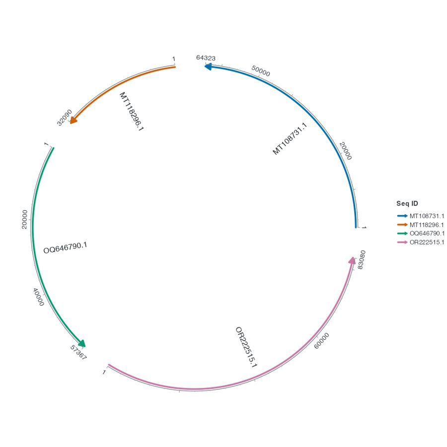
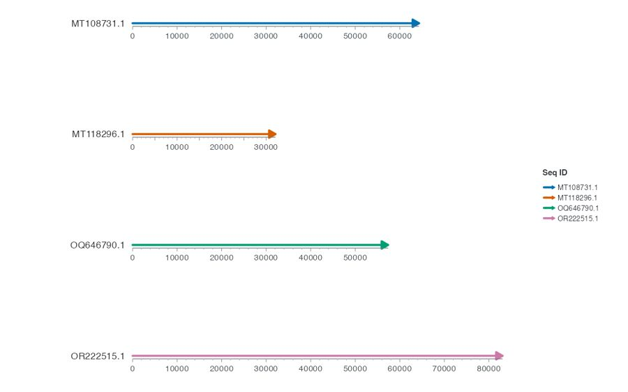
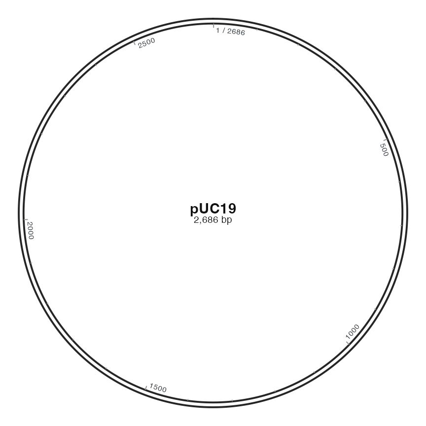

<!-- Generated by tools/sync-tutorials.py; edit website/ and tools/documentation-examples.R. -->

```{r setup, include=FALSE}
knitr::opts_chunk$set(eval = FALSE, collapse = TRUE, comment = "#>")
```


用随包记录学习三种绘图模式，每种模式都提供独立的首图代码。自备数据、专业专题和完整科研案例请继续查阅在线教程。


## 下载与安装 {#installation}

### 下载与安装 {#installation-requirements}

需要 R ≥ 4.1.0 和 ggplot2 ≥ 4.0.0。在 R 中运行下列命令，CRAN 会提供 ggchord 和所需依赖。

```{r example-1, eval=FALSE}
install.packages("ggchord")
library(ggchord)
packageVersion("ggchord")
```

最后一行显示已安装版本。本地文档预览 **0.24.0.9000**；仓库记录的最近正式版为
**0.16.6**。新的基础架构、Fusion、BEDPE与字符对齐接口需要相应开发 checkout。更新已有脚本前请阅读
[迁移说明](../MIGRATION-Hans.md)。

开发时先安装依赖，再在对应 checkout 根目录使用新的 R 会话运行：

```{r example-2, eval=FALSE}
install.packages(".", repos = NULL, type = "source")
library(ggchord)
stopifnot(as.character(packageVersion("ggchord")) == "0.24.0.9000")
```

版本号不能区分不同提交，下载的构建清单记录源码版本。本地预览不代表包已发布或
网站已部署。正式版用户可查阅 [0.16.6 文档](https://stat.ethz.ch/CRAN/web/packages/ggchord/index.html)。

<span id="verified-versions"></span>

#### 源码下载 {#installation-source}

可从 [CRAN](https://cran.r-project.org/web/packages/ggchord/index.html) 或 [GitHub v0.16.6](https://github.com/DangJem/ggchord/releases/tag/v0.16.6) 下载源码包。

#### 可选依赖 {#installation-support-evidence}

开始使用和基础弦图章节只需要 ggchord。完整案例会列出额外依赖。

### 确认安装 {#installation-troubleshooting}

在新 R 会话中用 `library(ggchord)` 加载。如果安装或加载报错，先查看报错中提到的 R 或依赖包版本。

### 下一步 {#installation-first-steps}

- [基本数据表](https://dangjem.github.io/ggchord/zh/chord-data.html)展示序列、连接和特征的真实记录，并逐列解释。
- [绘图基本概念](https://dangjem.github.io/ggchord/zh/modes.html)介绍骨架、图层与坐标系。
- <span id="first-plot"></span><span id="input"></span><span id="read"></span>[绘制序列骨架](#chord-start)进入弦图章节。
- <span id="save"></span>[保存图片](https://dangjem.github.io/ggchord/zh/output.html)介绍尺寸与输出格式。


## 绘制序列骨架 {#chord-start}

从随包的四条序列开始。先看各条骨架的位置和长度，再添加比对和特征。

### 绘制骨架 {#chord-start-draw}

按[安装页](#installation)安装本网站对应版本后，在全新 R 会话运行本课。

```{r example-3, eval=FALSE}
library(ggchord)
```


```{r example-4, eval=FALSE}
p_chord_backbone <- ggchord(seq_data = seq_data_example) +
  geom_seq() +
  geom_seq_label() +
  coord_chord()
view_ggchord(p_chord_backbone, width = 7, height = 7, units = "in")
```


<figure class="documentation-figure"><figcaption>四条序列的默认弧形骨架</figcaption></figure>

### 读图 {#chord-start-read}

每条弧代表序列表的一行。用标签找到 `MT108731.1`，再与 `MT118296.1` 比较。它们分别为 64,323 bp 和 32,090 bp，所以第一条弧约为第二条的两倍长。

`geom_seq()` 画出骨架，`geom_seq_label()` 标出序列 ID，`coord_chord()` 把四条骨架排成弧形。

### 试着去掉标签 {#chord-start-try}

删除 `geom_seq_label()` 那一行并重新运行。四条弧会保留，序列名会消失。

### 换成自己的序列 {#chord-start-adapt}

把 `seq_data_example` 换成含 `accver` 和 `length` 的表即可。列的含义见[基本数据表](https://dangjem.github.io/ggchord/zh/chord-data.html#tables)。接下来[添加连接和特征](https://dangjem.github.io/ggchord/zh/chord-build.html)。


## 绘制共线性骨架 {#collinear-start}

先把四条随包序列排成横行。这里用与弦图相同的输入，先观察骨架。

### 绘制四条骨架 {#collinear-start-draw}

按[安装页](#installation)安装本网站对应版本后，在全新 R 会话运行本课。

```{r example-5, eval=FALSE}
library(ggchord)
```


```{r example-6, eval=FALSE}
p_linear_base <- ggchord(seq_data = seq_data_example) +
  geom_seq() +
  geom_seq_label() +
  coord_collinear()
view_ggchord(p_linear_base, width = 8, height = 5, units = "in")
```


<figure class="documentation-figure"><figcaption>四条共线性骨架</figcaption></figure>

### 按共同尺度读位置和长度 {#collinear-start-read}

每一行代表一条序列。比较 `MT108731.1` 和 `MT118296.1`，前者约 64 kb，后者约 32 kb。共线性图用共同的 bp 尺度，因此可以直接比较横向长度。

### 试着去掉序列名 {#collinear-start-try}

去掉 `geom_seq_label()` 后，四条骨架及其相对长度仍在。

### 换用自己的序列 {#collinear-start-adapt}

提供含 `accver` 和完整 `length` 的序列表。接下来[添加比对和 CDS](https://dangjem.github.io/ggchord/zh/collinear-build.html)。


## 绘制圆形骨架 {#plasmid-start}

先用随包的 pUC19 画出一条完整的环状骨架。

### 绘制骨架与中心名称 {#plasmid-start-draw}

按[安装页](#installation)安装本网站对应版本后，在全新 R 会话运行本课。

```{r example-7, eval=FALSE}
library(ggchord)
```


```{r example-8, eval=FALSE}
plasmid <- plasmid_example_pUC19
p_first_circle <- ggchord(seq_data = plasmid) +
  geom_seq() +
  geom_seq_center_label() +
  coord_circular()
view_ggchord(p_first_circle, width = 6, height = 6, units = "in")
```


<figure class="documentation-figure"><figcaption>标有名称与长度的 pUC19 圆形骨架</figcaption></figure>

刻度线从双线骨架的内缘向圆内伸出，文字位于刻度内侧。画布变窄时，默认保留刻度线并省略部分相撞的文字。

### 读圆周刻度 {#plasmid-start-features}

一圈对应 pUC19 的完整长度。默认起点位于 12 点钟，坐标顺时针增加。刻度使用 bp，中心文字识别这条序列。圆周上的位置由 `coord_circular()` 和骨架确定，下一节会在这条骨架上定位复制起点。

### 换用自己的序列 {#plasmid-start-adapt}

提供一行含 `accver` 和完整 `length` 的序列表，再用相同的 ID 连接特征表。[继续添加特征和标签](https://dangjem.github.io/ggchord/zh/plasmid-build.html)。


## HSP点阵图与径向辐条 {#view-expansion}

复用已有来源表，无需另一套比对表。Dotplot线段保留四个HSP端点，Radial使用已有环形邻接关系和真实长度比例。来源准备、支持图层与位置反查见网站view-expansion章节。

```{r example-9, eval=FALSE}
ggchord(seq_data_example, ribbon_data_example) +
  geom_alignment_segment(aes(link_colour = pident)) +
  coord_dotplot()

ggchord(seq_data_example, ribbon_data_example) +
  geom_seq() +
  geom_link_ribbon() +
  geom_seq_label() +
  coord_radial_synteny()
```
