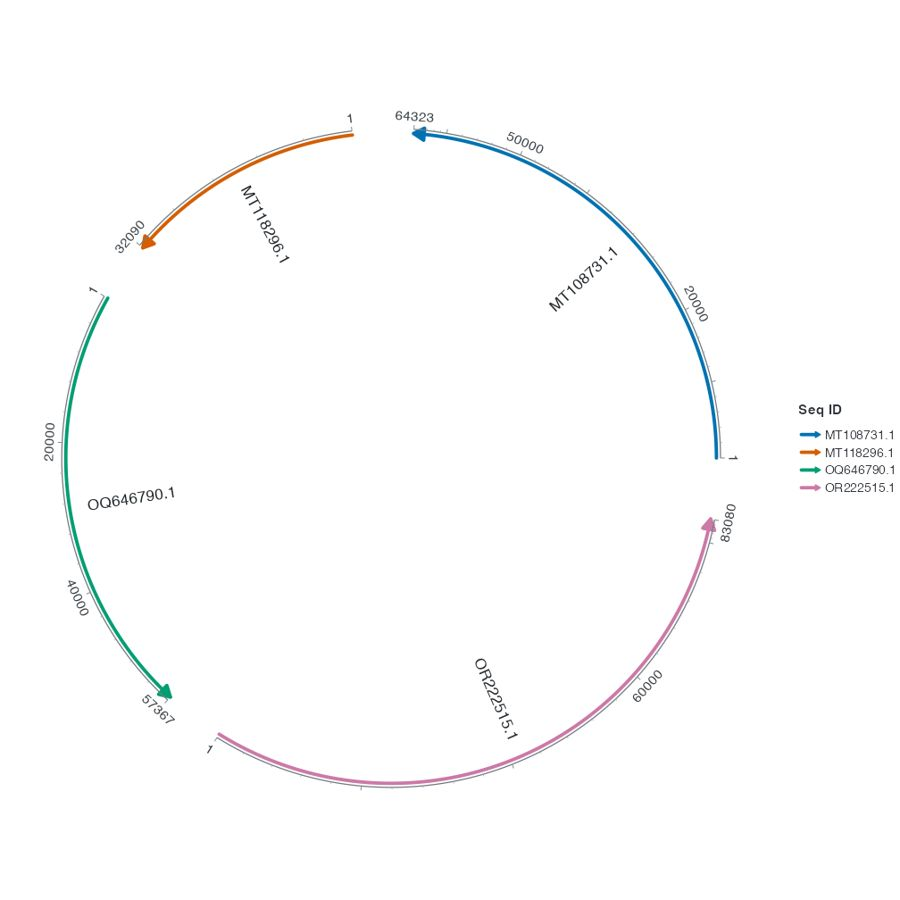
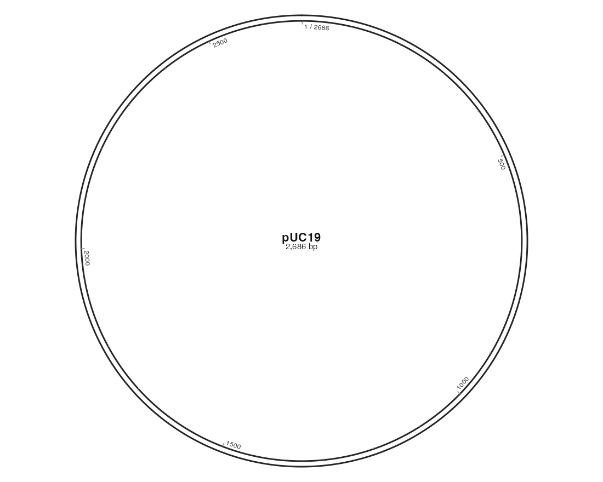
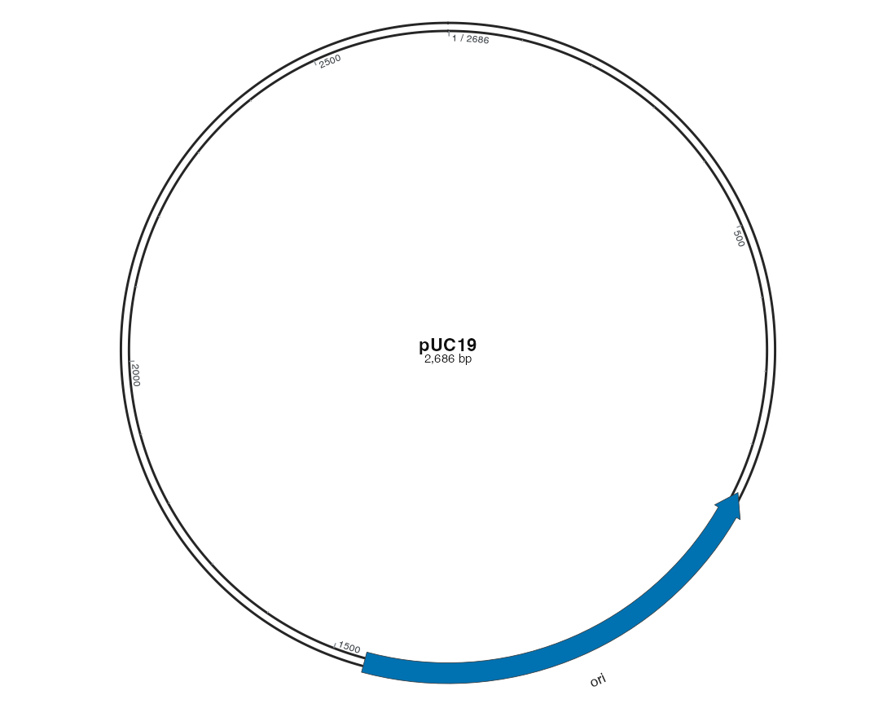
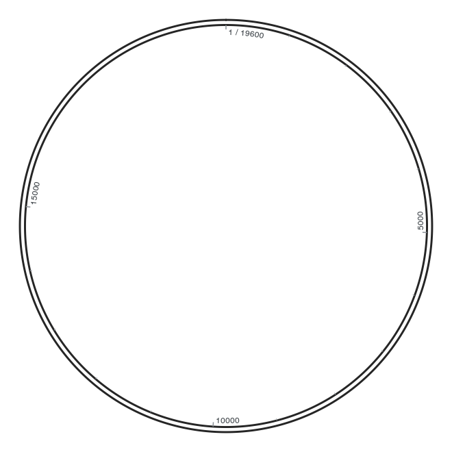
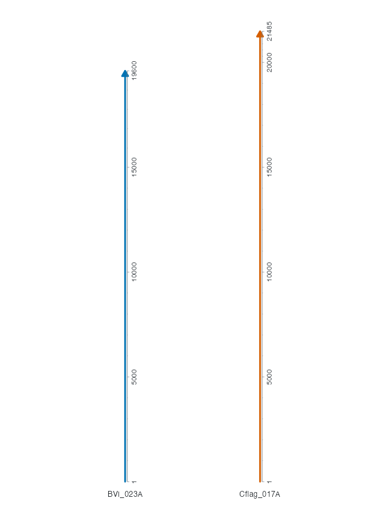
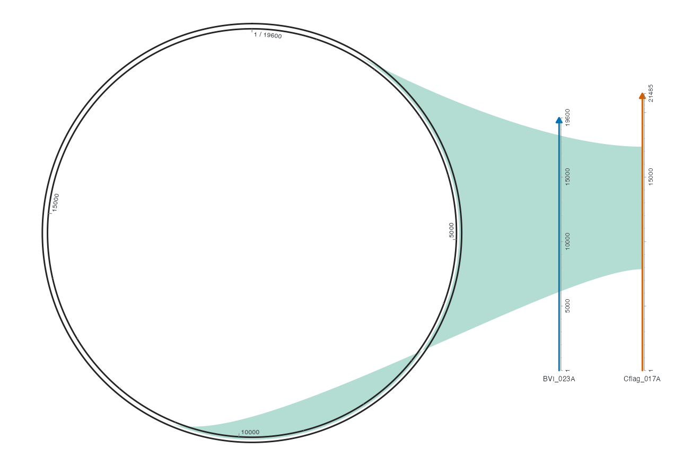

<!-- Generated by tools/sync-tutorials.py; edit website/ and tools/documentation-examples.R. -->

```{r setup, include=FALSE}
knitr::opts_chunk$set(eval = FALSE, collapse = TRUE, comment = "#>")
```


Choose among four plotting modules. Each opening lesson includes its own setup. Continue online for data import, advanced workflows and complete research examples.


## Download and install {#installation}

### Choose a version and dependencies {#installation-requirements}

These lessons use the **0.27.0.9000 development API**. Choose a matching source; the stable 0.16.6 package has a different teaching scope.

R ≥ 4.1.0; ggplot2 ≥ 4.0.0.

```{r example-1, eval=FALSE}
install.packages("remotes")
```

#### Stable release {#installation-stable}

The latest recorded formal release is 0.16.6. Its source and versioned help are available at [GitHub v0.16.6](https://github.com/DangJem/ggchord/releases/tag/v0.16.6). Use its bundled help after installing the fixed tag; these lessons include newer APIs.

```{r example-2, eval=FALSE}
remotes::install_github("DangJem/ggchord@v0.16.6", dependencies = NA)
```

#### Development snapshot {#installation-source}

The development runtime is pinned to public audit commit `0f5dd96da57876da74cd1234c7de9cf5579c80b8`. This local documentation refactor does not change runtime behavior. The separate documentation revision, build time and input hashes are recorded in the [build manifest](https://dangjem.github.io/ggchord/build-manifest.json). Installation downloads source and dependencies.

```{r example-3, eval=FALSE}
runtime_commit <- "0f5dd96da57876da74cd1234c7de9cf5579c80b8"
remotes::install_github(
  paste0("DangJem/ggchord@", runtime_commit),
  dependencies = NA, upgrade = "never"
)
```

<span id="verified-versions"></span>

### Confirm in a fresh session and draw {#installation-troubleshooting}

```{r example-4, eval=FALSE}
library(ggchord)
stopifnot(as.character(packageVersion("ggchord")) == "0.27.0.9000")
stopifnot(packageDescription("ggchord")$RemoteSha ==
  "0f5dd96da57876da74cd1234c7de9cf5579c80b8")
p <- ggchord(seq_data_example) +
  geom_seq() +
  geom_seq_label() +
  coord_chord()
p
```

#### Optional dependencies {#installation-support-evidence}

The first plot needs only ggchord. Data lessons explicitly use dplyr; import recipes name their optional decoders.

### Continue learning {#installation-first-steps}

<span id="first-plot"></span><span id="input"></span><span id="read"></span>

- [Input tables](https://dangjem.github.io/ggchord/en/data.html#prepare)
- [First multi-sequence plot](#multi-sequence-start-draw)
- <span id="save"></span>[Save at target size](https://dangjem.github.io/ggchord/en/output.html)


## First multi-sequence relationship plot {#multi-sequence-start}

Build backbones, a link, a feature and labels in one lesson using bundled source records. Run in order; this lesson uses ggchord and optional dplyr.

### Draw the backbones {#multi-sequence-start-draw}

Run this lesson in a fresh R session after installing the version described on the [installation page](#installation).


```{r example-5, eval=FALSE}
library(ggchord)
```


```{r example-6, eval=FALSE}
p_chord_backbone <- ggchord(seq_data = seq_data_example) +
  geom_seq() +
  geom_seq_label() +
  coord_chord()
view_ggchord(p_chord_backbone, width = 7, height = 7, units = "in")
```


<figure class="documentation-figure"><figcaption>Default arc backbones for four sequences</figcaption></figure>
### Read the plot {#multi-sequence-start-read}

Each arc represents a row of the sequence table. Find `MT108731.1` by its label and compare it with `MT118296.1`. These two sequences are 64,323 bp and 32,090 bp, so the first arc is about twice as long as the second.

`geom_seq()` draws the backbones, `geom_seq_label()` adds their IDs, and `coord_chord()` arranges the backbones as arcs.
### Try removing the labels {#multi-sequence-start-try}

Remove the `geom_seq_label()` line and run the code again. The arcs stay in place and the sequence names disappear.
### Add an alignment ribbon {#multi-sequence-start-links}

Take the first row of the bundled alignment table. It connects two of the four sequences.


```{r example-7, eval=FALSE}
chord_links <- head(ribbon_data_example, 1)

p_chord_ribbon <- p_chord_backbone +
  geom_link_ribbon(data = chord_links)
view_ggchord(p_chord_ribbon, width = 7, height = 7, units = "in")
```


<figure class="documentation-figure"><figcaption>One alignment ribbon added</figcaption></figure>

Follow the ribbon to both ends. It spans 26,298–51,139 bp on `MT108731.1` and 7,121–31,959 bp on `MT118296.1`. Each end covers an interval, so this layer uses `geom_link_ribbon()`.

The default colour reflects the alignment identity for this row, about 98.6%. The crossed shape comes from how the interval ends are joined. Use the alignment coordinates to assess inversion.
### Add a CDS {#multi-sequence-start-add-genes}

<span id="prepare"></span><span id="inspect-genes"></span><span id="genes"></span>Select the original annotation starting at 43,765 bp on `OQ646790.1` and recover its biological strand.


```{r example-8, eval=FALSE}
chord_genes_example <- subset(gene_data_example, accver == "OQ646790.1" & start == 43765)
chord_genes_example$strand <- chord_genes_example$source_strand

p_chord_feature <- p_chord_ribbon +
  geom_gene(data = chord_genes_example)
view_ggchord(p_chord_feature, width = 7, height = 7, units = "in")
```


<figure class="documentation-figure"><figcaption>One integrase CDS added to the green backbone</figcaption></figure>

Find the red arrow on green `OQ646790.1`. It marks the plus-strand integrase CDS from 43,765 to 46,140 bp. The ribbon and this CDS use independent input tables.

To display the CDS name, add `geom_gene_label(data = chord_genes_example)`. It reads the label from `anno`. Next, use the same backbones to compare [rotation and gaps](https://dangjem.github.io/ggchord/en/chord-geometry.html#orientation).

### Display the feature name {#multi-sequence-start-labels}


```{r example-9, eval=FALSE}
p_chord_gene_labels <- ggchord(seq_data_example) +
  geom_seq() +
  geom_seq_label() +
  geom_gene(data = chord_genes_example) +
  geom_gene_label(data = chord_genes_example, label_radial_offset = 0.10) +
  coord_chord()
view_ggchord(p_chord_gene_labels, width = 7, height = 7, units = "in")
```


<figure class="documentation-figure"><figcaption>Label the CDS with its original annotation</figcaption></figure>

### Switch to a linear layout {#multi-sequence-start-collinear}


```{r example-10, eval=FALSE}
p_chord_feature + coord_collinear()
```


This keeps the input and layers, while Collinear selects adjacent rows by default. Compare all four views in the [next lesson](https://dangjem.github.io/ggchord/en/multi-sequence-views.html).

### Use your own sequences {#multi-sequence-start-adapt}

Replace `seq_data_example` with a table containing `accver` and `length`. See [Basic input tables](https://dangjem.github.io/ggchord/en/data.html#prepare) for the column definitions.


## First single-sequence circular map {#circular-start}

### Length and a prepared annotation {#circular-start-input}

Only lengths and prepared tables are needed. The ori row is the verified pUC19 annotation 867–1455, matching the original inspectorigin output; no DNA recognition is run. Dependencies: ggchord and dplyr.

```{r example-11, eval=FALSE}
library(ggchord)
```


```{r example-12, eval=FALSE}
library(dplyr)
circle_seqs <- plasmid_example_pUC19 |> select(accver, length)
circle_origins <- tibble(
  accver = "pUC19", start = 867, end = 1455,
  strand = "-", type = "rep_origin", anno = "ori"
)
p_coursecircle <- ggchord(circle_seqs) +
  geom_seq() + geom_seq_center_label() + coord_circular()
```




### Add the feature and its label {#circular-start-features-and-labels}


```{r example-13, eval=FALSE}
p_coursecirclefeature <- p_coursecircle +
  geom_feature_plasmid(data = circle_origins) +
  geom_feature_label(data = circle_origins,
    label_side = "inside", label_radial_offset = 0.12, size = 4)
view_ggchord(p_coursecirclefeature)
```




Locate both ori endpoints on the ticks and trace the label to anno. A circular display is not evidence of molecular topology.

### Exercise and save {#circular-start-exercise}

Remove the label layer and rerun; backbone and source interval stay unchanged. Replace the row with your own known annotation.

```{r example-14, eval=FALSE}
ggsave("circular-first.png", p_coursecirclefeature,
  width = 10, height = 8, units = "in", dpi = 144)
```


## Read a two-axis Dotplot from existing HSPs {#dotplot-start}


```{r example-15, eval=FALSE}
library(ggchord)
library(dplyr)
```


### Plot original HSP endpoints {#dotplot-start-dotplot}

The source-backed EMALE PAF pair has 11 observed HSPs. Its declared sequence
lengths supply both axes. `read_paf()` converts zero-based half-open intervals
to the internal one-based convention and reverses target endpoints for minus
alignments. The files and their provenance are in the [input download](https://dangjem.github.io/ggchord/en/formats.html).
The following code needs the optional `dplyr` package for data preparation.


```{r example-16, eval=FALSE}
library(dplyr)
dotplot_hsp <- read_paf("examples/format-inputs/emales-pair.paf")
dotplot_seqs <- bind_rows(
  dotplot_hsp |> transmute(accver = qaccver, length = qlen),
  dotplot_hsp |> transmute(accver = saccver, length = slen)
) |>
  distinct()
```


Each line runs from `(qstart, sstart)` to `(qend, send)`. `geom_seq()` is not
required. Use `link_*` mappings and scales for colour, alpha, width and type.
The default Identity domain is 0–100 with ticks 0/50/80/90/95/100; an explicit
user scale overrides it.


```{r example-17, eval=FALSE}
p_viewdotplot <- ggchord(dotplot_seqs, dotplot_hsp) +
  geom_alignment_segment(aes(link_colour = pident), linewidth = 0.65) +
  coord_dotplot()
view_ggchord(p_viewdotplot, width = 8, height = 7, units = "in")
```


<figure class="documentation-figure"><figcaption>All 11 source-backed EMALE PAF HSPs in one-based native coordinates; reverse alignments retain their negative slope.</figcaption></figure>

The legacy constructor may warn about descending endpoints in these valid reverse HSPs. Keep the normalized ordering; sorting each interval would erase the displayed inversion.

`x_seqs` and `y_seqs` independently select/order accessions. `gap` is display
spacing in native bp/aa, not omitted source sequence. Axis directions accept
1/-1 or complete named vectors. Display reversal changes the slope without
changing the biological source table. Each axis starts at source position 1;
concatenated segments retain their own accession and local tick labels.


```{r example-18, eval=FALSE}
dotplot_reversed <- ggchord(dotplot_seqs, dotplot_hsp) +
  geom_alignment_segment(aes(link_colour = pident), linewidth = 0.65) +
  coord_dotplot(y_orientation = -1)
dotplot_layout <- export_ggchord_layout(dotplot_reversed)
dotplot_layout$axis_layout
```


Use `map_ggchord_position(..., axis = "x"/"y")` for native/global conversion,
with `inverse = TRUE` to go back. Display gaps return NA. Focused source
origins use `source = TRUE`; default axis labels stay window-relative.
Unknown directions are warned, omitted and reported; contradictory direction
metadata is rejected. Repeated declared HSP IDs require `allow_repeated=TRUE`
in all participating layers. Unidentified duplicate/self rows remain distinct.
Without cg/cs/CIGAR or another alignment trace, these are HSP segments, not
base-level mismatches or gap paths.

### Boundaries and next steps {#dotplot-start-support}

Backbone gene/feature/track/ribbon layers, facets and Fusion endpoints are unsupported. To inspect gaps or mismatches, provide actual aligned characters; see [the alignment workflow](https://dangjem.github.io/ggchord/en/aligned-sequences.html). Exercise: trace four endpoints of one segment and explain slope and colour separately.


## One real link between independent plots {#fusion-start}

### Start with two independent plots {#fusion-start-panels}

Use ggchord, dplyr and the original PAF in the [input bundle](https://dangjem.github.io/ggchord/assets/tutorial-inputs.zip). Print course_center and course_detail independently, then connect one existing relationship.

```{r example-19, eval=FALSE}
library(ggchord)
library(dplyr)
```


```{r example-20, eval=FALSE}
library(dplyr)
fusion_hsp <- read_paf("examples/format-inputs/emales-pair.paf")
fusion_seqs <- bind_rows(
  fusion_hsp |> transmute(accver = qaccver, length = qlen),
  fusion_hsp |> transmute(accver = saccver, length = slen)
) |>
  distinct()
fusion_colours <- setNames(c("#0072B2", "#D55E00"), fusion_seqs$accver)
fusion_links <- fusion_hsp |>
  filter(length >= 900, pident >= 85)
fusion_events <- fusion_hsp |>
  transmute(accver = qaccver, pos = qstart)
```


```{r example-21, eval=FALSE}
course_center <- ggchord(fusion_seqs |> slice(1)) +
  geom_seq(show.legend = FALSE) +
  coord_circular()
course_detail <- ggchord(fusion_seqs) +
  geom_seq(show.legend = FALSE) +
  geom_seq_label() +
  coord_collinear(seq_axis = "vertical")
p_coursefusion <- ggchord_fusion(course_center) +
  fusion_panel(course_detail, id = "detail", side = "right") +
  fusion_ribbon(
    fusion_links |> slice(1), qpanel = "center", spanel = "detail",
    fill = "#269B82", alpha = 0.35
  )
view_ggchord(p_coursefusion)
```








### Check intervals, panels and instances {#fusion-start-intervals}

Fusion is a composition, not a seventh Coord. Each panel retains its data, layers, scales and physical ratio. A side places a panel without rotating it. Endpoints must share units, be fully visible and route unambiguously; direct bp–aa links are unsupported.

```{r example-22, eval=FALSE}
course_export <- export_ggchord_fusion(p_coursefusion, width = 12, height = 8)
course_export$connections
course_export$fronts
```

### Save at the same size {#fusion-start-save}

```{r example-23, eval=FALSE}
ggsave("fusion-first.png", p_coursefusion,
  width = 12, height = 8, units = "in", dpi = 144)
```

Exercise: choose another real HSP and identify qpanel/spanel and its source row. Dotplot, facets and unregistered external plots are unsupported.


## HSP Dotplot and radial spokes {#view-expansion}

Use the existing source tables; no extra alignment table is required. Dotplot segments retain all four HSP endpoints. Radial spokes use cyclic existing relationships and proportional lengths. See the website view-expansion chapter for source preparation, supported layers and inverse mapping.

```{r example-24, eval=FALSE}
ggchord(seq_data_example, ribbon_data_example) +
  geom_alignment_segment(aes(link_colour = pident)) +
  coord_dotplot()

ggchord(seq_data_example, ribbon_data_example) +
  geom_seq() +
  geom_link_ribbon() +
  geom_seq_label() +
  coord_radial_synteny()
```
