<!-- Generated by tools/sync-tutorials.py; edit website/ and tools/documentation-examples.R. -->

```{r setup, include=FALSE}
knitr::opts_chunk$set(eval = FALSE, collapse = TRUE, comment = "#>")
```


This paired tutorial is generated from the same sources as the website. Code blocks are shown without executing during vignette rendering; the shared documentation script verifies the examples directly. Examples prefer bundled or source-backed data; deliberate diagnostic errors are labelled. Inputs marked as repository files require the checkout or input bundle. Each chapter provides its own preparation; start with the first-plot lesson.


## Get started: your first plot {#installation}

<div class="lesson-intro">
Build a sequence comparison from bundled data and save a figure. You do not need to run BLAST or prepare your own files first.
</div>

<div class="lesson-goal">
By the end of this page, you will have a collinear plot containing sequence backbones, gene arrows and observed alignment intervals, saved as a PNG at an explicit size. The real-data tutorials use the same layer composition.
</div>

<div class="lesson-path">Install and load → inspect three tables → compose layers → read the result → save</div>

### 1. Install and load {#installation-requirements}
Use R ≥4.1.0 and ggplot2 ≥4.0.0. Open R or RStudio and run the installation commands in its console.
Skip installation if ggchord is already installed and loads successfully.

```{r example-1, eval=FALSE}
install.packages("remotes")
remotes::install_github("DangJem/ggchord")
library(ggchord)
packageVersion("ggchord")
```

#### Which version are you using? {#installation-source}
This site describes the local **0.16.5 development version**; the latest formal release remains 0.15.0.
GitHub installation uses the remote repository and cannot include local changes that have not been pushed.
If you have this version's source checkout, run from its repository root:

```{r example-2, eval=FALSE}
install.packages("pkgload")
pkgload::load_all(".")
packageVersion("ggchord")
```

Use the loading route appropriate to your source; you do not need both installation paths.
Record the version when reproducing a plot. This lesson needs neither optional Bioconductor packages nor Biopython.

### 2. Inspect the three input tables {#installation-input}
Select the bundled sequences `MT108731.1` and `MT118296.1`. Keep the complete source objects;
the code below selects only the columns used here. Run the complete block first:


```{r example-3, eval=FALSE}
library(ggchord)
data(seq_data_example)
data(gene_data_example)
data(ribbon_data_example)
ids <- c("MT108731.1", "MT118296.1")
first_sequences <- seq_data_example[seq_data_example$accver %in% ids, c("accver", "length")]
first_genes <- transform(gene_data_example, strand = source_strand)
first_genes <- first_genes[first_genes$accver %in% ids, c("accver", "start", "end", "strand")]
first_links <- ribbon_data_example[ribbon_data_example$qaccver %in% ids &
  ribbon_data_example$saccver %in% ids, c("qaccver", "saccver", "qstart", "qend", "sstart", "send")]
```


| Object | Required columns | One row represents |
| --- | --- | --- |
| `first_sequences` | `accver`, `length` | A sequence and its full length |
| `first_genes` | `accver`, `start`, `end`, `strand` | A gene annotation |
| `first_links` | Two IDs and four query/subject endpoints | An observed alignment interval between sequences |

`accver` joins the tables and must agree; it need not be a GenBank accession. Coordinates are one-based inclusive bp.
The bundled gene fixture separately retains `source_strand`; restoring it uses biological direction rather than alternating strands for display.

Check column names, then inspect the first annotation rows:

```{r example-4, eval=FALSE}
names(first_sequences)
names(first_genes)
names(first_links)
head(first_genes)
```

<div class="lesson-check">
Checkpoint: the sequence table has 2 columns, genes 4 and links 6. Neither pident nor qlen is required for this basic plot;
identity colouring or coverage calculations require their corresponding fields later.
</div>

### 3. Compose your first plot {#installation-first-plot}
Start with a linear view so genomic distances are easy to read.
`ggchord()` supplies the data, three geometry layers draw links, backbones and genes, and the coordinate selects a linear arrangement.
Named arguments avoid accidentally passing genes into the second positional argument, `ribbon_data`.


```{r example-5, eval=FALSE}
first_colours <- setNames(c("#3264D6", "#E18428"), ids)
p_first <- ggchord(seq_data = first_sequences, ribbon_data = first_links,
  gene_data = first_genes) +
  geom_link_ribbon(fill = "#A4B3CC", alpha = .55) +
  geom_seq(colour = "#253954", show.legend = FALSE) +
  geom_gene(aes(gene_fill = accver), position = position_strand(.10), width = .045) +
  geom_seq_label(size = 4) + coord_collinear() +
  scale_gene_fill_manual(values = first_colours, name = "Sequence") +
  scale_seq_position_continuous(n.breaks = 3, minor_breaks = NULL) +
  theme_ggchord_publication(axis.text = element_text(size = 11)) +
  theme(legend.position = "bottom")
p_first
```

<figure class="documentation-figure"><a class="figure-link" href="../man/figures/first.png" title="Click to enlarge">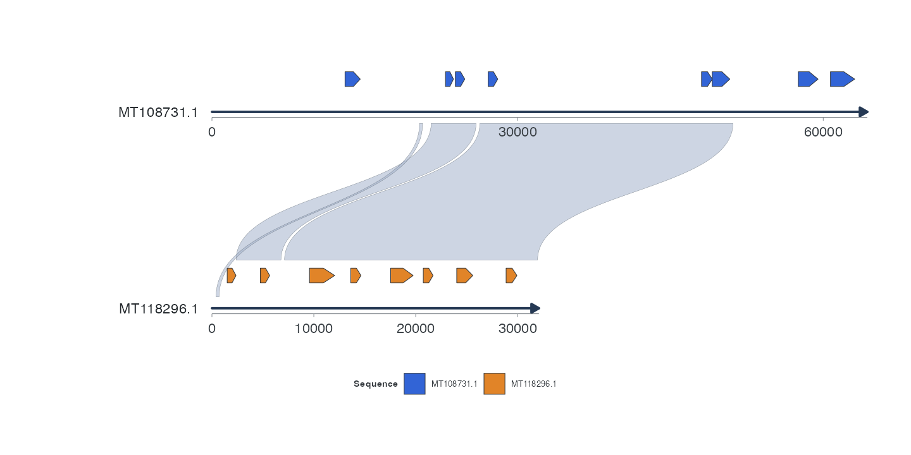</a><figcaption>Your first plot: two bundled sequences, gene arrows and observed alignment intervals · <span class="figure-hint">Click to enlarge</span></figcaption></figure>

The two colours identify the sequence containing each gene; **they do not assert homology-cluster membership**.
Neutral alignment bands keep attention on genes and positions.

### 4. Read the result {#installation-read}
Inspect the plot in this order:

1. Names on the left identify the sequences. Backbones and ticks show full lengths and bp positions.
2. Arrows show selected bundled gene annotations and their source strands. An unshown gene is not evidence of absence.
3. Bands between rows show supplied alignment intervals. They are neither newly computed alignments nor base-by-base alignment displays.

This view teaches positions and links. Use a chord view for overall relationships among several sequences,
or a single-sequence circular view for plasmid annotations. Choose the question before the geometry;
see [which view to use](#modes).

### 5. Save at an explicit size {#installation-save}
`p_first` is an ordinary ggplot object. Save it to the current working directory:


```{r example-6, eval=FALSE}
ggsave("first-comparison.png", p_first, width = 10, height = 5, units = "in", dpi = 144)
```


```{r example-7, eval=FALSE}
file.exists("first-comparison.png")
```

`TRUE` confirms that the file was created. RStudio's Plots pane can change the layout when resized.
To inspect the intended export, preview at the same dimensions:

```{r example-8, eval=FALSE}
view_ggchord(p_first, width = 10, height = 5, units = "in")
```

### 6. Troubleshoot a first run {#installation-troubleshooting}
| Symptom | Check first |
| --- | --- |
| `first_sequences` or `p_first` is missing | Run the blocks in order from step 2, rather than copying only the last line |
| A function is unavailable | Check that the loaded development version matches this tutorial with `packageVersion()` |
| Links are missing | Check that both IDs occur in the sequence table and that the selected link table is nonempty |
| The plot is small or labels differ | Preview at the explicit 10 × 5 in size; see [output and sizing](#output) |
| You cannot find the saved file | Check the working directory with `getwd()` |

### Choose your next task {#installation-first-steps}
You have prepared data, composed layers and saved a figure. Continue according to your next task:

- **Use your own records**: [import and adaptation](#formats); BLAST users can continue with [standard tables and protein coordinates](#alignments).
- **Compare complete real records**: [the FASTA, GFF3 and alignment workflow](#real-data).
- **Make a plasmid map**: [pUC19 genes, primers and restriction annotations](#plasmids).
- **Control the appearance**: [colours and guides](#styling), [label placement](#labels).
- **Look up a parameter**: [complete function reference](#glossary).


## Prepare tables and coordinates {#data}

<div class="task-intro"><p>Turn file observations into plotting roles. Check minimal fields and coordinates, then use validation reports to decide on cleaning; do not guess missing lengths or strands.</p></div>

### Prepare this page {#data-prepare}
In a fresh R session, run the code below, then follow this page in order. Colours and layout are optional display choices; inputs select only the fields needed. For file-based examples, first extract the [input bundle](https://github.com/DangJem/ggchord/tree/main/examples) so the working directory contains `examples/`.

<details class="preparation"><summary>Preparation code — run once on this page</summary>

```{r example-9, eval=FALSE}
library(ggchord)
data(seq_data_example)
data(ribbon_data_example)
data(gene_data_example)
seqs <- seq_data_example[c("accver", "length")]
links <- ribbon_data_example[c("qaccver", "saccver", "qstart", "qend", "sstart", "send")]
# The fixture preserves biological strands separately from its old display strands.
genes <- transform(gene_data_example, strand = source_strand)[c("accver", "start", "end", "strand")]
```

</details>

### Tables {#data-tables}
| Input | Required fields | Meaning |
| --- | --- | --- |
| Sequence | `accver`, `length` | Unique ID; positive full length in bp |
| Interval link | `qaccver`, `saccver`, `qstart`, `qend`, `sstart`, `send` | Query and subject anchors |
| Gene | `accver`, `start`, `end`, `strand` | Known `+`/`-`; optional `anno` |
| Feature | `accver`, `start`, `end`, `strand` or declared direction | May retain unknown strand; optional `type`, `label`, `feature_id` |

Identifiers may be arbitrary strings. Accession versions are preserved exactly.
`pident` and alignment `length` are optional unless a mapping, filter or statistic
needs them. A feature interval does not imply a sequence's full length.

### Coordinate contract {#data-coordinates}
Genomic coordinates are **one-based, inclusive bp**. BED/PAF readers convert their
source conventions; do not convert twice. Gene endpoints are ordered with
strand stored separately; link endpoint order may encode direction. A one-bp
link without direction evidence stays unknown. Unknown strand is never silently
changed to `+`; use `geom_feature()` instead of the strict gene layer.

Amino-acid coordinates require [explicit CDS projection](#projection).
Native Cartesian layout units, genomic bp, angles in degrees, physical mm and
track value units are different domains. See the full
data contract (`help("ggchord_data_contract", package = "ggchord")`).

### Import original records {#data-import}
Run this repository-only example from its root. Original files are not rewritten.


```{r example-10, eval=FALSE}
seq_files <- read_fasta_lengths(files = "examples/fasta/*.fna", source_file = TRUE)
link_files <- read_blast(files = "examples/blastn-standard/*.tsv", source_file = TRUE)
feature_files <- read_gff3(files = "examples/gff3/*.gff3", unstranded = "keep", source_file = TRUE)
```


`read_genbank()` retains record/feature provenance and segmented locations.
`read_bed()` and `read_paf()` retain their conversion metadata. `as_ggchord_seq()`,
`as_ggchord_feature()` and `as_ggchord_link()` adapt supported S4 objects; provide
full lengths and IDs explicitly when the object lacks them. `file` and `files` both accept path vectors or globs; repeated resolved paths
are read once in first-occurrence order. Choose one clear entry for a workflow. Missing sequence or
homology data must be supplied by the analyst, not invented by the plotting layer.

### Validate, clean, prepare {#data-validation}
After this page’s preparation code:


```{r example-11, eval=FALSE}
validation <- validate_ggchord_data(seqs, links, genes)
cleaned <- clean_ggchord_data(seqs, links, genes)
prepared <- prepare_ggchord_data(seqs, links, features = list(genes = genes))
```


Validation reports issues; cleaning makes explicit repairs with a report.
Preparation combines workflow steps without inferring biological membership.
Inspect `validation`, `cleaned$report` and `prepared$report` before plotting.
`source_row` in geometry refers to the resolved layer input, while `.source_line`
means a physical file line; GenBank has separate record/feature provenance.
Aggregates may have `source_rows` and `.length_estimated` flags. Preserve these
when filtering or merging links.

### Inspect a problematic input and its repair report {#data-repairs}

```{r example-12, eval=FALSE}
# Deliberately corrupt copies to demonstrate diagnostics; original rows remain intact.
problem_links <- ribbon_data_example[1:2, c("qaccver", "saccver", "qstart", "qend", "sstart", "send", "pident")]
problem_links$qaccver[2] <- "absent"
problem_links$pident[1] <- 103
problem_report <- validate_ggchord_data(seqs, problem_links)
repaired <- clean_ggchord_data(seqs, problem_links, unknown_id = "drop", invalid_pident = "clip")
```

| Metric | Observed output |
| --- | --- |
| Input rows | 2 |
| Rows retained after explicit cleaning | 1 |

The demonstration intentionally includes an unknown ID and
identity outside 0–100 in copied source rows. These explicit repairs are not a recommendation to clip
scientific observations silently. Inspect `problem_report` and `repaired$report`,
retain the original table, and choose policies appropriate to actual evidence.
A legitimate reverse alignment can keep endpoint order instead of being sorted.
`prepare_ggchord_data()` therefore retains its workflow-specific default policy;
standalone cleaning and preparation should not be assumed identical.

### Declare genome and contig keys {#data-hierarchy}

```{r example-13, eval=FALSE}
# Each source record represents a separate complete phage genome.
contigs <- transform(seqs, genome = accver)
genomes <- data.frame(genome = seqs$accver)
hierarchy <- validate_ggchord_hierarchy(contigs, genomes, strict = TRUE)
```


`hierarchy$contigs` summarizes declared membership without concatenating contigs.
No membership is inferred from an accession prefix. Provide globally unique IDs
when separate samples reuse local contig names. Use [file formats and adapters](#formats)
for format/optional-object details, and the [real-record tutorial](#real-data)
to carry reports into a complete figure.

### Minimal input and protein alignments {#data-minimal}
| Metric | Observed output |
| --- | --- |
| Sequence columns passed to the plot | 2 |
| Link columns passed to the plot | 6 |
| Gene columns passed to the plot | 4 |

The second positional constructor argument is `ribbon_data`, not `gene_data`.
Use explicit argument names as in the shared examples. Optional identity, length
and coverage fields are needed only by operations that consume them. See
[standard BLAST/protein input](#alignments) and [parameter formats](#parameters).

### Check your result {#data-check-result}
Input IDs must match complete sequence records. Keep original records separate from repaired copies. Decreasing endpoints can be legitimate reverse hits; warnings do not all mean rows must be removed.

<div class="next-step">Continue: <a href="#formats">File formats and explicit adapters →</a></div>


## Import and convert data {#formats}

<div class="task-intro"><p>Convert tables, BED, PAF or GenBank into ggchord inputs while retaining record identity and converting coordinate conventions only once.</p></div>

### Prepare this page {#formats-prepare}
In a fresh R session, run the code below, then follow this page in order. Colours and layout are optional display choices; inputs select only the fields needed. For file-based examples, first extract the [input bundle](https://github.com/DangJem/ggchord/tree/main/examples) so the working directory contains `examples/`.

<details class="preparation"><summary>Preparation code — run once on this page</summary>

```{r example-14, eval=FALSE}
library(ggchord)
data(seq_data_example)
data(ribbon_data_example)
data(gene_data_example)
seqs <- seq_data_example[c("accver", "length")]
links <- ribbon_data_example[c("qaccver", "saccver", "qstart", "qend", "sstart", "send")]
# The fixture preserves biological strands separately from its old display strands.
genes <- transform(gene_data_example, strand = source_strand)[c("accver", "start", "end", "strand")]

library(ggchord)
doc_theme <- theme_ggchord_publication(axis.text = element_text(size = 11),
  axis.text.check.overlap = TRUE) + theme(legend.position = "bottom")
doc_axis <- function(coordinates = "relative") scale_seq_position_continuous(
  coordinates = coordinates, n.breaks = 3, minor_breaks = NULL,
  labels = function(x) format(x, scientific = FALSE, big.mark = ",", trim = TRUE))

data(plasmid_example_pUC19)
plasmid_seq <- plasmid_example_pUC19[c("accver", "length")]
feature_source <- find_common_features(plasmid_example_pUC19)
features <- feature_source[c("accver", "start", "end", "strand", "type", "anno")]
```

</details>

### Adapt an existing table {#formats-adapters}
Run this page’s preparation code below. These examples rename columns of
bundled source-backed sequences, links and genes; they do not invent alignments.


```{r example-15, eval=FALSE}
renamed_sequences <- setNames(seqs, c("chrom", "size"))
sequence_input <- as_ggchord_seq(renamed_sequences, mapping = c(accver = "chrom", length = "size"))
renamed_features <- setNames(genes, c("chrom", "left", "right", "strand"))
feature_input <- as_ggchord_feature(renamed_features,
  mapping = c(accver = "chrom", start = "left", end = "right"))
link_input <- as_ggchord_link(links)
```


Adapters return ordinary frames with `ggchord_conversion` provenance. IDs remain
unchanged. Supply reliable full lengths rather than using maximum feature ends.
See [alignment input](#alignments) for minimal fields and coordinate units.

### BED and PAF: convert coordinates once {#formats-zero-based}
The BED example writes known pUC19 intervals as minimal BED3 and reads them back.
PAF comes directly from real minimap2 output in the public tutorial, with original
optional tags/values. The display retains mapq ≥30 and receives only six endpoint roles.


```{r example-16, eval=FALSE}
# BED3 carries intervals only; the source annotations remain in features.
bed_path <- tempfile(fileext = ".bed")
bed_rows <- data.frame(accver = features$accver, start0 = features$start - 1L, end = features$end)
write.table(bed_rows, bed_path, sep = "\t", quote = FALSE, row.names = FALSE, col.names = FALSE)
bed_features <- read_bed(bed_path)
unlink(bed_path)
# Unchanged PAF rows from the public EMALE tutorial, not a simulated alignment.
paf_source <- read_paf("examples/format-inputs/emales-pair.paf")
paf_selected <- paf_source[!is.na(paf_source$mapq) & paf_source$mapq >= 30, ]
paf_links <- paf_selected[c("qaccver", "saccver", "qstart", "qend", "sstart", "send")]
paf_seqs <- unique(rbind(data.frame(accver = paf_source$qaccver, length = paf_source$qlen),
  data.frame(accver = paf_source$saccver, length = paf_source$slen)))
p_paf <- ggchord(seq_data = paf_seqs, ribbon_data = paf_links) +
  geom_link_ribbon(fill = "#7199DF", alpha = .5) + geom_seq(colour = "#253954") +
  geom_seq_label(size = 4) + coord_collinear() + doc_axis() + doc_theme
p_paf
```

<figure class="documentation-figure"><a class="figure-link" href="../man/figures/paf.png" title="Click to enlarge">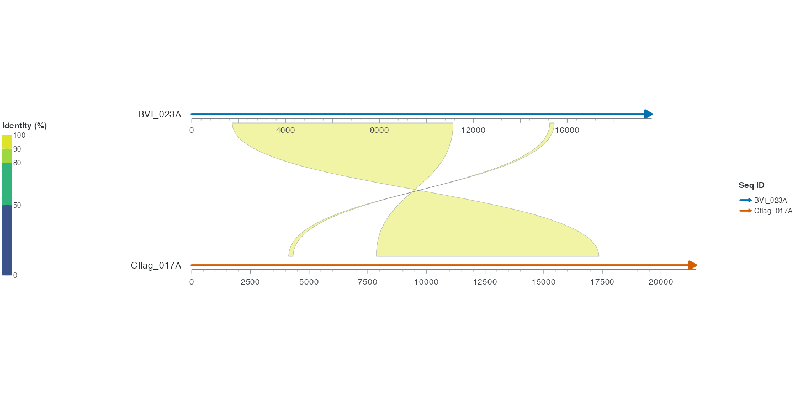</a><figcaption>A real minimap2 PAF comparison between two EMALE genomes · <span class="figure-hint">Click to enlarge</span></figcaption></figure>

The reader converts BED zero-based half-open intervals to one-based inclusive
coordinates; do not add one again. BED3 has no strand, so it returns unknown
strand; use a strand-bearing format when needed. Negative PAF relative direction
becomes decreasing subject endpoints. These are valid reverse hits, not values
to sort indiscriminately. Quality/identity use producer fields, not new alignments.

### GenBank: retain record identity {#formats-genbank}

```{r example-17, eval=FALSE}
# The original NCBI L09137.2 record identifies pUC19c; keep that identity.
genbank_result <- NULL
if (nzchar(Sys.which("python3")) && identical(suppressWarnings(system2("python3",
  c("-c", shQuote("from Bio import SeqIO")), stdout = FALSE, stderr = FALSE)), 0L)) {
  genbank_result <- read_genbank("examples/format-inputs/pUC19c-L09137.2.gb")
}
```


This is the original NCBI L09137.2 record, named pUC19c; do not rename it to the
bundled pUC19. Results include `seq_data`, `features$annotation` and `report`,
retaining segmented locations and record/feature provenance. The selected Python
needs Biopython already installed; no automatic installation occurs.
`unsupported = "report"` records unsupported locations rather than guessing bounds.

### Optional interval objects {#formats-ranges}

```{r example-18, eval=FALSE}
range_inputs <- NULL
if (requireNamespace("GenomicRanges", quietly = TRUE)) {
  unknown <- features[features$strand == ".", ][1, ]
  ranges <- GenomicRanges::GRanges(seqnames = unknown$accver,
    ranges = IRanges::IRanges(unknown$start, unknown$end), strand = "*",
    seqlengths = setNames(plasmid_seq$length, plasmid_seq$accver))
  range_inputs <- list(seq_data = as_ggchord_seq(ranges), features = as_ggchord_feature(ranges))
}
```

| Metric | Observed output |
| --- | --- |
| GenBank optional reader | SKIP: Biopython unavailable |
| Optional interval adapter | SKIP: GenomicRanges unavailable |

An originally unknown-strand pUC19 annotation remains unknown as `*`. Known full
lengths populate Seqinfo. `GInteractions` can become links but still needs explicit
sequence/length context. Missing dependencies are marked skipped, not validated
by source presence. See the data contract (`help("ggchord_data_contract", package = "ggchord")`).
SAM/BAM CIGAR is not parsed directly: use an alignment-aware tool before table
adaptation; renaming columns alone cannot resolve splicing.

### Check your result {#formats-check-result}
Inspect returned fields and conversion reports before selecting plotting fields. Preserve endpoint direction for reverse PAF hits; do not rename a GenBank record to pretend it is a different bundled plasmid.

<div class="next-step">Continue: <a href="#alignments">Import nucleotide and protein alignments →</a></div>


## Choose a plot {#modes}

<div class="task-intro"><p>Choose a layout for your question. The examples below compare three views using source-backed bundled records.</p></div>

### Which view should you choose? {#modes-choose}
| Task | Preferred view | Avoid this misreading |
| --- | --- | --- |
| Overall relationships among several sequences | Chord | Crossings alone are not evidence of inversion |
| Annotations on one plasmid or circular sequence | Circular | Multiple sequences do not fit a single-sequence coordinate |
| Positions, gene order and local neighbourhoods | Collinear | Display alignment or flipping is not a biological conclusion |

All three consume existing data; none computes a new BLAST alignment. Try the minimal combinations below, then follow the [raw-record workflow](#real-data), [complete plasmid map](#plasmids) or [local homolog comparison](#homology).

### Prepare this page {#modes-prepare}
In a fresh R session, run the code below, then follow this page in order. Colours and layout are optional display choices; inputs select only the fields needed.

<details class="preparation"><summary>Preparation code — run once on this page</summary>

```{r example-19, eval=FALSE}
library(ggchord)
data(seq_data_example)
data(ribbon_data_example)
data(gene_data_example)
seqs <- seq_data_example[c("accver", "length")]
links <- ribbon_data_example[c("qaccver", "saccver", "qstart", "qend", "sstart", "send")]
# The fixture preserves biological strands separately from its old display strands.
genes <- transform(gene_data_example, strand = source_strand)[c("accver", "start", "end", "strand")]

# Optional appearance choices; none of these columns or scales is required input.
library(ggchord)
seq_palette <- setNames(c("#3867D6", "#E58A28", "#219B83", "#9B59B6"),
  c("MT108731.1", "MT118296.1", "OQ646790.1", "OR222515.1"))
gene_palette <- c("+" = "#3B6FD8", "-" = "#E1812C", "." = "#8291A6")

library(ggchord)
feature_palette <- c(CDS = "#3973CB", promoter = "#8B5EC4", rep_origin = "#E8A42D",
  primer_bind = "#168F86", misc_feature = "#A0ADBD", protein_bind = "#CC6485")

library(ggchord)
doc_theme <- theme_ggchord_publication(axis.text = element_text(size = 11),
  axis.text.check.overlap = TRUE) + theme(legend.position = "bottom")
doc_axis <- function(coordinates = "relative") scale_seq_position_continuous(
  coordinates = coordinates, n.breaks = 3, minor_breaks = NULL,
  labels = function(x) format(x, scientific = FALSE, big.mark = ",", trim = TRUE))

data(plasmid_example_pUC19)
plasmid_seq <- plasmid_example_pUC19[c("accver", "length")]
feature_source <- find_common_features(plasmid_example_pUC19)
features <- feature_source[c("accver", "start", "end", "strand", "type", "anno")]
```

</details>

Run this page’s preparation code below. once. Each object below is a normal
composable ggplot; print it or use `ggsave()`.

### Chord: compare multiple sequences {#modes-chord}

```{r example-20, eval=FALSE}
p_chord <- ggchord(seq_data = seqs, ribbon_data = links, gene_data = genes) +
  geom_link_ribbon(aes(ribbon_fill = qaccver), alpha = .7) +
  scale_ribbon_fill_manual(values = seq_palette, guide = "none") + geom_seq(show.legend = FALSE) + geom_gene(position = position_strand(.1), width = .04) +
  geom_seq_label(size = 4, seq_label_radius = .84, seq_label_hjust = .5) + coord_chord() +
  scale_seq_colour_manual(values = seq_palette) +
  scale_gene_fill_manual(values = gene_palette) + doc_theme
p_chord
```

<figure class="documentation-figure"><a class="figure-link" href="../man/figures/chord.png" title="Click to enlarge"></a><figcaption>Bundled sequences and alignment intervals in a chord view · <span class="figure-hint">Click to enlarge</span></figcaption></figure>

Links are coloured by query sequence ID using the backbone category palette; this does not encode identity or homolog groups. See the [raw-record workflow](#real-data-chord) for colour mapped to reported identity.
`coord_chord()` controls global rotation and fitting. Sequence-local radius,
curvature, gap and orientation belong to `geom_seq()`. A NULL link control point
uses the historical origin-based chord route; it does not mean a universal
straight link. Ribbon avoidance defaults to `uniform`, line avoidance to `none`.

### Circular: annotate one sequence {#modes-circular}

```{r example-21, eval=FALSE}
circle_features <- features[features$type %in% c("CDS", "rep_origin"), ]
p_circular <- ggchord(seq_data = plasmid_seq) + geom_seq() +
  geom_feature(aes(feature_fill = type), data = circle_features, position = position_plasmid()) +
  geom_feature_label_repel(data = circle_features, position = position_plasmid(), size = 4) +
  geom_seq_center_label() + scale_feature_fill_manual(values = feature_palette, breaks = unique(circle_features$type)) +
  coord_circular() + theme_ggchord_publication(axis.text = element_text(size = 11))
p_circular
```

<figure class="documentation-figure"><a class="figure-link" href="../man/figures/circular.png" title="Click to enlarge"></a><figcaption>pUC19 annotations in a circular map · <span class="figure-hint">Click to enlarge</span></figcaption></figure>
This example selects CDS and the replication origin for display, retaining the full sequence bp axis.
`coord_circular()` requires a single sequence. General features can carry unknown
strand. `geom_feature_plasmid()` is a convenience preset with its own defaults;
choose it explicitly when those defaults fit the task. Primer and restriction
layers are described in [recognition](#recognition).

### Collinear: align local comparisons {#modes-collinear}

```{r example-22, eval=FALSE}
anchor_rows <- unlist(lapply(split(seq_len(nrow(genes)), genes$accver), function(i)
  i[which.max(genes$end[i] - genes$start[i])]))
anchors <- genes[anchor_rows, c("accver", "start", "end")]
p_collinear <- ggchord(seq_data = seqs, ribbon_data = links, gene_data = genes) +
  geom_link_ribbon(aes(ribbon_fill = qaccver), alpha = .7) +
  scale_ribbon_fill_manual(values = seq_palette, guide = "none") + geom_seq() +
  geom_gene(position = position_strand(.1)) + geom_seq_label(size = 4) +
  coord_collinear(anchor = anchors, align = "center", orientation = "auto") + doc_axis() +
  scale_seq_colour_manual(values = seq_palette) +
  scale_gene_fill_manual(values = gene_palette) + doc_theme
p_collinear
```

<figure class="documentation-figure"><a class="figure-link" href="../man/figures/collinear.png" title="Click to enlarge"></a><figcaption>Bundled records aligned to explicitly selected annotation anchors · <span class="figure-hint">Click to enlarge</span></figcaption></figure>
Each sequence is anchored to its own longest known gene for display; this does not assert homology.
`anchor` aligns specified intervals; `orientation = "auto"` chooses supported
orientations using available evidence. Inspect orientation diagnostics rather
than assuming biological inversion. Ribbons connect adjacent displayed rows by
default; use `adjacent_only = FALSE` or explicit `pairs` to retain others.
Non-adjacent outlines default to dashed; explicit styles take priority. These
rules differ from chord mode. [Focus and segments](#views) preserve source
coordinates for cropped or locally reversed views.

### Check your result {#modes-check-result}
First count sequences: use circular for one annotated sequence, chord for the overall link pattern, and collinear for positions, distances or neighbourhoods.

<div class="next-step">Continue: <a href="#installation">Get started: your first plot →</a></div>


## Compare sequences from original files {#real-data}

<div class="task-intro"><p>Combine original FASTA, GFF3 and standard BLAST tables into a traceable comparison. Inspect inputs, choose a display subset, then compare chord and full-length views.</p></div>

### Prepare this page {#real-data-prepare}
In a fresh R session, run the code below, then follow this page in order. Colours and layout are optional display choices; inputs select only the fields needed. For file-based examples, first extract the [input bundle](https://github.com/DangJem/ggchord/tree/main/examples) so the working directory contains `examples/`.

<details class="preparation"><summary>Preparation code — run once on this page</summary>

```{r example-23, eval=FALSE}
# Optional appearance choices; none of these columns or scales is required input.
library(ggchord)
seq_palette <- setNames(c("#3867D6", "#E58A28", "#219B83", "#9B59B6"),
  c("MT108731.1", "MT118296.1", "OQ646790.1", "OR222515.1"))
gene_palette <- c("+" = "#3B6FD8", "-" = "#E1812C", "." = "#8291A6")

library(ggchord)
doc_theme <- theme_ggchord_publication(axis.text = element_text(size = 11),
  axis.text.check.overlap = TRUE) + theme(legend.position = "bottom")
doc_axis <- function(coordinates = "relative") scale_seq_position_continuous(
  coordinates = coordinates, n.breaks = 3, minor_breaks = NULL,
  labels = function(x) format(x, scientific = FALSE, big.mark = ",", trim = TRUE))
```

</details>

This complete workflow uses four sequence records already present in the source
repository. It requires the matching development checkout or the tutorial input
bundle, not new alignments or external gene prediction. [Download the inputs](https://github.com/DangJem/ggchord/tree/main/examples)
and unpack them so `examples/` is under the working directory. Record the package
version and [build manifest](https://github.com/DangJem/ggchord/tree/main/website) with the exported figure.

### 1. Read and inspect original records {#real-data-read}

```{r example-24, eval=FALSE}
sequence_source <- read_fasta_lengths(files = "examples/fasta/*.fna", source_file = TRUE)
seq_real <- sequence_source[c("accver", "length")]
annotation_source <- read_gff3(files = "examples/gff3/*.gff3", unstranded = "keep", source_file = TRUE)
feature_real <- annotation_source[c("accver", "start", "end", "strand", "type", "anno")]
alignment_source <- read_blast(files = "examples/blastn-standard/*.tsv", source_file = TRUE)
link_real <- alignment_source[c("qaccver", "saccver", "qstart", "qend", "sstart", "send", "pident", "length")]
real_validation <- validate_ggchord_data(seq_real, link_real)
real_validation
```


The FASTA headers supply exact accession versions and lengths. GFF3 contributes
CDS intervals and their original strands. BLAST output contributes existing
alignments; the reader does not run BLAST. Inspect `real_validation` before
continuing: decreasing link endpoints can be legitimate reverse-direction hits.
Never turn unknown annotation strands into `+` to make a gene shortcut accept them.

### 2. Make the display selection explicit {#real-data-selection}

```{r example-25, eval=FALSE}
real_prepared <- prepare_ggchord_data(seq_real, link_real,
  features = list(annotation = feature_real))
real_filtered <- filter_ggchord_ribbons(link_real, min_pident = 80, min_length = 500)
# Explicit display subset: the six longest CDS per sequence; raw annotations stay intact.
display_rows <- unlist(lapply(split(seq_len(nrow(feature_real)), feature_real$accver),
  function(i) head(i[order(-(feature_real$end[i] - feature_real$start[i] + 1))], 6)))
real_display_features <- feature_real[display_rows, , drop = FALSE]
label_rows <- unlist(lapply(split(seq_len(nrow(real_display_features)), real_display_features$accver),
  function(i) head(i[real_display_features$anno[i] != "hypothetical protein"], 2)))
real_labels <- real_display_features[label_rows, , drop = FALSE]
real_filtered$report
```

| Metric | Observed output |
| --- | --- |
| Sequences | 4 |
| Annotation rows | 266 |
| CDS selected for the chord view | 24 |
| Original HSPs | 32 |
| HSPs retained by the display filter | 8 |
| Selected text labels | 6 |

The link display retains identity ≥80% and reported alignment length ≥500 bp.
The chord view selects the six longest imported CDS per sequence, labelling at most two selected CDS with informative annotations (excluding
hypothetical protein). These are display rules, not biological findings or a claim
that omitted genes are absent. Raw `feature_real` and `link_real` remain intact;
`real_prepared$report` and `real_filtered$report` retain preparation/filter evidence.
No display strands are recoded. This differs from the small packaged teaching
fixture whose documented generation includes display-strand recoding.

### 3. Build a chord comparison {#real-data-chord}

```{r example-26, eval=FALSE}
p_real_chord <- ggchord(seq_data = seq_real, ribbon_data = real_filtered$data, validate = "none") +
  geom_link_ribbon(aes(ribbon_fill = pident), alpha = .65) + geom_seq(show.legend = FALSE) +
  geom_feature(aes(feature_fill = strand), data = real_display_features,
    width = .045, position = position_strand(.08)) +
  geom_feature_label_repel(data = real_labels, label_layout = "radial",
    label_wrap = 20, size = 4, position = position_strand(.08)) +
  geom_seq_label(size = 4, seq_label_radius = .84, seq_label_hjust = .5) + coord_chord() +
  scale_seq_colour_manual(values = seq_palette) +
  scale_feature_fill_manual(values = gene_palette, breaks = c("+", "-")) +
  scale_ribbon_fill_gradientn(colours = c("#3D2185", "#C74678", "#F6B739"), name = "Identity (%)") +
  doc_theme
p_real_chord
```

<figure class="documentation-figure"><a class="figure-link" href="../man/figures/realchord.png" title="Click to enlarge">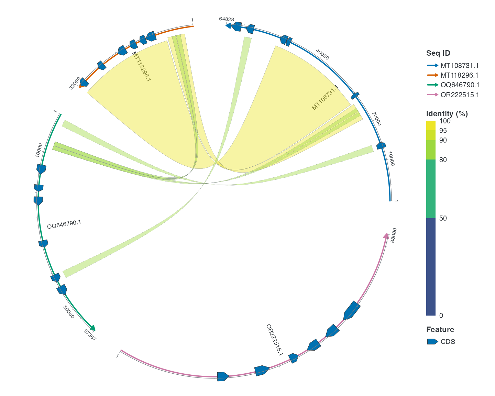</a><figcaption>Original sequences with explicitly selected CDS and alignment links · <span class="figure-hint">Click to enlarge</span></figcaption></figure>

Read sequence labels first, then source-strand feature arrows and interval links.
Ribbons encode existing aligned intervals and mapped identity; their crossing is
not itself evidence of a rearrangement. The selected features remain visibly
separate from the much wider alignment spans. Use the full input tables when
scientific interpretation needs annotations outside this display subset.

### 4. Inspect all annotations in a linear view {#real-data-linear}

```{r example-27, eval=FALSE}
p_real_linear <- ggchord(seq_real, real_filtered$data, validate = "none") +
  geom_link_ribbon(fill = "#7199DF", alpha = .45) + geom_seq() + geom_seq_label(size = 4) +
  geom_feature(data = feature_real, feature_fill = "#3B6FD8", show.legend = FALSE, position = position_strand(.18)) +
  geom_seq_scale(length = 10000) + doc_axis() +
  coord_collinear() + doc_axis() +
  scale_seq_colour_manual(values = seq_palette) + doc_theme
p_real_linear
```

<figure class="documentation-figure"><a class="figure-link" href="../man/figures/reallinear.png" title="Click to enlarge"></a><figcaption>Original sequences, all imported CDS and filtered links · <span class="figure-hint">Click to enlarge</span></figcaption></figure>

This view draws all imported annotations. Ribbons connect adjacent displayed
sequences by default; retaining every comparison is an explicit layer decision.
The bp scale bar belongs to collinear coordinates. See [local views](#views)
for cropping, source-coordinate axes and independent windows, and
[output](#output) to preview and save at the gallery's stated dimensions.

### 5. Keep the evidence with the figure {#real-data-provenance}
The input archive contains unmodified FASTA/GFF3/BLAST files, a SHA256 manifest
and the shared example script. The plot manifest records the code hash, PNG device,
width, height and dpi. The accession names identify source records; a drawing is
not a replacement for the original annotations or alignment evidence.

### Select fields before passing data {#real-data-minimal-fields}
The `*_source` objects keep original fields and provenance; `seq_real` has two
columns, `feature_real` only geometry/type/text, and `link_real` adds identity and
reported length only because this workflow filters and colours by them. Standard
12-column BLAST conversions are used, not a requirement for the historical 17 fields.
The bundled gene fixture preserves its original strand in `source_strand`; the
short examples restore that biological strand before selecting four gene columns.
See [alignment input](#alignments) for exact format and unit boundaries.

### Check your result {#real-data-check-result}
Check that IDs agree across the tables, inspect filtering reports and verify that guides encode identity and strand. Use the overview to locate regions, then focus a neighbourhood to study a CDS.

<div class="next-step">Continue: <a href="#homology">Explicit homologs and coding-coordinate links →</a></div>

### Save this result {#real-data-save-result}
Save the plot just created to the working directory; use matching dimensions for preview.

```{r example-28, eval=FALSE}
ggsave("phage-comparison.png", p_real_chord, width = 10, height = 8, units = "in", dpi = 144)
```


## A complete circular annotation workflow {#plasmids}

<div class="task-intro"><p>Build a readable plasmid map from bundled pUC19 DNA, with separate annotation, primer and restriction layers. Keep display choices separate from complete results.</p></div>

### Prepare this page {#plasmids-prepare}
In a fresh R session, run the code below, then follow this page in order. Colours and layout are optional display choices; inputs select only the fields needed.

<details class="preparation"><summary>Preparation code — run once on this page</summary>

```{r example-29, eval=FALSE}
library(ggchord)
feature_palette <- c(CDS = "#3973CB", promoter = "#8B5EC4", rep_origin = "#E8A42D",
  primer_bind = "#168F86", misc_feature = "#A0ADBD", protein_bind = "#CC6485")
```

</details>

Run this page’s preparation code below. for the explicit palette first.

### Use a source-backed sequence {#plasmids-input}
The bundled `plasmid_example_pUC19` is copied from the repository's original
`examples/plasmid/pUC19.fna`; bases and sequence identity are not edited for display.
The workflow uses the package's source-backed recognition catalogues. It needs no
network request or experimental measurements fabricated for the figure.


```{r example-30, eval=FALSE}
data(plasmid_example_pUC19)
plasmid_seq <- plasmid_example_pUC19[c("accver", "length")]
plasmid_feature_source <- find_common_features(plasmid_example_pUC19)
# Dedicated primer layers already show bindings; avoid duplicate primer annotations.
plasmid_features <- plasmid_feature_source[plasmid_feature_source$type != "primer_bind",
  c("accver", "start", "end", "strand", "type", "anno")]
plasmid_primers <- find_primer_bindings(plasmid_example_pUC19, set = "universal")
plasmid_sites <- find_restriction_sites(plasmid_example_pUC19)
display_sites <- filter_restriction_sites(plasmid_sites, enzymes = c("EcoRI", "BamHI", "HindIII"))
primer_names <- primer_catalog(set = "universal")
```


Inspect `plasmid_features`, `plasmid_primers` and `display_sites` to distinguish complete search results from display choices.

### Compose independent layers {#plasmids-draw}
Add the backbone, annotations, labels, primers and restriction sites in that order. Features and their labels share one Position; each layer reads its own data.


```{r example-31, eval=FALSE}
plasmid_position <- position_feature_stack(spacing = .085, base_position = position_plasmid())
p_plasmid <- ggchord(seq_data = plasmid_seq) + geom_seq(seq_style = "double") +
  geom_feature_plasmid(aes(feature_fill = type), data = plasmid_features, position = plasmid_position) +
  geom_feature_label_repel(data = plasmid_features, position = plasmid_position,
    label_fit = "shrink", label_min_size = 2.4, size = 4) +
  geom_primer(data = plasmid_primers, colour = "#168F86") +
  geom_primer_label_repel(data = plasmid_primers, colour = "#167F80", max_overlaps = 0, size = 3) +
  geom_restriction_site(data = display_sites, colour = "#29364B", label_size = 3) + geom_seq_center_label() +
  scale_feature_fill_manual(values = feature_palette) +
  coord_circular(rotation = 90) + theme_ggchord_publication(axis.text = element_text(size = 11))
p_plasmid
```

<figure class="documentation-figure"><a class="figure-link" href="../man/figures/plasmid.png" title="Click to enlarge">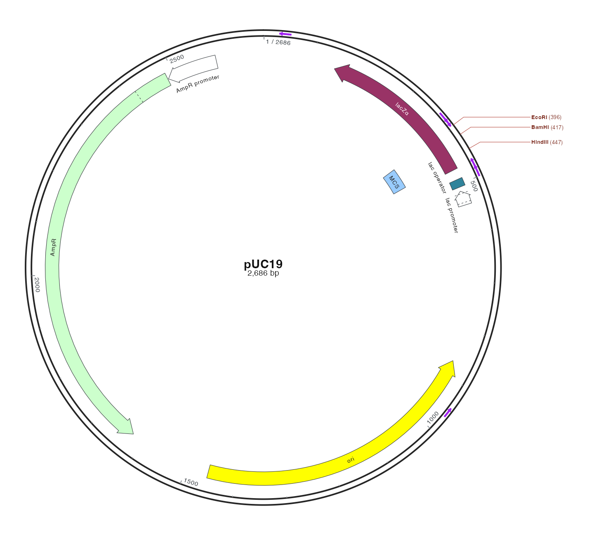</a><figcaption>pUC19 features, exact primer hits and three selected restriction sites · <span class="figure-hint">Click to enlarge</span></figcaption></figure>
| Metric | Observed output |
| --- | --- |
| Full sequence length (bp) | 2686 |
| Annotation rows | 7 |
| Exact primer hit records | 6 |
| Enzyme match records (not distinct positions) | 49845 |
| Restriction records selected for display | 3 |

The original annotation table is retained in `plasmid_feature_source`. Dedicated
primer layers replace duplicate `primer_bind` annotations in the displayed feature
table; only geometry, type and annotation text are passed to feature layers.

### Read the annotation layers {#plasmids-layers}
The double backbone establishes one circular sequence. General features use a
plasmid preset and explicit stacking Position; labels use the same Position.
Primer arcs indicate binding ranges, restriction ticks indicate cleavage/display
positions, and the centre label identifies the sequence and length. A cropped or
filtered display does not change the full-sequence restriction count.

### Choose the displayed sites deliberately {#plasmids-sites}
`find_restriction_sites()` returns all matches. This figure explicitly selects
EcoRI, BamHI and HindIII so that a compact restriction cluster remains readable;
`plasmid_sites` retains the complete search result. The `reference` filter uses a saved
reference display set only when the complete supplied sequence matches that
reference. Other tasks can select `unique`, `six_plus` or explicit enzyme names.
Inspect `display_sites` and the site's methylation/source columns before drawing.
The reference set is a presentation choice, not a claim about an unknown sample.

### Understand catalogue and label limits {#plasmids-limits}
`primer_names` exposes catalogue entries. This example searches the universal catalogue exactly; reference primer
annotations and exact oligonucleotide searches have distinct provenance. Near-exact protein feature
recognition has the limitations in [recognition](#recognition); it does not
validate biological function or a primer experiment. Text can move, shrink within
its explicit minimum, or hide. Keep the geometry and inspect exported label
reasons at the final size rather than assuming every annotation must have text.

### Adapt the workflow {#plasmids-adapt}
For your own named DNA sequence, replace the input and inspect search results
before adding geoms. For externally curated annotations, pass your feature table
instead of running recognition. Use [stacking and shapes](#annotations) for
geometry, [labels](#labels) for fitting, and [output](#output) for devices.

### Check your result {#plasmids-check-result}
Start with the centre name and length, then read positions, category colours, arrow directions and outer labels. Check enzyme names in display_sites; selecting a display subset leaves plasmid_sites intact.

<div class="next-step">Continue: <a href="#labels">Labels and local placement →</a></div>

### Save this result {#plasmids-save-result}
Save the plot just created to the working directory; use matching dimensions for preview.

```{r example-32, eval=FALSE}
ggsave("pUC19-map.png", p_plasmid, width = 10, height = 9, units = "in", dpi = 144)
```


## Import nucleotide and protein alignments {#alignments}

<div class="task-intro"><p>Use standard BLAST tabular output without the historical custom 17-column layout. Distinguish file fields, minimal plotting roles and nucleotide versus protein units.</p></div>

### Prepare this page {#alignments-prepare}
In a fresh R session, run the code below, then follow this page in order. Colours and layout are optional display choices; inputs select only the fields needed. For file-based examples, first extract the [input bundle](https://github.com/DangJem/ggchord/tree/main/examples) so the working directory contains `examples/`.

```{r example-33, eval=FALSE}
library(ggchord)
```

### Use the default tabular columns {#alignments-standard}
The historical custom list of 17 fields is unnecessary. Use standard tabular output:

```sh
blastn -query query.fna -subject subject.fna -outfmt 6 -out result.tsv
blastp -query proteins.faa -subject reference.faa -outfmt 7 -out result.tsv
```

Format `6` is a table; `7` adds comments. Without a custom field list both use
12 default fields. Omitting `-outfmt` entirely produces pairwise text, which this
tabular reader does not parse. Fields are query ID, subject ID, pident, length,
mismatch, gapopen, qstart, qend, sstart, send, evalue, bitscore. Their identifier
roles become `qaccver`/`saccver`; values are preserved and need not be accession versions.
See the [NCBI format documentation](https://www.ncbi.nlm.nih.gov/sites/books/NBK279684/table/appendices.T.options_common_to_all_blast/).

### File layout and minimal plotting fields differ {#alignments-minimal}
Twelve file columns do not require twelve plotting columns. After the
preparation code above, try the source-backed records:


```{r example-34, eval=FALSE}
blast_source <- read_blast("examples/blastn-standard/MT108731.1__MT118296.1.tsv")
blast_links <- blast_source[c("qaccver", "saccver", "qstart", "qend", "sstart", "send")]
# A six-column table is sufficient for drawing; extra fields stay in blast_source.
custom_path <- tempfile(fileext = ".tsv")
write.table(blast_links, custom_path, sep = "\t", quote = FALSE, row.names = FALSE, col.names = FALSE)
custom_source <- read_blast(custom_path, format = "custom", col_names = names(blast_links))
custom_links <- custom_source[names(blast_links)]
unlink(custom_path)
```


`blast_source` retains statistics and provenance; `blast_links` has six endpoint roles.
Identity requires `pident` only when mapped/filtered; alignment-length filters or
weights require `length`. `qlen`/`slen` support the corresponding coverage calculations.
They are not general plotting requirements. A custom headerless layout requires
explicit `col_names`; arbitrary six-column meanings are not guessed.
Use `as_ggchord_link(x, mapping = ...)` for an already-read non-BLAST table;
see [format conversion](#formats-adapters).

Files in `examples/blastn-standard/` retain historical HSP rows and their first
12 values. They are column conversions, not new BLAST runs. Old `.o7` inputs are
unchanged; the conversion script and hashes record that distinction.

### Read BLASTp with explicit coordinate units {#alignments-protein}
This real BLASTP 2.9.0+ output and query CDS annotation come from the public
EMALE tutorial. Retain the original table, then select sufficiently long,
low-evalue query HSPs with complete known CDS mappings.


```{r example-35, eval=FALSE}
protein_source <- read_blast("examples/format-inputs/emales-mavirus-blastp.tsv", source_file = TRUE)
emale_source <- read_gff3("examples/format-inputs/emales-BVI_023A.gff3", source_file = TRUE)
# The source declares complete Prodigal CDS and translation table 11.
emale_coding <- emale_source[grepl("partial=00", emale_source$attributes),
  c("feature_id", "accver", "start", "end", "strand", "phase")]
emale_cds <- build_ggchord_cds(emale_coding, genetic_code = 11)
# Keep strong HSPs whose query protein has a known complete CDS.
# Gaps are retained: projecting one query span does not assert an ungapped pair.
protein_kept <- protein_source[protein_source$qaccver %in% emale_coding$feature_id &
  protein_source$evalue <= 1e-10 & protein_source$length >= 50, ]
protein_kept <- protein_kept[order(-protein_kept$bitscore), ]
selected_hsp <- protein_kept[1, ]
query_interval <- data.frame(feature_id = "query_HSP", parent_id = selected_hsp$qaccver,
  start = selected_hsp$qstart, end = selected_hsp$qend)
projected_query <- project_ggchord_features(query_interval, emale_cds)
# Subject projection additionally requires its own CDS map; it is not guessed from an accession.
```

| Metric | Observed output |
| --- | --- |
| Original BLASTp HSPs | 2948 |
| Complete query CDS records | 24 |
| Query HSPs retained by the explicit filter | 3 |
| Selected query start (aa) | 50 |
| Selected query end (aa) | 289 |
| Projected query-span rows | 1 |

BLASTp endpoints are amino-acid coordinates. This example projects the query HSP
span into the known CDS's genomic coordinates, retaining strand and phase.
A gapped HSP still has a projectable query span; that envelope is not a base-by-base
nucleotide correspondence. Weak hits, gap counts and statistics remain in the source.

Projecting both ends requires the subject's own CDS map. It cannot be inferred
from an accession, maximum endpoint or annotation name. The `ungapped = TRUE`
assertion for `project_ggchord_links()` needs evidence. The [projection tutorial](#projection)
uses two real plasmid CDS with identical oriented DNA to demonstrate a justified
ungapped two-ended case.

Native protein backbones with aa axes are outside this version. For `blastx` and
`tblastn`, check each endpoint's units independently. Parsing does not establish
that a table can be drawn directly in genomic bp coordinates.

### Sources and limits {#alignments-source}
Original EMALE records come from the [public gggenomes data/tutorial](https://thackl.github.io/gggenomes/articles/emales.html).
Only data records are reused; all figures are drawn with ggchord, without copying
upstream figures or plotting code. The input bundle's `sources.json` records URLs,
archive members, line ranges, hashes and selection. Parsing neither reruns
alignments nor establishes biological function.

### Check your result {#alignments-check-result}
A basic link table needs six fields. BLASTp reading retains aa coordinates; use a supported CDS mapping before drawing on this version’s bp axes.

<div class="next-step">Continue: <a href="#projection">CDS coordinate projection →</a></div>


## Set values by sequence and strand {#parameters}

<div class="task-intro"><p>Adjust geometry by sequence or strand, retaining useful flexible parameter formats while making their scope explicit.</p></div>

### Prepare this page {#parameters-prepare}
In a fresh R session, run the code below, then follow this page in order. Colours and layout are optional display choices; inputs select only the fields needed.

<details class="preparation"><summary>Preparation code — run once on this page</summary>

```{r example-36, eval=FALSE}
library(ggchord)
data(seq_data_example)
data(ribbon_data_example)
data(gene_data_example)
seqs <- seq_data_example[c("accver", "length")]
links <- ribbon_data_example[c("qaccver", "saccver", "qstart", "qend", "sstart", "send")]
# The fixture preserves biological strands separately from its old display strands.
genes <- transform(gene_data_example, strand = source_strand)[c("accver", "start", "end", "strand")]

# Optional appearance choices; none of these columns or scales is required input.
library(ggchord)
seq_palette <- setNames(c("#3867D6", "#E58A28", "#219B83", "#9B59B6"),
  c("MT108731.1", "MT118296.1", "OQ646790.1", "OR222515.1"))
gene_palette <- c("+" = "#3B6FD8", "-" = "#E1812C", "." = "#8291A6")

library(ggchord)
doc_theme <- theme_ggchord_publication(axis.text = element_text(size = 11),
  axis.text.check.overlap = TRUE) + theme(legend.position = "bottom")
doc_axis <- function(coordinates = "relative") scale_seq_position_continuous(
  coordinates = coordinates, n.breaks = 3, minor_breaks = NULL,
  labels = function(x) format(x, scientific = FALSE, big.mark = ",", trim = TRUE))
```

</details>

### The capability remains supported {#parameters-recommendation}
Sequence-local geometry often needs one value per sequence or strand; duplicating
whole layers would obscure that intent. Keep scalars as the default, use vectors
named by `accver` when values differ, and name strand pairs `+`/`-`.


```{r example-37, eval=FALSE}
# Sequence IDs remain stable when the data is reordered; positional lists do not.
radii <- setNames(c(1.1, 1, 1, 1), seqs$accver)
widths <- c("+" = .045, "-" = .065)
p_parameters <- ggchord(seq_data = seqs, gene_data = genes) +
  geom_seq(seq_radius = radii) + geom_gene(width = widths,
    position = position_strand(c("+" = .08, "-" = -.1))) +
  geom_seq_label(size = 4) + scale_seq_colour_manual(values = seq_palette) +
  scale_gene_fill_manual(values = gene_palette) + coord_chord() + doc_theme
p_parameters
```


Run this page’s preparation code below. first. Named radii survive sequence
reordering; unnamed entries follow current positions. These are layout/geometry
values, not a universal extension to colours or themes.

### Supported parameters {#parameters-scope}
| Interface | Parameters | Matching scope |
| --- | --- | --- |
| `geom_seq()` | `seq_radius`, `seq_curvature`, `seq_gap`, `seq_orientation` | Sequence; radius/curvature effects depend on coordinates |
| `geom_seq_label()` | `labels`, `seq_label_radius`, `seq_label_rotation`, `size`, `seq_label_hjust`, `seq_label_vjust` | Sequence; `seq_label_orientation` is one mode choice |
| `geom_link_ribbon()` / `geom_link_line()` | `link_gap` | Endpoint sequence; Cartesian control points are not per-sequence scalars |
| `geom_gene()` / `geom_feature()` | `width` | Sequence and/or `+`/`-` strand |
| `position_strand()` / `position_plasmid()` | `offset` | Sequence/strand; prefer Positions over compatibility offset inputs |
| Fixed `geom_gene_label()` / `geom_feature_label()` | `label_radial_offset`, `label_circum_offset`, `label_circum_limit`, `label_rotation` | Sequence/strand, not every text setting |
| `position_track()` | Numeric `width`, `gap` | Native numeric placement by sequence; physical `unit()` is a scalar absolute size |

`seq_order` is itself an ordering. Automatic `label_layout` is a mode; manual angles
and offsets belong to fixed label layers rather than automatic-label `...`.
Axes/themes, aesthetics, scales and guides do not inherit the list extension.
Manual scales do accept vectors named by **data categories**, under ordinary
ggplot2 scale semantics; see [styling](#styling).

### Compatibility and design tradeoffs {#parameters-compatibility}
Equal-length unnamed vectors, sequence-named lists, position-named lists and
unnamed lists remain compatible. Gene/feature entries can additionally contain
strand pairs. Each parameter still validates its own type, length, range and units.
This does not make a list a valid container for any argument.

Avoid expanding low-frequency equivalent forms: positional lists can silently
follow a new order after filtering; nested lists are harder to read. This version
does not remove them. The planned v0.16.6 audit will evaluate convergence;
any breaking decision needs explicit migration and removal timing. This design
recommendation is not an announced deprecation.

Numeric values do not all share one unit: `seq_gap` is a proportion, rotations
are degrees, and physical track sizes use explicit `unit()` values. `seq_backbone_gap`
and `seq_backbone_width` are scalar style controls, not members of the list rule.
Automatic collinear orientation belongs to `coord_collinear(orientation = "auto")`;
`geom_seq(seq_orientation = ...)` supplies numerical +1/-1 sequence directions.

### Check your result {#parameters-check-result}
Named-vector keys must match actual accver values or +/− strands. Recheck matching after reordering; list rules do not extend to themes, scales or aesthetics.

<div class="next-step">Continue: <a href="#styling">Mappings, scales, guides and themes →</a></div>


## Prepare and summarize alignment links {#ribbons}

<div class="task-intro"><p>Reduce link clutter while retaining provenance: filtering, deduplication, merging and bundling have different meanings.</p></div>

### Prepare this page {#ribbons-prepare}
In a fresh R session, run the code below, then follow this page in order. Colours and layout are optional display choices; inputs select only the fields needed. For file-based examples, first extract the [input bundle](https://github.com/DangJem/ggchord/tree/main/examples) so the working directory contains `examples/`.

<details class="preparation"><summary>Preparation code — run once on this page</summary>

```{r example-38, eval=FALSE}
library(ggchord)
data(seq_data_example)
data(ribbon_data_example)
data(gene_data_example)
seqs <- seq_data_example[c("accver", "length")]
links <- ribbon_data_example[c("qaccver", "saccver", "qstart", "qend", "sstart", "send")]
# The fixture preserves biological strands separately from its old display strands.
genes <- transform(gene_data_example, strand = source_strand)[c("accver", "start", "end", "strand")]

# Optional appearance choices; none of these columns or scales is required input.
library(ggchord)
seq_palette <- setNames(c("#3867D6", "#E58A28", "#219B83", "#9B59B6"),
  c("MT108731.1", "MT118296.1", "OQ646790.1", "OR222515.1"))
gene_palette <- c("+" = "#3B6FD8", "-" = "#E1812C", "." = "#8291A6")

library(ggchord)
doc_theme <- theme_ggchord_publication(axis.text = element_text(size = 11),
  axis.text.check.overlap = TRUE) + theme(legend.position = "bottom")
doc_axis <- function(coordinates = "relative") scale_seq_position_continuous(
  coordinates = coordinates, n.breaks = 3, minor_breaks = NULL,
  labels = function(x) format(x, scientific = FALSE, big.mark = ",", trim = TRUE))

sequence_source <- read_fasta_lengths(files = "examples/fasta/*.fna", source_file = TRUE)
seq_real <- sequence_source[c("accver", "length")]
annotation_source <- read_gff3(files = "examples/gff3/*.gff3", unstranded = "keep", source_file = TRUE)
feature_real <- annotation_source[c("accver", "start", "end", "strand", "type", "anno")]
alignment_source <- read_blast(files = "examples/blastn-standard/*.tsv", source_file = TRUE)
link_real <- alignment_source[c("qaccver", "saccver", "qstart", "qend", "sstart", "send", "pident", "length")]
real_validation <- validate_ggchord_data(seq_real, link_real)
real_validation

real_prepared <- prepare_ggchord_data(seq_real, link_real,
  features = list(annotation = feature_real))
real_filtered <- filter_ggchord_ribbons(link_real, min_pident = 80, min_length = 500)
# Explicit display subset: the six longest CDS per sequence; raw annotations stay intact.
display_rows <- unlist(lapply(split(seq_len(nrow(feature_real)), feature_real$accver),
  function(i) head(i[order(-(feature_real$end[i] - feature_real$start[i] + 1))], 6)))
real_display_features <- feature_real[display_rows, , drop = FALSE]
label_rows <- unlist(lapply(split(seq_len(nrow(real_display_features)), real_display_features$accver),
  function(i) head(i[real_display_features$anno[i] != "hypothetical protein"], 2)))
real_labels <- real_display_features[label_rows, , drop = FALSE]
real_filtered$report
```

</details>

### Begin with the original link table {#ribbons-input}
Use the [real-record workflow](#real-data-selection) to create `seq_real`,
`link_real` and `real_filtered`. Keep its original tables and filter report.


```{r example-39, eval=FALSE}
unique_links <- deduplicate_ggchord_ribbons(real_filtered$data, by = "overlap",
  min_reciprocal_overlap = .9)
merged_links <- merge_ggchord_ribbons(unique_links$data, max_gap = 100,
  min_pident_difference = 2)
bundled_links <- bundle_ggchord_ribbons(link_real, seq_real, bins = 30)
p_density <- ggchord(seq_real, link_real, validate = "none") + geom_seq(show.legend = FALSE) +
  geom_seq_label(size = 4, seq_label_radius = .84, seq_label_hjust = .5) +
  stat_ribbon_density(aes(ribbon_alpha = after_stat(density)), fill = "#5379CE") +
  scale_ribbon_alpha_continuous(name = "Relative density", range = c(.1, .6),
    guide = guide_ggchord_legend(position = "bottom", nrow = 1)) +
  scale_seq_colour_manual(values = seq_palette) + coord_chord() + doc_theme
p_bundle <- ggchord(seq_real, link_real, validate = "none") + geom_seq() +
  stat_ribbon_bundle(bins = 30, fill = "#5379CE") + coord_chord() + doc_theme
p_density
```

| Metric | Observed output |
| --- | --- |
| Filtered HSPs | 8 |
| After overlap deduplication | 8 |
| Merged display intervals | 8 |
| Bundle output rows | 28 |

### Understand each transformation {#ribbons-transformations}
Filtering keeps observations meeting declared thresholds. Reciprocal-overlap
deduplication selects a representative existing observation; it does not sum
identities. Merging combines nearby compatible intervals into a display envelope.
Bundling groups nearby query/subject locations into an aggregate. Inspect each
`$report` and source-row membership, especially when extra metadata conflict.
The merged or bundled envelope is not a newly computed nucleotide alignment.
Estimated lengths retain their flags; unobserved identity is never invented.

### Density is an explicit statistic {#ribbons-density}
<figure class="documentation-figure"><a class="figure-link" href="../man/figures/density.png" title="Click to enlarge">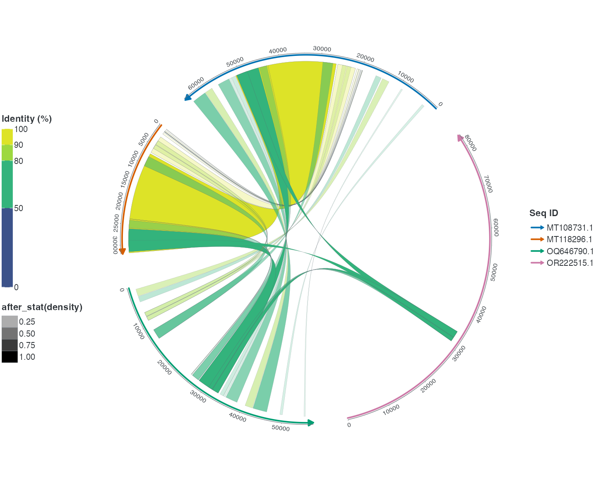</a><figcaption>Interval density from the original alignment observations · <span class="figure-hint">Click to enlarge</span></figcaption></figure>

`stat_ribbon_density()` maps a computed density, and `stat_ribbon_bundle()` performs
its explicit aggregation during build. The ordinary ribbon geom still draws one
ribbon per row. Interpret count, reported length and identity weighting in their
own units; more opaque ribbons need not mean stronger independently validated
homology. A point anchor without direction evidence cannot acquire an aggregate
orientation merely because its endpoints are equal.

### Choose interval ribbons or point links {#ribbons-points}
After this page’s preparation code:


```{r example-40, eval=FALSE}
# Midpoints summarize existing HSPs for display; they are not new alignments.
points <- ribbon_data_example[c("qaccver", "saccver", "qstart", "qend", "sstart", "send", "pident")]
points$qpos <- floor((points$qstart + points$qend) / 2)
points$spos <- floor((points$sstart + points$send) / 2)
points <- points[c("qaccver", "saccver", "qpos", "spos", "pident")]
p_points <- ggchord(seq_data = seqs) + geom_seq() + geom_seq_label(size = 4) +
  geom_link_line(aes(link_colour = pident), data = points,
    arrow = arrow(length = unit(2, "mm")), linewidth = .7) +
  scale_link_colour_gradientn(colours = c("#3D2185", "#F6B739"),
    name = "Identity (%)", guide = guide_ggchord_colourbar(available_aes = "link_colour",
      position = "bottom", direction = "horizontal",
      theme = theme(legend.key.width = unit(35, "mm"), legend.key.height = unit(3, "mm")))) +
  scale_seq_colour_manual(values = seq_palette) + coord_chord() + doc_theme
p_points
```

<figure class="documentation-figure"><a class="figure-link" href="../man/figures/pointlinks.png" title="Click to enlarge">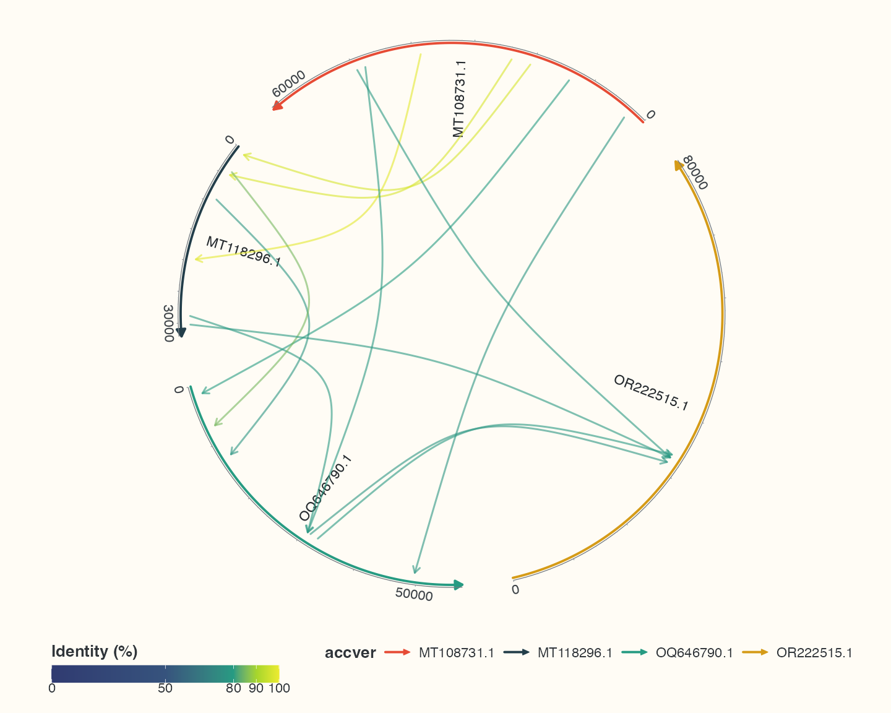</a><figcaption>Midpoint links derived from existing HSP intervals · <span class="figure-hint">Click to enlarge</span></figcaption></figure>

Point positions are integer midpoints of real bundled HSPs; identity remains the reported `pident`. Lines use `qpos/spos`,
not interval ends, and an arrow points from query to subject. The line default
avoidance is `none`; ribbon avoidance is `uniform`. Global chord rotation belongs
to the coordinate system. Pair selection and adjacent-row defaults in linear
plots are covered in [three modes](#modes-collinear).

The point-link colour scale supplies `available_aes = "link_colour"` to its
colourbar explicitly. Ordinary ggplot2 colourbars and the wrapper default do not
accept every extended role; choose the matching role when making a custom guide.

### Check your result {#ribbons-check-result}
Inspect each report and member rows before reading the plot. Aggregated bands are not new alignments; point links summarize midpoints of existing HSPs.

<div class="next-step">Continue: <a href="#views">Focus, segments and homology →</a></div>


## Features, stacking and genomic decoration {#annotations}

<div class="task-intro"><p>Draw real annotations as independent layers, choose suitable shapes and share stacking positions between overlapping intervals and text.</p></div>

### Prepare this page {#annotations-prepare}
In a fresh R session, run the code below, then follow this page in order. Colours and layout are optional display choices; inputs select only the fields needed.

<details class="preparation"><summary>Preparation code — run once on this page</summary>

```{r example-41, eval=FALSE}
library(ggchord)
data(seq_data_example)
data(ribbon_data_example)
data(gene_data_example)
seqs <- seq_data_example[c("accver", "length")]
links <- ribbon_data_example[c("qaccver", "saccver", "qstart", "qend", "sstart", "send")]
# The fixture preserves biological strands separately from its old display strands.
genes <- transform(gene_data_example, strand = source_strand)[c("accver", "start", "end", "strand")]

# Optional appearance choices; none of these columns or scales is required input.
library(ggchord)
seq_palette <- setNames(c("#3867D6", "#E58A28", "#219B83", "#9B59B6"),
  c("MT108731.1", "MT118296.1", "OQ646790.1", "OR222515.1"))
gene_palette <- c("+" = "#3B6FD8", "-" = "#E1812C", "." = "#8291A6")

library(ggchord)
feature_palette <- c(CDS = "#3973CB", promoter = "#8B5EC4", rep_origin = "#E8A42D",
  primer_bind = "#168F86", misc_feature = "#A0ADBD", protein_bind = "#CC6485")

library(ggchord)
doc_theme <- theme_ggchord_publication(axis.text = element_text(size = 11),
  axis.text.check.overlap = TRUE) + theme(legend.position = "bottom")
doc_axis <- function(coordinates = "relative") scale_seq_position_continuous(
  coordinates = coordinates, n.breaks = 3, minor_breaks = NULL,
  labels = function(x) format(x, scientific = FALSE, big.mark = ",", trim = TRUE))

data(plasmid_example_pUC19)
plasmid_seq <- plasmid_example_pUC19[c("accver", "length")]
feature_source <- find_common_features(plasmid_example_pUC19)
features <- feature_source[c("accver", "start", "end", "strand", "type", "anno")]
```

</details>

### Preserve feature semantics {#annotations-stack}
Run this page’s preparation code below. and [circular example](#modes-circular).
This table retains actual overlapping pUC19 annotations and unknown strands. Geometry and fill map separately
from the same category; an explicit fixed `shape` would override shape mapping.


```{r example-42, eval=FALSE}
stack_features <- features[c("accver", "start", "end", "strand", "type", "anno")]
stack_position <- position_feature_stack(spacing = .12)
feature_shapes <- setNames(ifelse(names(feature_palette) == "CDS", "arrow", "block"), names(feature_palette))
p_stack <- ggchord(seq_data = plasmid_seq) + geom_seq(show.legend = FALSE) +
  geom_feature(aes(feature_fill = type, feature_shape = type), data = stack_features,
    width = .08, position = stack_position) +
  geom_feature_label_repel(data = stack_features, position = stack_position, size = 3.8, label_fit = "shrink", label_min_size = 2.8) +
  scale_feature_shape_manual(values = feature_shapes) +
  scale_feature_fill_manual(values = feature_palette) + coord_collinear() + doc_axis() + doc_theme
p_stack
```

<figure class="documentation-figure"><a class="figure-link" href="../man/figures/featurestack.png" title="Click to enlarge">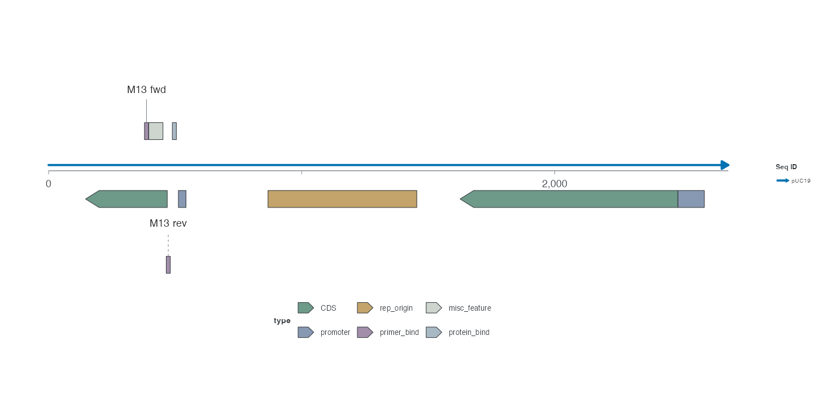</a><figcaption>Stacked overlapping annotations from the pUC19 reference · <span class="figure-hint">Click to enlarge</span></figcaption></figure>

`position_feature_stack()` resolves overlapping annotation lanes. The label layer
uses the same Position, so text anchors follow those lanes. Prefer unique
`feature_id` values for subset/reordered label inputs. The strict gene shortcut
requires known `+/-`; general features retain unknown/bidirectional semantics.

### Choose shapes by meaning {#annotations-shapes}
| Geometry | Typical use | Important distinction |
| --- | --- | --- |
| `arrow`, `compact_arrow` | Directional coding/feature interval | Known direction is evidence, not a display guess |
| `block`, `capped_line` | Region or unfilled interval | Shape choice does not infer biological function |
| `promoter_arrow`, `primer_arrow`, `primer_arc` | Declared promoter/primer-style annotation | Computational matching and drawing are separate |
| `marker`, `chevron`, `lollipop` | Custom interval/point-like emphasis | Keep real interval metadata; display shape is a mapping |

`geom_gene()` and `geom_feature_plasmid()` are useful presets, not aliases with
identical defaults. Use `position_strand()` for signed offsets and
`position_plasmid()` as a circular placement preset; the latter is not a fourth
coordinate mode.

### Highlight an interval without rewriting observations {#annotations-decoration}

```{r example-43, eval=FALSE}
regions <- data.frame(accver = links$qaccver[1], start = min(links$qstart[1], links$qend[1]),
  end = max(links$qstart[1], links$qend[1]), category = "alignment interval")
p_decorated <- ggchord(seq_data = seqs, ribbon_data = links) +
  geom_seq_region(aes(region_fill = category), data = regions, colour = NA) +
  geom_link_ribbon(fill = "#7199DF", alpha = .4) + geom_seq() + geom_seq_label(size = 4) +
  scale_region_fill_manual(values = c("alignment interval" = "#E3D0A5")) +
  scale_seq_colour_manual(values = seq_palette) + geom_seq_scale(length = 10000) +
  coord_collinear() + doc_axis() + doc_theme
p_decorated
```

<figure class="documentation-figure"><a class="figure-link" href="../man/figures/decorations.png" title="Click to enlarge">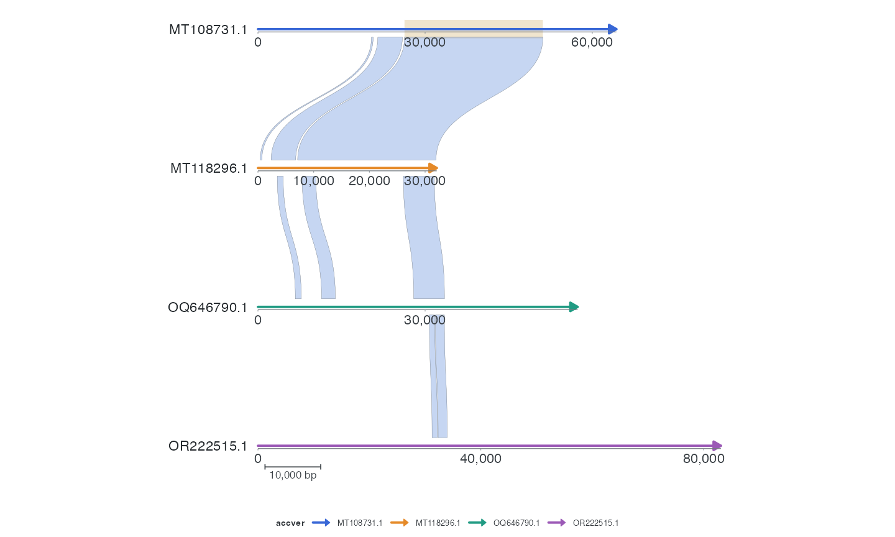</a><figcaption>Highlighting the query interval of an observed alignment · <span class="figure-hint">Click to enlarge</span></figcaption></figure>

A region overlay uses its own table and `region_fill` scale. `geom_seq_label()`
names sequences, `geom_seq_center_label()` supplies name/length in a single circle,
and `geom_seq_break()` marks cropped/segmented ends. `geom_seq_scale()` is an
independent bp reference bar for collinear plots; it differs from
`scale_seq_position_continuous()`, which controls genomic axes on sequences.
An ordinary ggplot2 annotation should use [position mapping](#views-mapping)
instead of treating bp as Cartesian x/y.

### Check your result {#annotations-check-result}
Check intervals and strands before shapes and labels. Unknown strands remain in general features; stacking changes display placement, not genomic coordinates.

<div class="next-step">Continue: <a href="#labels">Labels and local placement →</a></div>


## Labels and local placement {#labels}

<div class="task-intro"><p>Arrange text while retaining annotation geometry: choose export dimensions and a label subset before choosing automatic or fixed placement.</p></div>

### Prepare this page {#labels-prepare}
In a fresh R session, run the code below, then follow this page in order. Colours and layout are optional display choices; inputs select only the fields needed.

<details class="preparation"><summary>Preparation code — run once on this page</summary>

```{r example-44, eval=FALSE}
library(ggchord)
data(seq_data_example)
data(ribbon_data_example)
data(gene_data_example)
seqs <- seq_data_example[c("accver", "length")]
links <- ribbon_data_example[c("qaccver", "saccver", "qstart", "qend", "sstart", "send")]
# The fixture preserves biological strands separately from its old display strands.
genes <- transform(gene_data_example, strand = source_strand)[c("accver", "start", "end", "strand")]

# Optional appearance choices; none of these columns or scales is required input.
library(ggchord)
seq_palette <- setNames(c("#3867D6", "#E58A28", "#219B83", "#9B59B6"),
  c("MT108731.1", "MT118296.1", "OQ646790.1", "OR222515.1"))
gene_palette <- c("+" = "#3B6FD8", "-" = "#E1812C", "." = "#8291A6")

library(ggchord)
doc_theme <- theme_ggchord_publication(axis.text = element_text(size = 11),
  axis.text.check.overlap = TRUE) + theme(legend.position = "bottom")
doc_axis <- function(coordinates = "relative") scale_seq_position_continuous(
  coordinates = coordinates, n.breaks = 3, minor_breaks = NULL,
  labels = function(x) format(x, scientific = FALSE, big.mark = ",", trim = TRUE))
```

</details>

### Select a layout {#labels-layout}
Gene labels offer `"auto"`, `"radial"` and `"arc"` layouts. General feature
labels additionally support the internal-first `"feature"` default and external
`"callout"` layout. Choose the documented values for the layer you use; they are
not interchangeable presets.

After this page’s preparation code:


```{r example-45, eval=FALSE}
label_data <- transform(gene_data_example, strand = source_strand)
label_data <- label_data[label_data$anno != "hypothetical protein",
  c("accver", "start", "end", "strand", "anno")]
p_labels <- ggchord(seq_data = seqs, gene_data = genes) + geom_seq() + geom_gene() +
  geom_gene_label_repel(data = label_data, label_layout = "auto", size = 4, label_wrap = 22) +
  geom_seq_label(size = 4) + coord_collinear() + doc_axis() +
  scale_seq_colour_manual(values = seq_palette) + scale_gene_fill_manual(values = gene_palette) + doc_theme
p_labels
```

<figure class="documentation-figure"><a class="figure-link" href="../man/figures/labels.png" title="Click to enlarge">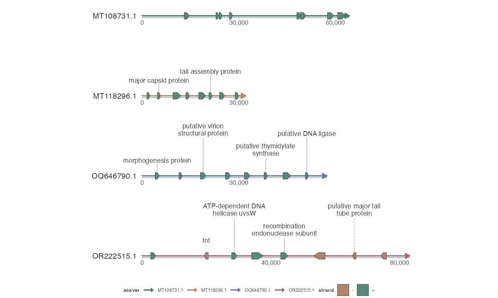</a><figcaption>Automatic placement of informative source gene annotations · <span class="figure-hint">Click to enlarge</span></figcaption></figure>

### Fixed and automatic placement {#labels-fixed}
Use `geom_gene_label()` or `geom_feature_label()` for manual `label_rotation`,
radial/circumferential offsets and orientation controls. Automatic layers reject
these manual controls: choose `label_layout` or remove the manual argument.
Use `size`, `colour` and `family` for supported fixed text styles.

`label_fit`, `label_wrap`, `label_max_lines` and `label_min_size` control fitting
where supported. Shrinking is explicit and bounded. Unresolved labels may move
or hide; the feature geometry remains. Inspect `label_fit_diagnostics` and
`label_diagnostics` at the final export size.

### Match anchors across layers {#labels-anchors}
In collinear mode, an omitted feature-label Position inherits an unambiguous
matching feature layer. Unique `feature_id` permits reordering or subsets, but
accession, interval and strand must agree. Multiple matching layers need an
explicit Position or unambiguous IDs. Preview after selecting the final device
size; resizing the Plots pane changes the available space.

### Compare the three gene layouts {#labels-comparison}

```{r example-46, eval=FALSE}
# Compare layouts with at most the first and last informative label per sequence.
comparison_labels <- do.call(rbind, lapply(split(label_data, label_data$accver),
  function(x) x[unique(c(1L, nrow(x))), , drop = FALSE]))
label_plots <- lapply(c("auto", "radial", "arc"), function(layout)
  ggchord(seq_data = seqs, gene_data = genes) + geom_seq() + geom_gene() +
    geom_gene_label_repel(data = comparison_labels, label_layout = layout, size = 4, label_wrap = 22) +
    geom_seq_label(size = 4) + scale_seq_colour_manual(values = seq_palette) +
    scale_gene_fill_manual(values = gene_palette) +
    coord_chord(xlim = c(-1.8, 1.8), ylim = c(-1.6, 1.6)) +
    theme_ggchord_publication(axis = element_blank()) + labs(title = layout))
names(label_plots) <- c("auto", "radial", "arc")
p_manual_labels <- ggchord(seq_data = seqs, gene_data = genes) + geom_seq() + geom_gene() +
  geom_gene_label(data = label_data, label_rotation = 30) + coord_collinear()
label_plots$auto
```

<figure class="documentation-figure"><a class="figure-link" href="../man/figures/labelauto.png" title="Click to enlarge">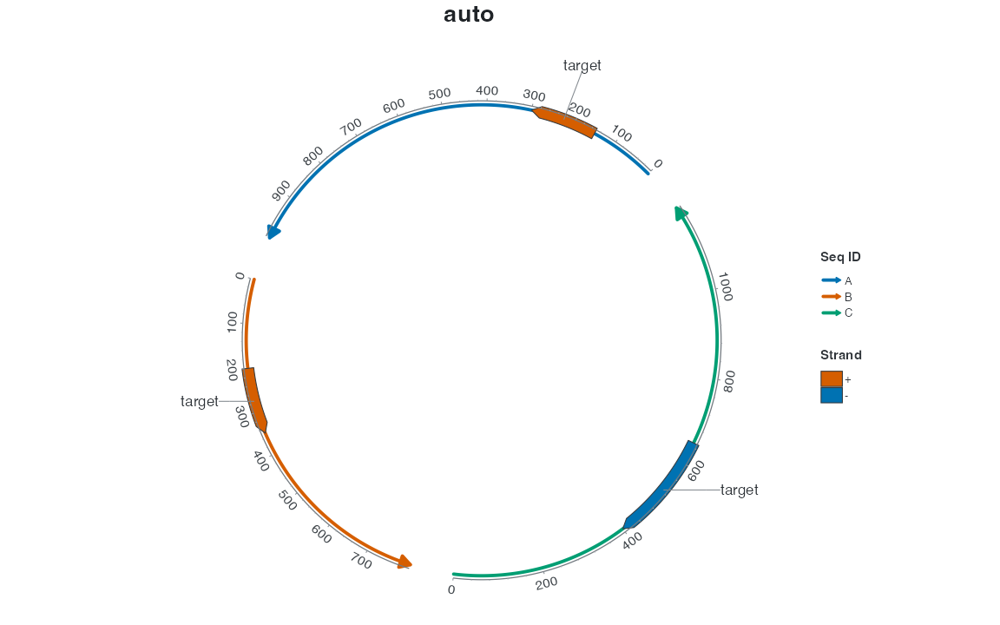</a><figcaption>Informative gene annotations with automatic side placement · <span class="figure-hint">Click to enlarge</span></figcaption></figure>
<figure class="documentation-figure"><a class="figure-link" href="../man/figures/labelradial.png" title="Click to enlarge">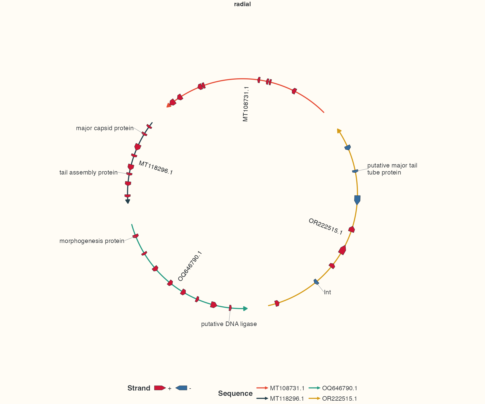</a><figcaption>The same gene annotations with radial placement · <span class="figure-hint">Click to enlarge</span></figcaption></figure>
<figure class="documentation-figure"><a class="figure-link" href="../man/figures/labelarc.png" title="Click to enlarge">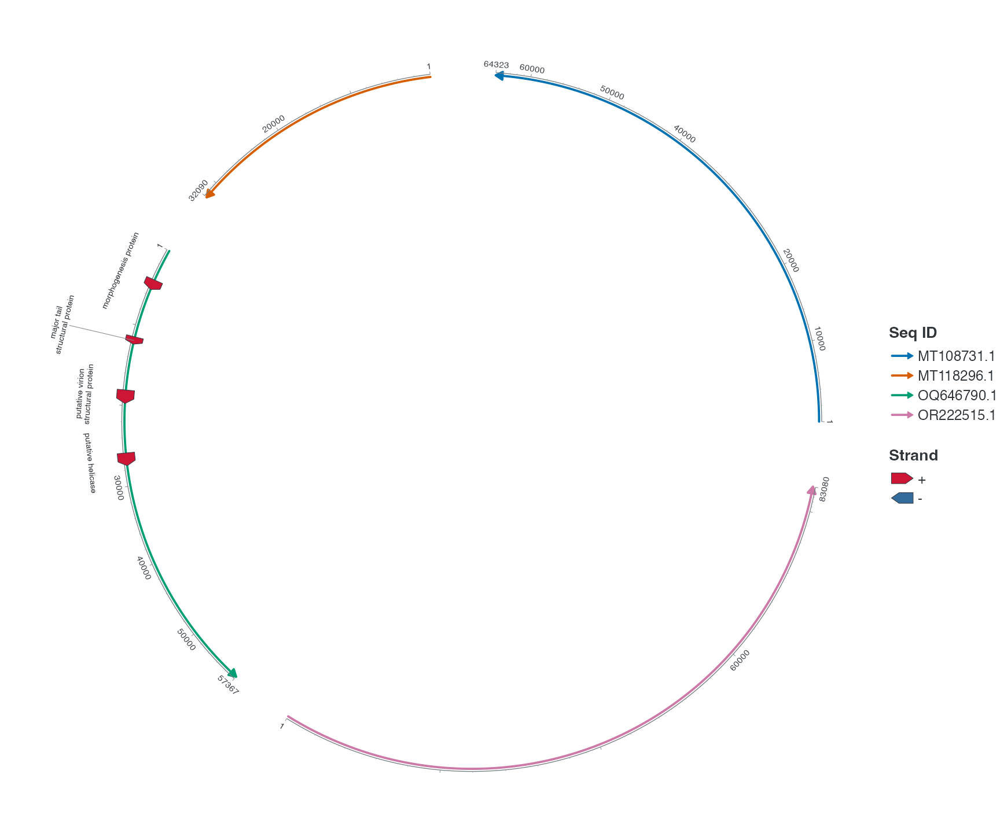</a><figcaption>The same gene annotations with arc-oriented text · <span class="figure-hint">Click to enlarge</span></figcaption></figure>

Keep at most the first and last informative labels per sequence, retaining all gene arrows, to compare text orientation.
Print `label_plots$auto`, `$radial` or `$arc` to inspect a candidate. The inputs and
requested font size are identical; only the layout choice changes. Auto uses
shared columns where applicable, radial follows local contours and arc follows
the sequence tangent. `p_manual_labels` shows the separate fixed-label route;
its explicit rotation does not belong in an automatic repel layer.
General feature labels have additional internal-first/callout choices; see the
[complete circular workflow](#plasmids) for dense mixed annotation and
[stacking](#annotations-stack) for inherited or explicit Position anchors.

### Check your result {#labels-check-result}
The three layout comparisons share the same input. Assess text direction, leaders and hiding reasons together; missing text does not mean a feature was lost.

<div class="next-step">Continue: <a href="#output">Export, preview and diagnostics →</a></div>


## Quantitative tracks {#tracks}

<div class="task-intro"><p>Compute GC fractions from real DNA, then add bars, a moving mean and an annotation band. Each track has an explicit unit, window and baseline.</p></div>

### Prepare this page {#tracks-prepare}
In a fresh R session, run the code below, then follow this page in order. Colours and layout are optional display choices; inputs select only the fields needed.

<details class="preparation"><summary>Preparation code — run once on this page</summary>

```{r example-47, eval=FALSE}
library(ggchord)
feature_palette <- c(CDS = "#3973CB", promoter = "#8B5EC4", rep_origin = "#E8A42D",
  primer_bind = "#168F86", misc_feature = "#A0ADBD", protein_bind = "#CC6485")

library(ggchord)
doc_theme <- theme_ggchord_publication(axis.text = element_text(size = 11),
  axis.text.check.overlap = TRUE) + theme(legend.position = "bottom")
doc_axis <- function(coordinates = "relative") scale_seq_position_continuous(
  coordinates = coordinates, n.breaks = 3, minor_breaks = NULL,
  labels = function(x) format(x, scientific = FALSE, big.mark = ",", trim = TRUE))

data(plasmid_example_pUC19)
plasmid_seq <- plasmid_example_pUC19[c("accver", "length")]
feature_source <- find_common_features(plasmid_example_pUC19)
features <- feature_source[c("accver", "start", "end", "strand", "type", "anno")]
```

</details>

### Compute a track from actual DNA {#tracks-domain}
After this page’s preparation code, compute GC fraction in 100 bp
windows of bundled pUC19. The final shorter window uses its actual base count.


```{r example-48, eval=FALSE}
data(plasmid_example_pUC19)
track_seq <- plasmid_example_pUC19[c("accver", "length")]
starts <- seq.int(1L, track_seq$length, by = 100L)
bins <- data.frame(accver = track_seq$accver, start = starts,
  end = pmin(starts + 99L, track_seq$length))
bins$gc <- vapply(seq_len(nrow(bins)), function(i) {
  bases <- strsplit(substr(plasmid_example_pUC19$sequence, bins$start[i], bins$end[i]), "")[[1]]
  mean(bases %in% c("G", "C"))
}, numeric(1))
head(bins)
```


Each row of `bins` is an actual sequence window. Check its endpoints and `gc`, then map values to track height and colour.

#### Draw GC fractions {#tracks-draw-gc}


```{r example-49, eval=FALSE}
p_tracks <- ggchord(seq_data = track_seq) + geom_seq() + geom_seq_center_label() +
  geom_track_bar(aes(track_value = gc, track_fill = gc), data = bins,
    position = position_track("gc", width = unit(10, "mm"))) +
  scale_track_value_continuous("gc", limits = c(0, 1), unit = "GC fraction") +
  scale_track_fill_gradientn("gc", colours = c("#E9F1FE", "#65A1DC", "#224B9B")) +
  coord_circular() + doc_theme
p_tracks
```

<figure class="documentation-figure"><a class="figure-link" href="../man/figures/tracks.png" title="Click to enlarge">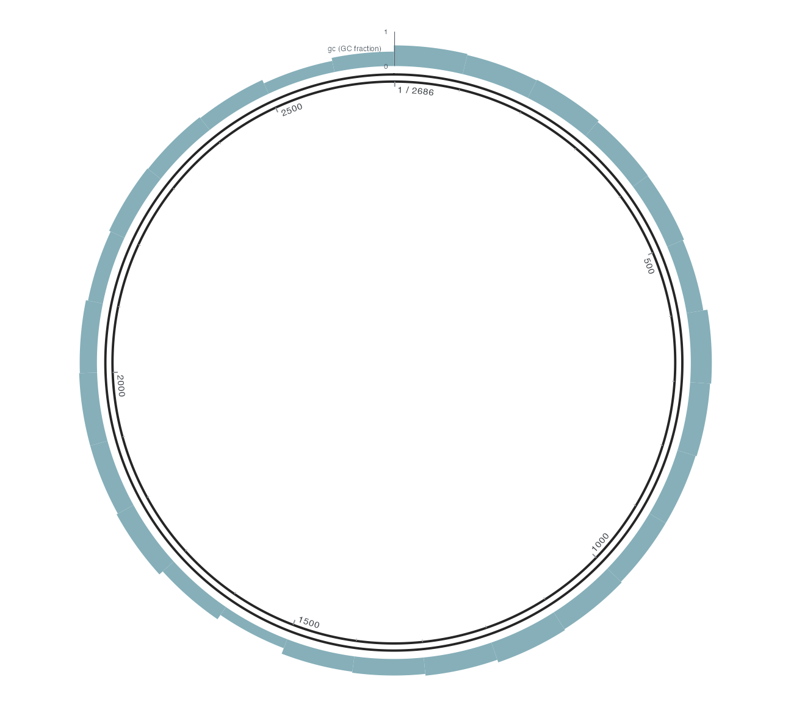</a><figcaption>GC fractions computed from the bundled pUC19 DNA · <span class="figure-hint">Click to enlarge</span></figcaption></figure>

The domain is 0–1, in fractions. Replace it with the actual unit/range of other
measurements. `position_track()` controls placement/physical width;
`scale_track_value_continuous()` controls numerical mapping.

### Share an ID deliberately {#tracks-sharing}
Same-ID layers share a numerical domain, including bar baselines, and must agree
on width/placement. Colour scales are scoped independently by track ID. Tiles
show interval categories, lines connect observations, bars encode interval values
relative to a baseline. Sharing a domain does not require sharing a spatial band.

### Inspect retention and limits {#tracks-diagnostics}
The export's `track_registry` and `track_diagnostics` record domains, physical
sizes, native offsets and clipping. Omitted/clipped rows do not mean zero values.
Focus tracks with `focus_ggchord_track()` using the same windows.

### Combine bars, a moving mean and annotation bands {#tracks-multiple}
Run the [circular example](#modes-circular) to obtain real `features` first.


```{r example-50, eval=FALSE}
line_bins <- transform(bins, pos = floor((start + end) / 2),
  gc_mean = as.numeric(stats::filter(gc, rep(1 / 3, 3), sides = 2)))
line_bins <- line_bins[is.finite(line_bins$gc_mean), c("accver", "pos", "gc_mean")]
categories <- features[c("accver", "start", "end", "type")]
p_multitrack <- ggchord(seq_data = track_seq) + geom_seq() + geom_seq_center_label() +
  geom_track_bar(aes(track_value = gc, track_fill = gc), data = bins,
    position = position_track("gc", width = unit(10, "mm"))) +
  geom_track_line(aes(track_value = gc_mean), data = line_bins,
    position = position_track("gc", width = unit(10, "mm")), colour = "#454D65") +
  scale_track_value_continuous("gc", limits = c(0, 1), unit = "GC fraction") +
  scale_track_fill_gradientn("gc", colours = c("#E9F1FE", "#65A1DC", "#224B9B")) +
  geom_track_tile(aes(track_fill = type), data = categories,
    position = position_track("features", order = 2, width = unit(2, "mm"))) +
  scale_track_fill_manual("features", values = feature_palette) + coord_circular() + doc_theme +
  theme(legend.box = "vertical", legend.box.just = "left")
focused_bins <- focus_ggchord_track(bins, track_seq,
  loci = data.frame(accver = track_seq$accver, start = 500, end = 1500), type = "interval")
p_multitrack
```

<figure class="documentation-figure"><a class="figure-link" href="../man/figures/multitrack.png" title="Click to enlarge">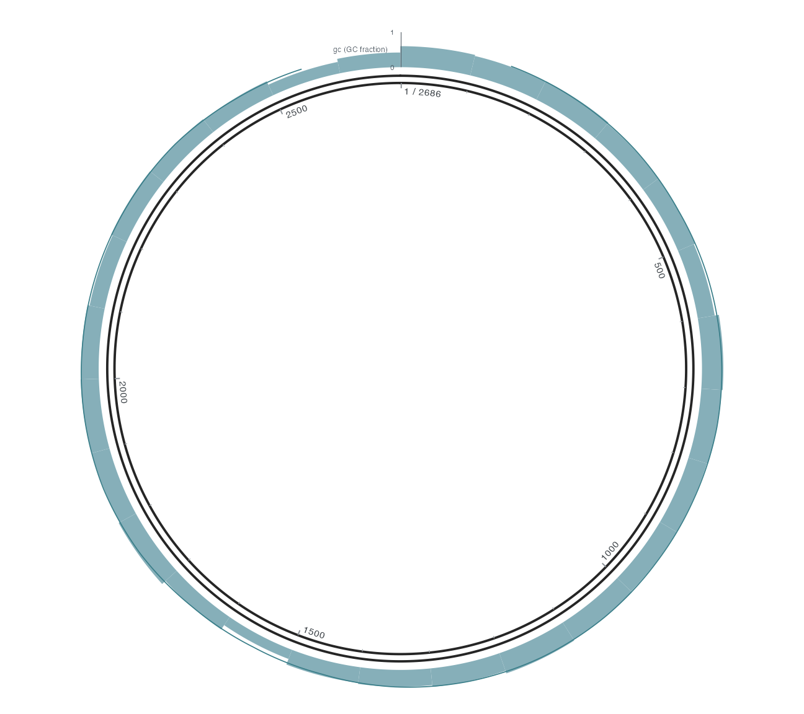</a><figcaption>pUC19 GC fractions, a three-bin moving mean and annotation bands · <span class="figure-hint">Click to enlarge</span></figcaption></figure>

Bars and line use the same actual GC measurements; the line is a three-window
moving mean. Incomplete end windows are omitted, not filled with invented values.
Line positions use integer bin midpoints. Annotation bands have an independent ID
and palette. Bands are explicitly ordered outside; overly wide inner bands at
small radii can fold and are rejected.

### Check your result {#tracks-check-result}
GC in bins lies between 0 and 1; each row is an actual window and the last may be shorter than 100 bp. Continuous colour expresses values; the category band expresses feature types, not GC magnitude.

<div class="next-step">Continue: <a href="#output">Export, preview and diagnostics →</a></div>

### Save this result {#tracks-save-result}
Save the plot just created to the working directory; use matching dimensions for preview.

```{r example-51, eval=FALSE}
ggsave("pUC19-tracks.png", p_multitrack, width = 9, height = 8, units = "in", dpi = 144)
```


## Primers, restriction and feature search {#recognition}

<div class="task-intro"><p>Search known DNA for primers, restriction sites and common features, then choose a display. Computational matches and experimental validation are different.</p></div>

### Prepare this page {#recognition-prepare}
In a fresh R session, run the code below, then follow this page in order. Colours and layout are optional display choices; inputs select only the fields needed.

```{r example-52, eval=FALSE}
library(ggchord)
```

### Search and display are separate {#recognition-search}
Use the bundled pUC19 DNA for exact catalogue-primer and selected restriction searches:


```{r example-53, eval=FALSE}
data(plasmid_example_pUC19)
target <- setNames(plasmid_example_pUC19$sequence, plasmid_example_pUC19$accver)
primers <- find_primer_bindings(target, set = "universal")
sites <- find_restriction_sites(target, enzymes = c("EcoRI", "BamHI", "HindIII"), methylation = "none")
p_sites <- ggchord(seq_data = plasmid_example_pUC19[c("accver", "length")]) + geom_seq() +
  geom_primer(data = primers, colour = "#168F86") +
  geom_restriction_site(data = sites, colour = "#29364B") + coord_circular()
p_sites
```


Search supports circular-origin binding; set `circular = FALSE` for a linear sequence.
The actual pUC19 hits shown here should be inspected in the returned table. Search hits are computational matches, not experimental validation.
Primer `"three_prime"` mode finds an exact suffix, with no mismatch model;
its Wallace melting-temperature estimate is a composition heuristic.

### Restriction interpretation {#recognition-restriction}
`find_restriction_sites()` returns unfiltered matches and cleavage coordinates;
`filter_restriction_sites()` selects a display set. Enzyme site counts refer to
the full supplied sequence and remain stable after filtering. `methylation =
"auto"` uses audited context only for exactly recognized bundled references;
it does not claim unknown samples are unblocked. This example explicitly uses `"none"`; this is a search assumption, not a measurement
of methylation in a physical sample. `geom_restriction_site(leader = "radial")` is the default route.

### General feature recognition {#recognition-features}
`find_common_features()` supports curated exact-reference annotations, DNA and
record-specific matching modes. Protein searches use standard-code six-frame
translation; they do not implement splicing, alternative initiation or
origin-crossing protein matches. Source genetic-code metadata does not select
another translation table. For nonstandard codes use DNA matching or external
code-aware analysis. Confidence is a heuristic label, not a probability.
Use [explicit CDS projection](#projection) for known protein/genome maps.

### Follow an annotated reference workflow {#recognition-reference}
This short workflow uses the same source-backed plasmid as the complete map. The [complete pUC19
workflow](#plasmids) demonstrates catalogue annotations, exact reference
matching, site display filtering, primer labels and feature stacking together.
Changing only a sequence name does not make it a recognized reference; sequence
content determines source-backed recognition. Read the result methods and
methylation provenance instead of assigning reference claims to an unknown sample.

### Check your result {#recognition-check-result}
Inspect match positions, methods and provenance. Restriction filtering is a display choice; methylation search conditions are not a measurement of an unknown sample.

<div class="next-step">Continue: <a href="#plasmids">A complete circular annotation workflow →</a></div>


## Compare CDS neighbourhoods {#homology}

<div class="task-intro"><p>Compare AmpR neighbourhoods in two plasmids. Check real coding DNA, establish correspondence, then focus to each CDS plus 200 bp on either side.</p></div>

### Prepare this page {#homology-prepare}
Only bundled data is needed; no download or new alignment. Load the package and optional display settings first.

<details class="preparation"><summary>Preparation code — run once on this page</summary>

```{r example-54, eval=FALSE}
library(ggchord)
doc_theme <- theme_ggchord_publication(axis.text = element_text(size = 11),
  axis.text.check.overlap = TRUE) + theme(legend.position = "bottom")
doc_axis <- function(coordinates = "relative") scale_seq_position_continuous(
  coordinates = coordinates, n.breaks = 3, minor_breaks = NULL,
  labels = function(x) format(x, scientific = FALSE, big.mark = ",", trim = TRUE))
```

</details>

### 1. Extract actual CDS and coding DNA {#homology-membership}
Select AmpR annotations from bundled pUC19 and pETDuet-1, retaining IDs, coordinates, strand and text. Reverse-complement negative-strand DNA so comparisons use the same biological orientation rather than annotation names alone.


```{r example-55, eval=FALSE}
data(plasmid_example_pUC19)
data(plasmid_example_pETDuet_1)
homolog_source <- rbind(plasmid_example_pUC19, plasmid_example_pETDuet_1)
homolog_seq <- homolog_source[c("accver", "length")]
cluster_features <- do.call(rbind, lapply(seq_len(nrow(homolog_source)), function(i) {
  f <- find_common_features(homolog_source[i, ])
  f[f$type == "CDS" & f$anno == "AmpR", c("accver", "start", "end", "strand", "anno")]
}))
cluster_features$feature_id <- with(cluster_features, paste(accver, start, end, sep = ":"))
# Membership is computed from exact strand-corrected CDS DNA equality, not gene names.
cds_dna <- vapply(seq_len(nrow(cluster_features)), function(i) {
  f <- cluster_features[i, ]; dna <- homolog_source$sequence[match(f$accver, homolog_source$accver)]
  dna <- substr(dna, f$start, f$end)
  if (f$strand == "-") dna <- chartr("ACGT", "TGCA", paste(rev(strsplit(dna, "")[[1]]), collapse = ""))
  dna
}, "")
```


`cluster_features` should contain two actual CDS; `cds_dna` retains their oriented coding sequences. This strict example checks exact DNA equality. General homology analysis can use external alignments and clustering; homologs need not be identical.

### 2. Declare members and sequence pairs {#homology-links}
Build membership from exact coding-DNA equality. Different DNA does not enter one group merely because both annotations say AmpR.


```{r example-56, eval=FALSE}
membership <- data.frame(feature_id = cluster_features$feature_id,
  cluster_id = paste0("exact_CDS_", match(cds_dna, unique(cds_dna))))
homologs <- link_ggchord_clusters(cluster_features, membership,
  pairs = data.frame(qaccver = homolog_seq$accver[1], saccver = homolog_seq$accver[2]))
loci <- find_ggchord_loci(homolog_seq, cluster_features,
  targets = cluster_features$feature_id[cluster_features$anno == "AmpR"][1], upstream = 100, downstream = 100)
```


Inspect `membership` and `homologs$report$comparisons` and `$members`. The linking utility consumes existing groups; it does not compute a new alignment. Unknown members and ambiguous paralogs are reported; only explicit `paralogs = "all"` requests all combinations within the documented bounds.

### 3. Focus on comparable neighbourhoods {#homology-focus}
Full plasmid lengths would shrink the individual CDS. Construct windows from each real CDS source interval and add 200 bp on either side, retaining the original sequence and annotation tables.


```{r example-57, eval=FALSE}
# Compare equivalent local windows instead of shrinking one gene on full plasmids.
homolog_windows <- cluster_features[c("accver", "start", "end")]
local_homologs <- focus_ggchord_data(homolog_seq, homologs$data, cluster_features,
  loci = homolog_windows, expand = 200)
p_homologs <- ggchord(seq_data = local_homologs$seq_data,
  ribbon_data = local_homologs$ribbon_data, gene_data = local_homologs$gene_data) +
  geom_link_ribbon(fill = "#8D7AC6", alpha = .65) + geom_seq(colour = "#253954", show.legend = FALSE) +
  geom_feature(data = local_homologs$gene_data, feature_fill = "#D79A24",
    position = position_strand(.10), width = .07) +
  geom_feature_label_repel(data = local_homologs$gene_data, size = 4, label_fit = "shrink") +
  geom_seq_label(size = 4) + geom_seq_break() +
  coord_collinear() + doc_axis("source") + doc_theme
p_homologs
```

<figure class="documentation-figure"><a class="figure-link" href="../man/figures/homologs.png" title="Click to enlarge">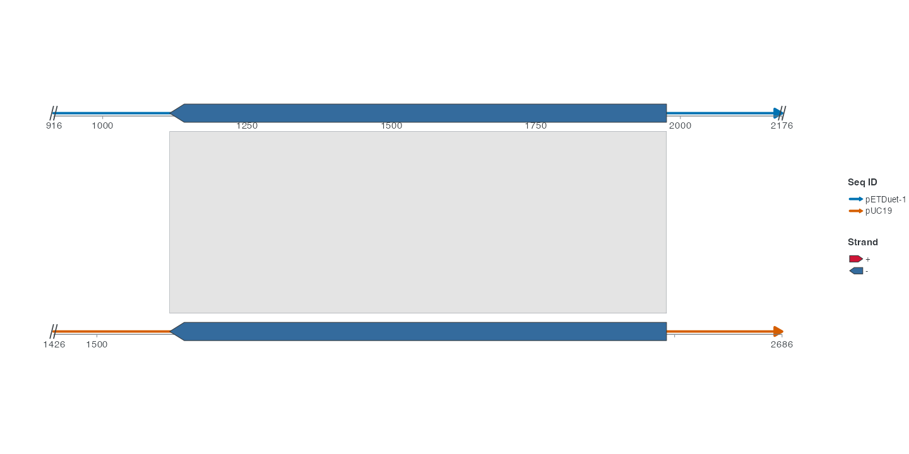</a><figcaption>AmpR neighbourhoods: identical CDS, 200 bp flanks and source coordinates · <span class="figure-hint">Click to enlarge</span></figcaption></figure>

Gold arrows identify the checked identical coding sequences; the purple band connects their CDS ranges and internal text names AmpR. Axes use each original sequence's positions, so one horizontal location can have different source labels. Break markers indicate that only local windows remain.

`local_homologs$report` records retention and clipping. Genes outside the windows are omitted, not absent. The band represents declared interval correspondence, not a base alignment; envelopes of segmented annotations likewise do not establish exon-level correspondence.

### 4. Project supported protein intervals to both CDS {#homology-projection}

```{r example-58, eval=FALSE}
# Exact CDS DNA equality supplies evidence for these selected ungapped residues.
matching <- homologs$data[1, ]
paired_coding <- transform(cluster_features, phase = 0)
paired_cds <- build_ggchord_cds(paired_coding)
protein_link <- data.frame(qfeature_id = matching$qfeature_id, sfeature_id = matching$sfeature_id,
  qstart = 1, qend = 20, sstart = 1, send = 20)
projected_links <- project_ggchord_links(protein_link, paired_cds, ungapped = TRUE)
projected_links
```

| Metric | Observed output |
| --- | --- |
| Projected genomic feature rows | 1 |
| Projected nucleotide link rows | 1 |

The first 20 residues of identical CDS provide sequence evidence for `ungapped = TRUE`. Equal spans alone do not justify that claim for ordinary BLASTp HSPs. The utility retains protein statistics rather than presenting them as nucleotide identity.

### Check your result {#homology-check-result}
Both internal labels should read AmpR and arrows retain the actual negative strand. Coding DNA supports correspondence; source axes and focus reports explain the local display. Save at [explicit 10 × 5 in dimensions](#output).

Next: [read real BLASTp query intervals](#alignments-protein), understand [CDS projection and segments](#projection), or create [independent local windows](#views).

### Save this result {#homology-save-result}
Save the plot just created to the working directory; use matching dimensions for preview.

```{r example-59, eval=FALSE}
ggsave("ampR-neighbourhood.png", p_homologs, width = 10, height = 5, units = "in", dpi = 144)
```


## Project protein intervals to genomic coordinates {#projection}

<div class="task-intro"><p>Project known protein intervals to genomic positions through real CDS, retaining phase, strand and segmentation explicitly.</p></div>

### Prepare this page {#projection-prepare}
In a fresh R session, run the code below, then follow this page in order. Colours and layout are optional display choices; inputs select only the fields needed.

<details class="preparation"><summary>Preparation code — run once on this page</summary>

```{r example-60, eval=FALSE}
library(ggchord)
doc_theme <- theme_ggchord_publication(axis.text = element_text(size = 11),
  axis.text.check.overlap = TRUE) + theme(legend.position = "bottom")
doc_axis <- function(coordinates = "relative") scale_seq_position_continuous(
  coordinates = coordinates, n.breaks = 3, minor_breaks = NULL,
  labels = function(x) format(x, scientific = FALSE, big.mark = ",", trim = TRUE))

data(plasmid_example_pUC19)
data(plasmid_example_pETDuet_1)
homolog_source <- rbind(plasmid_example_pUC19, plasmid_example_pETDuet_1)
homolog_seq <- homolog_source[c("accver", "length")]
cluster_features <- do.call(rbind, lapply(seq_len(nrow(homolog_source)), function(i) {
  f <- find_common_features(homolog_source[i, ])
  f[f$type == "CDS" & f$anno == "AmpR", c("accver", "start", "end", "strand", "anno")]
}))
cluster_features$feature_id <- with(cluster_features, paste(accver, start, end, sep = ":"))
# Membership is computed from exact strand-corrected CDS DNA equality, not gene names.
cds_dna <- vapply(seq_len(nrow(cluster_features)), function(i) {
  f <- cluster_features[i, ]; dna <- homolog_source$sequence[match(f$accver, homolog_source$accver)]
  dna <- substr(dna, f$start, f$end)
  if (f$strand == "-") dna <- chartr("ACGT", "TGCA", paste(rev(strsplit(dna, "")[[1]]), collapse = ""))
  dna
}, "")

membership <- data.frame(feature_id = cluster_features$feature_id,
  cluster_id = paste0("exact_CDS_", match(cds_dna, unique(cds_dna))))
homologs <- link_ggchord_clusters(cluster_features, membership,
  pairs = data.frame(qaccver = homolog_seq$accver[1], saccver = homolog_seq$accver[2]))
loci <- find_ggchord_loci(homolog_seq, cluster_features,
  targets = cluster_features$feature_id[cluster_features$anno == "AmpR"][1], upstream = 100, downstream = 100)

# Compare equivalent local windows instead of shrinking one gene on full plasmids.
homolog_windows <- cluster_features[c("accver", "start", "end")]
local_homologs <- focus_ggchord_data(homolog_seq, homologs$data, cluster_features,
  loci = homolog_windows, expand = 200)
p_homologs <- ggchord(seq_data = local_homologs$seq_data,
  ribbon_data = local_homologs$ribbon_data, gene_data = local_homologs$gene_data) +
  geom_link_ribbon(fill = "#8D7AC6", alpha = .65) + geom_seq(colour = "#253954", show.legend = FALSE) +
  geom_feature(data = local_homologs$gene_data, feature_fill = "#D79A24",
    position = position_strand(.10), width = .07) +
  geom_feature_label_repel(data = local_homologs$gene_data, size = 4, label_fit = "shrink") +
  geom_seq_label(size = 4) + geom_seq_break() +
  coord_collinear() + doc_axis("source") + doc_theme
p_homologs
```

</details>

### Start with source-backed CDS {#projection-cds}
Run the [identical-CDS comparison](#homology-membership) first. It uses real
bundled plasmid annotations and DNA. Complete CDS use explicit phase 0 and
translation table 11.


```{r example-61, eval=FALSE}
# Run the exact-CDS comparison first; these are complete source-backed CDS.
coding <- transform(cluster_features, phase = 0)
cds <- build_ggchord_cds(coding, genetic_code = 11)
# This selects residues for a display example; it does not claim a detected domain.
domains <- data.frame(feature_id = "selected_residues", parent_id = coding$feature_id[1], start = 2, end = 20)
genomic <- project_ggchord_features(domains, cds)
genomic
```


This example selects residues 2–20 for display; it does not claim a detected
protein domain. Projection returns genomic intervals with strand/segment context.
Actual domains require exact parent CDS IDs and amino-acid ranges; annotation
names or maximum feature endpoints cannot supply missing evidence.

### Segments, phase and partial regions {#projection-boundaries}
`build_ggchord_cds()` constructs a segment map; `project_ggchord_features()` then
splits amino-acid intervals through it. Crossing a boundary can return several
rows; multiplying coordinates by three is insufficient. Inspect policies/reports
for partial CDS, phase and truncation. DNA matching, interval projection and
actual translation/alignment are distinct operations.

### BLASTp query spans and two-ended links {#projection-links}

```{r example-62, eval=FALSE}
# Exact CDS DNA equality supplies evidence for these selected ungapped residues.
matching <- homologs$data[1, ]
paired_coding <- transform(cluster_features, phase = 0)
paired_cds <- build_ggchord_cds(paired_coding)
protein_link <- data.frame(qfeature_id = matching$qfeature_id, sfeature_id = matching$sfeature_id,
  qstart = 1, qend = 20, sstart = 1, send = 20)
projected_links <- project_ggchord_links(protein_link, paired_cds, ungapped = TRUE)
projected_links
```


This ungapped case relies on [verified identical coding DNA](#homology).
Real BLASTp HSPs may contain gaps: query spans can still be projected, but paired
links need the subject CDS and justified ungapped correspondence. See
[real BLASTp import/projection](#alignments-protein). This version does not
reinterpret aa as bp or add native protein-coordinate plotting.

### Check your result {#projection-check-result}
Check parent CDS IDs, projection reports and returned segments. The selected residue range is a display example, not a detected domain.

<div class="next-step">Continue: <a href="#alignments">Import nucleotide and protein alignments →</a></div>


## Focus, segments and homology {#views}

<div class="task-intro"><p>Select local windows or segments while keeping source positions distinct from display transformations.</p></div>

### Prepare this page {#views-prepare}
In a fresh R session, run the code below, then follow this page in order. Colours and layout are optional display choices; inputs select only the fields needed.

<details class="preparation"><summary>Preparation code — run once on this page</summary>

```{r example-63, eval=FALSE}
library(ggchord)
data(seq_data_example)
data(ribbon_data_example)
data(gene_data_example)
seqs <- seq_data_example[c("accver", "length")]
links <- ribbon_data_example[c("qaccver", "saccver", "qstart", "qend", "sstart", "send")]
# The fixture preserves biological strands separately from its old display strands.
genes <- transform(gene_data_example, strand = source_strand)[c("accver", "start", "end", "strand")]

# Optional appearance choices; none of these columns or scales is required input.
library(ggchord)
seq_palette <- setNames(c("#3867D6", "#E58A28", "#219B83", "#9B59B6"),
  c("MT108731.1", "MT118296.1", "OQ646790.1", "OR222515.1"))
gene_palette <- c("+" = "#3B6FD8", "-" = "#E1812C", "." = "#8291A6")

library(ggchord)
doc_theme <- theme_ggchord_publication(axis.text = element_text(size = 11),
  axis.text.check.overlap = TRUE) + theme(legend.position = "bottom")
doc_axis <- function(coordinates = "relative") scale_seq_position_continuous(
  coordinates = coordinates, n.breaks = 3, minor_breaks = NULL,
  labels = function(x) format(x, scientific = FALSE, big.mark = ",", trim = TRUE))
```

</details>

### Focus without losing origins {#views-focus}
After this page’s preparation code:


```{r example-64, eval=FALSE}
focus_loci <- data.frame(accver = seqs$accver,
  start = floor(seqs$length * .25), end = floor(seqs$length * .75))
focused <- focus_ggchord_data(seqs, links, genes, loci = focus_loci)
p_focus <- ggchord(seq_data = focused$seq_data, ribbon_data = focused$ribbon_data,
  gene_data = focused$gene_data) + geom_seq() +
  geom_link_ribbon(fill = "#7199DF", alpha = .5) + geom_gene() + geom_seq_break() +
  geom_seq_label(size = 4) + scale_seq_colour_manual(values = seq_palette) +
  scale_gene_fill_manual(values = gene_palette) +
  doc_axis("source") + coord_collinear() + doc_theme
p_focus
```

<figure class="documentation-figure"><a class="figure-link" href="../man/figures/focus.png" title="Click to enlarge">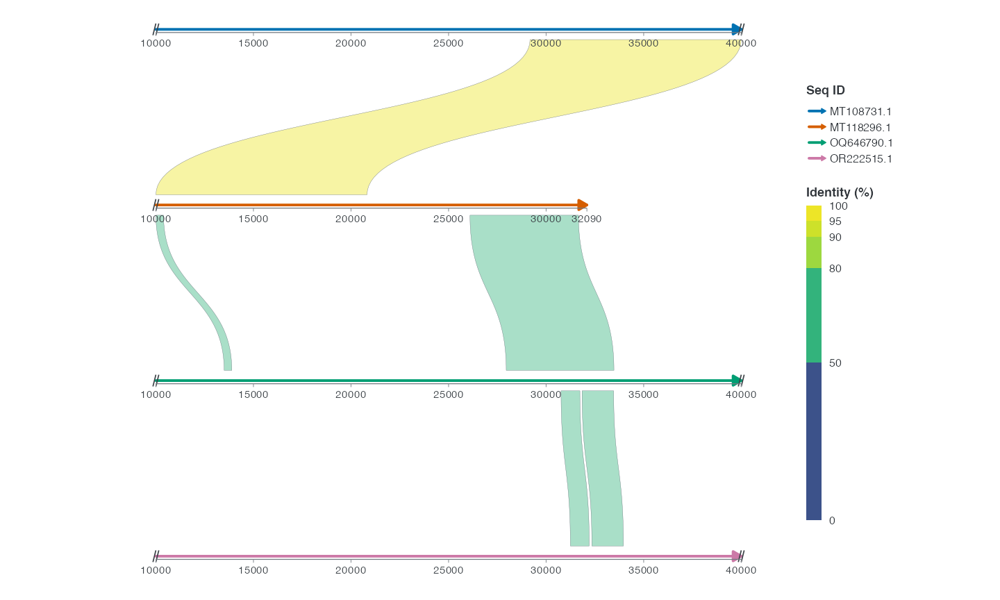</a><figcaption>Focused sequence windows with source-coordinate axes · <span class="figure-hint">Click to enlarge</span></figcaption></figure>

Focus relocates retained positions to local one-based coordinates and retains
source origins, truncation flags and a report. `boundary = "trim"` can clip
links by a linear display projection; it does not realign sequences. A scaled
alignment length is flagged as estimated. `coordinates = "source"` restores
source axis labels, including after repeated focusing.

### Independent windows and local reversal {#views-segments}

```{r example-65, eval=FALSE}
windows <- data.frame(accver = rep(seqs$accver[1], 2),
  start = c(1, floor(seqs$length[1] * .65)), end = c(floor(seqs$length[1] * .4), seqs$length[1]),
  locus_id = c("left_window", "right_window"), row_id = seqs$accver[1], orientation = c(1, -1))
segmented <- segment_ggchord_data(seqs[1, ], windows = windows)
p_segments <- ggchord(seq_data = segmented$seq_data) + geom_seq() +
  coord_collinear(segments = segmented$segments, segment_gap = 2000)
p_segments
```


Each window has a reversible source mapping; omitted gaps have no mapping.
`map_ggchord_position()` maps explicit source positions into a plot for ordinary
ggplot2 annotations. Supply the window ID when windows share a source sequence.
Do not interpret display orientation as a change to the original strand.

### Explicit biological relationships {#views-homology}
`find_ggchord_loci()` selects declared feature/name queries. `link_ggchord_clusters()`
requires an explicit membership table and sequence pairs; equal gene names do
not establish homology. `filter_ggchord_ribbons()`, `deduplicate_ggchord_ribbons()`
and `merge_ggchord_ribbons()` prepare existing alignments, preserving source
membership and estimated-length flags. Bundle and density statistics summarize
provided links rather than creating new sequence alignments.

### Map an annotation back to source coordinates {#views-mapping}

```{r example-66, eval=FALSE}
source_position <- focus_loci$start[1] + 100
source_mark <- map_ggchord_position(p_focus, seqs$accver[1], source_position, source = TRUE)
p_marked <- p_focus + ggplot2::geom_point(data = source_mark, aes(x, y),
  inherit.aes = FALSE, colour = "#9B59B6", size = 3)
p_marked
```


Run the [focus example](#views-focus) first. The helper returns Cartesian x/y
for a source position 100 bp inside the first selected window. It does not make all ordinary ggplot2 coordinates
become genomic bp. In segmented views choose the window ID, and check positions
in omitted gaps rather than extrapolating across them. Use [explicit homologs](#homology)
when the locus selection comes from declared feature/cluster evidence.

### Check your result {#views-check-result}
Inspect cropping reports, break markers and source coordinates. Omitted gaps have no mapping; a display flip alone is not evidence of inversion.

<div class="next-step">Continue: <a href="#homology">Explicit homologs and coding-coordinate links →</a></div>


## Mappings, scales, guides and themes {#styling}

<div class="task-intro"><p>Give colours a clear meaning: identify categories or continuous quantities, then choose mappings, scales and guides. Website accents do not dictate data colours.</p></div>

### Prepare this page {#styling-prepare}
In a fresh R session, run the code below, then follow this page in order. Colours and layout are optional display choices; inputs select only the fields needed.

<details class="preparation"><summary>Preparation code — run once on this page</summary>

```{r example-67, eval=FALSE}
library(ggchord)
data(seq_data_example)
data(ribbon_data_example)
data(gene_data_example)
seqs <- seq_data_example[c("accver", "length")]
links <- ribbon_data_example[c("qaccver", "saccver", "qstart", "qend", "sstart", "send")]
# The fixture preserves biological strands separately from its old display strands.
genes <- transform(gene_data_example, strand = source_strand)[c("accver", "start", "end", "strand")]

# Optional appearance choices; none of these columns or scales is required input.
library(ggchord)
seq_palette <- setNames(c("#3867D6", "#E58A28", "#219B83", "#9B59B6"),
  c("MT108731.1", "MT118296.1", "OQ646790.1", "OR222515.1"))
gene_palette <- c("+" = "#3B6FD8", "-" = "#E1812C", "." = "#8291A6")

library(ggchord)
doc_theme <- theme_ggchord_publication(axis.text = element_text(size = 11),
  axis.text.check.overlap = TRUE) + theme(legend.position = "bottom")
doc_axis <- function(coordinates = "relative") scale_seq_position_continuous(
  coordinates = coordinates, n.breaks = 3, minor_breaks = NULL,
  labels = function(x) format(x, scientific = FALSE, big.mark = ",", trim = TRUE))
```

</details>

### Build styles from data roles {#styling-roles}
Run this page’s preparation code below. The example declares categories
explicitly: ribbon fill maps query ID; sequence colour maps sequence ID; gene fill
maps strand. Manual scale names match those values exactly.


```{r example-68, eval=FALSE}
p_styled <- ggchord(seq_data = seqs, ribbon_data = links, gene_data = genes) + geom_seq() +
  geom_link_ribbon(aes(ribbon_fill = qaccver), alpha = .5) + geom_gene() +
  geom_seq_label(size = 4) + coord_collinear() + doc_axis() +
  scale_seq_colour_manual(values = seq_palette) + scale_gene_fill_manual(values = gene_palette) +
  scale_ribbon_fill_manual(values = seq_palette) +
  guides(gene_fill = guide_ggchord_legend(nrow = 1)) + doc_theme
theme_variants <- list(minimal = theme_ggchord_minimal(), dark = theme_ggchord_dark(), plasmid = theme_ggchord_plasmid())
p_styled
```

<figure class="documentation-figure"><a class="figure-link" href="../man/figures/styling.png" title="Click to enlarge">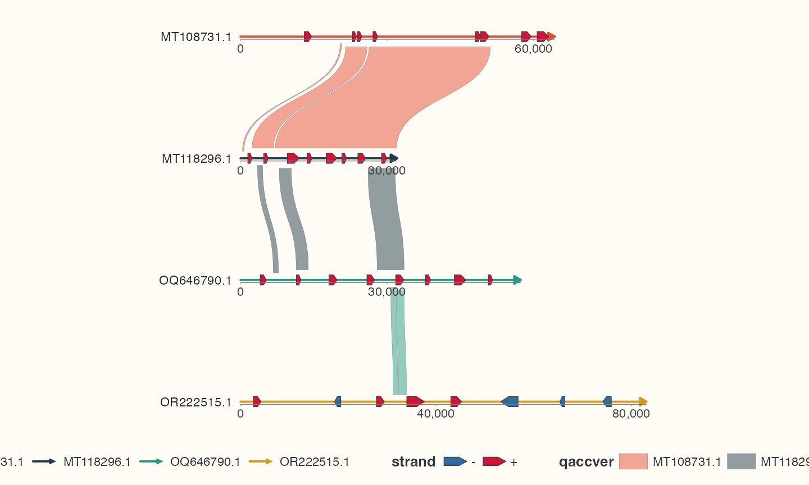</a><figcaption>Explicit sequence, strand and query-category colour scales · <span class="figure-hint">Click to enlarge</span></figcaption></figure>

| Role | Mapped data | Useful scale family |
| --- | --- | --- |
| `seq_colour`, `seq_ring` | Sequence/category | Sequence colour or ring manual scales |
| `ribbon_fill`, `ribbon_alpha`, `ribbon_colour`, `ribbon_linetype` | Alignment metadata or statistics | Manual, gradient/steps/identity and alpha scales |
| `feature_fill`, `feature_shape`, `gene_fill`, `region_fill` | Annotation category or strand | Role-specific manual/preset scales |
| `link_colour`, `link_alpha`, `link_linewidth`, `link_linetype` | Point-link metadata | Continuous or manual link scales |
| `track_value`, `track_fill`, `track_colour` | Values/categories in one named track | Named value domain and colour/fill scales |

### Fixed styles and user scale priority {#styling-priority}
Put a constant style outside `aes()`. Map variable styles inside it and supply an
appropriate scale. An explicitly fixed geom value takes precedence; omitting that
argument keeps mapping active. Your scale takes priority over automatic defaults.
Repeated same-kind layers keep independent data/mapping/parameters. A geometric
vector named by `accver` does not mean a scale also accepts per-sequence lists.

### Make legends readable {#styling-guides}
`guide_ggchord_legend()` controls discrete role legends; `guide_ggchord_colourbar()`
controls continuous colour guides. The colour/color spelling aliases are retained,
with `colour` preferred in this documentation. Use `show.legend` on a layer,
`guides()` for guide choices and `theme(legend.position = ...)` for placement.
A wide guide may need multiple rows or a wider export, not smaller biological data.

### Select a theme for the scene {#styling-themes}
The example stores minimal, dark and plasmid alternatives in `theme_variants`.
Add the appropriate object to the matching plot. `theme_ggchord_publication()`
is used above; the plasmid preset belongs with the circular workflow. These
objects style non-data appearance. They do not choose a coordinate system or
replace data-driven fill scales. Use `theme(text = element_text(...))` for text
appearance; removed `base_size` constructor-style shortcuts have a
[migration route](#migration).

### Check your result {#styling-check-result}
Links from the same query share a colour; continuous identity needs a continuous scale. Put fixed colours outside aes() and make each guide explain its mapping.

<div class="next-step">Continue: <a href="#adjustments">Common adjustments and grammar →</a></div>


## Common adjustments and grammar {#adjustments}

<div class="task-intro"><p>Put common adjustments in the appropriate ggplot2 component: mappings, geometry, positions, coordinates and themes have distinct roles.</p></div>

### Prepare this page {#adjustments-prepare}
In a fresh R session, run the code below, then follow this page in order. Colours and layout are optional display choices; inputs select only the fields needed.

<details class="preparation"><summary>Preparation code — run once on this page</summary>

```{r example-69, eval=FALSE}
library(ggchord)
data(seq_data_example)
data(ribbon_data_example)
data(gene_data_example)
seqs <- seq_data_example[c("accver", "length")]
links <- ribbon_data_example[c("qaccver", "saccver", "qstart", "qend", "sstart", "send")]
# The fixture preserves biological strands separately from its old display strands.
genes <- transform(gene_data_example, strand = source_strand)[c("accver", "start", "end", "strand")]

# Optional appearance choices; none of these columns or scales is required input.
library(ggchord)
seq_palette <- setNames(c("#3867D6", "#E58A28", "#219B83", "#9B59B6"),
  c("MT108731.1", "MT118296.1", "OQ646790.1", "OR222515.1"))
gene_palette <- c("+" = "#3B6FD8", "-" = "#E1812C", "." = "#8291A6")

library(ggchord)
doc_theme <- theme_ggchord_publication(axis.text = element_text(size = 11),
  axis.text.check.overlap = TRUE) + theme(legend.position = "bottom")
doc_axis <- function(coordinates = "relative") scale_seq_position_continuous(
  coordinates = coordinates, n.breaks = 3, minor_breaks = NULL,
  labels = function(x) format(x, scientific = FALSE, big.mark = ",", trim = TRUE))
```

</details>

### Assign each responsibility {#adjustments-grammar}
| Task | Interface |
| --- | --- |
| Map a column to an aesthetic | `aes()` |
| Define mapping and guide | `scale_*()`, `guides()` |
| Geometry and fixed style | `geom_*()` |
| Local placement | `position_*()` |
| Global coordinate system | `coord_*()` |
| Non-data appearance | `theme_*()`, `theme()` |
| Titles and captions | `labs()` |

Fixed styles may be supplied directly to geoms. Data-driven variation needs a
mapping and scale. An explicit fixed value overrides its mapping; omitting the
fixed argument preserves the mapping. User scales override inferred defaults.
`shape` is the fixed feature geometry parameter; `feature_shape` remains the
mapped role. Explicit `shape = NULL` is invalid, not a request to use a mapping.

### Map link identity {#adjustments-mapping}
After this page’s preparation code:


```{r example-70, eval=FALSE}
identity_links <- ribbon_data_example[c("qaccver", "saccver", "qstart", "qend", "sstart", "send", "pident")]
p_mapped <- ggchord(seq_data = seqs, ribbon_data = identity_links) + geom_seq() +
  geom_link_ribbon(aes(ribbon_fill = pident), alpha = .6) +
  scale_ribbon_fill_gradientn(colours = c("#3D2185", "#C74678", "#F6B739"), name = "Identity (%)") +
  scale_seq_colour_manual(values = seq_palette) +
  coord_chord(rotation = 20) + labs(title = "Sequence comparison") + doc_theme
p_mapped
```


### Place features {#adjustments-position}
Use `position_strand(c("+" = .1, "-" = -.2))` for signed strand offsets.
`position_feature_stack()` handles overlapping features; `position_track()`
allocates a named quantitative lane. Geometric sequence parameters accept one
value, a matching unnamed vector, or a vector named by `accver`; named vectors
are recommended. This syntax does not extend to scales, guides or themes.

Each layer owns its own `data`, `mapping` and parameters. Repeated feature or
link layers do not replace one another. Use ordinary ggplot2 `show.legend` and
`inherit.aes`; role input mappings precede geometry, while staged visual mappings
follow ggplot2 evaluation. See the API contract (`help("ggchord_api_contract", package = "ggchord")`).

### Check your result {#adjustments-check-result}
Use a coordinate for global rotation, named values for per-sequence geometry, and mappings plus scales for data-dependent colour.

<div class="next-step">Continue: <a href="#parameters">Set values by sequence and strand →</a></div>


## Export, preview and diagnostics {#output}

<div class="task-intro"><p>Inspect figures at their actual export dimensions, save with standard ggsave(), and understand what layout tables and diagnostics establish.</p></div>

### Prepare this page {#output-prepare}
In a fresh R session, run the code below, then follow this page in order. Colours and layout are optional display choices; inputs select only the fields needed.

<details class="preparation"><summary>Preparation code — run once on this page</summary>

```{r example-71, eval=FALSE}
library(ggchord)
data(seq_data_example)
data(ribbon_data_example)
data(gene_data_example)
seqs <- seq_data_example[c("accver", "length")]
links <- ribbon_data_example[c("qaccver", "saccver", "qstart", "qend", "sstart", "send")]
# The fixture preserves biological strands separately from its old display strands.
genes <- transform(gene_data_example, strand = source_strand)[c("accver", "start", "end", "strand")]

# Optional appearance choices; none of these columns or scales is required input.
library(ggchord)
seq_palette <- setNames(c("#3867D6", "#E58A28", "#219B83", "#9B59B6"),
  c("MT108731.1", "MT118296.1", "OQ646790.1", "OR222515.1"))
gene_palette <- c("+" = "#3B6FD8", "-" = "#E1812C", "." = "#8291A6")

library(ggchord)
doc_theme <- theme_ggchord_publication(axis.text = element_text(size = 11),
  axis.text.check.overlap = TRUE) + theme(legend.position = "bottom")
doc_axis <- function(coordinates = "relative") scale_seq_position_continuous(
  coordinates = coordinates, n.breaks = 3, minor_breaks = NULL,
  labels = function(x) format(x, scientific = FALSE, big.mark = ",", trim = TRUE))

anchor_rows <- unlist(lapply(split(seq_len(nrow(genes)), genes$accver), function(i)
  i[which.max(genes$end[i] - genes$start[i])]))
anchors <- genes[anchor_rows, c("accver", "start", "end")]
p_collinear <- ggchord(seq_data = seqs, ribbon_data = links, gene_data = genes) +
  geom_link_ribbon(aes(ribbon_fill = qaccver), alpha = .7) +
  scale_ribbon_fill_manual(values = seq_palette, guide = "none") + geom_seq() +
  geom_gene(position = position_strand(.1)) + geom_seq_label(size = 4) +
  coord_collinear(anchor = anchors, align = "center", orientation = "auto") + doc_axis() +
  scale_seq_colour_manual(values = seq_palette) +
  scale_gene_fill_manual(values = gene_palette) + doc_theme
p_collinear
```

</details>

### Save the intended size {#output-size}
After creating `p_collinear` in [three modes](#modes):


```{r example-72, eval=FALSE}
ggsave("comparison.png", p_collinear, width = 8, height = 5, units = "in", dpi = 144)
```


RStudio's Plots pane uses the current panel size and can rearrange labels and
guides. Preview at the same explicit dimensions before final `ggsave()`:


```{r example-73, eval=FALSE}
view_ggchord(p_collinear, width = 8, height = 5, units = "in")
diagnosis <- diagnose_ggchord(p_collinear, width = 8, height = 5, units = "in")
```


`view_ggchord()` returns a temporary image path; it does not keep a final export.
The website, README and vignettes share PNG assets exported through standard
`ggsave()` at sizes listed in the [gallery](#gallery). They do not capture an
interactively resized panel. Use your intended PDF/SVG device explicitly for
final vector output; font availability and embedding remain device-dependent.

### Consume geometry by name {#output-geometry}

```{r example-74, eval=FALSE}
geometry <- export_ggchord_layout(p_collinear, include = "seq")
rows <- unique(geometry$seq[c("layer_id", "component", "source_row")])
```


`export_ggchord_layout()` is the recommended layer-aware table interface.
`get_chord_layout()` retains the complete documented layout; neither is deprecated.
Select named fields, not fixed column positions. `source_row` indexes resolved
layer input; IDs are build-local resources, not permanent biological identifiers.
See the complete layout contract (`help("ggchord_layout_contract", package = "ggchord")`).

### Interpret evidence {#output-diagnostics}
`diagnose_ggchord()` separates measured panel size from geometry convergence.
A measured panel does not certify collision-free text, font embedding or all
applications. Inspect warnings, text/guide measurements and placement reasons.
`optimize_ggchord_layout()` applies documented opt-in adjustments; retain a copy
and inspect the result. Previews and diagnostics use independent render copies.
Direct mutation of shared ggproto layer environments retains ordinary ggplot2
reference semantics; it is not an automatically isolated edit.

### Complete layout, tables and opt-in ordering {#output-consumption}

```{r example-75, eval=FALSE}
full_layout <- get_chord_layout(p_collinear)
layer_tables <- export_ggchord_layout(p_collinear, include = c("seq", "gene"), original_data = TRUE)
layout_choice <- optimize_ggchord_layout(seqs, links, optimize = c("order", "orientation"), weight = "count")
```


Create `p_collinear` in [three modes](#modes-collinear) first.
`full_layout` retains the complete documented getter result. `layer_tables`
selects sequence/gene tables and resolved original data; it is not a raw-file
archive. Layer IDs and source-row roles distinguish independent same-kind layers.
Empty components can lack a fixed column prototype. Select fields by name.

`layout_choice` optimizes declared order/orientation using count weighting because
the minimal plotting table deliberately omits alignment-length statistics. It returns a choice
for explicit use in sequence settings; it does not mutate the plot or establish
biological orientation. Save the choice and compare the result before adopting it.
The export asset manifest (`website/assets/plots.csv` in the source repository) records exact documentation sizes.

### Check your result {#output-check-result}
Use matching dimensions for preview and saving. Inspect text, guides and warnings; a successful measurement does not certify fonts or release quality across devices.

<div class="next-step">Continue: <a href="#faq">Frequently asked questions →</a></div>


## Frequently asked questions {#faq}

### Why are labels different after resizing? {#faq-resize}
The available physical space changed. Use [explicit-size preview and saving](#output-size).
Check hidden-label diagnostics; do not infer missing input rows from absent text.

### Why did an old parameter stop working? {#faq-removed}
The API cleanup removed execution of old aliases. Use the [migration table](#migration).
Do not mix old and new spellings for one semantic setting. The colour/color
function spelling aliases remain, with `colour` preferred in documentation.

### Why is a feature rejected as a gene? {#faq-strand}
The gene shortcut requires known `+`/`-` strand. Keep unknown strand in a general
feature layer; do not guess `+`. Amino-acid intervals require explicit projection.

### Why is a ribbon missing in linear mode? {#faq-ribbons}
By default ribbons connect adjacent displayed sequences. Inspect pair selection,
clipping and validation. Use explicit `pairs` or `adjacent_only = FALSE` deliberately.
This default does not remove original input records.

### Can the package compute alignments or validate primer experiments? {#faq-biology}
It visualizes supplied alignments and computational search results. It does not
run BLAST, infer clusters from names or validate wet-lab outcomes. Search confidence
is not a probability. See [recognition limitations](#recognition).

### Is a measured diagnostic a release certification? {#faq-quality}
No. It describes a requested render. Platform/device/font checks, full vignettes
and package checks belong to an explicitly authorized release. This development
version has only scoped documentation verification.

### Where should I report a problem? {#faq-report}
Use the [issue tracker](https://github.com/DangJem/ggchord/issues) with a small input,
package/ggplot2 versions, code, intended width/height, device and diagnostic output.
Avoid attaching private sequence data; a synthetic reproduction is usually enough.


## Migrate to the candidate API {#migration}

### Scope and timing {#migration-scope}
These are current candidate replacements, not a v1.0.0 compatibility promise.
Earlier 0.16.x versions are locally completed but unreleased. Old calls in this
table explain migration and must not be executed as current examples. Exact
first-removal tags are not guessed where historical evidence gives only an upper bound.

### Replacement table {#migration-table}
| Old (do not run) | Current | Removal / guard | Meaning |
| --- | --- | --- | --- |
| `geom_ribbon()` | `geom_link_ribbon()` | ≤ 0.16.1 | Renamed link layer; not ggplot2::geom_ribbon(). |
| `ggchord(..., rotation = 20)` | `ggchord(...) + coord_chord(rotation = 20)` | ≤ 0.16.1 | Global coordinates are composed with +. |
| `geom_feature(feature_shape = "block", feature_width = .05)` | `geom_feature(shape = "block", width = .05)` | 0.16.1 | Mapped feature_shape is retained. |
| `geom_gene(gene_offset = c("+" = .1, "-" = .2))` | `geom_gene(position = position_strand(c("+" = .1, "-" = -.2)))` | 0.16.1 | Explicit Position values are signed. |
| `geom_feature(feature_offset = .1)` | `geom_feature(position = position_strand(.1))` | 0.16.1 | Use a Position object. |
| `geom_gene(gene_width = .05)` | `geom_gene(width = .05)` | 0.16.1 | Fixed geometry uses the shared width name. |
| `geom_link_ribbon(ribbon_gap = .01)` | `geom_link_ribbon(link_gap = .01)` | 0.16.1 | Use link_gap; likewise use link_ctrl_point. |
| `geom_gene_label_repel(gene_label_layout = "aligned")` | `geom_gene_label_repel(label_layout = "auto")` | 0.16.1 | Migrate both the name and value. |
| `geom_gene_label_repel(label_rotation = 90)` | `geom_gene_label(label_rotation = 90)` | 0.16.4 guard | Previously ignored manual control now errors; alternatively remove it. |
| `geom_feature_label_repel(label_orientation = "horizontal")` | `geom_feature_label(label_orientation = "horizontal")` | 0.16.4 guard | Use the fixed feature-label layer for unknown-strand features. |
| `geom_restriction_site(leader = "trunk")` | `geom_restriction_site(leader = "radial")` | 0.16.1 | The radial default remains. |
| `theme_ggchord(base_size = 10)` | `theme_ggchord() + theme(text = element_text(size = 10))` | ≤ 0.16.1 | Text appearance belongs to theme elements. |

### Run the replacement {#migration-replacement}
In a fresh session, run this preparation before the current replacements:

<details class="preparation"><summary>Preparation code — run once on this page</summary>

```{r example-76, eval=FALSE}
library(ggchord)
data(seq_data_example)
data(ribbon_data_example)
data(gene_data_example)
seqs <- seq_data_example[c("accver", "length")]
links <- ribbon_data_example[c("qaccver", "saccver", "qstart", "qend", "sstart", "send")]
# The fixture preserves biological strands separately from its old display strands.
genes <- transform(gene_data_example, strand = source_strand)[c("accver", "start", "end", "strand")]

data(plasmid_example_pUC19)
plasmid_seq <- plasmid_example_pUC19[c("accver", "length")]
feature_source <- find_common_features(plasmid_example_pUC19)
features <- feature_source[c("accver", "start", "end", "strand", "type", "anno")]
```

</details>


```{r example-77, eval=FALSE}
p_migrated <- ggchord(plasmid_seq) + geom_seq() +
  geom_feature(data = features, shape = "block", width = .05) +
  geom_feature_label(data = features, label_rotation = 0) + coord_circular()
p_offsets <- ggchord(seqs, gene_data = genes) + geom_seq() +
  geom_gene(position = position_strand(c("+" = .1, "-" = -.2)))
```


Old minus-strand offset magnitudes need a negative sign in explicit Position
values. Mapping still uses `aes(feature_shape = type)` with a shape scale;
the fixed parameter is `shape`. Automatic labels use `label_layout`; manual
geometry uses the corresponding fixed-label layer. `label_layout = "aligned"`
becomes `"auto"`. Removed names are errors, not silently retained execution paths.

### What remains supported {#migration-retained}
The five colour/color spelling aliases, all upstream reexports, gene/feature/plasmid
shortcuts and both geometry getter/export interfaces remain. Coordinate-specific
defaults and already documented result fields are retained. See the
API contract (`help("ggchord_api_contract", package = "ggchord")`) and current reference for
NULL/NA/missing semantics; NULL does not universally mean disabled.


## Reproducible gallery {#gallery}

<p class="lesson-intro">Choose an example by the question it answers. Thumbnails help you navigate; click for full size. Every figure links to preparation, code and interpretation.</p>

### Find a figure by task {#gallery-tasks}
| Overall relationships | One annotated sequence | Local positions | Quantities and text |
| --- | --- | --- | --- |
| [Chord](#gallery-realchord) | [Plasmid](#gallery-plasmid) | [CDS neighbourhood](#gallery-homologs) | [GC tracks](#gallery-multitrack) |
| [Point links](#gallery-pointlinks) | [Feature stacking](#gallery-featurestack) | [Focus](#gallery-focus) | [Label layouts](#gallery-labelauto) |

### Figures and dimensions {#gallery-figures}
<div class="gallery-grid"><section class="gallery-card"><h3 id="gallery-chord">Bundled sequences and alignment intervals in a chord view</h3><figure class="documentation-figure"><a class="figure-link" href="../man/figures/chord.png" title="Click to enlarge"></a><figcaption>Bundled sequences and alignment intervals in a chord view · <span class="figure-hint">Click to enlarge</span></figcaption></figure><p><a href="#modes-chord">Data, code and interpretation →</a></p><p class="asset-size"><code>p_chord</code> · 10 × 8 in · 144 dpi</p></section><section class="gallery-card"><h3 id="gallery-circular">pUC19 annotations in a circular map</h3><figure class="documentation-figure"><a class="figure-link" href="../man/figures/circular.png" title="Click to enlarge"></a><figcaption>pUC19 annotations in a circular map · <span class="figure-hint">Click to enlarge</span></figcaption></figure><p><a href="#modes-circular">Data, code and interpretation →</a></p><p class="asset-size"><code>p_circular</code> · 9 × 8 in · 144 dpi</p></section><section class="gallery-card"><h3 id="gallery-collinear">Bundled records aligned to explicitly selected annotation anchors</h3><figure class="documentation-figure"><a class="figure-link" href="../man/figures/collinear.png" title="Click to enlarge"></a><figcaption>Bundled records aligned to explicitly selected annotation anchors · <span class="figure-hint">Click to enlarge</span></figcaption></figure><p><a href="#modes-collinear">Data, code and interpretation →</a></p><p class="asset-size"><code>p_collinear</code> · 10 × 6 in · 144 dpi</p></section><section class="gallery-card"><h3 id="gallery-tracks">GC fractions computed from the bundled pUC19 DNA</h3><figure class="documentation-figure"><a class="figure-link" href="../man/figures/tracks.png" title="Click to enlarge"></a><figcaption>GC fractions computed from the bundled pUC19 DNA · <span class="figure-hint">Click to enlarge</span></figcaption></figure><p><a href="#tracks-domain">Data, code and interpretation →</a></p><p class="asset-size"><code>p_tracks</code> · 9 × 8 in · 144 dpi</p></section><section class="gallery-card"><h3 id="gallery-focus">Focused sequence windows with source-coordinate axes</h3><figure class="documentation-figure"><a class="figure-link" href="../man/figures/focus.png" title="Click to enlarge"></a><figcaption>Focused sequence windows with source-coordinate axes · <span class="figure-hint">Click to enlarge</span></figcaption></figure><p><a href="#views-focus">Data, code and interpretation →</a></p><p class="asset-size"><code>p_focus</code> · 10 × 6 in · 144 dpi</p></section><section class="gallery-card"><h3 id="gallery-labels">Automatic placement of informative source gene annotations</h3><figure class="documentation-figure"><a class="figure-link" href="../man/figures/labels.png" title="Click to enlarge"></a><figcaption>Automatic placement of informative source gene annotations · <span class="figure-hint">Click to enlarge</span></figcaption></figure><p><a href="#labels-layout">Data, code and interpretation →</a></p><p class="asset-size"><code>p_labels</code> · 10 × 6 in · 144 dpi</p></section><section class="gallery-card"><h3 id="gallery-realchord">Original sequences with explicitly selected CDS and alignment links</h3><figure class="documentation-figure"><a class="figure-link" href="../man/figures/realchord.png" title="Click to enlarge"></a><figcaption>Original sequences with explicitly selected CDS and alignment links · <span class="figure-hint">Click to enlarge</span></figcaption></figure><p><a href="#real-data-chord">Data, code and interpretation →</a></p><p class="asset-size"><code>p_real_chord</code> · 10 × 8 in · 144 dpi</p></section><section class="gallery-card"><h3 id="gallery-reallinear">Original sequences, all imported CDS and filtered links</h3><figure class="documentation-figure"><a class="figure-link" href="../man/figures/reallinear.png" title="Click to enlarge"></a><figcaption>Original sequences, all imported CDS and filtered links · <span class="figure-hint">Click to enlarge</span></figcaption></figure><p><a href="#real-data-linear">Data, code and interpretation →</a></p><p class="asset-size"><code>p_real_linear</code> · 10 × 6 in · 144 dpi</p></section><section class="gallery-card"><h3 id="gallery-plasmid">pUC19 features, exact primer hits and three selected restriction sites</h3><figure class="documentation-figure"><a class="figure-link" href="../man/figures/plasmid.png" title="Click to enlarge"></a><figcaption>pUC19 features, exact primer hits and three selected restriction sites · <span class="figure-hint">Click to enlarge</span></figcaption></figure><p><a href="#plasmids-input">Data, code and interpretation →</a></p><p class="asset-size"><code>p_plasmid</code> · 10 × 9 in · 144 dpi</p></section><section class="gallery-card"><h3 id="gallery-density">Interval density from the original alignment observations</h3><figure class="documentation-figure"><a class="figure-link" href="../man/figures/density.png" title="Click to enlarge"></a><figcaption>Interval density from the original alignment observations · <span class="figure-hint">Click to enlarge</span></figcaption></figure><p><a href="#ribbons-density">Data, code and interpretation →</a></p><p class="asset-size"><code>p_density</code> · 10 × 8 in · 144 dpi</p></section><section class="gallery-card"><h3 id="gallery-pointlinks">Midpoint links derived from existing HSP intervals</h3><figure class="documentation-figure"><a class="figure-link" href="../man/figures/pointlinks.png" title="Click to enlarge"></a><figcaption>Midpoint links derived from existing HSP intervals · <span class="figure-hint">Click to enlarge</span></figcaption></figure><p><a href="#ribbons-points">Data, code and interpretation →</a></p><p class="asset-size"><code>p_points</code> · 10 × 8 in · 144 dpi</p></section><section class="gallery-card"><h3 id="gallery-featurestack">Stacked overlapping annotations from the pUC19 reference</h3><figure class="documentation-figure"><a class="figure-link" href="../man/figures/featurestack.png" title="Click to enlarge"></a><figcaption>Stacked overlapping annotations from the pUC19 reference · <span class="figure-hint">Click to enlarge</span></figcaption></figure><p><a href="#annotations-stack">Data, code and interpretation →</a></p><p class="asset-size"><code>p_stack</code> · 10 × 5 in · 144 dpi</p></section><section class="gallery-card"><h3 id="gallery-multitrack">pUC19 GC fractions, a three-bin moving mean and annotation bands</h3><figure class="documentation-figure"><a class="figure-link" href="../man/figures/multitrack.png" title="Click to enlarge"></a><figcaption>pUC19 GC fractions, a three-bin moving mean and annotation bands · <span class="figure-hint">Click to enlarge</span></figcaption></figure><p><a href="#tracks-multiple">Data, code and interpretation →</a></p><p class="asset-size"><code>p_multitrack</code> · 9 × 8 in · 144 dpi</p></section><section class="gallery-card"><h3 id="gallery-homologs">AmpR neighbourhoods: identical CDS, 200 bp flanks and source coordinates</h3><figure class="documentation-figure"><a class="figure-link" href="../man/figures/homologs.png" title="Click to enlarge"></a><figcaption>AmpR neighbourhoods: identical CDS, 200 bp flanks and source coordinates · <span class="figure-hint">Click to enlarge</span></figcaption></figure><p><a href="#homology-membership">Data, code and interpretation →</a></p><p class="asset-size"><code>p_homologs</code> · 10 × 5 in · 144 dpi</p></section><section class="gallery-card"><h3 id="gallery-decorations">Highlighting the query interval of an observed alignment</h3><figure class="documentation-figure"><a class="figure-link" href="../man/figures/decorations.png" title="Click to enlarge"></a><figcaption>Highlighting the query interval of an observed alignment · <span class="figure-hint">Click to enlarge</span></figcaption></figure><p><a href="#annotations-decoration">Data, code and interpretation →</a></p><p class="asset-size"><code>p_decorated</code> · 10 × 6 in · 144 dpi</p></section><section class="gallery-card"><h3 id="gallery-labelauto">Informative gene annotations with automatic side placement</h3><figure class="documentation-figure"><a class="figure-link" href="../man/figures/labelauto.png" title="Click to enlarge"></a><figcaption>Informative gene annotations with automatic side placement · <span class="figure-hint">Click to enlarge</span></figcaption></figure><p><a href="#labels-comparison">Data, code and interpretation →</a></p><p class="asset-size"><code>p_labelauto</code> · 12 × 10 in · 144 dpi</p></section><section class="gallery-card"><h3 id="gallery-labelradial">The same gene annotations with radial placement</h3><figure class="documentation-figure"><a class="figure-link" href="../man/figures/labelradial.png" title="Click to enlarge"></a><figcaption>The same gene annotations with radial placement · <span class="figure-hint">Click to enlarge</span></figcaption></figure><p><a href="#labels-comparison">Data, code and interpretation →</a></p><p class="asset-size"><code>p_labelradial</code> · 12 × 10 in · 144 dpi</p></section><section class="gallery-card"><h3 id="gallery-labelarc">The same gene annotations with arc-oriented text</h3><figure class="documentation-figure"><a class="figure-link" href="../man/figures/labelarc.png" title="Click to enlarge"></a><figcaption>The same gene annotations with arc-oriented text · <span class="figure-hint">Click to enlarge</span></figcaption></figure><p><a href="#labels-comparison">Data, code and interpretation →</a></p><p class="asset-size"><code>p_labelarc</code> · 12 × 10 in · 144 dpi</p></section><section class="gallery-card"><h3 id="gallery-styling">Explicit sequence, strand and query-category colour scales</h3><figure class="documentation-figure"><a class="figure-link" href="../man/figures/styling.png" title="Click to enlarge"></a><figcaption>Explicit sequence, strand and query-category colour scales · <span class="figure-hint">Click to enlarge</span></figcaption></figure><p><a href="#styling-roles">Data, code and interpretation →</a></p><p class="asset-size"><code>p_styled</code> · 10 × 6 in · 144 dpi</p></section><section class="gallery-card"><h3 id="gallery-paf">A real minimap2 PAF comparison between two EMALE genomes</h3><figure class="documentation-figure"><a class="figure-link" href="../man/figures/paf.png" title="Click to enlarge"></a><figcaption>A real minimap2 PAF comparison between two EMALE genomes · <span class="figure-hint">Click to enlarge</span></figcaption></figure><p><a href="#formats-zero-based">Data, code and interpretation →</a></p><p class="asset-size"><code>p_paf</code> · 10 × 5 in · 144 dpi</p></section><section class="gallery-card"><h3 id="gallery-first">Your first plot: two bundled sequences, gene arrows and observed alignment intervals</h3><figure class="documentation-figure"><a class="figure-link" href="../man/figures/first.png" title="Click to enlarge"></a><figcaption>Your first plot: two bundled sequences, gene arrows and observed alignment intervals · <span class="figure-hint">Click to enlarge</span></figcaption></figure><p><a href="#installation-first-plot">Data, code and interpretation →</a></p><p class="asset-size"><code>p_first</code> · 10 × 5 in · 144 dpi</p></section></div>

### One source for both languages {#gallery-source}
All figures use bundled source-backed data or attributed real input records, defined in the shared
[documentation example source](https://github.com/DangJem/ggchord/blob/main/tools/documentation-examples.R).
No raw FASTA/GFF3/BLAST record was changed to improve appearance. The same image
bytes are used by both languages, README and vignette; captions provide localized
interpretation. The source and asset hashes are recorded in the asset manifest (`website/assets/plots.csv` in the source repository).

Display filters are stated in the relevant articles. GC is computed from actual
DNA; exact-CDS membership is checked from sequence content. Deliberate corruption
is confined to diagnostic examples and is never presented as biological data.

### Reproduce {#gallery-reproduce}
From the source repository, with its suggested development dependencies available:

```sh
Rscript tools/documentation-plots.R
python3 tools/sync-tutorials.py --check
python3 tools/build-website.py
python3 tools/check-documentation.py
```

The PNG device is used only to update these documentation figures. This is not
an output-device matrix or release validation. Source code and dimensions live
in `tools/documentation-plots.R`; changing the figure parameters requires
regenerating the manifest. See [output](#output) for your own export.

### Asset sources {#gallery-assets}
[Artwork, template and dependency licenses](https://github.com/DangJem/ggchord/blob/main/website/ASSET-SOURCES.md).


## Terminology and design sources {#glossary}

### Shared terminology {#glossary-terms}
| English | 现代汉语 | API / units |
| --- | --- | --- |
| sequence | 序列 | accver / length |
| chord diagram | 弦图 | coord_chord() |
| circular sequence map | 单序列圆图 | coord_circular() |
| collinearity plot | 共线性图 | coord_collinear() |
| interval link / ribbon | 区间连接 / 连接带 | qaccver / saccver |
| feature | 通用注释特征（feature） | geom_feature() |
| gene | 已知链的基因 | geom_gene() |
| strand | 链方向 | + / - / unknown |
| aesthetic mapping | 美学属性映射 | aes() |
| scale | 标度 | scale_*() |
| guide | 图例 / 标度指南 | guides() |
| position | 局部位置调整 | position_*() |
| track | 定量轨道 | position_track() |
| genomic position | 基因组位置 | one-based inclusive bp / 一基闭区间 |
| layout units | 原生布局单位 | not bp or mm / 不等于 bp 或 mm |
| source row | 已解析输入来源行 | source_row |
| physical file line | 物理文件行 | .source_line |
| focus | 局部聚焦 | focus_ggchord_data() |
| segment | 分段窗口 | segment_ggchord_data() |
| leader | 标签引导线 | label / connection |
| CDS projection | 编码序列坐标投影 | build_ggchord_cds() |
| measured panel | 已测量面板 | not visual certification / 不等于视觉认证 |

### Design and asset provenance {#glossary-sources}
The grammar follows [ggplot2](https://ggplot2.tidyverse.org/): mappings, scales,
geometry, positions, coordinates and themes retain distinct responsibilities.
Compact query/subject field names follow BLAST-style tables; ggchord does not run
an alignment tool during drawing. Circular hierarchy and feature readability
are compared with Circos, clinker and DNA Features Viewer, as recorded in the
repository design documents. These are conceptual comparisons, not copied APIs.

The detailed ggchord artwork was supplied by the user on 2026-11-01 for this
website and documentation. Full-size PNG and WebP preserve every decoded RGBA
pixel. Only the small navigation thumbnail is resized. See the image manifest (`website/assets/icon.json` in the source repository)
for source hashes and exact sizes. The compact hexagonal study mark below, site
CSS/JS and documentation diagrams are original project assets under the
repository MIT terms. The study mark is supplementary, not a replacement for
the supplied artwork.

 System fonts are used; no webfont, icon
library or third-party image is downloaded. Plot colours come from the package's
existing defaults or explicit teaching code; those literal colour choices are
listed with the source. The site uses the existing Pandoc and R documentation
converters at build time without bundling their binaries or stylesheets.
