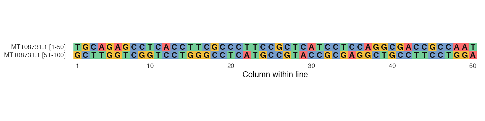

{{code:courseblockaq}}

{{prepare:setup}}

The examples use bundled data and require no input download or extraction; optional dependencies are listed in each section. Original records remain traceable through the [real input bundle](https://github.com/DangJem/ggchord/archive/refs/heads/main.zip).

<a id="characters"></a>

## Retain actual FASTA characters {#characters}

Bundled `sequence_detail_example$plasmid_source` already retains real characters, physical header line numbers and source-file provenance; use `keep_sequence = TRUE` when importing your own FASTA. Import removes whitespace while retaining case; declare bp or aa explicitly rather than guessing the alphabet. Focusing clips both strings and intervals: local position 1 below corresponds to source position 1001. Descending regions select the same interval without reverse-complementing it. Lengths alone cannot recover characters, and HSP endpoints cannot recover mismatch or gap columns. Gapped FASTA lengths include gaps; genomic use needs a separate alignment-column-to-source-position mapping.

{{code:courseblockar}}

### Import your own existing alignment {#read-alignment}

This subsection specifically demonstrates `read_aligned_fasta()`. Replace the path with an existing equal-length FASTA; the source example is available in the input bundle. Reading is skipped when the file is absent, and subsequent plots continue to use the bundled tables directly.

```r
alignment_file <- "examples/alignment/opuntia-aligned.fasta"
if (file.exists(alignment_file)) {
  imported_alignment <- read_aligned_fasta(
    alignment_file, "DNA", source_file = TRUE
  )
}
```

<a id="aligned-characters"></a>

## Existing alignments: keep columns and source positions separate {#aligned-characters}

The examples directly use prepared DNA/protein alignment tables in `sequence_detail_example`. Original Biopython records, upstream licenses, hashes and reproducible FASTA conversion rules remain in the source directory `examples/alignment/`. No alignment tools are run and complete record IDs and original characters are unchanged; rows and columns are selected explicitly.

`read_aligned_fasta()` reads one existing alignment. Declare DNA, RNA or AA; equal lengths alone do not establish homology. `alignment_column` includes `-` and `.` gaps, whose `source_position` is NA. Default positions count the ungapped input fragment from one; they are not complete-genome coordinates. Lowercase letters consume positions, so this reader must not be used as an A3M insertion parser.

{{code:courseblockas}}

The first selected row has a gap at alignment column 343. Column lookup therefore returns `matched = TRUE`, `is_gap = TRUE` and a missing source position. Inverse lookup of source position 343 finds its actual alignment column, without interpolation. Positions removed by filtering return `matched = FALSE`; filtering never renumbers retained columns. `map_alignment_position()` selects an alignment-row ID even when a separately declared source ID differs.

`geom_residue()` is a standard Cartesian ggplot layer. Styles and user scales follow ggplot2. It measures glyphs against actual cell width and height at draw time: `overflow = "error"` requires readable letters; `"tile"` retains colour cells where text cannot fit, without shrinking fonts. Focus fewer columns or increase physical width to show letters. For example, save `p_characters` with ordinary `ggsave(width = 12, height = 3.4, units = "in")`; simply raising DPI adds no physical room. Discrete rows, identity/reverse position scales and Cartesian coordinates are supported; this layer does not directly project characters onto backbone Coords. A Cartesian character plot with explicit source mapping can be registered using `register_ggchord_alignment()` for [Fusion character details](fusion-details.md#character-detail).

Default residue plots join neighbouring cells continuously and use a 1:1 cell ratio unless coordinates were explicitly supplied. Dark bold sans-serif glyphs fit the cells at a uniform size, with a default readability floor of 3 mm. Without an explicit fill, label is mapped automatically and the data alphabet selects DNA/RNA/AA chemistry colours. Use `scale_fill_residue()` to select an alphabet or `ggplot2::scale_fill_manual()` to replace the colours. Explicit sizes, mappings, fixed colours and user coordinates take priority. Character legends are hidden by default; enable them with `show.legend = TRUE`.

### Automatic line wrapping {#wrapped-residues}

Pass `line_width = 50` to `geom_residue()` to display 100 bases as lines 1–50 and 51–100. This example reads the first 100 observed bases of MT108731.1. Row labels retain the original column ranges and the x axis shows the column within a line. Multiple sequences share the same breaks, and gaps still occupy columns. Original data, alignment columns and source positions are not renumbered.

{{code:residuewrap}}



Wrapped character plots can also be registered for Fusion. Each focus interval must fit within one displayed line; split cross-line selections into explicit source intervals. The default `line_width` is NULL, which keeps a single line.

<a id="aligned-protein"></a>

### Protein excerpt {#aligned-protein}

The same data contract accepts observed protein characters. The excerpt retains upstream gaps and residue differences; default fill groups amino acids by side-chain chemistry, rather than inferred functional domains.

{{code:courseblockat}}

<a id="aligned-source"></a>

### Explicit source coordinates {#aligned-source}

Provide one `source_data` row per aligned record with `accver`, `start` and `strand`. `start` is the first nongap source coordinate. Negative-strand positions decrease; strings must already be in alignment orientation. An optional `source_accver` identifies the original molecule. If you provide a full forward `sequence`, every nongap character is checked, using nucleotide complementation on the negative strand and order reversal only for AA. Missing source strings remain unverified; no origins or strands are guessed.

The following example checks consistency against ungapped fragments derived from the same alignment. It is deliberately **not independent genomic validation**. For a real genomic projection, supply independently known source sequences and interval metadata instead.

{{code:courseblockau}}

No mismatch/gap detail can be recovered from six HSP endpoints alone. This workflow accepts existing columns, not CIGAR/A3M/Clustal/Stockholm parsing, phase inference, consensus/Logo analysis or alignment computation. Explicit CDS translation is described below; exact macro/detail registration is available in the Fusion section.

<a id="cds-translation"></a>

## Source-backed CDS translation {#cds-translation}

`build_ggchord_cds()` defines observed coding coordinates; `translate_ggchord_cds()` additionally needs actual complete forward DNA/RNA strings and optional **Biostrings**. This real EMALE negative-strand CDS has source phase 0 and an ATG start. Table 11 is an explicit choice checked against the unchanged upstream protein FASTA. Input provenance is in `examples/format-inputs/README.md`.

{{code:courseblockav}}

`models` reports coding/protein strings, genetic code, initiation/ambiguity policies, partial ends and terminal remainder. `nucleotides` retains each genomic base; `residues$source_positions` contains the three genomic positions of each codon in biological order, even across exon boundaries. Residue positions use the CDS feature ID's observed-protein namespace; they are not an inferred external protein accession. Terminal and internal stops remain `*`. The example removes only the final stop for comparison with the upstream FASTA convention.

The default `initiation = "literal"` does not recode alternative starts; `"start"` requires a complete 5-prime end. `ambiguous = "error"` rejects fuzzy codons; explicit `"solve"` delegates to Biostrings, using X if unresolved. Unknown codes, missing/short sources and declared translation exceptions fail. `partial = "trim"` belongs to the CDS map: only the initial phase and incomplete terminal codon are excluded; later segment phases validate continuity without deleting junction bases. No missing sequence is reconstructed. RNA must be declared explicitly. Ordered `segments` support the existing spliced/origin-join contract.

A complete runnable nucleotide/codon/macro example is `examples/m2-detail.R`; its negative-strand labels are centred on their three coding bases. Real spliced plus/minus controls, source hashes and original expected translations are retained in `examples/cds/`. [Register the character plot](fusion-details.md#character-detail) to connect its exact source boundaries.
