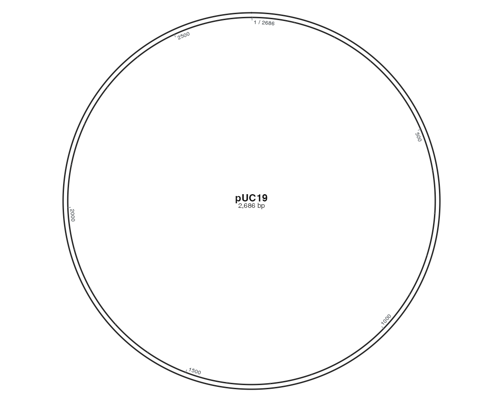
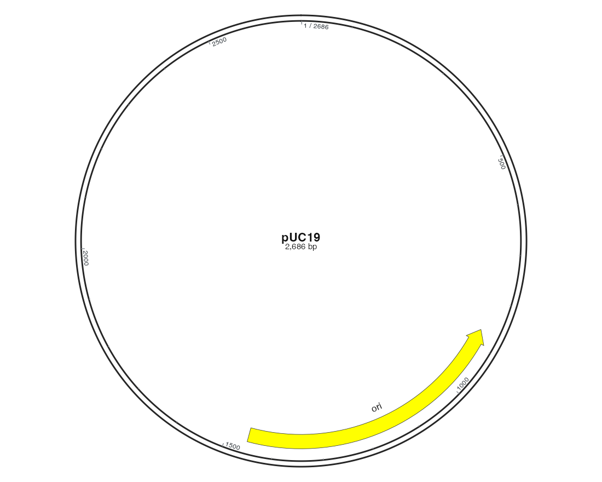

<a id="input"></a>

## Length and a prepared annotation {#input}

This example reads the full length and existing annotations from the bundled pUC19 record. Copy either plotting block to draw that stage.

```r
library(ggchord)
```

{{code:coursecircleinput}}



<a id="features-and-labels"></a>

## Add the feature and its label {#features-and-labels}

{{code:coursecirclefeature}}



Locate both ori endpoints on the ticks and trace the label to anno. A circular display is not evidence of molecular topology.

<a id="exercise"></a>

## Preview and save {#exercise}

Remove the label layer and rerun; backbone and source interval stay unchanged. Replace the row with your own known annotation.

```r
circular_width <- 10
circular_height <- 8
view_ggchord(p_coursecirclefeature,
  width = circular_width, height = circular_height, units = "in")
ggsave("circular-first.png", p_coursecirclefeature,
  width = circular_width, height = circular_height, units = "in", dpi = 144)
```
