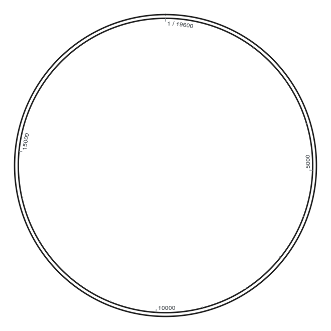
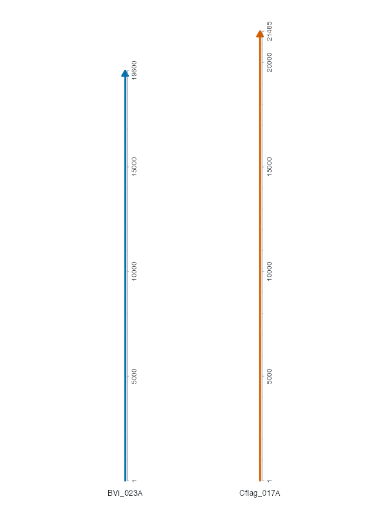
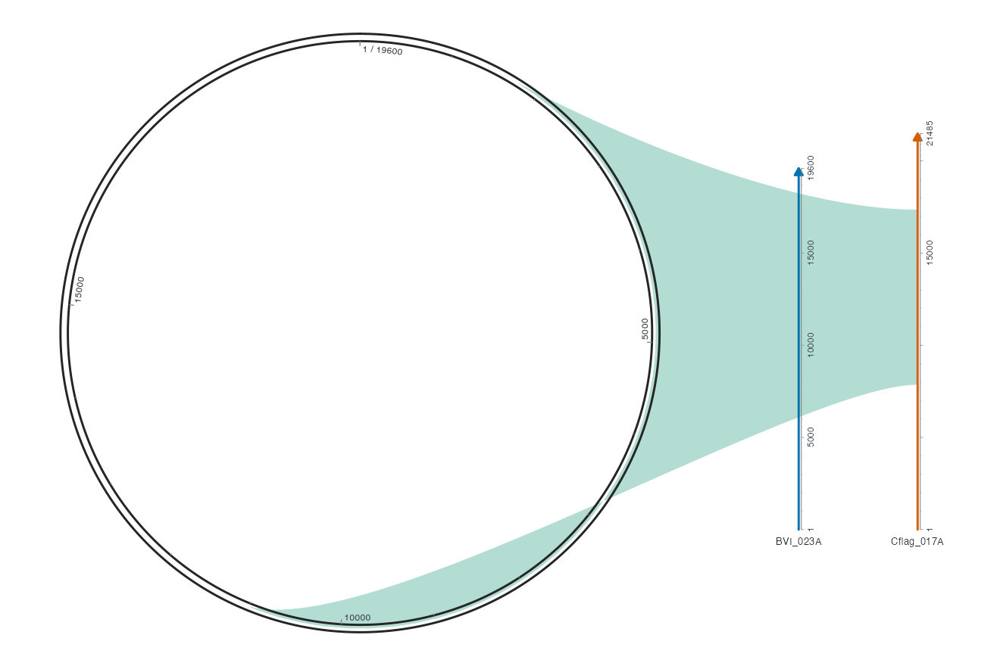

<a id="panels"></a>

## Start with two independent plots {#panels}

Use ggchord, dplyr and the original PAF in the [input bundle](https://github.com/DangJem/ggchord/archive/refs/heads/main.zip). Print course_center and course_detail independently, then connect one existing relationship.

```r
library(ggchord)
library(dplyr)
```

{{prepare:fusiondata}}

{{code:coursefusion}}







<a id="intervals"></a>

## Check intervals, panels and instances {#intervals}

Fusion is a composition, not a seventh Coord. Each panel retains its data, layers, scales and physical ratio. A side places a panel without rotating it. Endpoints must share units, be fully visible and route unambiguously; direct bp–aa links are unsupported.

```r
fusion_width <- 12
fusion_height <- 8
view_ggchord(p_coursefusion,
  width = fusion_width, height = fusion_height, units = "in")
course_export <- export_ggchord_fusion(p_coursefusion,
  width = fusion_width, height = fusion_height)
course_export$connections
course_export$fronts
```

<a id="save"></a>

## Save at the same size {#save}

```r
ggsave("fusion-first.png", p_coursefusion,
  width = fusion_width, height = fusion_height, units = "in", dpi = 144)
```

Example: choose another real HSP and identify qpanel/spanel and its source row. Dotplot, facets and unregistered external plots are unsupported.
