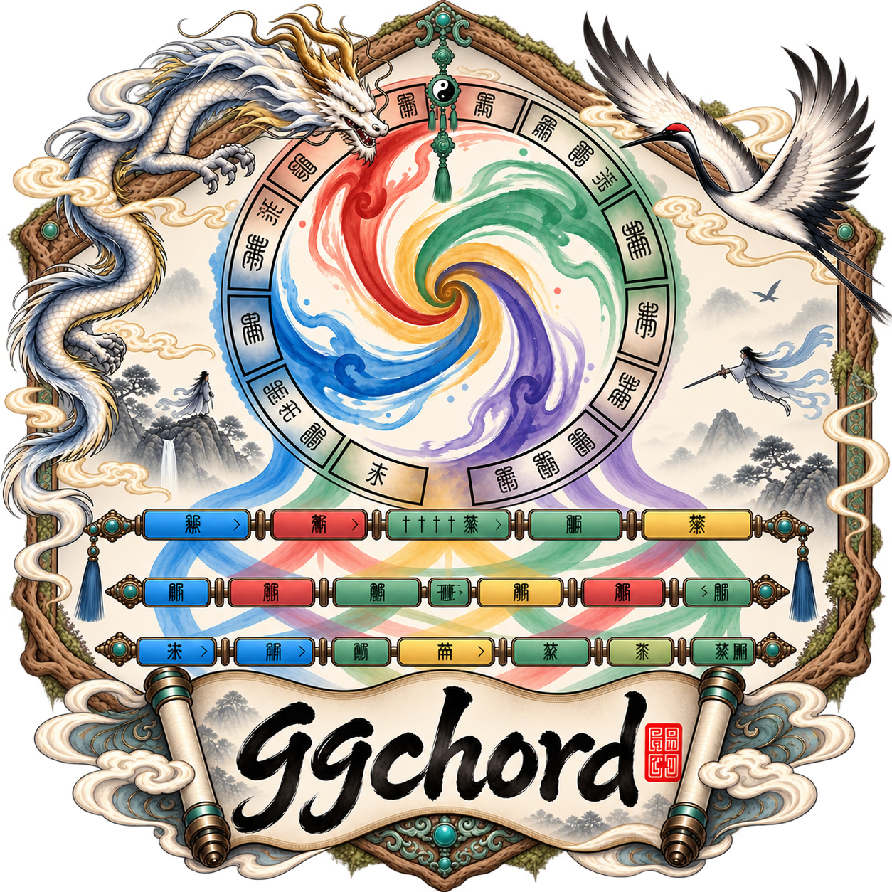

A grammar of graphics for **chord comparisons, circular annotation maps and linear
collinearity**. ggchord combines sequence backbones, interval/point links, genes,
general features, labels, genomic axes and quantitative tracks with ggplot2.

## See a complete sequence comparison {#showcase}
{{figure:reallinear}}

Four original sequence records, their GFF3 annotations and existing BLAST links,
without recoding source strands. Follow [the full data-to-figure workflow](real-data.html)
for filters, reports, source provenance and the chord view. A separate
[complete circular workflow](plasmids.html) combines reference features, primers,
restriction sites, stacking and labels.

## Choose your next step {#learn}
- [Install](installation.html), then draw [three minimal views](modes.html).
- Learn [data contracts](data.html), [file formats](formats.html) and [plot grammar](adjustments.html).
- Browse [task articles](articles.html), [function reference](reference.html) and [gallery](gallery.html).
- Find current [migration directions](migration.html), [FAQ](faq.html) and [changes](news.html).

## A small reproducible start {#quick-start}
{{code:setup}}
{{code:chord}}

Print `p_chord`, then [preview and save at the same explicit size](output.html).
These small inputs are synthetic; the showcase above uses original source records.
The documentation describes 0.16.5 development against the 0.16.4 API candidate;
0.15.0 remains the formal release. See [installation](installation.html#source)
for the difference between a matching checkout and an older installed package.
