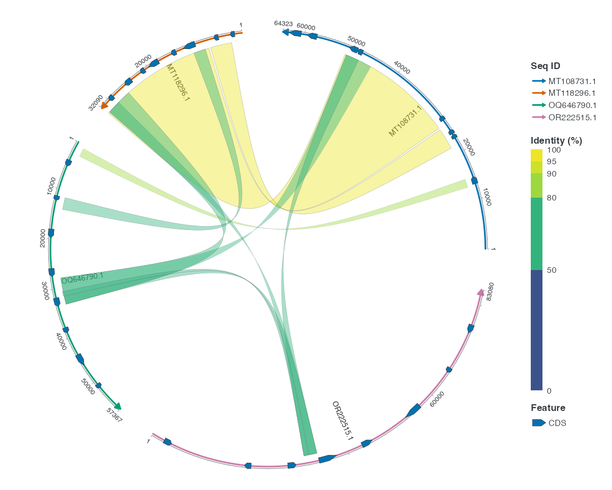
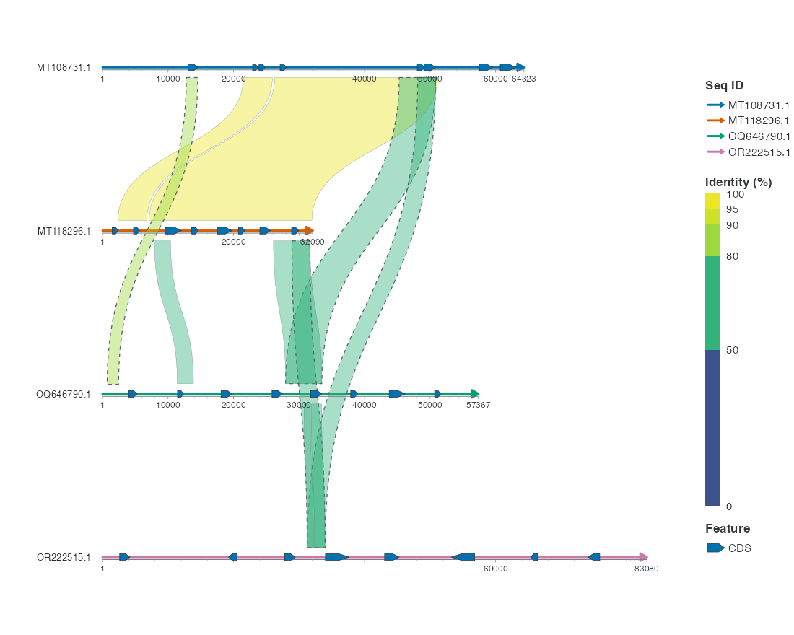
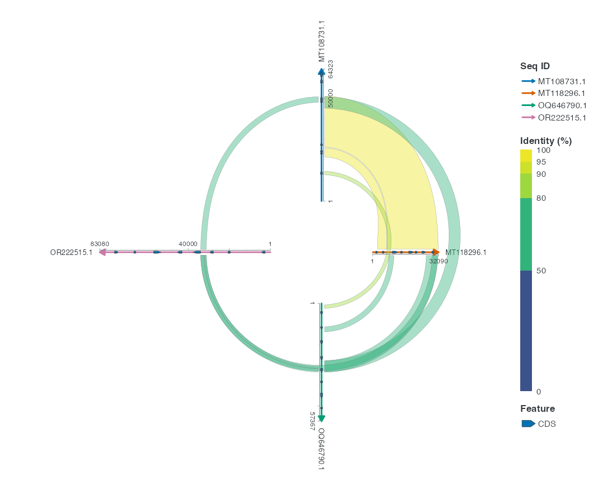
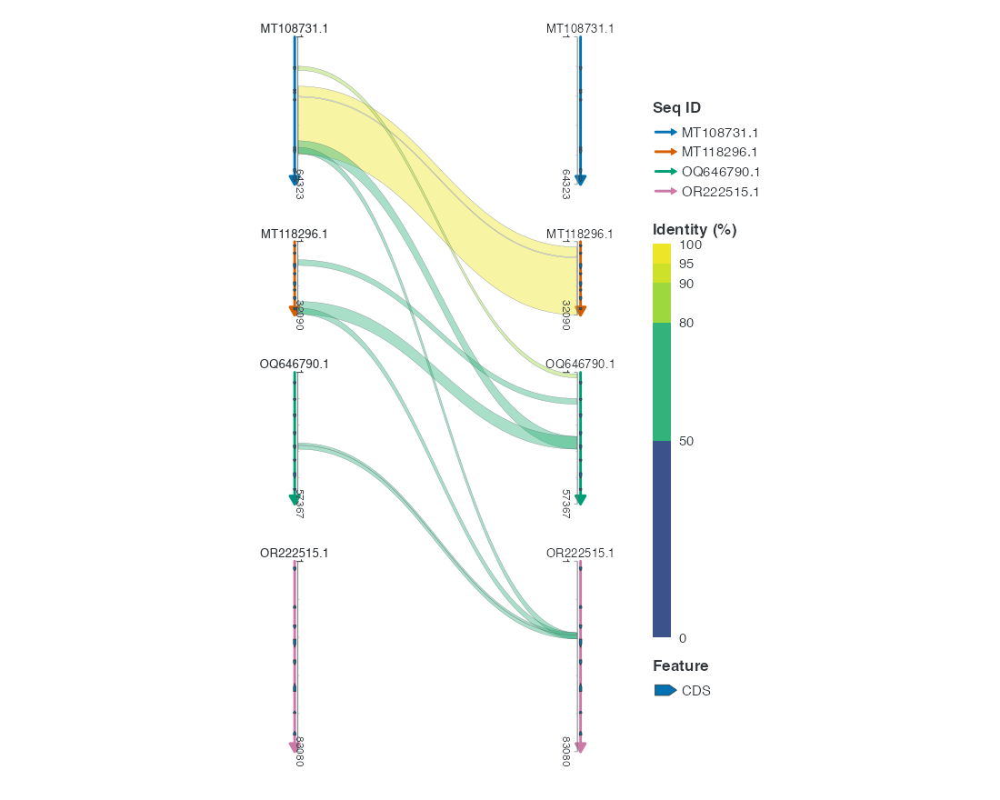

<a id="input"></a>

## Prepare once {#input}

The same source input need not produce the same default relation set. First explicitly select all pairs to compare geometry, then inspect each view’s default selection. Dependencies: ggchord and dplyr.

{{prepare:radialdata}}

{{code:coursecomparison}}

<a id="chord"></a>

### Chord {#chord}



<a id="linear"></a>

### Linear {#linear}



<a id="radial"></a>

### Radial {#radial}



<a id="sankey"></a>

### Sankey {#sankey}



<a id="selection"></a>

## Default selection and comparable conditions {#selection}

| View | Default relation selection | This comparison |
| --- | --- | --- |
| Chord | All pairs | Same HSP table, explicit all pairs |
| Collinear | Adjacent rows | Explicit adjacent_only = FALSE |
| Radial | Cyclic neighbors | Explicit adjacent_only = FALSE |
| Sankey | Excludes same-entity self links | This real input has no self links |

{{code:coursecomparisonreport}}

<a id="flagship"></a>

## Retained flagships and derived views {#flagship}

The existing Chord and Collinear flagships are retained with their original composition, input selection, colours and layer design; the Chord image is redrawn solely for the confirmed default outline fix. Radial derives from Chord; Sankey derives from Collinear. The retained parents share source preparation but keep their original feature and cross-row HSP display selections, so the four images are not claimed to use an identical displayed subset.

{{prepare:sequencepalette,docstyle,showcasedata,chordshowcasegenes,showcasechord,showcasecollinear}}

Radial removes Chord-only radii and curvature. Sankey uses each column’s native axis, replacing Collinear Cartesian controls and its shared scale bar. Complete figures retain all original CDS name candidates, Sequence guides and source records. Labels are placed near their features in final projected coordinates using measured text sizes and short leaders. Crowded names that cannot fit may still be hidden; use `diagnose_ggchord()` at the export size to inspect visibility and contacts.

{{code:flagshipmulti}}

<a id="flagship-chord"></a>

### Chord {#flagship-chord}

{{manualfigure:flagchord}}

<a id="flagship-collinear"></a>

### Collinear {#flagship-collinear}

{{manualfigure:flaglinear}}

<a id="flagship-radial"></a>

### Radial {#flagship-radial}

Use a 12 × 10.5 inch canvas, spokes starting at 45°, and horizontal sequence IDs. All 20 original CDS geometries and name candidates remain. Local labels avoid long leaders and global side columns that shrink the sequence panel. Sequence, Strand and the numerically proportional Identity guide sit below the plot.

```r
view_ggchord(flag_radial, width = 12, height = 10.5, units = "in")
```

{{manualfigure:flagradial}}

<a id="flagship-sankey"></a>

### Sankey {#flagship-sankey}

Four sequences stack in each column on a 10 × 16 inch portrait canvas. All 16 original CDS geometries and name candidates, and the 10 selected HSPs remain. Both display copies receive annotations; names are no longer sampled to one per sequence. Short connections and local collision handling keep names near their features. Complete coordinates and all three guides remain; homepage previews separately omit dense names and coordinate text.

```r
view_ggchord(flag_sankey, width = 10, height = 16, units = "in")
```

{{manualfigure:flagsankey}}

<a id="direction-and-adjacency"></a>

## Directions, instances and display scale {#direction-and-adjacency}

Biological strand, HSP endpoint direction, display orientation and seq_order are separate. Sankey copies do not add observations; interval widths do not imply flow conservation. Reuse layers only within their shared support.

<a id="projection"></a>

## Visual length and connection style {#projection}

`length_mode="equal"` changes angular allocation or linear span. Original lengths,
intervals and local axes remain unchanged. `sequence_display` exports both source
length and projection factor. A shared absolute scale bar is rejected for equal
multi-sequence displays. Default axes show 1 and the final source position;
intermediate ticks use available physical space. Closed circular seams combine
the two endpoints. Explicit breaks and labels take priority.

{{prepare:foundationdata}}

{{code:foundationequal}}

{{figure:foundationequal}}

Default ribbons keep Identity fills and full interval fronts.
Use `geom_link_ribbon(gradient = TRUE)` to interpolate endpoint sequence colours along the curve. `tip="subject"` opts into a decorative taper; its
shoulder retains the translated target span and its marker is not a single
matched base or a biological transfer direction. The source endpoints stay in layout exports.
Use `tip="none"` to keep full fronts. Fixed fill, mapped ribbon_fill or an explicit
ribbon fill scale overrides endpoint interpolation. Explicit pident uses a fixed
0–100 domain, boundaries 0/50/80/90/95/100 and five numerical interval proportions
50/30/10/5/5%. User scales and guides remain authoritative.

<a id="tip"></a>

### Optional subject taper {#tip}

{{code:foundationarrow}}

{{figure:foundationarrow}}

Automatic categorical guides measure text to choose rows/columns, while the
render loop measures guide and panel space together. Explicit guide/theme
settings win. Circular outer labels share a measured queue at every label count;
`label_visibility` reports source row, visibility and available placement fields.
An unavailable collision count is not zero. Tiny canvases can remain crowded;
inspect [output diagnostics](output.md) at the intended export size.

Automatic Identity rulers reserve length from measured boundary text rather than generic legend swatch sizes. Set `legend.ribbon.key.height` or `legend.ribbon.key.width`, or supply an explicit guide, for a manual length. In circular layouts, parallel axis labels follow the circle glyph by glyph; horizontal and numeric orientations remain straight.

<a id="exercise"></a>

## Preview and save {#exercise}

Choose an HSP and identify its two sources. Restore default adjacency and explain a possible omission. Save your chosen view at target size and retain the input table.
