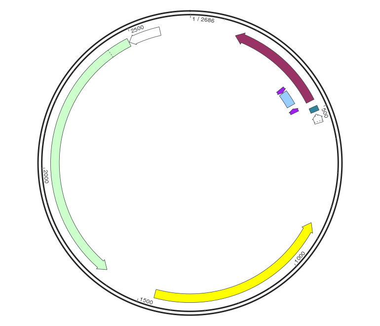

<a id="features"></a>

## Draw the nine pUC19 features {#features}

The bundled pUC19 record supplies its full length and nine reference features. Each directional arrow preserves its annotated strand and interval.

{{code:pucfeatures}}



<a id="input"></a>

## Complete pUC19 inputs {#input}

This page explains the composition of one complete reference map. pETDuet-1 and its dense-label choices are described [separately](circular-dense-case.md).

{{code:courseblocki,catalogmap}}

{{figure:catalogpuc}}

<a id="layers"></a>

## Read the layers {#layers}

The double backbone carries source positions. All reference features retain their original intervals, strands and segments. Feature labels share the stacking Position; independent primers and restriction sites use their own tables and layers. The centre gives identity and complete length.

<a id="sites"></a>

## Inspect the complete tables {#sites}

```r
reference$policy
nrow(reference$features)
nrow(reference$primers)
nrow(reference$sites)
```

This source profile contains 9 features and 39 restriction-site records at 33 distinct positions, without independent reference-primer rows. `reference$all_site_count` retains the original candidate count; complete search results can be rebuilt through the generator. The displayed reference set is not sampled down to three sites.

<a id="adapt"></a>

## Use your own annotations {#adapt}

Prepared annotation, primer and site tables can go directly to independent layers. Sequence recognition is optional when the tables already exist. Full lengths and source units must be supplied independently.

<a id="save-result"></a>

## Save at the same size {#save-result}

```r
ggsave("pUC19-complete.png", p, width = 10, height = 8, units = "in", dpi = 144)
```


<span id="check-result"></span><span id="draw"></span><span id="evidence-check"></span><span id="limits"></span><span id="question"></span><span id="source-rights"></span>
