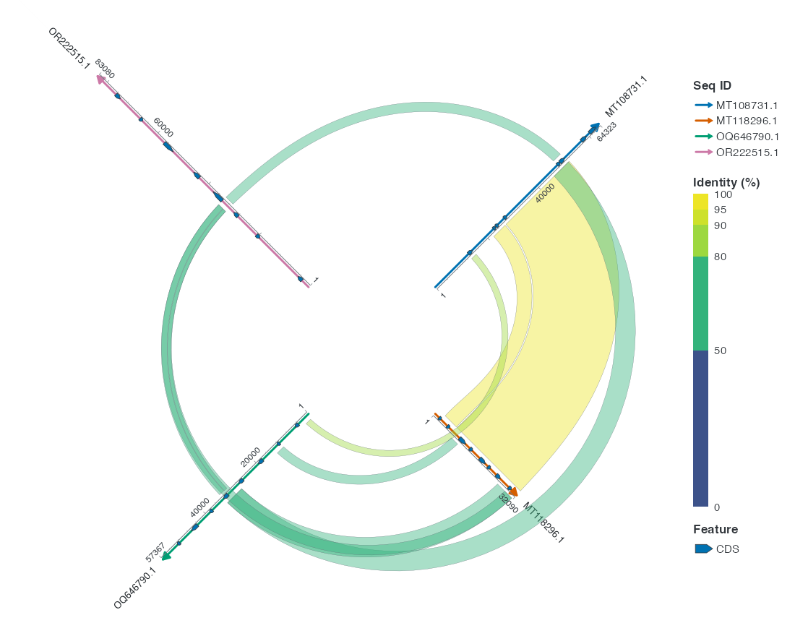

<a id="radial"></a>

## Proportional radial spokes {#radial}

The bundled four-sequence data retain their original lengths and CDS strands.
This explicit display filter selects observed HSPs of at least 900 bp and
75 percent identity, taking the two longest per directed pair. The count track
counts those selected query-start observations, not inferred depth or coverage.

{{code:radialdata}}

{{code:radialview}}

{{figure:viewradial}}

Spoke order comes from `layout_sequences(order = ...)`. Default lengths are
proportional; `layout_sequences(length_mode = "equal")` explicitly normalizes display lengths
while preserving source coordinates. `start_angle` is measured counterclockwise
from positive x; `clockwise` controls spoke order, not source strand. Positive
feature/track offsets point counterclockwise from an outward spoke. Physical
Track widths and source statistics reuse the shared band and Stat system.

Cyclic neighbors include the last/first pair **only when an HSP exists**.
Without that relationship its channel stays empty. N=2 draws each source row
once; N=1 is rejected. Reverse HSPs retain full ordered interval fronts and
twists. New Radial fronts use inclusive interval boundaries `[min-1,max]`, so
a one-position HSP has nonzero width; axis positions stay one-based. Existing
views retain their own documented interval conventions. The hole is display
spacing, not deleted sequence. Sequence names sit beyond the outer tips.

{{prepare:coursecomparison}}

{{code:courseradialangle}}




Ribbons can select nonneighbors with explicit `pairs` or
`adjacent_only=FALSE`. Nonneighbor point links need `between`; named A–B–A
instances use the same unambiguous [routing contract](instances.md#instances).
User control points use final x/y coordinates. Endpoint gradients and subject
tips remain explicit options; default ribbons retain Identity fills.

<a id="export"></a>

## Export and reverse-map {#export}

{{code:radialmap}}

Exports retain `radial_frames`, original source intervals and projected complete
fronts in `radial_endpoints`, plus connection selection, instance routing,
track statistics and label visibility. Radial inverse mapping requires both
x and y on the selected backbone. This avoids inventing a position from a
single x value shared by multiple spokes. Focus/segment inputs retain source
origins; radial display does not join multiple windows onto one spoke.

<a id="support"></a>

## Usage and boundaries {#support}

Change only start_angle and verify source coordinates and directions. N=1, shared branches, circular-only layers and stitching separate windows into one spoke are unsupported. Inverse mapping needs backbone x/y.

<a id="nonadjacent"></a>

## Nonadjacent outlines and outward lift {#nonadjacent}

In final cyclic order, neighbouring ribbons (including first/last) remain solid. Non-neighbours use dashed outlines with the same 0.4 mm width as Collinear. `nonadjacent_linewidth=0` restores ordinary widths; explicit line types, width mappings and user scales take priority.

`nonadjacent_bulge` sets outward lift for nonadjacent annular paths, default 0. Positive values also increase lift as needed to clear full intervening spokes and separate same-channel ribbon bands. The longest proportional spoke has length 2; 0.2 below is in display layout units, not bp. Endpoints, source coordinates and interval widths remain intact; crossings required by endpoint order may remain.

```r
ggchord(prepare_ggchord_data(radial_seqs, radial_hsp)) +
  geom_seq() +
  geom_link_ribbon(adjacent_only = FALSE) +
  coord_radial_synteny(nonadjacent_bulge = 0.2)
```

For per-row manual adjustments, `link_ctrl_point` accepts Cartesian controls for the two edges and takes priority over automatic lift; it changes the annular path shape. `link_gap` only controls clearance near sequence endpoints and cannot replace midpoint lift.
