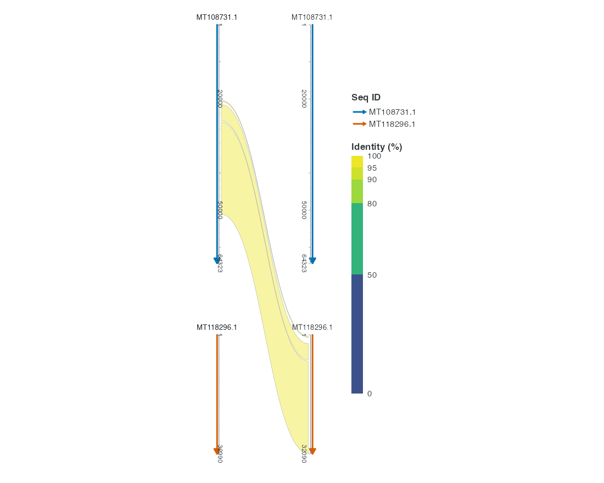

## Prepare real sources {#input}

## Mirrored two-column relationships {#sankey}

Sankey displays each source once in each column. Query endpoints connect from
the left to subject endpoints on the right. Reciprocal input rows stay distinct;
same-entity links are excluded by default (`self_links=TRUE` opts in). Widths
come from both real intervals. This layout expresses relationships, not flow
conservation. It owns its left/right copies and does not accept `between` or
shared branches in this first version.

{{code:foundationsankey}}

{{figure:foundationsankey}}

## Change only the column gap {#column-gap}

{{code:coursesankeygap}}

## Check sources and instances {#instances}

{{code:courseblockae}}

Each of two sources appears once on each side. Do not duplicate seq_data to manufacture observations. Reciprocal records stay distinct. self_links = TRUE enables existing self records without creating any. layout_sequences(order = ...) contains each source once; between and shared branches are unsupported.

Example: trace both ends of one ribbon back to query and subject and explain why total widths need not be conserved.
