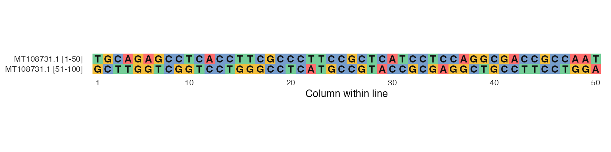

{{code:courseblockaq}}


示例使用随包表或随安装提供的小文件。每段代码列出所用的依赖。

<a id="characters"></a>

## 保留真实 FASTA 字符 {#characters}

随包对象 `sequence_detail_example$plasmid_source` 已保留真实字符、头部物理行号和文件来源；导入自己的 FASTA 时使用 `keep_sequence = TRUE`。仅读取时去除空白，保留大小写；显式声明 bp 或 aa，不猜字母表。聚焦同时裁剪字符串与区间，下例局部位置 1 对应原始位置 1001。降序区域仍选择同一区间，不执行反向互补。只有长度不能恢复字符，只有 HSP 端点不能恢复 mismatch 或 gap 列。有 gap 的 FASTA 会将 gap 计入长度，基因组用途需要单独的比对列到源位置映射。

{{code:courseblockar}}

### 导入自己的已有对齐 {#read-alignment}

随包仙人掌 FASTA 保留等长的已对齐记录。要读取自己的已有对齐，请替换文件路径。

```r
alignment_file <- system.file("extdata", "tutorial", "opuntia-aligned.fasta", package = "ggchord", mustWork = TRUE)
imported_alignment <- read_aligned_fasta(alignment_file, "DNA", source_file = TRUE)
```

<a id="aligned-characters"></a>

## 已有字符对齐：区分对齐列与源位置 {#aligned-characters}

以下直接使用 `sequence_detail_example` 中已准备的 DNA/蛋白对齐表。原始 Biopython 记录、上游许可、哈希及可重复的 FASTA 转写规则保留在来源目录 `examples/alignment/`。不运行比对工具，不改动完整记录 ID 或原始字符；显式选择行与列。

`read_aligned_fasta()` 读取一个已有对齐，须声明 DNA、RNA 或 AA；等长本身不能证明同源性。`alignment_column` 包括 `-` 和 `.` gap，这些列的 `source_position` 为 NA。默认源位置在去 gap 输入片段中从 1 计数，不是完整基因组坐标。小写字符也消耗位置，因此不能把此读取器当作 A3M 插入语义解析器。

{{code:courseblockas}}

首条选中记录在对齐列 343 有 gap；按列查找返回 `matched = TRUE`、`is_gap = TRUE` 和缺失源位置。反向查找源位置 343 则定位到其实际对齐列，不做插值。被筛选删除的位置返回 `matched = FALSE`；筛选不重编号保留列。即使另行声明了不同源 ID，`map_alignment_position()` 仍按对齐行 ID 选择记录。

`geom_residue()` 是普通 Cartesian ggplot 图层，样式和用户标度遵循 ggplot2。绘制时按实际单元宽高测量字形：`overflow = "error"` 要求文字可读，`"tile"` 对放不下的字母保留色格，不缩小字号。显示字母时可减少列数或增大物理宽度，例如用普通 `ggsave(width = 12, height = 3.4, units = "in")` 保存 `p_characters`；仅增加 DPI 不会增加物理空间。支持离散行、identity/reverse 位置标度与 Cartesian 坐标；该层不直接投射到骨架 Coord。具有明确来源映射的 Cartesian 字符图可经 `register_ggchord_alignment()` 注册，用于 [Fusion 字符细节](fusion-details.md#character-detail)。

默认残基图将相邻色格连续拼接，在未指定坐标时采用1:1单元格比例。字形使用深色粗体无衬线字体，并以统一比例适配色格；默认不会缩到3 mm以下。未显式提供 fill 时自动映射 label，依据数据 alphabet 使用 DNA/RNA/AA 化学性质配色；`scale_fill_residue()` 可显式选择字母表，`ggplot2::scale_fill_manual()` 可替换颜色。显式字号、映射、固定颜色与用户坐标优先。默认不显示字符图例，可用 `show.legend = TRUE` 开启。

### 自动换行 {#wrapped-residues}

将 `line_width = 50` 传给 `geom_residue()`，可把100个碱基分成1–50、51–100两行。以下读取 MT108731.1 的前100个真实碱基；行标签保留原始列范围，横轴显示行内列号。多序列共用同一分段边界，gap仍占一列；原始数据、对齐列和源位置不会重编号。

{{code:residuewrap}}



换行字符图也可注册到 Fusion；每个聚焦选区必须落在单个显示行内，跨行选区须显式拆成多个源区间。`line_width` 默认 NULL，即不换行。

<a id="aligned-protein"></a>

### 蛋白局部片段 {#aligned-protein}

同一数据契约可接收真实蛋白字符。该窗口保留上游 gap 与残基差异；默认 fill 按侧链化学性质分组，不代表推断的功能域。

{{code:courseblockat}}

<a id="aligned-source"></a>

### 显式源坐标 {#aligned-source}

`source_data` 的每个对齐记录对应一行，包含 `accver`、`start` 和 `strand`。`start` 是首个非 gap 源位置；负链位置递减，字符串必须已处于比对方向。可选 `source_accver` 标识原分子。若提供完整正向 `sequence`，逐一核对非 gap 字符：负链核酸使用互补，AA 仅反序。未提供完整源字符串时标为未核对，不猜起点或链。

下例只检查同一对齐去 gap 后的片段一致性，**不构成独立基因组验证**。实际基因组投影应提供有独立来源的序列和区间元数据。

{{code:courseblockau}}

仅凭六个 HSP 端点不能恢复内部 mismatch/gap。此工作流接收已有对齐列，不解析 CIGAR/A3M/Clustal/Stockholm，不推断相位，不计算共识、Logo 或新比对。显式CDS翻译见下节；精确宏观/细节注册见Fusion章节。

<a id="cds-translation"></a>

## 有来源的 CDS 翻译 {#cds-translation}

`build_ggchord_cds()` 定义已观测编码坐标；`translate_ggchord_cds()` 还需要真实的完整正向 DNA/RNA 字符串及可选依赖 **Biostrings**。本例真实 EMALE 负链 CDS 的源 phase 为0、起始密码子为ATG。表11为显式选择，并与保留的上游蛋白 FASTA 核对；输入来源见 `examples/format-inputs/README.md`。

{{code:courseblockav}}

`models` 报告编码/蛋白字符串、翻译表、起始及模糊碱基策略、不完整末端和末端余数。`nucleotides` 保留每个基因组碱基；`residues$source_positions` 按生物学顺序列出每个 codon 的三个基因组位置，也保留跨 exon 的 codon。残基位置使用 CDS feature ID 的已观测蛋白坐标域，不推断外部蛋白 accession。内部及末端终止符均保留为 `*`；本例仅在对照时删除一个末端终止符，以符合上游 FASTA 约定。

默认 `initiation = "literal"` 不改写替代起始密码子；`"start"` 要求完整5′端。`ambiguous = "error"` 拒绝模糊 codon，显式 `"solve"` 交由 Biostrings 解析，不能唯一确定时输出X。未知翻译表、缺失/过短源序列及已声明的翻译例外均报错。`partial = "trim"` 在构建 CDS map 时声明：只排除首段 phase 与末端不完整 codon，后续 phase 用于校验连续性，不删除跨段 codon 的碱基。缺失序列不会被补造。RNA 必须显式声明；有序 `segments` 沿用既有分段/跨原点契约。

完整的碱基、codon 和宏观关联可运行示例在 `examples/m2-detail.R`，负链氨基酸标在其三个编码碱基中心。真实正/负链分段对照、源hash和原始预期翻译保存在 `examples/cds/`。[注册字符图](fusion-details.md#character-detail)后可连接精确源边界。

## 从比对列追溯到画布位置 {#gap-to-display}

在这个合成的小例子中，A 的第三列为 gap。已知 gap 的 `matched` 为真且 `source_position` 缺失，缺少的第五列则返回假。只有真实来源位置才能交给布局查询。

```r
cells <- as_ggchord_alignment(c(A = "AC-G", B = "ACTG"), "DNA")
lookup <- map_alignment_position(cells, "A", c(2, 3, 5))
lookup[c("alignment_column", "source_position", "is_gap", "matched")]
backbones <- data.frame(accver = c("A", "B"), length = c(3, 4))
p_cells <- ggchord(data = backbones) + geom_seq() + coord_collinear()
map_ggchord_position(p_cells, "A", lookup$source_position[1])
```
