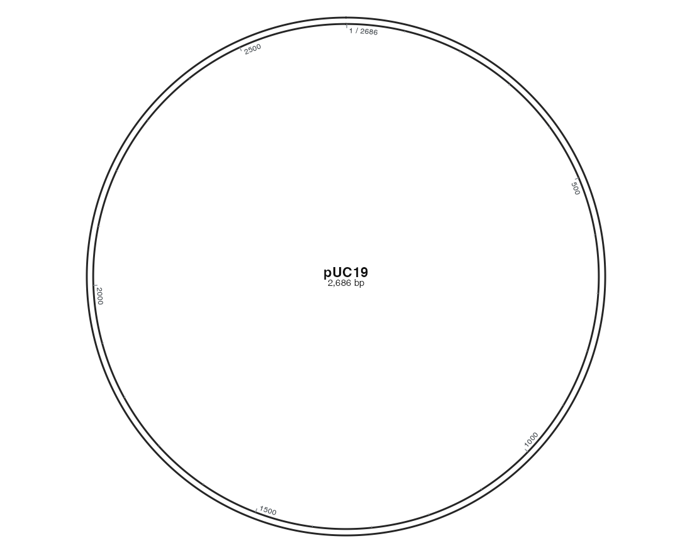
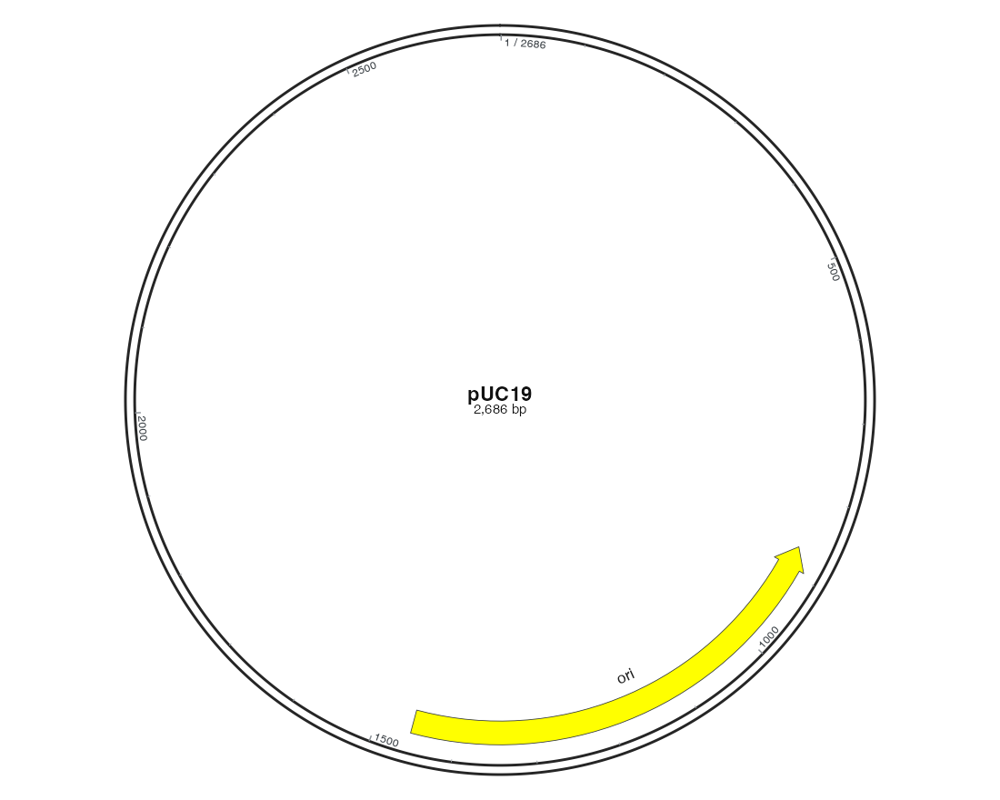

<a id="input"></a>

## 长度与已有注释 {#input}

本例从随包 pUC19 记录读取全长和已有注释。复制任一绘图代码块，即可查看该阶段的图。

```r
library(ggchord)
```

{{code:coursecircleinput}}



<a id="features-and-labels"></a>

## 添加特征和标签 {#features-and-labels}

{{code:coursecirclefeature}}



找到 ori 在刻度上的两端，确认文字来自 anno；圆形外观不表示已验证分子拓扑。

<a id="exercise"></a>

## 调整与保存 {#exercise}

去掉标签层再运行，骨架和源区间保持。用自己的已知注释替换该行。

```r
circular_width <- 10
circular_height <- 8
view_ggchord(p_coursecirclefeature,
  width = circular_width, height = circular_height, units = "in")
ggsave("circular-first.png", p_coursecirclefeature,
  width = circular_width, height = circular_height, units = "in", dpi = 144)
```
