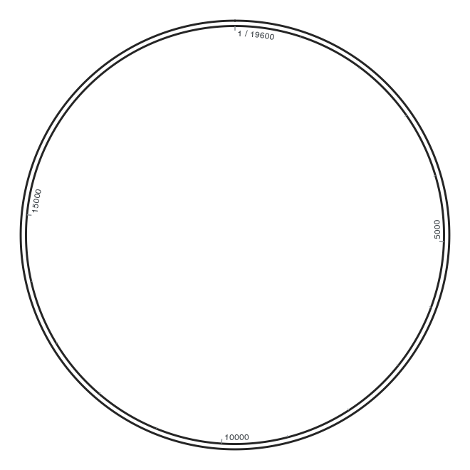
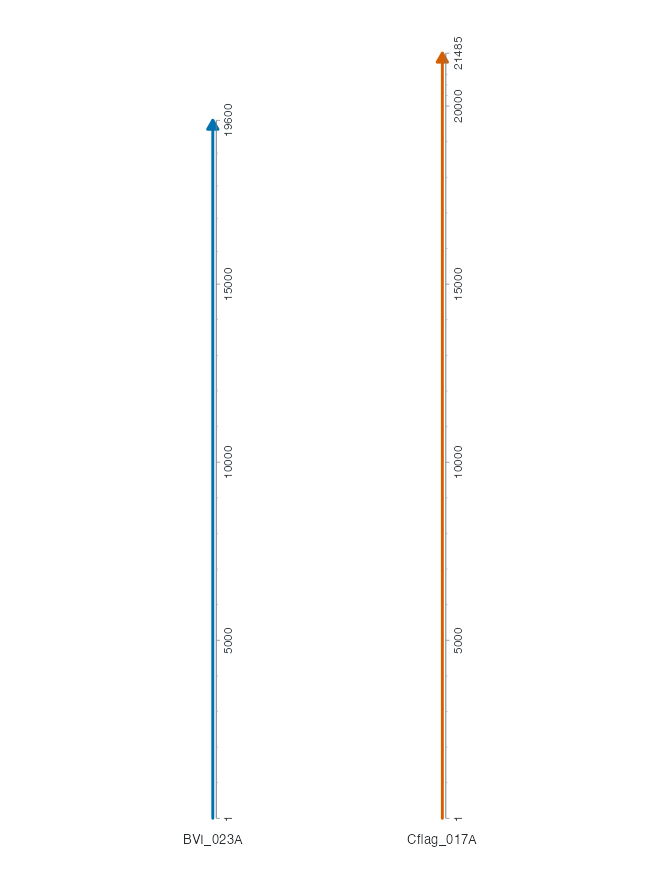
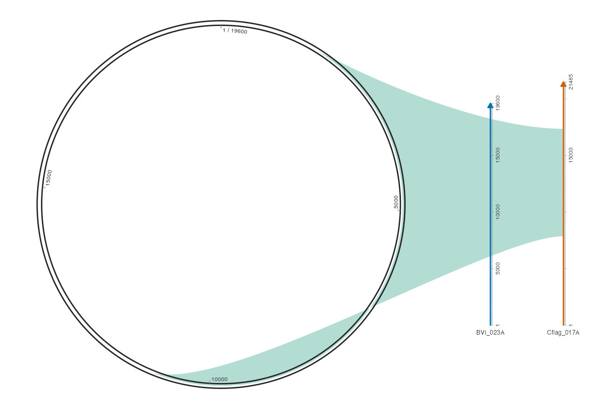

<a id="panels"></a>

## 先独立画好两张图 {#panels}

用随包 PAF 表画两个面板，再用一条已观测的比对连接它们。

```r
library(ggchord)
library(dplyr)
```


```r
course_center
```



```r
course_detail
```



```r
p_coursefusion
```



<a id="intervals"></a>

## 核对区间、面板和实例 {#intervals}

Fusion 是组合对象，不是第七 Coord。每个面板保留自己的数据、图层、标度和比例；side 仅摆放，不旋转子图。两端须同单位、完整可见且路由唯一，不能直接连接 bp 与 aa。

```r
fusion_width <- 12
fusion_height <- 8
view_ggchord(p_coursefusion,
  width = fusion_width, height = fusion_height, units = "in")
course_export <- export_ggchord_fusion(p_coursefusion,
  width = fusion_width, height = fusion_height)
course_export$connections
course_export$fronts
```

<a id="save"></a>

## 按相同尺寸保存 {#save}

```r
ggsave("fusion-first.png", p_coursefusion,
  width = fusion_width, height = fusion_height, units = "in", dpi = 144)
```

操作示例：换成另一条真实 HSP，指出 qpanel/spanel 与源行。Dotplot、facet 和未注册外部图当前不支持。
